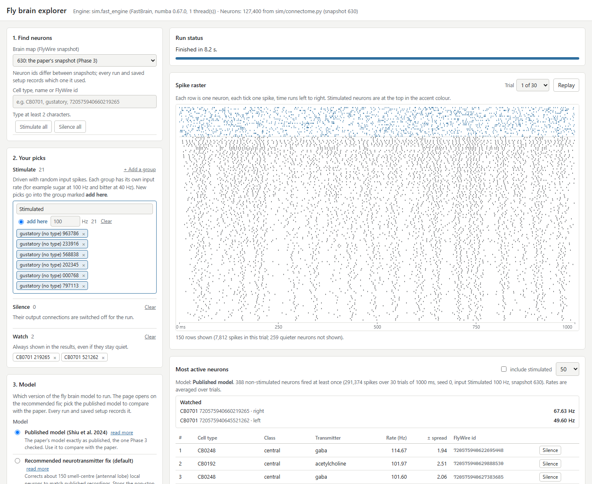

# Fly Brain Simulator

A whole-brain spiking simulation of the fruit fly (*Drosophila melanogaster*)
on the FlyWire connectome (about 139,000 neurons and 54 million synapses): a
reproduction and extension of Shiu et al. 2024 (*Nature*).

The project first rebuilt the published model and checked it against the
paper. It then added a fast engine, an explorer app, experiments, more
realistic neurons and synapses, mushroom-body learning, a physics body, and a
scorecard that compares the model with measurements from real flies.



> **TODO:** `docs/screenshot.png` does not exist yet. Add a screenshot of the
> explorer app before publishing.

## Status

Read this before quoting any result.

- **Reproduction of Shiu et al. 2024: faithful.** All 12 checks of the paper's
  results came out the same way as in the paper. For example, sugar-neuron
  input drives the feeding motor neuron MN9 to 67.0 spikes/s (paper: 65.7).
  Neuron by neuron, firing rates agree with the original authors' own saved
  Brian2 output (correlation 0.9992 at 100 Hz and 0.9996 at 200 Hz input). A separate audit
  re-checked 65 quoted numbers against the saved result files, and every
  headline result held. See [docs/phase3-explained.md](docs/phase3-explained.md),
  [docs/fast-engine-explained.md](docs/fast-engine-explained.md) and
  [docs/claims-audit.md](docs/claims-audit.md).
- **Comparison with real flies: mixed, and every verdict is PRELIMINARY.**
  With the recommended fix to the smell centre (`al_ln_literature`), 13 of 35
  real-fly tests match, 6 partly match, 11 miss and 5 cannot be scored. Two of
  the matches or partials are circular, because the cell labels come from the
  same papers; without them, 12 of 33 match. The unmodified published model
  scores 7 match, 3 partly, 13 miss and 4 cannot be scored, out of 27. Several
  pass rules were not written down before the runs. See
  [docs/real-fly-scorecard-summary.md](docs/real-fly-scorecard-summary.md).
- **Phase 9 (brain driving a physics body): checkpoint PARTIAL.** With one
  antenna covered, the brain turns the body toward the smelling side, and the
  turn disappears when the descending neuron DNa02 is silenced. With both
  antennae, the brain turns the body the wrong way. Legs, walking rhythm and
  speed come from FlyGym's built-in controller and are not brain-driven. See
  [docs/phase9-video.md](docs/phase9-video.md).
- **The model has not yet been shown to match a real fly.** Nothing here has
  been peer-reviewed or independently checked.

## Documentation

- [PLAN.md](PLAN.md): the phases and their checkpoints (the source of truth).
- [EXPERIMENTS.md](EXPERIMENTS.md): a dated log of every experiment and whether
  it was validated.
- [docs/](docs/): plain-English write-ups of each phase and side study, for
  example [docs/phase2-explained.md](docs/phase2-explained.md) (the brain data).

## Requirements

- Python 3.13.
- No C/C++ compiler. Brian2 runs in its pure-Python (numpy) mode, and the
  fast engine is compiled by numba, which brings its own compiler.
- About 200 MB of disk space for the required data, plus a few hundred MB for
  caches and results.
- Development and testing were done on Windows. The Linux/macOS commands below
  are the standard equivalents and have not been tested.

## Install

Windows (PowerShell):

```powershell
py -3.13 -m venv .venv
.venv\Scripts\python.exe -m pip install -r requirements.txt
```

Linux / macOS:

```bash
python3.13 -m venv .venv
.venv/bin/python -m pip install -r requirements.txt
```

The Phase 9 body experiments use a **separate** environment, so the physics
body model cannot disturb the main setup. It is optional:

```powershell
py -3.13 -m venv .venv-body
.venv-body\Scripts\python.exe -m pip install -r requirements-body.txt
```

(On Linux/macOS: `python3.13 -m venv .venv-body`, then
`.venv-body/bin/python -m pip install -r requirements-body.txt`.)

The rest of this README uses the Windows form `.venv\Scripts\python.exe`. On
Linux/macOS, use `.venv/bin/python` instead.

## Get the data

The data is large and is never committed (`data/` is in `.gitignore`).

```powershell
# 1. The reference paper's code and preprocessed connectome (required, ~190 MB)
git clone https://github.com/philshiu/Drosophila_brain_model data/reference
git -C data/reference checkout 91bdd1e7dcf193f3e7ca5a8933497fcef63b7960

# 2. Neuron labels: downloaded automatically (checksum-pinned) the first
#    time the loader runs, into data/flywire/.
.venv\Scripts\python.exe -c "from sim.connectome import load_connectome; load_connectome('783'); load_connectome('630')"
```

Optional, only for the cross-check script
`experiments/phase2/crosscheck_zenodo.py`: download
`proofread_connections_783.feather` (852 MB) from the Zenodo record below into
`data/flywire/` (`proofread_root_ids_783.npy` is fetched automatically).

Some side studies download their own extra data into `data/` (for example,
the BANC tables under `data/banc/`, about 4.2 GB). Each one's doc says how.

## Configure

Nothing needs configuring for normal use. The explorer app reads two optional
environment variables:

| Variable | Effect |
|---|---|
| `FLYBRAIN_APP_FAKE=1` | Uses a small stand-in engine and neuron list instead of the real brain. The automated tests use this, so the app tests run without the data. |
| `FLYBRAIN_APP_THREADS=n` | Lets the fast engine run `n` trials at once (default 1, capped at 8). |
| `FLYBRAIN_OVERVIEW_PAGE=path` | Only for `experiments/claims_audit/audit.py`: an HTML results overview page whose quoted numbers it should also locate. Optional. |

## Run the tests

```powershell
.venv\Scripts\python.exe -m pytest -m "not slow"   # quick checks, seconds
.venv\Scripts\python.exe -m pytest -m slow         # loads the whole brain
```

Tests marked `slow` need the data above. Judge a run by pytest's last summary
line (for example `N passed, M deselected`), not by its exit code.

## Run the explorer app

```powershell
.venv\Scripts\python.exe -m app            # optional: --port 8765 --no-warm
```

Then open http://127.0.0.1:8765 in a browser. The app finds neurons by cell
type, label or FlyWire ID. You choose neurons to stimulate (each group at its
own input rate), silence or watch, run the whole brain, and see the firing
rates. It uses the fast engine and falls back to the slower Brian2 port if the
fast engine is unavailable. By default it listens only on this computer
(`127.0.0.1`). See [docs/phase4-app-explained.md](docs/phase4-app-explained.md).

## Load the brain in code

```python
from sim.connectome import load_connectome
brain = load_connectome()          # FlyWire release 783 (default)
paper = load_connectome("630")     # release 630, the one the paper used
brain.by_cell_type("APL")          # look up neurons by cell type
M = brain.matrix("reference")      # sparse matrix: M[sender, receiver] = signed synapse count
```

The first load takes 5 to 13 s and writes a cache to `data/cache/`; later loads
take about half a second. Summary numbers:
`.venv\Scripts\python.exe experiments\phase2\summary.py`.

## The virtual hybrid computer (`vhc/`)

`vhc/` is a separate, PRELIMINARY side study. It is a software cost model of a
machine with a conventional core, a neuromorphic core and an optional
living-neuron module. Every component has a price list with sources, so each
benchmark gives time, energy and accuracy per design. See
[vhc/README.md](vhc/README.md) and [docs/virtual-computer.md](docs/virtual-computer.md).

## Repository map

| Folder | What is in it |
|---|---|
| `sim/` | The models: connectome loader (`connectome.py`), Brian2 port of the paper (`shiu_model.py`), fast engine (`fast_engine.py`), realism upgrades (`realism.py`, `celltype_params.py`, `gap_junctions.py`, `sign_fixes.py`), learning (`plasticity.py`), the brain-body loop (`body/`) |
| `app/` | The explorer web app (FastAPI, plain HTML/JS in `static/`) |
| `tests/` | pytest suite (`-m "not slow"` runs without the data) |
| `vhc/` | The virtual hybrid computer (above), with its own tests in `vhc/tests` |
| `docs/` | Plain-English write-ups, one per phase or study |
| `experiments/` | One folder per experiment: scripts, small results tables and plots |

`experiments/`, grouped by phase:

| Phase | Folders | What they do |
|---|---|---|
| 1-2 | `phase1`, `phase2` | A toy spiking network; loading and cross-checking the connectome |
| 3 | `phase3`, `fast_engine` | Reproducing the paper; the fast engine's speed and agreement with Brian2 |
| 5 | `phase5` | The sugar pathway, sugar vs bitter competition, sensitivity to settings, smell |
| 6 | `phase6`, `runaway_783`, `cb0216_loop` | The "runaway activity" surprise and its fix, steering, a neuron pair that never stops firing |
| 7 | `phase7`, `phase7_cond`, `phase7_celltype`, `phase7_gap`, `phase7_neuromod`, `phase7_signs` | More realistic neurons and synapses: delays, conductances, adaptation, cell-type parameters, electrical synapses, neuromodulators, transmitter-sign audit |
| 8 | `phase8`, `phase8_aversive`, `mb_continual` | Learning in the mushroom body (reward and punishment), continual learning |
| 9 | `phase9`, `phase9_da1`, `phase9_sameside`, `phase9_video` | The brain driving a FlyGym physics body; the odour-steering demo and its video |
| Real-fly checks | `scorecard`, `scorecard_batch1`, `olfaction_realfly`, `heldout`, `banc_asymmetry`, `claims_audit` | Comparing the model with real-fly measurements and other connectomes; re-checking quoted numbers |
| Side studies | `reservoir`, `reservoir_spiking`, `minimal_circuit`, `robust_circuit`, `energy_budget` | The wiring as a reservoir computer, the smallest circuit that makes the feeding decision, energy per decision |

Run logs, queue markers and cache pickles are not tracked. Rerunning the
scripts regenerates them. Large raw outputs are also left out and are
regenerated the same way.

## How it works, and why it is built this way

**The neuron model.** As in Shiu et al. 2024, every neuron is a leaky
integrate-and-fire neuron. Its voltage leaks back toward rest (-52 mV). Input
arrives as a synaptic current that decays with a 5 ms time constant. When the
voltage crosses -45 mV, the neuron spikes, is reset, and stays silent for a
short refractory period. Every connection comes from the FlyWire wiring
diagram. A connection's strength is its synapse count times a fixed weight.
Its sign comes from the sending neuron's predicted transmitter: acetylcholine
excites, GABA and glutamate inhibit. To stimulate neurons (for example, sugar
taste neurons), the model drives them with random (Poisson) spike trains, like
optogenetic activation in a real fly. The simple model is deliberate: the
paper's claim is that the wiring alone predicts a lot of behaviour.

**Reproduce first, then extend.** A whole-brain model has many ways to be
quietly wrong: a wrong sign, an off-by-one in the indexing, a mislabelled
neuron. Rebuilding the published model and matching the published numbers
first gives a known-good baseline. Every later change is then measured against
that baseline, and it can be switched off to prove it is the cause of any
difference. Each realism upgrade in Phase 7 has an on/off switch. With every
switch off, the upgraded engine gives exactly the same spikes as the baseline
for the same seed, and tests check this.

**Two engines.** `sim/shiu_model.py` is a faithful port of the authors' Brian2
code. Its parameters and equations are copied unchanged, and each place that
had to change to run here is marked `PORT NOTE`. It runs in Brian2's
pure-Python mode, so it needs no compiler, but one 1-second trial of the whole
brain takes about 20 to 100 s. `sim/fast_engine.py` runs the same model with a
custom loop compiled by numba. One trial takes about 0.4 s on one CPU core,
which makes silencing screens, sensitivity sweeps and the interactive app
practical. The two engines are checked against each other spike for spike on
small networks. On the whole brain, the fast engine is checked against the
authors' own saved Brian2 output, within trial-to-trial noise (correlation
0.9996 to 0.9998). The Brian2 port remains the reference; the fast engine is
the workhorse.

**Reproducible runs.** The original code set no random seed. Here, trial `k`
uses seed `seed + k`, so any run can be repeated exactly.

**Why every verdict is PRELIMINARY.** PLAN.md asks for independent review
before any result counts as established, and that has not happened. Some
model parameters (for example, in the learning rule) could not be measured
and had to be chosen. Some real-fly comparisons had no pass rule written down
before the run. A few matches are circular. The docs say which results are
affected by each of these. Misses are reported as misses.

**Honest labels in the body loop.** In Phase 9 the brain only chooses left or
right. Everything the connectome cannot yet drive, such as leg control, comes
from FlyGym's built-in controller and is labelled "not brain-driven" in the
docs and on every frame of the video.

**How the code was written.** The project owner directs the work and does not
write code. Claude Code (Anthropic) wrote and ran all of the code,
experiments and docs here, following [PLAN.md](PLAN.md).

## Data sources

All sources below can be downloaded without an account.

| Data | Version | Where | Used for |
|---|---|---|---|
| Preprocessed connectome (neuron list + connection list with synapse counts and signs), FlyWire releases 630 and 783 | GitHub commit `91bdd1e7dc` (2024-09-14) | https://github.com/philshiu/Drosophila_brain_model (files `Connectivity_783.parquet`, `Completeness_783.csv`, `2023_03_23_connectivity_630_final.parquet`, `2023_03_23_completeness_630_final.csv`) | The wiring the simulator uses |
| Neuron annotations for release 783 (cell type, class, predicted neurotransmitter, soma and anchor positions) | flywire_annotations tag `v3.1.0`, commit `8587524c17`; SHA-256 `9a4f8b2f...81d1be` | https://raw.githubusercontent.com/flyconnectome/flywire_annotations/8587524c1748ce5ef2080822a2fc890fc03bf597/supplemental_files/Supplemental_file1_neuron_annotations.tsv | Labels, search, 3D positions |
| Neuron annotations for release 630 | flywire_annotations tag `v1.1.0`, commit `df6bb136f5`; SHA-256 `55c99c61...2e2e76` | https://raw.githubusercontent.com/flyconnectome/flywire_annotations/df6bb136f5b3d91c3992df4e8de2642329e2a384/supplemental_files/Supplemental_file1_annotations.tsv | Labels for the paper's release |
| Official FlyWire release 783 connectivity (`proofread_root_ids_783.npy`, `proofread_connections_783.feather`) | Zenodo v783.0 (2024-06-02) | https://doi.org/10.5281/zenodo.10676866 | Cross-checks only |
| Odour responses: DoOR.data (Münch & Galizia 2016), including the Hallem & Carlson 2006 receptor recordings | DoOR.data | https://github.com/ropensci/DoOR.data | Smell inputs and real-fly smell comparisons (`experiments/olfaction_realfly/`) |
| BANC (brain and nerve cord of a second fly), plus the hemibrain and maleCNS tables from the same public bucket | BANC release v888; hemibrain v1.2.1; maleCNS v0.9 | `https://storage.googleapis.com/lee-lab_brain-and-nerve-cord-fly-connectome/` (`compiled_data/`) | Left/right comparison across flies; only small per-glomerulus tables in `experiments/banc_asymmetry/results/` are committed |

Codex (https://codex.flywire.ai) serves the same release-783 data but needs a
Google sign-in. This project does not use it. FlyWire's citation table is at
https://codex.flywire.ai/about_flywire and its data guidelines are at
https://flywire.ai/guidelines.

## Licence

- **Code:** MIT. See [LICENSE](LICENSE).
- **Data and result files** are under their own licences, not MIT. See
  [DATA_LICENSE.md](DATA_LICENSE.md). In short:
  - Files derived from FlyWire (including result tables keyed by FlyWire
    neurons) are **CC BY-NC 4.0**. FlyWire's guidelines
    (https://flywire.ai/guidelines) state that the public release data is
    licensed CC BY-NC 4.0: you must credit the sources below and may not use
    it commercially. The Zenodo deposit is labelled CC BY 4.0, which is less
    strict; this project follows the stricter CC BY-NC 4.0 terms for all
    FlyWire-derived data.
  - The three DoOR-derived tables
    `experiments/olfaction_realfly/results/hc_delta.csv`, `hc_sfr.csv` and
    `door_ext_delta.csv` are **CC BY-SA 4.0**, the licence of DoOR.data.
  - BANC: the bucket's own README states no licence; it says the data are
    mirrored, with the same documentation, in the Harvard Dataverse deposit
    https://doi.org/10.7910/DVN/7WTH1N, which is licensed **CC BY 4.0**.
    hemibrain: Janelia states "Hemibrain is licensed under CC-BY"
    (https://www.janelia.org/project-team/flyem/hemibrain). maleCNS: "The
    Male CNS dataset is licensed under CC-BY" (https://male-cns.janelia.org).
    Neither Janelia statement names a version (we used hemibrain v1.2.1 and
    maleCNS v0.9, as re-hosted in the BANC bucket). Details in
    [DATA_LICENSE.md](DATA_LICENSE.md).
- **Reference model code:** the Brian2 port (`sim/shiu_model.py`) and the
  fast engine's constants (`sim/fast_engine.py`) are copied from Shiu &
  Spiller's Drosophila_brain_model, MIT License, Copyright (c) 2023 Philip Shiu
  and Nico Spiller. Their notice is in
  [THIRD_PARTY_NOTICES.md](THIRD_PARTY_NOTICES.md).
- **flywire_annotations** has no licence file; its README asks users to cite
  the papers listed under "Annotations" below.
- **Dependencies** are installed by pip, not included in this repository.
  Brian2 is licensed **CeCILL-2.1**. FlyGym/NeuroMechFly (optional, body
  environment only) is **Apache-2.0**. The rest are permissive (BSD, MIT,
  Apache-2.0, PSF-style).
This is our reading of the terms, not legal advice.

## Citations

Please cite these when using this project or its results.

FlyWire connectome (FlyWire asks that both be cited whenever the resource is
used; full table at https://codex.flywire.ai/about_flywire):

1. Dorkenwald, S. et al. Neuronal wiring diagram of an adult brain. *Nature*
   **634**, 124-138 (2024). https://doi.org/10.1038/s41586-024-07558-y
2. Schlegel, P. et al. Whole-brain annotation and multi-connectome cell typing
   of *Drosophila*. *Nature* **634**, 139-152 (2024).
   https://doi.org/10.1038/s41586-024-07686-5

Neurotransmitter predictions (used for excitatory/inhibitory signs):

3. Eckstein, N. et al. Neurotransmitter classification from electron
   microscopy images at synaptic sites in *Drosophila melanogaster*. *Cell*
   **187**, 2574-2594.e23 (2024). https://doi.org/10.1016/j.cell.2024.03.016

Reference model (and its preprocessed data files):

4. Shiu, P. K. et al. A *Drosophila* computational brain model reveals
   sensorimotor processing. *Nature* **634**, 210-219 (2024).
   https://doi.org/10.1038/s41586-024-07763-9
5. Shiu, P. K. & Spiller, N. Drosophila_brain_model (code and data, MIT
   License), commit 91bdd1e7dc. https://github.com/philshiu/Drosophila_brain_model.
   Model output archive: https://doi.org/10.17617/3.CZODIW

Annotations (flywire_annotations v3.x asks for these in addition to 1 and 2):

6. Matsliah, A. et al. Neuronal parts list and wiring diagram for a visual
   system. *Nature* **634**, 166-180 (2024).
   https://doi.org/10.1038/s41586-024-07981-1
7. Berg, S. et al. Sexual dimorphism in the complete *Drosophila* male
   central nervous system connectome. *Cell* **189**, 5504-5526.e15 (2026).
   https://doi.org/10.1016/j.cell.2026.08.015 (also the maleCNS source;
   preprint https://doi.org/10.1101/2025.10.09.680999)

Underlying data products that FlyWire credits (electron microscopy volume,
synapse detection):

8. Zheng, Z. et al. A complete electron microscopy volume of the brain of adult
   *Drosophila melanogaster*. *Cell* **174**, 730-743.e22 (2018).
   https://doi.org/10.1016/j.cell.2018.06.019
9. Buhmann, J. et al. Automatic detection of synaptic partners in a
   whole-brain *Drosophila* electron microscopy data set. *Nature Methods*
   **18**, 771-774 (2021). https://doi.org/10.1038/s41592-021-01183-7
10. Heinrich, L. et al. Synaptic cleft segmentation in non-isotropic volume
    electron microscopy of the complete *Drosophila* brain. *MICCAI 2018*,
    Lecture Notes in Computer Science, 317-325 (2018).
    https://doi.org/10.1007/978-3-030-00934-2_36

Simulator and body model:

11. Stimberg, M., Brette, R. & Goodman, D. F. M. Brian 2, an intuitive and
    efficient neural simulator. *eLife* **8**, e47314 (2019).
    https://doi.org/10.7554/eLife.47314
12. Wang-Chen, S. et al. NeuroMechFly v2: simulating embodied sensorimotor
    control in adult *Drosophila*. *Nature Methods* **21**, 2353-2362 (2024).
    https://doi.org/10.1038/s41592-024-02497-y

Odour responses:

13. Münch, D. & Galizia, C. G. DoOR 2.0 - Comprehensive mapping of
    *Drosophila melanogaster* odorant responses. *Scientific Reports* **6**,
    21841 (2016). https://doi.org/10.1038/srep21841
14. Hallem, E. A. & Carlson, J. R. Coding of odors by a receptor repertoire.
    *Cell* **125**, 143-160 (2006). https://doi.org/10.1016/j.cell.2006.01.050

Other connectomes (used only in `experiments/banc_asymmetry/`):

15. Bates, A. S., Phelps, J. S., Kim, M., Yang, H. H. et al. Distributed
    control circuits across a brain-and-cord connectome. *Nature* **656**,
    957-970 (2026). https://doi.org/10.1038/s41586-026-10735-w (BANC).
    Data: Harvard Dataverse, https://doi.org/10.7910/DVN/7WTH1N (CC BY 4.0);
    this project used BANC release v888 from the public bucket.
16. Scheffer, L. K. et al. A connectome and analysis of the adult
    *Drosophila* central brain. *eLife* **9**, e57443 (2020).
    https://doi.org/10.7554/eLife.57443 (hemibrain)

Connectome data: FlyWire Consortium, FlyWire Whole-brain Connectome
Connectivity Data, version 783.0, Zenodo (2024).
https://doi.org/10.5281/zenodo.10676866

## Contributing

Issues welcome; pull requests are not accepted right now.
