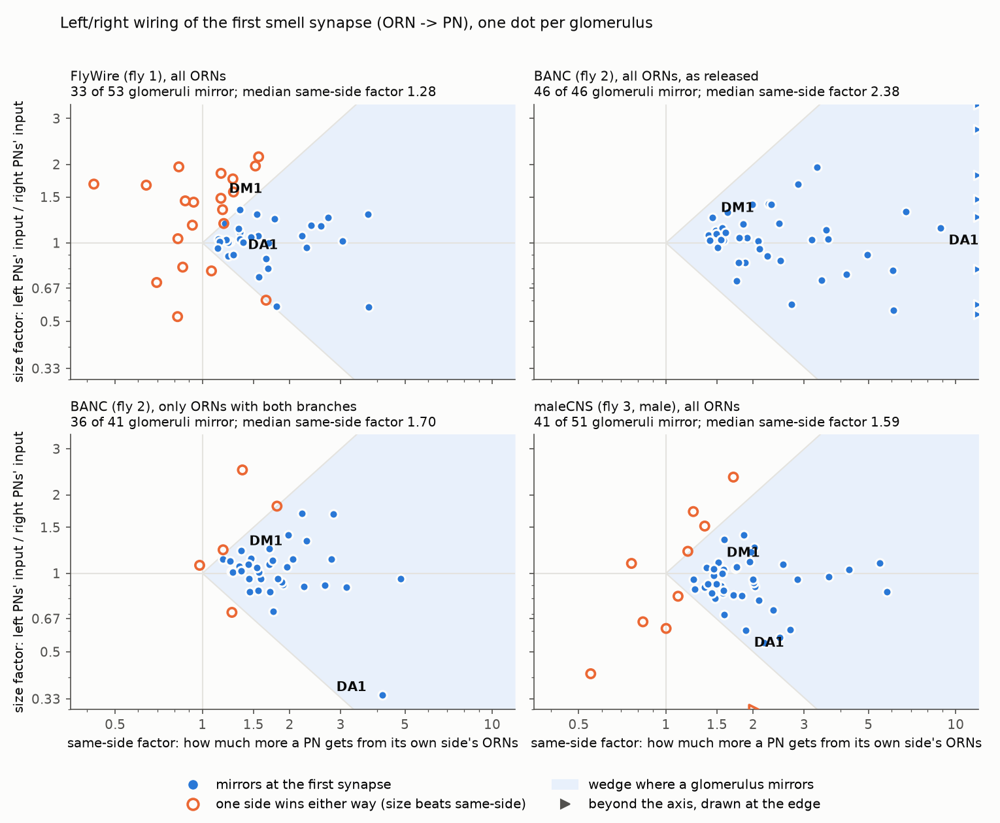

# Is FlyWire's left/right lean in a second fly? (BANC, plus two more flies)

Prepared 2026-09-23. Question from docs/phase6-steering.md sections 1-3: in FlyWire (one
adult female fly), the LEFT DM1 glomerulus's projection neurons get about 50% more smell
receptor synapses than the right ones, and 19 of 51 glomeruli have a left/right size
difference big enough to beat the same-side advantage. That is why the simulated fly always
turns left. Is this one fly's quirk, a reconstruction artefact, or how flies are wired?

Everything here is anatomy (synapse counts); no simulation was run. Numbers come from our
own runs, saved in `experiments/banc_asymmetry/results/`. Labels as in the other Phase 6
docs: **VALIDATED** = computed two independent ways, checked for bugs and against the
literature; **PRELIMINARY** = at least one of those checks is missing; **UNVERIFIED** = not
checked against a source.

---

## The short version

1. **BANC (a second female fly) is public, and no login is needed.** We downloaded it and
   ran FlyWire's exact Phase 6 code on it. The code was first shown to reproduce every
   FlyWire number exactly (section 3). **VALIDATED.**
2. **DM1's left side is bigger in BANC too, but only by about half as much: 23% vs 50%.**
   In BANC that is not enough to win: a right-only DM1 smell still gives the right DM1
   projection neurons more input (1,580 vs 1,365 synapses). So DM1 "mirrors" in BANC and
   fails in FlyWire. The male fly (maleCNS) has a 10% left lead, which also mirrors.
   **PRELIMINARY.**
3. **FlyWire's left DM1 is the unusual one, not its right one.** It takes 7.1% of all smell
   input to its lobe. Every other lobe we measured is between 4.1% and 5.8%, including
   FlyWire's own right DM1 (5.3%) (section 8). **PRELIMINARY** (only 5 other lobes).
4. **The same-side advantage is real in every fly, and weakest in FlyWire.** Median
   same-side/other-side ratio per glomerulus: FlyWire 1.27, maleCNS 1.62, BANC 1.63,
   hemibrain 1.72 (right lobe only). For BANC and maleCNS this counts only the receptor
   neurons whose crossing branch exists, which is fairer (sections 4-5). **PRELIMINARY.**
5. **BANC's release has a reconstruction gap that fakes a perfect result.** As released,
   BANC says all 46 of 46 glomeruli mirror, with a same-side ratio of 2.4. But 42% of
   BANC's receptor neurons have NO synapses at all in the far antennal lobe (FlyWire:
   3.6%). Real receptor neurons almost all branch to both sides. So the crossing branches
   are missing from the reconstruction, which inflates the same-side ratio. Using only the
   receptor neurons that have both branches, BANC mirrors in 36 of 41 glomeruli
   (section 5). **VALIDATED** (the gap is plain in the data; its cause is **UNVERIFIED**).
6. **Fair count of glomeruli where the size imbalance beats the same-side advantage:**
   FlyWire 20 of 52, maleCNS 11 of 51, BANC 5 of 41. FlyWire has the most, for two
   reasons: its same-side advantage is the weakest, and its size imbalances are the
   largest (median 21% vs 11-12%). **PRELIMINARY.**
7. **The imbalanced glomeruli are different ones in each fly.** Which glomeruli are
   lopsided, and which side is bigger, does not carry over between flies (correlations
   -0.21 to +0.34, mixed signs). This looks like individual variation or reconstruction
   noise, not a shared wiring rule. What DOES carry over is which glomeruli have a strong
   or weak same-side advantage (correlation +0.59 to +0.86 between flies) (section 7).
   **PRELIMINARY.**

**Verdict: mostly one fly's quirk.** FlyWire's big left DM1, and its weak same-side advantage
across the whole lobe, are both at the extreme of the four flies. In the other flies,
DM1 and most other glomeruli would steer correctly at the very first synapse. Whether
FlyWire's extremes are this fly's biology or a FlyWire reconstruction difference, we
cannot tell (**UNVERIFIED**). **For the model:** the left lean is a FlyWire-specific
property, not fly biology. The literature's same-side release boost (about 1.4x, Gaudry et
al. 2013) is still missing from the model. On top of that, the other flies suggest that
FlyWire's synapse counts understate the same-side advantage by roughly 1.3x (section 9).

---

## 1. Words used here

- **ORN** (olfactory receptor neuron): a smell receptor neuron. Its cell body sits in the
  antenna (or the maxillary palp). Its axon enters the brain on its own side, makes
  synapses in that side's **antennal lobe**, then usually crosses the midline and makes
  synapses in the other side's lobe too. That second branch is the **crossing branch**.
- **Glomerulus**: a ball of synapses in the antennal lobe. Each receptor type sends its ORNs
  to one glomerulus per side (DM1 = vinegar-type smells, DA1 = the pheromone cVA).
- **PN** (projection neuron): carries the smell onward from a glomerulus. A
  **uniglomerular PN** gets its receptor input from one glomerulus. Defined exactly as in
  FlyWire's run: 50% or more of its ORN synapses come from one ORN type, and at least 20.
- **Same-side / other-side**: an ORN from the left antenna is "same-side" for left PNs and
  "other-side" for right PNs.
- **Mirrors at the first synapse**: a left-only smell gives the left PNs more ORN synapses
  than the right PNs, AND a right-only smell gives the right PNs more. If a glomerulus does
  not mirror, one side wins whichever antenna smells.
- **Same-side factor** and **size factor**: every glomerulus's four counts (left ORNs to
  left PNs, left to right, right to left, right to right) split exactly into two numbers.
  The same-side factor is how much more a PN gets from its own side's ORNs. The size
  factor is how much more the left PNs get than the right PNs, from both antennae alike.
  A glomerulus mirrors exactly when the same-side factor is bigger than the size
  imbalance (checked for every glomerulus in every fly: always true).
- **FlyWire / FAFB** (fly 1): the whole brain of one adult female fly; our model's data.
- **BANC** (fly 2): brain and nerve cord of another adult female fly (Bates, Phelps, Kim,
  Yang et al.; data release "v888", April 2026).
- **maleCNS** (fly 3): the brain and nerve cord of a male fly (Janelia, release v0.9).
- **hemibrain** (fly 4): part of a female fly's brain (Janelia, release v1.2.1). Only its
  RIGHT antennal lobe is complete, so it can only give same-side vs other-side input for
  right PNs.

## 2. The data (all public, no account needed)

The BANC team keeps a public Google Cloud bucket,
`gs://lee-lab_brain-and-nerve-cord-fly-connectome/`. Anyone can download it over plain
https (`https://storage.googleapis.com/lee-lab_brain-and-nerve-cord-fly-connectome/...`),
with no login and no token. The `compiled_data/` folder holds the BANC tables plus copies
of the hemibrain, maleCNS and FlyWire tables, all with the same column names. We
downloaded about 4.2 GB into `data/banc/` (never committed). No file over 5 GB was needed.

| File | Size | Used for |
|---|---|---|
| `banc_888/banc_888_meta.feather` | 58 MB | BANC cell types, sides, nerves, proofreading status |
| `banc_888/banc_888_edgelist_simple_v2.feather` | 305 MB | BANC connections; the paper's synapse table (synapses of 5+ voxels, no minimum per connection, like FlyWire's) |
| `banc_888/banc_888_edgelist_simple_v3.feather` | 359 MB | the newer synapse detector (10+ voxels), as a check |
| `hemibrain_121/*_meta.feather`, `*_simple_edgelist.feather` | 2 + 92 MB | hemibrain |
| `malecns_09/*_meta.feather`, `*_simple_edgelist.feather` | 17 MB + 3.4 GB | maleCNS (read 65,536 rows at a time; peak memory stayed small) |

Skipped: the per-synapse tables (17-20 GB each) and anything needing a login (the CAVE
database and Codex downloads). **Owen does not need to do anything to unlock BANC.**

## 3. Same measures, same definitions

We moved the ORN-to-PN part of `experiments/phase6/steering/s1_anatomy.py` into a shared
function, unchanged, and ran it on FlyWire first. It reproduces the saved FlyWire tables
exactly: all 51 (snapshot 630) and 53 (snapshot 783) glomerulus rows and all 335 / 332 PN
rows, cell for cell (`results/port_check.txt`). It also reproduces every number in
docs/phase6-steering.md section 3: 41 of 51 same-side stronger, median ratio 1.25, 32 of
51 mirror, 15 of the 19 failures left-bigger, and 35 / 42 / 45 / 46 mirroring with a 1.2 /
1.4 / 1.6 / 2x same-side boost. **VALIDATED.**

How FlyWire's labels were matched in BANC:

| | FlyWire | BANC |
|---|---|---|
| ORN | class "olfactory", type ORN_<glomerulus> | class "olfactory_receptor_neuron", type ORN_<glomerulus> |
| ORN side | side of the nerve it enters by | side of the `nerve` column (left/right antennal or palp nerve); 2,801 of 2,811 ORNs have one |
| PN | class "ALPN" (all of them; uniglomerular decided by the 50%/20 rule) | class "antennal_lobe_projection_neuron" (same rule) |
| PN side | cell body side | `side` (from the cell body) |
| which neurons | the released proofread neurons | proofread OR roughly proofread (the BANC team's own "lenient" rule); strict-only as a check |
| synapse counts | every connection, even 1 synapse | every connection, even 1 synapse (v2 table) |

BANC has 2,811 typed ORNs (1,483 left, 1,319 right; FlyWire about 2,250) and 699 PNs
(FlyWire 685), of which 331 are uniglomerular (FlyWire 332).

**BANC label checks** (`results/banc_label_checks.csv`), as in steering section 2:
- PN cell bodies are on their labelled side: 345 of 348 left, 335 of 340 right.
- The ORN `side` column agrees with the nerve side: 1,192 of 1,199 left, 863 of 880 right.
- ORN "root point" (a reference point on the neuron) lies in the labelled side's antennal
  lobe: 1,058 of 1,062 left, 739 of 756 right.
- ORN fingerprint: ORNs give most of their PN synapses to their own side (2,546 of 2,790).
  Only 40 send more than 90% to the other side (FlyWire: 108).
- The results do not change if ORN sides are taken from the `side` column instead, if
  only strictly proofread neurons are used, if unproofread fragments are added, or with
  the v3 synapse detector (`results/banc_summary.csv`).
- One column did not behave as documented: `output_side_index` is negative for nearly
  all ORNs on BOTH sides, so its meaning is unclear. Not used.

## 4. Side by side

The FlyWire, BANC and maleCNS columns count all ORNs. Section 5 explains the fairer
"ORNs with both branches" column.

| | FlyWire 630 | FlyWire 783 | BANC as released | BANC, ORNs with both branches | maleCNS (male) | hemibrain (right lobe) |
|---|---|---|---|---|---|---|
| glomeruli with PNs on both sides | 51 | 53 | 46 | 41 | 51 | (22 with ORNs of both sides named) |
| same-side input stronger | 41 | 43 | 44 | 40 | 48 | 20 of 22 |
| median same-side / other-side ratio | 1.25 | 1.27 | 2.39 | 1.63 | 1.64 | 1.72 |
| all glomeruli pooled | 1.42 | 1.40 | 2.81 | 1.76 | 1.94 | 1.85 |
| **mirror at the first synapse** | **32** | **33** | **46** | **36** | **41** | - |
| size beats same-side (fails) | 19 (15 left bigger) | 20 (15) | 0 | 5 (4) | 10 (5) | - |
| median size imbalance | 16% | 17% | 17% | 12% | 16% (11% with both branches) | - |
| ORNs with no synapses on the far side | - | 3.6% | 42.5% | 0% (by choice) | 11.7% | - |
| DM1 mirrors? | no | no | yes | yes | yes | - |
| DA1 mirrors? | yes | yes | yes | yes | yes | - |

*One dot per glomerulus. Across: the same-side factor. Up: how much more the left PNs
get. Inside the shaded wedge a glomerulus mirrors (filled blue). Outside it, one side
wins either way (hollow orange). FlyWire's dots sit left of the others (a weak same-side
advantage), with several high up (a large left lead). BANC as released sits far right,
because its crossing branches are missing. With those ORNs removed, BANC looks like
maleCNS.*

## 5. The catch: BANC's receptor neurons are missing their crossing branches

Per receptor neuron, we counted its synapses onto its own glomerulus's PNs on each side
(`results/orn_branch_check.csv`):

| | FlyWire 783 | BANC v2 | BANC v3 detector | maleCNS |
|---|---|---|---|---|
| ORNs with NO synapses on the far side | 3.6% | **42.5%** | 42.2% | 11.7% |
| ... among BANC's fully proofread ORNs | | 28.4% | | |
| ... among BANC's roughly proofread ORNs | | 75.8% | | |
| median share of an ORN's synapses on the far side | 0.44 | 0.23 | 0.22 | 0.36 |
| same-side / other-side, ORNs with both branches only | 1.43 | 1.70 | 1.78 | 1.88 |

- Real ORNs nearly all branch to both sides (Tobin et al. 2017: 51 of 53 DM6 ORNs). So
  42% of BANC ORNs with no far-side synapses at all is a reconstruction gap: the crossing
  branch is missing, or was never attached to its ORN. It is worst in the lightly checked
  ("roughly proofread") ORNs, which fits. **VALIDATED** that the gap exists; the cause
  (tracing, the damaged antennal nerves noted in the BANC release, or segmentation) is
  **UNVERIFIED**.
- BANC's synapse detection is not the cause. Both detectors give the same picture, and
  PNs get a similar number of synapses per ORN as in FlyWire (57 vs 54).
- The gap makes the same-side ratio look larger than it is, so BANC's "46 of 46 mirror"
  is not evidence. The fair comparison keeps only ORNs with both branches. That removes
  about half of BANC's ORNs, evenly by side (695 of 1,377 left kept, 738 of 1,277 right).
  One glomerulus is badly lopsided: only 12 of 113 left DA1 ORNs keep a crossing branch,
  against 91 of 97 on the right. BANC's DA1 numbers are therefore unreliable.
- A side note that supports this reading: in both FlyWire and BANC, far-side ORN output
  goes about 60% to local neurons and 40% to PNs (FlyWire 61/39, BANC 59/41). What
  differs is only how much far-side output BANC has at all.

## 6. DM1 and DA1

**DM1** (synapses from ORNs onto the uniglomerular PNs; `results/banc_dm1_da1.csv`):

| | ORNs L / R | PNs L / R | left ORNs -> left PNs | left -> right | right -> left | right -> right | left PNs' total / right PNs' | mirrors? |
|---|---|---|---|---|---|---|---|---|
| FlyWire 783 | 35 / 33 | 4 / 4 | 2,123 | 1,236 | 1,729 | 1,351 | 1.49 | **no** (right-only smell: 1,351 < 1,729) |
| BANC | 42 / 47 | 3 / 3 | 1,789 | 985 | 1,365 | 1,580 | 1.23 | yes (1,580 > 1,365) |
| BANC, both branches | 38 / 45 | 3 / 3 | 1,637 | 985 | 1,365 | 1,520 | 1.20 | yes |
| maleCNS | 35 / 39 | 5 / 4 | 3,600 | 2,151 | 3,465 | 4,767 | 1.02 | yes |
| hemibrain (right PNs only) | 44 / 41 named | - / 4 | - | 1,970 | - | 3,038 | - | same-side 1.54x |

- DM1's split into the two factors: FlyWire size 1.48 vs same-side 1.16 (size wins).
  BANC size 1.25 vs same-side 1.45 (same-side wins). maleCNS size 1.10 vs same-side 1.52.
- So **the DM1 lean does appear in BANC, at half the size, and there it loses** to the
  same-side advantage. With FlyWire's DM1 same-side factor (1.16), BANC's DM1 would fail
  as well. **PRELIMINARY.**

**DA1** mirrors in all three two-sided flies, as in FlyWire. The hemibrain's right DA1
PNs get 1.46x more from same-side ORNs (5,934 vs 4,076); FlyWire's same-side ratio for
DA1 is 1.34. BANC's DA1 numbers are distorted by the missing left crossing branches
(section 5). **PRELIMINARY.**

## 7. Same glomeruli or different ones?

Rank correlations between flies, per glomerulus, counting only ORNs with both branches
(permutation p-values; `results/compare_stats.txt`):

| | FlyWire vs BANC | FlyWire vs maleCNS | BANC vs maleCNS |
|---|---|---|---|
| which side is bigger, and by how much | -0.21 (p 0.19) | +0.34 (p 0.015) | +0.07 (p 0.68) |
| how lopsided, ignoring side | -0.09 (p 0.55) | +0.17 (p 0.23) | -0.01 (p 0.97) |
| same-side factor | **+0.73** (p < 0.001) | **+0.86** (p < 0.001) | **+0.59** (p < 0.001) |

- **Lopsidedness is individual.** A glomerulus that is lopsided in one fly is no more
  likely to be lopsided in another. The one weakly positive "which side" correlation is
  not repeated in the other two pairs. Within one fly the measure is stable: FlyWire 630
  vs 783 gives r = 0.94, and BANC's two synapse detectors give 0.92. So the lack of match
  between flies is not measurement noise within a dataset.
- **The same-side advantage is shared.** Glomeruli with strong or weak same-side input in
  one fly are the same in the others. DM3 and DM5 fail in all three flies. Neither has
  much same-side advantage in any fly: DM3's same-side factor is 0.91-1.07, and DM5's
  0.65-1.26, with a 1.4-1.6x size imbalance on top.
- FlyWire's failing glomeruli and maleCNS's overlap in 5 glomeruli, no more than chance
  (p = 0.12).
- **Swap test** (41 shared glomeruli; section 1 explains the split). FlyWire's sizes with
  BANC's same-side factors: 33 mirror (FlyWire's own: 25). BANC's sizes with FlyWire's
  same-side factors: 28 mirror (BANC's own: 36). Both parts matter, and the same-side
  factor is the bigger lever. **PRELIMINARY.**

## 8. Which of FlyWire's two DM1s is the unusual one?

Each lobe's share of all ORN-to-uniglomerular-PN input, over the 36 glomeruli present in
all four flies (`results/dm1_relative_size.csv`):

| | FlyWire L | FlyWire R | BANC L | BANC R | maleCNS L | maleCNS R | hemibrain R |
|---|---|---|---|---|---|---|---|
| DM1 share of the lobe's smell input | **7.07%** | 5.26% | 4.88% | 4.48% | 5.83% | 4.33% | 4.11% |

FlyWire's LEFT DM1 is above every other lobe (1.58x the others' median). Its right DM1
is inside their range (1.18x). The same test on FlyWire's other lopsided glomeruli
(`results/flywire_failing_vs_other_flies.csv`) finds the bigger side is usually the odd
one: in 6 of 13 its share is above all 5 other lobes, while the smaller side is below all
of them in only 2 of 13. So FlyWire's imbalances are mostly one side being unusually big,
not the other being unusually small (a missing, unproofread piece would give the
opposite). **PRELIMINARY**: 5 comparison lobes, from flies reconstructed with different
methods.

Not a finding, just noted: DM1's left side is the bigger one in all three two-sided
flies (1.48, 1.25, 1.10). Three out of three happens by chance one time in four. We also
have not checked whether "left" means the fly's true left in every dataset. FlyWire's
image volume is mirror-flipped (docs/reference-notes.md section 3.5), and its release
notes do not say whether the side labels were corrected. **UNVERIFIED.**

## 9. What this means for the model

- The "always turn left" behaviour for DM1 (docs/phase6-steering.md,
  docs/phase9-da1-demo.md) comes from a property that is extreme in FlyWire. It is not a
  wiring rule seen in other flies. Phase 9's rule stands: DM1 steering must stay labelled
  NOT brain-driven. The reason is now "a FlyWire-specific anatomy", not "flies are wired
  this way".
- FlyWire's same-side synapse advantage (median 1.27) is the lowest of four flies; the
  others are 1.62-1.72. Two separate things could close the gap. One is Gaudry et al.'s
  same-side release boost (about 1.4x per spike), which is not in any wiring diagram. The
  other is that FlyWire may simply count fewer same-side synapses than other flies have,
  by roughly 1.3x. If both apply, the total same-side boost to test would be about
  1.4 x 1.3 = 1.8x. In FlyWire's synapse counts that makes 46 of 51 glomeruli mirror
  (snapshot 630; 48 of 53 in 783), DM1 included. This is an idea for a Phase 7 style
  upgrade, not something we ran in the model. **UNVERIFIED.**
- A second connectome could be used as a check on any steering result. BANC's ORN
  crossing branches make it unsuitable for ORN-level left/right work until they are
  finished. maleCNS is usable (11.7% of ORNs missing the far side), but it is a male fly
  and its ORNs are only "roughly traced".

## 10. Validation status (PLAN.md Phase 6)

| Step | Status |
|---|---|
| 1. Re-run with variations | Done. Two FlyWire snapshots; BANC with two synapse detectors, three proofreading rules and two ORN-side sources; four flies. |
| 2. Bug checks | Done. The shared code reproduces FlyWire exactly; BANC side labels checked four ways; the two-factor split checked in every glomerulus of every fly; maleCNS and hemibrain labels chosen by the fingerprint test (below). |
| 3. Literature | Partly. Tobin et al. 2017 (ORNs branch to both sides), Gaudry et al. 2013 (1.4x same-side release), Taisz et al. 2023 (DA1 1.45x in FlyWire), as cited in docs/phase6-steering.md. No paper comparing left/right glomerulus size across flies was searched for (**UNVERIFIED**). |
| 4. Fits fly biology? | The same-side advantage in every fly fits. BANC's missing crossing branches do not fit biology, so they are treated as a reconstruction gap. |
| 5. Written up | This document. |
| 6. Share | Not done (Owen's decision). Nothing was posted or sent. |

Label choices for the extra flies (`results/other_flies_label_checks.csv`):
- **maleCNS:** the `nerve` column gives an ORN same-side ratio of 0.95, which looks like
  random labels, so we used its `side` column (ratio 1.94; 41 of 51 glomeruli mirror).
- **hemibrain:** the `nerve` column is identical for every ORN of a type (for example all
  of DM1 "left", all of DA1 "right"), so it was filled in per type. We used the
  left-/right-antenna suffix in the neuPrint instance names (Schlegel et al. 2021) instead.
  These exist for 1,264 of 2,440 ORNs, and 22 glomeruli have ORNs from both antennae named.

**Unverified or open:** why BANC's crossing branches are missing; whether FlyWire's weak
same-side advantage is this fly's biology or a FlyWire reconstruction difference; whether
"left" means the same thing in every dataset; the maleCNS ORN side labels (they pass the
fingerprint test, but where they come from is undocumented). The hemibrain numbers use
only the half of its ORNs whose antenna is named.

## 11. Files

`experiments/banc_asymmetry/`, run in order with the project's `.venv` Python (each step
saves its results, so any step can be re-run alone):
- `common.py`: the shared ORN-to-PN code (ported unchanged from the steering run) and the
  summary numbers.
- `a0_check_port_flywire.py`: proves the port on FlyWire 630 and 783 (`results/port_check.txt`).
- `a1_extract_banc.py`: reads the BANC tables and keeps only ORN and PN connections
  (`data/banc/derived/`).
- `a2_banc_tables.py`: the BANC tables, label checks and variants (`results/banc_*`).
- `a3_other_flies.py`: maleCNS and hemibrain (`results/malecns_*`, `results/hemibrain_right_al.csv`).
- `a4_compare.py`: side-by-side numbers, correlations, swap test, DM1 share (`results/compare_*`, `results/dm1_relative_size.csv`).
- `a5_orn_branch_check.py`: the missing crossing branches, and the "both branches" tables.
- `a6_plot.py`: `plots/fly_comparison.png`.
- `explore_meta.py`, `explore_others.py`: quick looks at the raw tables.

Data: `data/banc/` (about 4.2 GB, not committed; re-download from the bucket in section 2).

Sources: BANC bucket README and schema notes
(https://storage.googleapis.com/lee-lab_brain-and-nerve-cord-fly-connectome/README.txt);
BANC analysis code (https://github.com/htem/BANC-project); FlyWire blog on BANC
(https://blog.flywire.ai/2025/11/03/the-banc-brain-and-nerve-cord/). The BANC paper
(Bates, Phelps, Kim, Yang et al. 2026) itself was not read.
