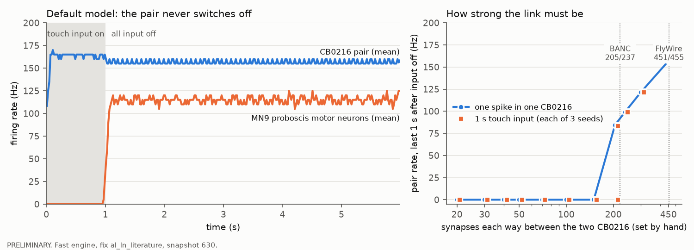

# The CB0216 pair that never stops firing: real biology or a model artefact? (PRELIMINARY)

*Lane started 2026-09-24. Scripts and results: `experiments/cb0216_loop/`. Status:
**PRELIMINARY**. Nothing in `sim/`, `app/`, `tests/` or `data/` was changed; the
project default model (`"al_ln_literature"`) is untouched.*

## 1. The short version

- **Verdict (by the rule fixed in advance): biology (plausible), not a sign error.** The
  two CB0216 neurons really are a strongly wired pair that excite each other, and every
  source we have says they are excitatory (acetylcholine). So, unlike the earlier smell
  runaway, there is no transmitter mistake to fix, and no sign-correction variant was
  built. What is **not** established is the model's claim that the pair, once started,
  fires forever at about 156 Hz. That part depends on things the model leaves out, and
  nobody has recorded these cells.
- **Who they are.** One neuron per side of the brain, in the gnathal ganglion (the
  bottom of the brain that runs feeding and the mouthparts). All their synapses are in
  that one region. FlyWire's transmitter guess is acetylcholine, confidence 0.64 (right)
  and 0.65 (left). That is modest: the paper that made these guesses reports an average
  of 0.79 for cells whose left and right copies agree. They receive 451 and 455 synapses
  from each other. Each one is the other's biggest output (18% of its output synapses)
  and biggest input (24-26%). They also send 553 synapses straight onto the two MN9
  motor neurons, the proboscis motor neurons that Phase 3 reads out.
- **Two other fly connectomes agree.** In the male fly (maleCNS 0.9, where the type is
  called GNG117) the pair has 914 and 973 synapses onto each other, and the
  transmitter guess is acetylcholine at 0.84 and 0.85. In BANC (a second female brain
  plus nerve cord) it has 205 and 237, with acetylcholine at 0.64 and 0.71. In both,
  each cell is the other's biggest output. The hemibrain does not cover this part of
  the brain.
- **Reproduced (R1 PASS).** After the input stops, both CB0216 cells keep firing at
  156-157 Hz for the full 5 seconds we simulated, in 3 of 3 seeds, for two different
  inputs. They drive the two MN9 proboscis motor neurons at 104-105 and 125-126 Hz the
  whole time. About 31 other cells keep firing with them.
- **The pair is the cause (R2 PASS).** Silencing either CB0216 cell stops everything:
  0 Hz for both, and 0 other cells still active, in all 12 runs (2 inputs x 2 sides x 3
  seeds).
- **What switches it on.** A single spike in either cell is enough. Touch-sensor input
  does it: all 2,633 touch sensors at 50 Hz for 1 s, or at 100 Hz for just 100 ms (not
  20 Hz, not 20 ms). Of the touch groups, only 50 sensors of "unknown" sub-class do it (35
  enter through the nerve from the proboscis, 15 through the antennal nerve). Taste
  (sugar, bitter, water, Ir94e), smell, sight, humidity and temperature input do not:
  CB0216 stays at 0 Hz. So **the Phase 3 sugar -> MN9 result (about 67 Hz) never
  involves this pair.**
- **What it takes.** The loop holds only if each direction has more than about 150-200
  synapses: with 205 or more it holds (205: 2 of 3 seeds), with 150 or fewer it never
  does. FlyWire's 451/455 is well above that line; BANC's 205/237 is just above it.
- **The project's realism upgrades do not stop it.** With spike-frequency adaptation on
  it still holds at 126-127 Hz; with conductance-based synapses at 151 Hz (3 of 3 seeds
  each).
- **It can be switched off.** Driving the pair's own inhibitory inputs (two GABA cells)
  for 0.1 s stops it in 3 of 3 seeds. In the model nothing drives those cells at rest,
  so nothing ever switches the loop off.
- **No other loop does this (R3).** The search found 357 pairs of excitatory cells wired
  both ways with at least 30 synapses each way, 158 three-cell excitatory loops and no
  cell that excites itself. We tested the top 60 pairs and top 30 three-cell loops: only
  CB0216 keeps going. Three other pairs are also above the one-spike line (LT1a/LT1b on
  each side, 180-268 synapses, and the CB0756 pair, 221-229). Isolated from the rest of
  the brain they also hold, at 70-110 Hz. In the whole brain they stop after one or two
  spikes, because the cells they excite send 333-479 inhibitory synapses straight back.
  CB0216's targets send back only 37. That missing brake is what makes CB0216 unique.

*The figure. Left: the default model, seed 0. Touch input for 1 s (grey), then no input at
all. The pair (blue) keeps firing at about 156 Hz and holds the proboscis motor neurons
(orange) at about 115 Hz until the simulation ends. (MN9 is silent while the touch input
is on and starts only when it stops.) Right: the same test with the pair's mutual synapse
count set by hand. Below about 150-200 synapses each way the loop dies. FlyWire's count
(451/455) is far above the line and BANC's (205/237) just above it.*

## Pass rules (written before any test was run)

These were written into this file before running the reproduction, the loop search or
any sign-correction variant. They are not changed afterwards; if one turns out to be
badly chosen, that is said in the results, not fixed silently.

"The pair" = the two CB0216 neurons, root IDs 720575940633316307 (right) and
720575940636552805 (left), snapshot 630. "Default model" = `build_brain("al_ln_literature")`.
"After input off" = the time after all outside input has been switched off.

- **R1 Persistence reproduces.** With the default model, at least one input makes both
  CB0216 neurons fire at 50 Hz or more in the LAST second of a 5-second input-off
  period, in at least 2 of 3 seeds.
- **R2 The pair is the cause.** For the same input and seeds, silencing either CB0216
  neuron (its outgoing synapses set to 0, the project's usual silencing) leaves both
  CB0216 neurons below 1 Hz in the last second, in all 3 seeds. Secondary: the number of
  non-sensory neurons still spiking in that last second falls to 10% or less of the
  unsilenced count (tests whether the pair drives the rest of the leftover activity).
- **R3 Other self-sustaining loops.** Candidates come from a search of the default
  model's wiring for strongly reciprocal excitatory pairs and short excitatory cycles
  (method in the results). A candidate "self-sustains" if, after its members are driven
  at 200 Hz for 200 ms and then left alone, every member fires at 20 Hz or more in the
  last second of a 3-second input-off period (seed 0; any hit is repeated on seeds 1
  and 2 and must hold in both).
- **R4 Verdict.**
  - *Biology (plausible)*: the transmitter evidence points to acetylcholine from at
    least two independent sources (for example FlyWire's prediction with confidence 0.8
    or more, a transmitter prediction in a second connectome, or a published staining
    result), the strong reciprocal wiring is present in at least one other connectome,
    and no published source contradicts it.
  - *Likely artefact*: the transmitter evidence points to GABA or glutamate (one
    published staining result, or at least two independent predictions agreeing), OR
    the persistence disappears when a published ingredient the model lacks
    (spike-frequency adaptation or conductance-based synapses, the project's own
    Phase 7 upgrades) is switched on.
  - *Can't tell*: anything else.
- **R5 Optional sign-correction variant (only if R4 finds a well-supported correction).**
  Built in `experiments/cb0216_loop/` the way `sim/sign_fixes.py` builds variants, on
  top of `"al_ln_literature"`, never as the default. It passes if (a) both CB0216
  neurons are below 1 Hz in the last second after input off, in all 3 seeds of the R1
  input, and (b) sugar 100 Hz -> MN9 stays within 5% of the default model's value
  (default about 67.3 Hz; 30 trials x 3 seeds, the Phase 3 protocol).

(The step 1 identity data in section 2 had been read before these rules were written; no
simulation had been run.)

## 2. Who the two cells are

| | right CB0216 | left CB0216 | source |
|---|---|---|---|
| Root ID (snapshot 630) | 720575940633316307 | 720575940636552805 | FlyWire |
| Class | central, intrinsic | central, intrinsic | FlyWire annotation |
| Hemilineage | putative primary | putative primary | FlyWire (Ito-Lee and Hartenstein columns) |
| Predicted transmitter (confidence) | acetylcholine (0.639; v783 0.642) | acetylcholine (0.650; v783 0.652) | FlyWire `top_nt` |
| Literature transmitter (`known_nt`) | none | none | FlyWire v783 |
| Average synapse scores, all outputs (ACh / Glu / DA / GABA) | 0.64 / 0.21 / 0.10 / 0.03 | 0.65 / 0.18 / 0.12 / 0.03 | v783 connection table |
| Synapses onto the other CB0216 | 451 (ACh score 0.62, Glu 0.22) | 455 (ACh 0.63, Glu 0.21) | model = v783 table |
| Where | all 2,426 output and 1,738 input synapses in the GNG | all 2,489 output and 1,856 input synapses in the GNG | v783 table |
| Synapses onto MN9 (the two cells) | 146 + 122 | 193 + 92 | model |
| Inhibitory input | 753 synapses (top: two unlabelled GABA cells, 116 and 111; DNge160 pair, 75 and 69) | 842 (same cells: 144, 128, 90, 76) | model |
| maleCNS 0.9 (type GNG117) | ACh 0.836; 973 synapses onto partner | ACh 0.852; 914 onto partner | data/banc/malecns_09 |
| BANC 888 (type CB0216) | ACh 0.644; 205 onto partner | ACh 0.708; 237 onto partner | data/banc |

FlyWire and v783 have exactly two CB0216 cells, and the model's mutual synapse counts
match the v783 proofread table exactly. So the IDs are right and the loop is not an
indexing or copying mistake. "GNG" is the gnathal ganglion. The model gives both cells
the excitatory sign (+1), which matches every prediction. The runner-up guess is
glutamate at about 0.2, which would make the loop inhibitory in this model. No source
supports it.

## 3. Reproduction (fast engine, default model, one simulation at a time)

Protocol: input on, then **all** input off; rates in the last second. Driven sensory
cells get no refractory period (the paper's input rule). Cells driven directly inside
the brain keep their normal 2.2 ms. (A first scan drove the pair itself without a
refractory period and got a 471 Hz state. That was a protocol mistake, fixed before any
rule was scored.)

| test | CB0216 last 1 s (Hz) | MN9 last 1 s (Hz) | other cells still active | seeds |
|---|---|---|---|---|
| R1: reservoir lane's input, all sensory cells, 400 Hz peak, 2 s, then 5 s off | 156-157 / 156-157 | 104-105 / 125-126 | 31-32 | 3 of 3 on |
| R1: all touch sensors 100 Hz, 1 s, then 5 s off | 157 / 157 | 105 / 125 | 31-32 | 3 of 3 on |
| R2: same two inputs, right or left CB0216 silenced | 0 / 0 | 0 / 0 | 0 | 12 of 12 off |
| One kick (one spike) to either CB0216, then 2 s | 156-157 | 104-105 / 125 | | seed 0 |
| Spike-frequency adaptation on (touch input) | 126-127 | 77-78 / 93-98 | | 3 of 3 on |
| Conductance-based synapses on (touch input) | 151 | 89-90 / 120-121 | | 3 of 3 on |
| Drive the two GABA inputs 0.1 s after the loop is on | 0 | | | 3 of 3 off |
| Drive the DNge160 pair 0.1 s instead | 0 (2 seeds), 156 (1 seed) | | | 2 of 3 off |

Inputs that switch it on (seed 0, input then 2 s off): the reservoir input at 150 and 400
Hz; all touch sensors at 50 Hz (1 s) or 100 Hz (100 ms); the 50 touch sensors whose
sub-class FlyWire gives as "unknown", at 100 Hz for 1 s (35 from the maxillary-labial
nerve, which serves the proboscis; 15 from
the antennal nerve). Inputs that do not: all touch sensors at 2-20 Hz, or 100 Hz for 5-20
ms; eye bristles (1,111 cells), head bristles (302), taste pegs (75), hearing (388) and
the 705 touch cells with no sub-class; all visual, smell, taste, humidity and temperature
sensors at 100 Hz; sugar 100/200 Hz, bitter 200, water 200, Ir94e 200 (CB0216 0 Hz
throughout). Once on, nothing in the model ever turns it off. The loop's own firing
rate is set by its wiring alone: the pair cut out of the brain on its own fires at the
same 156 Hz.

Mutual-synapse sweep (both directions set to N, everything else unchanged; one kick,
plus touch input in 3 seeds): N = 451: 157 Hz; 300: 122; 237: 99 (3 of 3); 205: 84 (kick,
2 of 3 touch seeds); 150, 100, 70, 50, 40, 30, 20: 0 in every run. That matches simple
arithmetic for this model: one spike through N synapses lifts the partner by at most about
0.043 mV x N, and the threshold is 7 mV above rest, so N must be above about 162 for one
spike to fire the partner.

## 4. Other self-sustaining loops (R3)

Search (`loops.py`): every pair of cells that excite each other with at least 30
synapses each way (357 pairs), every three-cell excitatory loop with every link at least
30 and no two-way pair inside (158), and cells that excite themselves (none). The 60
strongest pairs and 30 strongest three-cell loops were tested (driven at 200 Hz for 0.2 s,
then 3 s with no input). **Only the CB0216 pair self-sustains**, and it repeats on seeds 1
and 2. No other candidate left a single cell firing.

Why the others fail (`diag.py`, one kick each):

| pair | synapses each way | alone (2-cell network) | in the whole brain | inhibitory synapses sent back by the cells they fire in the first 0.1 s |
|---|---|---|---|---|
| CB0216 right / left | 451 / 455 | 156 Hz | 156-158 Hz | 37 |
| LT1a / LT1b (left) | 252 / 268 | 108-110 Hz | 0 | 333 |
| CB0756 right / left | 229 / 221 | 94 Hz | 0 | 370 |
| LT1b / LT1a (right) | 188 / 180 | 70-72 Hz | 0 | 479 |
| unlabelled pair | 175 / 146 | 0 | 0 | 0 |

So strong two-way excitation is not rare. What is rare is strong two-way excitation
**without** fast feedback inhibition. Both facts come from the wiring, not from a
parameter.

## 5. What the literature says

- **Nothing published names CB0216 or GNG117** in anything we could find (web searches
  for both names, with and without "Drosophila", "connectome", "FlyWire"). The only
  sources are the dataset annotations: FlyWire, BANC and maleCNS. There is no staining
  result for its transmitter and no recording of its activity.
- **Transmitter guesses.** Eckstein et al. 2024 (*Cell*, "Neurotransmitter classification
  from electron microscopy images at synaptic sites in Drosophila melanogaster")
  reports 94% accuracy for neurons and 91% for known cholinergic cell types in FlyWire.
  Paired cells whose left and right predictions agreed had an average confidence of
  0.79. CB0216's 0.64-0.65 is below that, but both sides agree, and the maleCNS
  (0.84-0.85) and BANC (0.64-0.71) predictions agree too. Those come from different
  brains and images; we did not check how independent the classifiers are.
- **MN9.** Activating MN9 makes the proboscis extend (McKellar et al. 2020, *eLife*,
  "Controlling motor neurons of every muscle for fly proboscis reaching"). MN9 is
  activated by sugar and inhibited by bitter (Gordon & Scott 2009, *Neuron*, "Motor
  control in a Drosophila taste circuit"; abstract only).
- **Persistent activity from a recurrent loop does exist in flies elsewhere.** Zhao et
  al. 2018 (*eLife*, "Persistent activity in a recurrent circuit underlies courtship
  memory in Drosophila") show several minutes of persistent activity in aSP13 neurons.
  It is carried by a MBgamma > M6 > aSP13 loop with cholinergic and glutamatergic
  transmission and is "not an intrinsic property of aSP13 neurons". So a circuit-held
  state is not biologically strange in itself.
- Not found: any report that brief touch to the proboscis causes long-lasting MN9 firing
  or proboscis extension. We could not confirm the opposite either, so this is an open
  prediction, not a contradiction.

## 6. Verdict against the rules

- R1 **PASS** (156-157 Hz in the last second, 3 of 3 seeds, two inputs).
- R2 **PASS** (0 Hz in 12 of 12 silenced runs; other active cells 0 against 31-32 other
  cells, below the 10% line).
- R3: **no other self-sustaining loop** among 90 tested candidates. CB0216 repeats on
  seeds 1 and 2.
- R4 **Biology (plausible)**. Acetylcholine comes from two sources beyond FlyWire
  (maleCNS at 0.84-0.85, which clears the 0.8 bar, and BANC). The strong two-way wiring
  is in both other connectomes, and no published source contradicts it. The
  "likely artefact" rule is not met: no source points to GABA or glutamate, and the
  loop survives adaptation and conductance-based synapses.
- R5 **not run**: there is no well-supported sign correction, so no variant was built.
  The default model is unchanged. The sugar -> MN9 result cannot be affected anyway,
  because CB0216 is silent during sugar input.

**How far the verdict goes.** The rule was written to catch a sign mistake like the
earlier smell runaway, and it finds none. It cannot tell whether a real CB0216 pair
holds on for seconds at about 156 Hz after one spike. That depends on things the model
does not have:
- synapses that tire with use (short-term depression) or saturate. Here every spike
  delivers a 20 mV kick through 451 synapses, forever.
- background activity. Here the GABA cells that can switch the loop off are silent at
  rest.
- stronger adaptation than the one Phase 7 calibrated.

So our reading is: **the loop is real wiring and probably excitatory. A long-lasting
"on" state after a touch is plausible. The endless 156 Hz lock-in is probably
exaggerated by the model. This is PRELIMINARY, and nobody has recorded these cells.** A
direct test would be to record CB0216 or MN9 in a real fly after a brief touch to the
proboscis (for example with calcium imaging). That would need a genetic line for CB0216,
and we do not know of one.

## 7. Phase 6 checks applied (PLAN.md; step 6, sharing, skipped)

1. **Seeds and variations.** 3 seeds for R1/R2 and both realism upgrades; mutual
   weight swept from 451 down to 20 (it holds down to about 205, i.e. to less than half
   of FlyWire's count).
2. **Bugs.** IDs checked: the only two CB0216 cells in both annotation releases. Synapse
   counts identical in the model and the v783 proofread table. The model's sign (+1)
   matches the prediction. Silencing removes the whole leftover activity. The pair cut
   out of the brain reproduces the 156 Hz rate. One protocol mistake (no refractory
   period for directly driven cells) was found and fixed before scoring.
3. **Literature.** Section 5.
4. **Against known biology.** No known contradiction. The permanent MN9 firing is
   flagged as probably exaggerated but untested.
5. **Write-up.** This file plus `experiments/cb0216_loop/log-entry.md`.

## 8. Files

`experiments/cb0216_loop/`: `identify.py` (labels, transmitter scores, synapses and
neuropils), `cross_datasets.py` (maleCNS, BANC, hemibrain), `lib_cb.py` (shared helpers),
`reproduce.py` (stages scan, mech, r1r2, realism, weight, offswitch), `loops.py` (loop
search and tests), `diag.py` (why other pairs fail), `make_figure.py`, `run_queue.sh`.
Results in `results/` (CSV, JSON and logs for every stage; figure
`fig_cb0216_loop.png`). About 35 minutes of single-thread compute in total.
