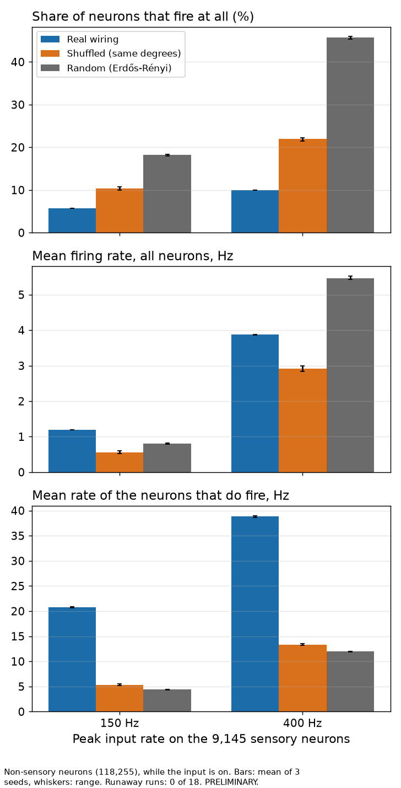
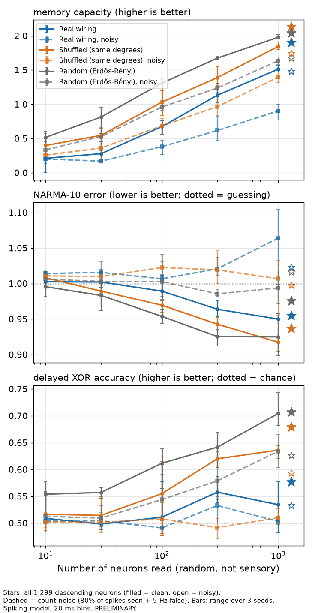

# The fly's wiring as a reservoir, re-tested with the spiking model (PRELIMINARY)

**In one sentence:** run as real spikes, with its real synapse strengths and
no rescaling, the fly's wiring again did **not** compute better than random
wiring. By the rule written down before the runs it won 0 of 6 comparisons,
lost 4 and tied 2, the same score as the rate version. The reason has changed,
though. There is no longer a scaling artefact. Instead the real brain sends
most of its activity down a few hot pathways (mostly smell), leaves 90% of its
neurons silent, and so gives the readout less to work with.

All numbers are PRELIMINARY. The pre-registration at the bottom was written
before any comparison run and not changed afterwards; two timed amendments
are listed under it.

## The result in numbers

Each network is compared at its own best input rate (150 or 400 Hz, picked
on validation data), as the mean of 3 seeds. The range across seeds is in
brackets.

**Headline verdicts** (the pre-registered pass rule, readouts without noise):

| Readout | Task | Real wiring | Shuffled (same degrees) | Random (Erdős-Rényi) | Verdict |
|---|---|---|---|---|---|
| All 1,299 descending neurons | Memory capacity (higher is better) | 1.90 (0.16) | 2.13 (0.15) | 2.03 (0.13) | LOSE |
| All 1,299 descending neurons | NARMA-10 error (lower is better) | 0.95 (0.07) | 0.94 (0.05) | 0.98 (0.07) | TIE |
| All 1,299 descending neurons | Delayed XOR accuracy | 57.6% (5.7) | 67.8% (3.5) | 70.7% (5.3) | LOSE |
| 1,000 random neurons | Memory capacity | 1.51 (0.10) | 1.85 (0.11) | 1.98 (0.06) | LOSE |
| 1,000 random neurons | NARMA-10 error | 0.95 (0.02) | 0.92 (0.03) | 0.93 (0.05) | TIE |
| 1,000 random neurons | Delayed XOR accuracy | 53.4% (9.5) | 63.6% (2.5) | 70.4% (6.2) | LOSE |

- **Pass or fail:** FAIL. 0 wins, 4 losses, 2 ties.
  - Against the shuffle: 4 losses, 2 ties. Against Erdős-Rényi: 3 losses,
    3 ties (descending-neuron memory is a tie there).
  - Across all 36 comparisons (every readout size, with and without noise)
    the real wiring never wins a task. 19 are losses, 17 ties. Its only
    single win against one control is NARMA with 100 noisy neurons against
    the shuffle, where both are worse than guessing (1.007 against 1.023).
- **Every network forgets fast.** Memory capacity is about 2 for all three,
  against 18-48 in the rate version. Per delay (descending neurons, 400 Hz):

  | How far back | Real | Shuffled | Erdős-Rényi |
  |---|---|---|---|
  | this bin (0-20 ms) | 0.91 | 0.95 | 0.95 |
  | 1 bin back (20-40 ms) | 0.73 | 0.84 | 0.82 |
  | 2 bins back | 0.10 | 0.17 | 0.09 |
  | 3 or more bins back | about 0 | about 0 | about 0 |

  (1.0 = the input can be read back perfectly, 0 = not at all.) The model's
  neurons forget in about 20 ms, and nothing in the model holds a signal
  longer (the one loop that keeps firing, see "Checks", ignores the input).
  So after about 50 ms the input is gone in all three.
- **NARMA-10 is failed by everyone.** It needs 10 steps (200 ms) of memory.
  All networks score 0.92-0.98, barely better than always guessing the
  average (1.0). The two ties are ties at "failing".
- **XOR is where the wiring shows.** It needs the current and the previous
  bin combined non-linearly, which fits in 40 ms. Random wiring does it best
  (70%), the shuffle next (64-68%), the real wiring worst (53-58%; chance is
  50%).
- A 50 Hz input level was also run for the real network (seed 0 only; see
  amendment 1). It was its worst level: memory 1.0, NARMA 0.99, XOR 50%.

**Activity levels: nothing runs away, but the real brain is lopsided.**
Non-sensory neurons (118,255) while the input is on, mean of 3 seeds:

| | Real 150 Hz | Real 400 Hz | Shuffled 150 | Shuffled 400 | Erdős-Rényi 150 | Erdős-Rényi 400 |
|---|---|---|---|---|---|---|
| Neurons that fire at all | 5.7% | 10.0% | 10.4% | 21.9% | 18.2% | 45.8% |
| Mean rate, all neurons | 1.2 Hz | 3.9 Hz | 0.6 Hz | 2.9 Hz | 0.8 Hz | 5.5 Hz |
| Mean rate of the firing ones | 21 Hz | 39 Hz | 5 Hz | 13 Hz | 4 Hz | 12 Hz |
| Neurons above 100 Hz | 0.21% | 0.92% | 0 | 0.04% | 0 | 0.02% |
| Descending neurons that fire | 29% | 35% | 22% | 39% | 18% | 46% |
| Runaway | no | no | no | no | no | no |

- **No runaway anywhere** (0 of 18 runs, plus the real 50 Hz run). When the
  input stops, activity falls to near zero within 40 ms in every network.
- **The random networks are the calm, even ones here**, the opposite of the
  worry going in (that random wiring might fire non-stop). The real brain is
  the lopsided one:
  - at 400 Hz, about 1,080 real neurons (0.9%) fire above 100 Hz and make 36%
    of all non-sensory spikes. In the controls, at most 49 neurons do, making
    under 2%;
  - the hot neurons are mostly in the smell system: antennal-lobe local
    neurons (212, including 30 lLN1_bc), projection neurons (147), plus 95
    descending and 60 ascending neurons (`results/hot_neurons.json`);
  - meanwhile 90% of the real brain never fires at all.
- **A small self-sustaining loop.** In the real brain only, a trickle of
  activity (0.016 Hz averaged over the brain, 0.4-1.4% of the driven level)
  keeps going after the input stops, and was still going 1 s later. It is far
  below the pre-registered runaway line (10%). See "Checks" for the pair of
  neurons behind it.

**The electrode bottleneck** (random non-sensory neurons read, each network at
its best rate; "noisy" = 80% of spikes seen plus 5 false spikes per second):

| Neurons read | Memory: real | shuffled | random | XOR: real | shuffled | random |
|---|---|---|---|---|---|---|
| 10 | 0.21 | 0.40 | 0.52 | 51% | 52% | 55% |
| 100 | 0.67 | 1.03 | 1.31 | 51% | 56% | 61% |
| 300 | 1.13 | 1.39 | 1.67 | 56% | 62% | 64% |
| 1,000 | 1.51 | 1.85 | 1.98 | 53% | 64% | 70% |
| 1,000, noisy | 0.90 | 1.39 | 1.64 | 50% | 51% | 63% |
| 1,299 descending, noisy | 1.48 | 1.74 | 1.67 | 53% | 59% | 63% |

- **The real wiring is the worst to read at every electrode count.** An
  electrode that lands at random in the real brain usually lands on a silent
  neuron (90% of them are silent), while in Erdős-Rényi about half are active.
- **Noise hurts the real wiring most.** With spike-sorting errors, its XOR
  drops to chance (50%) and its memory from 1.51 to 0.90. Erdős-Rényi keeps
  63% and 1.64.
- **Its descending neurons are its best readout.** Reading all 1,299 of them
  gives more than 1,000 random neurons (memory 1.90 against 1.51), and they
  are robust to noise (1.48). That fits biology: they are where the brain
  sends its output.

**What changed versus the rate version.**
- Same verdict count (0 wins, 4 losses, 2 ties), but not the same losses.
  In the rate version the real wiring lost memory and NARMA and tied XOR. Here
  it loses memory and XOR, and NARMA is a tie because everyone fails it.
- The rate version's explanation, a spectral radius set by 8 lobula-plate
  cells, cannot apply: nothing is rescaled here. Those cells (LPi21, DCH,
  VCH, HSE, H2) are in fact silent (0 Hz) in these runs: the sensory input
  barely reaches the optic lobe, where only 3% of neurons fire.
- A related explanation survives: **activity concentration**. In both
  models, the real wiring puts its activity into a small set of strongly
  connected cells and leaves most of the brain quiet. In the rate model this
  came from the scaling; in the spiking model it comes from convergence (many
  smell receptors feeding a few antennal-lobe cells) and from thresholds. One
  synapse moves a neuron's voltage by only about 0.04 mV and the threshold is
  7 mV above rest, so a neuron fires only when many inputs arrive together.
  Neurons with many strong, converging inputs fire hard; the rest stay
  silent.
- Memory is 10-20 times shorter in the spiking model at 20 ms bins, because
  the model has no slow parts (no adaptation, no slow synapses).

## Checks done (PLAN.md Phase 6)

**1. Seeds and variations.**
- 3 seeds per network, 2 input levels (plus 50 Hz for the real network,
  seed 0).
- **Synapse weight ±20%** (pre-registered; seed 0, 400 Hz, all three
  networks). Memory capacity / XOR accuracy:

  | Readout | Weight | Real | Shuffled | Erdős-Rényi |
  |---|---|---|---|---|
  | Descending | -20% | 2.02 / 61% | 2.01 / 69% | 1.89 / 74% |
  | Descending | normal | 1.99 / 61% | 2.21 / 67% | 2.11 / 74% |
  | Descending | +20% | 2.11 / 66% | 2.20 / 70% | 2.16 / 69% |
  | 1,000 random | -20% | 1.50 / 49% | 1.82 / 65% | 1.87 / 71% |
  | 1,000 random | normal | 1.57 / 55% | 1.91 / 64% | 2.02 / 74% |
  | 1,000 random | +20% | 1.56 / 62% | 2.17 / 67% | 2.11 / 72% |

  - XOR: the real wiring is the lowest at every weight, with both readouts.
  - Memory: lowest at every weight with 1,000 random neurons. With the
    descending neurons it is lowest at normal and +20%; at -20% the three are
    level (2.02, 2.01, 1.89).
  - NARMA-10: 0.91-0.97 for everyone at every weight.
  - Activity: no runaway at any weight. The share of neurons that fire is
    8-12% in the real brain, 16-28% in the shuffle and 33-59% in
    Erdős-Rényi. The real brain's leftover activity after the input stops
    grows tenfold at +20% (0.016 to 0.17 Hz, 3.6% of the driven level; the
    runaway line is 10%).
  - So the conclusion holds at ±20%. One seed only, so no verdicts.
- **Exploratory: 5 ms bins** (amendment 2; 400 Hz, 3 seeds, same rule).
  - 0 wins, 3 losses, 3 ties (all 36 comparisons: 15 losses, 21 ties).
  - Memory, descending neurons: real 0.87, shuffled 1.30, Erdős-Rényi 1.28.
    1,000 random: 0.56, 1.06, 1.26. XOR is at or near chance (50-57%) for
    everyone.
    NARMA 0.91-0.98.
  - Memory reaches back 3-4 bins (15-20 ms) in every network. Shorter bins
    only make each count sparser. They do not uncover a hidden advantage.

**2. Bugs.**
- Controls (`results/checks.json`): all have 14,635,639 connections, no
  self-connections and the same list of weights. The shuffles keep every
  neuron's number of outputs and its sign (0 neurons with mixed + and -
  outputs, as in the real brain). Erdős-Rényi mixes signs in every neuron, by
  design.
- **A small bug in the reused shuffle code** (`experiments/reservoir/lib.py`,
  `degree_shuffle` with `no_self=True`). To remove self-connections it swaps
  targets with randomly picked other connections; if the same connection is
  picked twice, one target is copied instead of swapped. In shuffle seed 1
  this changed 2 neurons' input counts by one. Seeds 0 and 2 are exact.
  Negligible here and in the rate lane's re-run, which used the same code.
  Not fixed, because the file belongs to that lane.
- The real network from `build_brain(fix="al_ln_literature")` matches the
  arrays the controls are made from (connection count and weight sums).
- Input: every input spike lands on a sensory neuron. The + and - neurons'
  rates follow u with correlation +1.000 and -1.000. The measured sensory
  rates are 1.5-4% below the intended ones (74 against 75 Hz, 192 against
  200 Hz), because a neuron ignores an input kick in the step it fires (the
  model's own rule, as in Brian2), and a few double kicks are merged.
- No readout neuron is a sensory neuron (checked for all 3 seeds).
- The task and ridge code are the rate lane's, which passed its no-network
  checks. Summing 101 memory delays adds a chance floor of about 0.15
  (about 1/600 per delay with 600 test bins).

**3. Literature.** See "Is this new?" below.

**4. Biology: who keeps firing after the input stops** (`persist.py`, 400 Hz,
2 s of input then 1 s with none, seed 0, `results/persist_400.csv`).
- Real brain: 422 neurons still fire 200-1,000 ms after the input stops, and
  the activity had not died out when the run ended.
- It is carried by one pair of cholinergic (excitatory) neurons, CB0216, one
  on each side of the brain. They excite each other through 451 and 455
  synapses and keep firing at about 156 Hz. They drag along 47 descending
  neurons, 6 motor neurons, dopamine neurons and others at low rates.
- Shuffled and Erdős-Rényi: everything stops within 20 ms.
- Two neurons locked into 156 Hz firing for good after a 2 s stimulus is
  unlikely in a real fly. Following step 4 ("suspect the model first"), this
  is more likely a model limit: their predicted transmitter may be wrong (as
  it was for the antennal-lobe cells the recommended fix corrects), or real
  synapses tire, which the model does not include. It is a candidate for the
  transmitter audit, not a finding.
- The hot antennal-lobe cells include 30 lLN1_bc, the cells behind the Phase 6
  runaway in the published matrix. With the recommended fix they fire hard
  (150-210 Hz, all 30, every seed) but do not run away.

**Is this new?** Partly.
- The rate version's sources still apply: the FlyWire connectome as an
  echo-state reservoir against a random control (Costi et al. 2025), and a
  FlyCircuit fly network with no advantage over degree-preserving nulls in
  conn2res (Suárez et al. 2024).
- A short web search (2026-09-24) found informal projects doing close
  relatives, none peer-reviewed:
  - a larval-fly (2,952 neurons) spiking reservoir against a degree-matched
    random graph playing Tetris, which says it is too short to conclude
    anything (github.com/itznotnelo/fly-brain-tetris);
  - a pre-registered "fly brain as reservoir" framework, still in its design
    phase with no results (github.com/igdigitallab/bioreservoir);
  - a GPU fly simulator that compared the real wiring with degree-preserving
    rewiring on activity, not tasks, and found the real wiring behaves very
    differently, for example the APL neuron falls silent when rewired
    (github.com/annel0/flybrain).
- Not found in any source we reached: the whole adult FlyWire brain as a
  spiking reservoir on the standard memory / NARMA / XOR set with both
  controls and pre-registration, the descending-neuron readout, the
  electrode and count-noise sweep, or the activity-concentration measure.
  "Not seen" is not "new": this was a few searches, not a review.

**What it means for the hybrid-computer goal.**
- Two different models now agree: the fly's wiring, copied as it is, is not
  a better generic reservoir than random wiring.
- The spiking version gives the more practical lesson. The real brain keeps
  most of its neurons silent and drives a few hard. For a device read by a
  handful of electrodes that is bad news, since most electrodes read
  silence.
- Its descending neurons are the exception: they carry more about the input
  than a similar number of random neurons, and they resist read noise. If a
  hybrid device reads a fly-like circuit, it should read the output neurons,
  not random ones.
- A spiking copy of the fly brain holds its input for only about 50 ms. Any
  task that needs longer memory will need slow parts added (adaptation, slow
  synapses, neuromodulation; PLAN.md Phase 7), or a faster task.

## How it was done

**The idea in one paragraph.** A "reservoir computer" keeps a network's
wiring fixed. You feed a signal into some neurons, let the activity echo
around, and train only a simple readout: a weighted sum of what a few neurons
are doing. If that readout can answer questions about the recent input, the
fixed network did the work. This is how a living-neuron computer would be
used: you cannot rewire the tissue, only stimulate it and read it with
electrodes.

**What is different from the rate version** (`docs/connectome-reservoir.md`):

| | Rate version (previous lane) | This lane |
|---|---|---|
| Neuron model | a number between -1 and 1 per neuron, tanh | the project's spiking model: voltage, threshold, spikes |
| Connection strength | synapse count, then the whole network divided by its largest eigenvalue | synapse count x 0.275 mV, exactly as the model uses it; no rescaling |
| Tuned setting | gain (8 values) x leak (2 values) | input rate (150 or 400 Hz) |
| Input | u(t) x ±1 into 9,145 sensory neurons | the same neurons, as Poisson spikes: + neurons fire faster when u is high, - neurons when u is low |
| One time step | one update | a 20 ms bin (200 engine steps of 0.1 ms) |
| Readout | activity value | spike count per bin |
| Read noise | Gaussian, SD 0.01 | electrode-like: 80% of spikes seen, plus 5 false spikes per second |
| Controls | same two kinds, 3 seeds | the same two kinds, 3 seeds, now built without self-connections |

The tasks (memory capacity, NARMA-10, delayed XOR), the ridge readout, the
training / validation / test split, the controls' code and the pass rule are
reused unchanged.

**The spiking model in brief.** Each neuron adds up incoming synaptic
current. When its voltage rises 7 mV above rest it fires, resets and is silent
for 2.2 ms. Each spike reaches the neuron's targets 1.8 ms later. There,
each synapse adds 0.275 mV to an input current that fades in about 5 ms
(minus for GABA and glutamate); its peak effect on the voltage is about
0.04 mV. The voltage leaks back with a 20 ms time constant. This is the model of Shiu et al. 2024, run by the
project's fast engine.

## Limits

- **An artificial input.** Every sensory neuron gets the same number, with a
  random sign. Real senses are not like that. 3,667 of the 9,145 inputs are
  photoreceptors, and each feeds its own optic-lobe column, so with no
  convergence almost nothing downstream fires: 97% of the optic lobe (58% of
  the brain) stays silent. A random electrode in the real brain therefore
  often lands in a region this input never reaches. The random controls
  spread the same input everywhere.
- **Tasks built for slow memory.** The model has no slow parts, so at 20 ms
  bins memory is about 2 bins for everyone and NARMA-10 is failed by all.
  The exploratory 5 ms run tests this.
- **Only two input levels** decided the best settings (50 Hz was dropped for
  time; amendment 1).
- **1,000 training bins** (20 s of simulated time) for up to 1,299 readout
  weights. The ridge penalty handles this, but more data would help every
  network.
- **One model.** The Shiu et al. leaky integrate-and-fire model, with the
  recommended antennal-lobe fix. No adaptation, no gap junctions, no
  neuromodulators.
- **Controls.** The shuffle keeps each neuron's number of connections but not
  which ones are strong. Erdős-Rényi also mixes + and - outputs within one
  neuron, which real neurons do not do.
- The reused shuffle code has a small bug (see "Checks"); it changes 2 of
  14.6 million connections in one control and cannot matter.
- No independent review.
- **Compute:** about 115 min in all (main grid 70 min including a stopped
  run, ±20% check 27 min, 5 ms run 11 min, probes and checks about 7 min).
  That is over the 90-minute budget, mostly because other lanes slowed the
  laptop (amendments 1 and 2).
- Not done: the published matrix (`fix="none"`) as a spiking reservoir; the
  ±20% check on seeds 1-2; other input codes (for example, driving one sense
  only).

## Files

All in `experiments/reservoir_spiking/`:
- `lib_spk.py`: the input code (push-pull Poisson spikes), the segmented
  simulation with the fast engine, and the count-noise model. It reuses the
  tasks, the ridge readout and the two controls from
  `experiments/reservoir/lib.py`.
- `timing.py`: the timing and activity probes.
- `run_grid.py`: the sweep (`--tag main`, `--tag wsyn --wsyn 0.8 1.2`,
  `--tag bin5 --bin 5`).
- `analyze_spk.py`: best settings, verdicts (the rate lane's `verdicts()`),
  tables and the two figures.
- `analyze_extra.py`: the ±20% check and the 5 ms run.
- `checks.py`, `hot_neurons.py`, `persist.py`: the Phase 6 checks.
- `results/`: `main_grid.csv` (every score), `main_activity.csv` (activity per
  run), `best_settings.csv`, `verdicts.csv`, `bottleneck.csv`,
  `activity_summary.csv`, `hot_neurons.json`, `checks.json`,
  `wsyn_check.csv`, `bin5_verdicts.csv`, `persist_400.csv`, `summary.json`,
  `fig_bottleneck.png`, `fig_activity.png`.
- `results/raw/`: the spike-count features of every run (`.npz`), memory
  curves, logs, and the debug run.
- `log-entry.md`: the entry for `EXPERIMENTS.md`.

## Pre-registration (written 2026-09-24 00:10, before any comparison run; not changed afterwards)

**What is being tested.** The same question as `docs/connectome-reservoir.md`:
does the fly's real wiring work better as a fixed "reservoir" than random
wiring with the same neurons, the same connection count and the same
connection strengths? This time the reservoir is the project's own spiking
model (`sim/fast_engine.py`), with its real synapse weights and no
spectral-radius scaling.

**What was run before this was written (debug only, no task comparison).**
- Short timing probes (0.8 s, seed 0) of the real network and one shuffle and
  one Erdős-Rényi network, at peak input rates 50, 150 and 400 Hz. Only speed
  and activity were looked at. No network ran away at any level. The real
  network had the highest mean firing rate at 50 and 150 Hz, Erdős-Rényi at
  400 Hz.
- One shortened pipeline test of the real network alone (seed 0, 150 Hz, 200
  training bins). Its task scores were used only to check the code runs.

**Networks** (all built from the same edge list, `fix="al_ln_literature"`
passed explicitly):
- Real: `sim.sign_fixes.build_brain(fix="al_ln_literature")`. 127,400 neurons,
  14,635,639 connections, weight = signed synapse count x 0.275 mV.
- Control (a), degree-preserving shuffle: the target column of the edge list
  is permuted (`experiments/reservoir/lib.py degree_shuffle`). Every neuron
  keeps its number of inputs and outputs and its outgoing weights and signs.
- Control (b), Erdős-Rényi: the same number of edges with the same weight
  values, between random pairs of neurons (`erdos_renyi`).
- Both controls are built without self-connections (`no_self=True`): the real
  brain has none, and the rate lane found that a single random self-connection
  distorted two of its controls.
- 3 seeds (0, 1, 2) per control. A seed also fixes the input, the input signs,
  the random readout neurons, the input spike trains and the read noise, so all
  three networks see identical input spikes at a given seed.
- Model constants are the engine's defaults (threshold 7 mV above rest,
  membrane 20 ms, synapse 5 ms, delay 1.8 ms, refractory 2.2 ms).

**Input.** One number per 20 ms bin, u(t), uniform between 0 and 0.5 (the rate
lane's input). It drives all 9,145 sensory neurons (the rate lane's set) as
Poisson spike trains:
- each sensory neuron gets a sign, + or -, at random (the rate lane's ±1
  weights);
- with v = 2u (0 to 1), a + neuron fires at peak x v and a - neuron at
  peak x (1 - v). Spike rates cannot be negative, so this "push-pull" code is
  the spiking version of ±1 weights. Every input spike makes its sensory
  neuron fire once (the engine's Poisson input, 68.75 mV per kick).
- The peak rate is the one setting that is tuned: 50, 150 or 400 Hz. 150 Hz
  is the model's default input rate.

**Time bins: 20 ms.** One input value per bin, and the readout counts spikes in
the same bins.
- Why 20 ms: it equals the model's membrane time constant, so each bin's
  counts mostly reflect that bin's input. In the probes, activity faded within
  about 3 bins (60 ms) after the input stopped, so there are several bins of
  memory to find.
- 10 ms bins would leave most readout neurons with 0 spikes in almost every
  bin (typical firing is a few Hz), and would halve the signal per bin.

**Timeline.** 1,000 bins to train, 400 to validate (choose settings), 600 to
test: the rate lane's split. Only test scores are reported.
- The run is cut into 4 segments of 500 kept bins. Each segment starts from
  rest and first gets 25 bins (500 ms) of the true preceding input, which are
  thrown away. This bounds memory if a network runs away. 500 ms is about 8
  times the fade-out time seen in the probes.
- At the end, 25 bins with the input switched off, to test for runaway.

**Readouts** (spike counts per bin, not normalised):
- Readout A: all 1,299 descending neurons.
- Readout B: N random non-sensory neurons, N = 10, 30, 100, 300, 1,000, nested,
  from one pool of 1,000 per seed. The same neurons are read in all three
  networks.
- Each readout clean, and with **count noise**: each real spike is detected
  with probability 0.8, plus false detections at 5 Hz per electrode (Poisson).
  This mimics spike-sorting errors on a real electrode.

**Tasks and readout training.** Reused unchanged from the rate lane
(`experiments/reservoir/lib.py`): memory capacity (delays 0-100 bins), NARMA-10
(latency 0-10 bins chosen on validation) and delayed XOR (delay 0-15 chosen on
validation). Ridge regression with the penalty chosen on validation data.

**Best settings.** For each network, task and readout: the peak rate with the
best validation score averaged over the 3 seeds. Test scores at that rate are
compared.

**Pass rule** (the rate lane's rule, unchanged). For one task and one readout:
- **Spread** is the larger of the two networks' seed-to-seed ranges (highest
  minus lowest of the 3 test scores).
- **WIN** against a control: the real network's mean is better by more than
  the spread. **LOSE**: the control is better by more than the spread.
  Otherwise **TIE**.
- The real wiring wins a task only if it wins against both controls.
- Headline: the two clean readouts (all descending neurons; 1,000 random
  neurons) x 3 tasks = 6 verdicts. The noisy readouts and the N sweep are
  reported but are not part of the headline.

**Activity levels** (reported for every run; part of the result):
- fraction of non-sensory neurons that fire at least once while the input is
  on; their mean rate; the fraction above 50 and 100 Hz; the same for the
  descending neurons;
- **runaway = yes** if the non-sensory activity 200-500 ms after the input is
  switched off is at least 10% of its level while the input was on. With no
  input the model is silent, so activity that outlasts the input by 10 times
  the membrane time constant must be feeding itself.

**Checks (PLAN.md Phase 6).**
- Synapse weight ±20% (w_syn 0.22 and 0.33 mV): all three networks, seed 0,
  at the peak rate that is most often best for the real network in the 6
  headline comparisons (a tie goes to the higher rate). Compared with each
  network's seed-0 score at the normal weight.
- Bugs: the controls' edge counts, degrees, weight lists and self-connections;
  the measured input rates against the intended ones; that no readout neuron
  is a sensory neuron.
- Literature and biology: as in the rate lane, plus which neurons carry any
  activity that outlasts the input.

**Budget.** Timed in the probes at about 3 s of computer time per simulated
second at 150 Hz. The main grid (3 rates x 3 networks x 3 seeds = 27 runs of
42.5 simulated seconds) is estimated at about 75 min, and the ±20% check at
about 15 min.

All results are PRELIMINARY.

**Amendment 1, 00:20, for compute time only.**
- The first three main runs (real network, seed 0, at 50, 150 and 400 Hz)
  took 135, 204 and 277 s: about 1.4 times the probe estimate, because other
  lanes were using the laptop. At that speed the main grid alone would take
  about 95 min.
- The 50 Hz level is dropped for every other run. It is the quietest level
  (in the probes both controls fired at only 0.1 Hz on average there), so it
  is the least informative.
- What had been seen when this was decided: only the real network's seed-0
  scores. 50 Hz was its worst or equal-worst level on every headline measure.
  No control had been scored.
- Possible bias: a control whose best level would have been 50 Hz loses that
  option. The probes make that unlikely, but it is noted.
- Best settings are now chosen from 150 and 400 Hz only. The real seed-0
  50 Hz run is reported, but not used for any verdict.
- Nothing else changed: not the pass rule, the tasks, the readouts or the
  ±20% check.

**Amendment 2, 01:25, after the main grid (an added EXPLORATORY run, not part
of the headline).**
- The main grid showed that every network forgets its input within about 2
  bins (40-60 ms). The tasks were built for memories of 10 steps or more, so
  at 20 ms bins they may mostly measure the bin size, not the wiring.
- Added: the same grid with 5 ms bins (so 10 bins = 50 ms), at 400 Hz only,
  all three networks, 3 seeds. Washout and the input-off tail stay at 500 ms.
- It is scored with the same pass rule, but reported as exploratory.
- It costs about 15 more minutes of compute, on top of about 100 min for the
  main grid and the ±20% check. That is over the 90-minute budget; it was
  judged worth it because it tests the main caveat.
