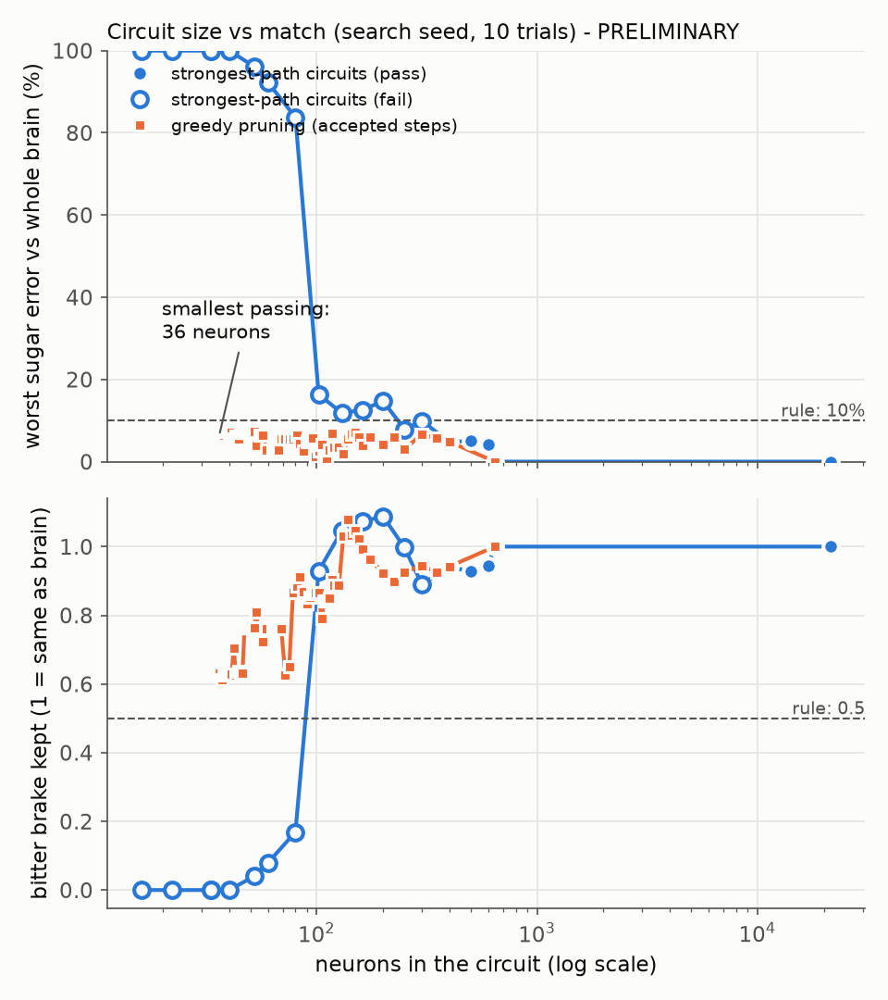
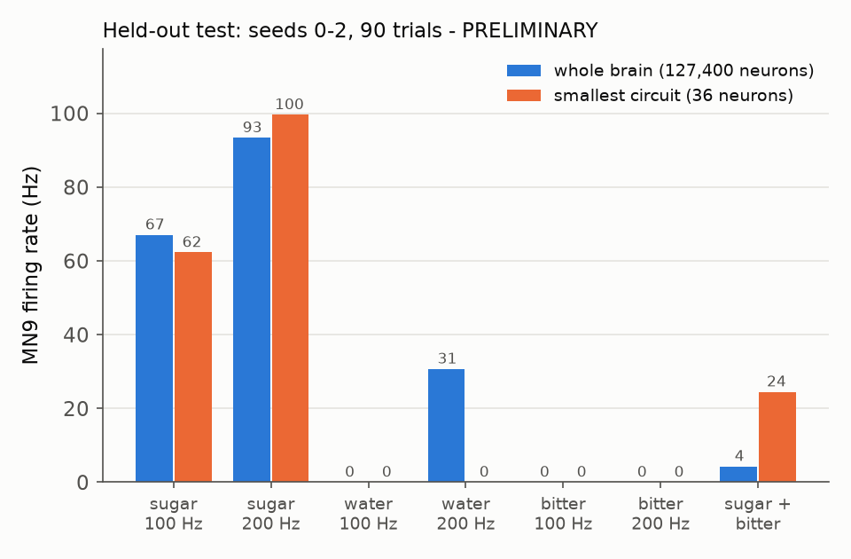

# The smallest fly circuit that still makes the feeding decision

*Started 2026-09-23. Every result in this document is **PRELIMINARY**.*

## The short answer

- **36 neurons are enough.** The smallest circuit that passes the rule has **36 neurons,
  110 connections and 6,463 synapses**. The whole brain has 127,400 neurons and 14.6
  million connections, so this is about 1 neuron in 3,500. The 36 are 9 sugar taste
  neurons, 3 bitter taste neurons, 23 relay neurons and MN9.
- **It passes on inputs it never saw.** On 3 new random seeds (30 trials each), MN9 stays
  within 5.3% to 7.9% of the whole brain at sugar 100 Hz and 200 Hz (the limit is 10%).
  Bitter alone gives 0 Hz. Bitter still brakes sugar, at 58% to 61% of the whole brain's
  brake (the rule needs 50%).
- **It fits the $17 RP2350 board easily.** It needs about **3.5 KB of the chip's 520 KB
  of memory**. By our estimate it uses about **7% of one of the chip's two 150 MHz
  cores** at the model's 0.1 ms time step, so it should run in real time with about
  14 times to spare. This is arithmetic, not a measurement on the chip.
- **But it is fragile.** Change every synapse's strength by 20% and the 36-neuron circuit
  no longer tracks the whole brain (at -20% it almost stops responding to sugar at
  100 Hz). It has also lost the water response, which the rule did not require.
  Storing weights in 8 bits just misses the rule (-10.3%); 16 bits pass.
- **A sturdier option: 400 neurons.** The 400-neuron circuit from the "strongest paths"
  step passes everything, including the +/-20% test and water. It needs about 108 KB of
  memory and, by our estimate, about 77% of one core, so it is borderline for real time
  on the RP2350 unless both cores or event-driven code are used.
- **It keeps most of the textbook pathway.** The 36 include 6 of the paper's 10 named
  sugar-pathway cell types (G2N-1, Zorro, FMIn, Roundup, Rattle, Clavicle), the
  strongest known route (sugar, then G2N-1, then Roundup, then MN9), and Scapula, the
  bitter-brake neuron. They drop Phantom, Usnea, Bract and Fdg.

*Figure 1. Each dot is a circuit run on its own. Top: the worse of the two sugar
errors (sugar 100 Hz and 200 Hz) against the whole brain. Bottom: how much of the
whole brain's bitter brake survives. Blue: circuits made by keeping only the strongest
taste-to-MN9 paths. Orange: the step-by-step pruning that followed. Dashed lines: the
pass limits. Scored on the search seed (10 trials); the final answer was re-checked on
3 new seeds (Figure 2).*

*Figure 2. MN9's firing rate in the whole brain (blue) and in the 36-neuron circuit
alone (orange), averaged over 3 new seeds x 30 trials. Sugar matches within 10%. Bitter
alone gives 0 in both. Water gives 0 in the circuit but 31 Hz in the whole brain at
200 Hz. With sugar and bitter together the circuit still fires 24 Hz, against 4 Hz in
the whole brain, so its brake is weaker (about 60% as strong).*

## 1. The pass rule (written down at 22:19 on 2026-09-23, before any search)

This rule is fixed. It was written before a single pruned circuit was run, and it was
not changed afterwards.

**Model.** The Shiu et al. 2024 whole-brain model on FlyWire snapshot 630, with the
`al_ln_literature` sign fix (`sim/sign_fixes.py`), run with the fast engine
(`sim/fast_engine.py`). The readout is the paper's MN9, root ID 720575940660219265.

**Stimuli.** Each trial lasts 1 second. The inputs are the paper's own taste neuron
lists (`sim/shiu_model.py`): 21 sugar, 18 water and 21 bitter gustatory receptor
neurons (GRNs), driven with random (Poisson) input.

| name | input |
|---|---|
| S100 | sugar GRNs at 100 Hz |
| S200 | sugar GRNs at 200 Hz |
| W100, W200 | water GRNs at 100 Hz, 200 Hz |
| B100, B200 | bitter GRNs at 100 Hz, 200 Hz |
| S100+B100 | sugar 100 Hz and bitter 100 Hz together |

**What "run on its own" means.** The circuit is built as a standalone network with
`FastBrain.from_arrays`: only its own neurons and the connections between them. The
stimulus drives whichever of the listed taste neurons the circuit still contains. The
whole brain is run with the same random seeds and the same number of trials.

**A circuit passes only if all four hold:**

1. **Sugar strength.** MN9's rate at S100 and at S200 are each within 10% of the whole
   brain's rate.
2. **Water is weaker than sugar.** MN9 at W100 is below MN9 at S100, and MN9 at W200 is
   below MN9 at S200.
3. **Bitter alone does not start feeding.** MN9 is 0 at B100 and at B200. (Allowed
   tolerance: below 0.5 Hz on average, that is, fewer than one stray spike per two
   trials.)
4. **The bitter brake works.** Adding bitter to sugar lowers MN9 by at least half as
   much as it does in the whole brain:
   (MN9 at S100 minus MN9 at S100+B100) in the circuit is at least 0.5 times the same
   drop in the whole brain.

**Final verdict.** The rule must hold on each of 3 held-out seeds (0, 1 and 2) with 30
trials each. None of these inputs is used during the search.

**Search settings (stricter, so the answer survives new inputs).** During the search,
candidates are scored on a separate seed (7, first 10 trials) against the whole brain on
the same 10 trials, with a tighter target: within 7.5% for sugar, zero MN9 spikes for
bitter alone, and at least 0.6 of the whole-brain brake. If the final circuit fails the
held-out check, the search steps back to the last larger circuit that passes.

**Known weakness of rule 2.** A circuit with no water neurons at all passes it
(water then gives MN9 = 0). We therefore also report, outside the rule, whether the
circuit still responds to water.

## 2. The whole brain's own numbers (measured first)

MN9's firing rate in Hz, whole brain, `al_ln_literature` model, 30 one-second trials per
cell (`results/reference.json`):

| input | seed 7 (search) | seed 0 | seed 1 | seed 2 | seed 0, weights -20% | seed 0, weights +20% |
|---|---|---|---|---|---|---|
| sugar 100 Hz | 68.7 | 67.6 | 67.3 | 66.2 | 36.6 | 79.7 |
| sugar 200 Hz | 93.7 | 92.9 | 93.3 | 93.8 | 82.4 | 100.1 |
| water 100 Hz | 0.0 | 0.0 | 0.0 | 0.0 | 0.0 | 13.4 |
| water 200 Hz | 31.3 | 31.0 | 30.8 | 30.3 | 0.0 | 61.6 |
| bitter 100 Hz | 0.0 | 0.0 | 0.0 | 0.0 | 0.0 | 0.0 |
| bitter 200 Hz | 0.0 | 0.0 | 0.0 | 0.0 | 0.0 | 0.0 |
| sugar 100 + bitter 100 | 4.8 | 4.4 | 3.6 | 4.9 | 0.5 | 13.8 |

These match the paper's headline numbers (about 67 Hz and 93 Hz). The whole-brain run
takes about 2.5 minutes per seed on this PC.

## 3. How the search worked, in plain English

1. **Start: every neuron that got any input.** Across the seven search-seed stimuli,
   643 neurons fired at least once (counting the taste neurons and MN9), and 21,461
   neurons received at least one input. We started from those 21,461 and the 2.57 million
   connections among them. Run on its own, this gives exactly the whole brain's MN9
   (0.00% error), which also checks that the circuit-building code is right.
2. **Drop neurons that never fire.** A neuron that never fires cannot affect anything.
   Keeping only the firing neurons that sit on some route from a taste neuron to MN9
   (642 of the 643) again gives exactly the whole brain's answer.
3. **Keep the strongest paths.** Each connection got a strength: how often the sending
   neuron fires times how many synapses it makes. Each neuron got a score: the strength
   of the weakest link on the best route from a taste neuron, through it, to MN9. We
   kept the top 600, 500, 400 and so on down to 15 (the blue line in Figure 1).
   400 was the smallest that passed the stricter search test.
4. **Remove neurons in blocks.** Starting from those 400, we tried removing blocks of
   neurons, weakest first, and kept each removal only if the circuit still passed. The
   blocks shrank from 100 neurons to 2. This got down to 53 neurons.
5. **Remove connections.** Throwing out every 1-synapse connection at once failed
   (sugar fell 20% short), so we removed connections in blocks, weakest first, down to
   blocks of 2.
6. **One at a time.** Finally we tried removing each remaining neuron, then each
   remaining connection, one at a time, and repeated that until a full round removed
   nothing (8 rounds). That point is a **local minimum**: no single neuron or
   connection can be taken out without failing.

After every accepted removal, any neuron that had lost all routes from the taste
neurons, or all routes to MN9, was dropped too (this cannot change MN9).

Every candidate was run as its own standalone network with `FastBrain.from_arrays`,
7 stimuli x 10 trials, on seed 7. In total 2,167 candidates were tested. The search
took about 24 minutes and the whole lane about 47 minutes of compute, inside the
90-minute budget, so nothing had to be cut.

## 4. Sizes along the way

Search seed, 10 trials. "Worst sugar error" is the larger of the two sugar errors.
"Brake" is 1 when bitter holds back sugar exactly as much as in the whole brain.
"Passes" is the stricter search test (7.5%).

| circuit | neurons | connections | synapses | worst sugar error | brake | water 200 Hz (whole brain 33) | passes |
|---|---|---|---|---|---|---|---|
| every neuron with any input | 21,461 | 2,569,571 | 12,517,427 | 0.0% | 1.00 | 33 | yes |
| only neurons that fire | 642 | 32,197 | 345,936 | 0.0% | 1.00 | 33 | yes |
| strongest paths, top 600 | 600 | 29,588 | 313,821 | 4.3% | 0.94 | 32 | yes |
| strongest paths, top 400 | 400 | 18,894 | 202,495 | 4.8% | 0.94 | 31 | yes |
| strongest paths, top 300 | 300 | 12,814 | 138,746 | 9.8% | 0.89 | 34 | no (over 7.5%) |
| strongest paths, top 200 | 200 | 6,297 | 82,363 | 14.7% | 1.09 | 17 | no |
| strongest paths, top 100 | 102 | 2,038 | 32,142 | 16.3% | 0.93 | 0 | no |
| strongest paths, top 80 | 80 | 1,252 | 23,610 | 84% | 0.17 | 0 | no |
| strongest paths, top 40 | 40 | 404 | 9,396 | 100% (MN9 silent) | 0 | 0 | no |
| block pruning | 249 | 8,119 | 90,102 | 3.0% | 0.93 | 29 | yes |
| block pruning | 120 | 2,477 | 32,904 | 3.6% | 0.89 | 0 | yes |
| block pruning | 69 | 982 | 17,222 | 5.5% | 0.76 | 0 | yes |
| connection pruning | 51 | 376 | 11,991 | 7.1% | 0.76 | 0 | yes |
| one-at-a-time, round 1 | 41 | 171 | 7,982 | 7.1% | 0.63 | 0 | yes |
| **final (local minimum)** | **36** | **110** | **6,463** | **6.1%** | **0.63** | **0** | **yes** |

What the curve says:

- **Picking neurons by "strongest path" alone stops working below about 250-400
  neurons.** At 80 neurons the bitter brake is gone, and at 40 MN9 goes silent.
- **Careful pruning goes about ten times further (to 36).** Removing neurons one block at
  a time, and checking each step, finds a much smaller circuit that still passes.
- **Water is the first thing lost.** It survives to about 250 neurons, is weak at 160,
  and is gone by 120 (the rule did not protect it).
- **The brake weakens as the circuit shrinks.** It falls from about 0.94 at 400 neurons
  to 0.63 at 36.

## 5. The 36-neuron circuit

Files: `experiments/minimal_circuit/results/minimal_circuit.json` (every neuron with its
labels and firing rates, and every connection with its signed synapse count).

- **Counts:** 36 neurons, 110 connections, 6,463 synapses. 106 connections excite and 4
  inhibit. The largest single connection has 561 synapses.
- **Inputs:** 9 of the 21 sugar taste neurons and 3 of the 21 bitter taste neurons. No
  water taste neurons.
- **Output:** MN9 (root ID 720575940660219265, FlyWire type CB0701).
- **The 23 relay neurons:**
  - Second-order taste neurons named in the paper: **G2N-1** (CB0616), **Zorro**
    (CB0192) and **FMIn** (CB0366), all on the stimulated side.
  - Pre-motor neurons named in the paper: **Roundup** (CB0553, both copies),
    **Rattle** (CB0499) and **Clavicle** (unlabelled type, root ID
    720575940655014049).
  - Neurons on our own strongest routes (docs/phase5-sugar-pathway.md): **Rounddown**
    (DNge080, both copies), **Roundtree** (CB0493), **Sternum** (CB0051) and
    **DNge062**.
  - Two brakes, the only inhibitory relay neurons: **Scapula** (CB0219, glutamate),
    which carries the bitter signal, and **DNge031** (GABA), which holds MN9 back in the
    whole brain too (silencing it raises MN9 by 38% there).
  - Others: CB0277, CB0824, CB0872, CB0393, CB0855, CB0177, DNge059 (both copies) and
    one unlabelled ascending neuron (720575940623210445).
- **Transmitters:** 21 of the 23 relay neurons use acetylcholine (excitatory in the
  model).

**Held-out check (the final verdict).** Seeds 0, 1 and 2, 30 trials each, against the
whole brain on the same trials (`results/validation.json`):

| seed | sugar 100 Hz: circuit vs brain | sugar 200 Hz | brake kept | water 200 Hz | bitter alone | passes |
|---|---|---|---|---|---|---|
| 0 | 63.7 vs 67.6 (-5.8%) | 100.1 vs 92.9 (+7.7%) | 0.61 | 0 vs 31.0 | 0 / 0 | yes |
| 1 | 62.1 vs 67.3 (-7.7%) | 100.0 vs 93.3 (+7.2%) | 0.58 | 0 vs 30.8 | 0 / 0 | yes |
| 2 | 61.0 vs 66.2 (-7.9%) | 98.8 vs 93.8 (+5.3%) | 0.61 | 0 vs 30.3 | 0 / 0 | yes |

The circuit passes on every seed, but with less room than the search suggested: errors
up to 7.9% against a 10% limit. It fires a little low at 100 Hz and a little high at
200 Hz, so its response curve is steeper than the whole brain's.

## 6. Robustness (PLAN.md Phase 6, steps 1 to 5)

1. **Seeds.** Passes on 3 new seeds (table above). **Weight +/-20%.** Fails. The whole
   brain and the circuit were both run with every synapse 20% weaker, then 20% stronger
   (seed 0, 30 trials):

   | | sugar 100 Hz: circuit vs brain | sugar 200 Hz | sugar + bitter |
   |---|---|---|---|
   | weights -20% | 0.3 vs 36.6 | 38.6 vs 82.4 | 0.1 vs 0.5 |
   | weights +20% | 120.2 vs 79.7 | 133.9 vs 100.1 | 79.8 vs 13.8 |

   The whole brain has many parallel routes that soften a change in strength. The
   36-neuron circuit has almost none left, so a 20% change swings it much further.
   We walked back along the search (every 5th accepted step, 76 circuits;
   `results/robustness_scan.csv`). Every circuit from 249 neurons down fails the
   +/-20% test. **The 400-neuron strongest-path circuit passes it** (errors under 3.5%,
   brake 0.93 to 1.00) and also passes the normal rule on all 3 new seeds, including
   water (30 to 32 Hz against 30 to 31 Hz). It is saved as `results/robust_circuit.json`.
   The true robust minimum lies somewhere between 249 and 400 neurons; the search did not
   look for it directly.
2. **Bug checks.** The 21,461-neuron and 642-neuron circuits reproduce the whole brain
   exactly (0.00% error), which checks the neuron ID mapping, the input order and the
   circuit builder. The path-scoring code was checked on a small hand-made network. MN9
   and the taste neuron lists are read straight from `sim/shiu_model.py`. None of the 36
   neurons is an antennal-lobe local neuron, so the `al_ln_literature` fix does not touch
   this circuit and the paper's original model would give the same result.
3. **Literature.** Section 8 compares the circuit with the named pathway. RP2350 specs
   were checked on the maker's page (section 7). We did not search for other published
   "minimal feeding circuit" studies.
4. **Fly biology.** Fdg, a feeding command neuron in real flies (Flood et al. 2013), is not
   needed here. That fits the model's known quirk that
   Roundup, not Fdg, is its bottleneck, which real-fly silencing contradicts
   (docs/phase5-sugar-pathway.md). So the 36-neuron circuit is **a reduction of this
   model**, not a claim that a real fly decides with 36 neurons.
5. **Write-up.** This document.

## 7. Does it fit the RP2350 microcontroller?

**Chip specs (checked 2026-09-23).** Two Arm Cortex-M33 cores at 150 MHz with hardware
single-precision floating point, and 520 KB of on-chip memory (SRAM)
([Raspberry Pi RP2350 page](https://www.raspberrypi.com/products/rp2350/)). The SparkFun
Pro Micro RP2350 adds 16 MB of flash and 8 MB of slower PSRAM, $16.95
([SparkFun](https://www.sparkfun.com/sparkfun-pro-micro-rp2350.html)).

**Memory for the 36-neuron circuit** (`results/hardware.json`):

| part | 16-bit weights | 8-bit weights |
|---|---|---|
| 110 connections (1-byte target number + weight) | 330 B | 220 B |
| where each neuron's connections start (37 x 2 bytes) | 74 B | 74 B |
| neuron state: voltage and input, 4 bytes each, plus a 1-byte refractory counter (36 x 9) | 324 B | 324 B |
| delay line: input waiting 1.8 ms = 18 steps, 19 slots x 36 neurons x 4 bytes | 2,736 B | 2,736 B |
| taste input list and random-number state | 88 B | 88 B |
| **total** | **3,552 B (3.5 KB, 0.7% of 520 KB)** | **3,442 B** |

**Weight precision.** The biggest connection has 561 synapses and 13 of 110 are above
127, so 8-bit numbers cannot hold the counts as they are. We tested three options
(seed 0, 30 trials):
- 16-bit (exact): passes (-5.8% / +7.7%).
- 8-bit, clipped at 127: fails badly (sugar 100 Hz gives 19.9 Hz instead of 67.6).
- 8-bit, rescaled so 561 becomes 127 (one step = 4.4 synapses; 4 small connections
  become 0): just fails (-10.3% at sugar 100 Hz).
Use 16-bit weights. They cost 110 extra bytes.

**Work per simulated second at 0.1 ms steps** (10,000 steps). Worst case is sugar at
200 Hz: 3,253 spikes, 11,943 synaptic events (one spike arriving at one target) and
1,800 input kicks (9 sugar neurons x 200 Hz).

- **Clock-driven** (update every neuron every step):
  - neuron updates: 36 x 10,000 = 360,000
  - random draws for the taste input: 12 x 10,000 = 120,000
  - synaptic events: 11,943
  - cycles, using our assumed costs (25 per neuron update, 12 per random draw, 10 per
    synaptic event): 360,000 x 25 + 120,000 x 12 + 11,943 x 10 = 9.0 M + 1.44 M + 0.12 M
    = **10.6 million cycles per simulated second**.
  - One core gives 150 million, so this is **about 7% of one core**, about 14 times
    faster than needed. Per 0.1 ms step: about 1,060 cycles used of 15,000 available.
- **Event-driven** (work only when an input or spike arrives): about 13,700 events per
  second x 35 cycles, plus 1,800 random draws x 12 = **0.5 million cycles per simulated
  second, about 0.3% of one core**.

**Verdict: yes, it fits and should run in real time with a wide margin.** The cycle costs
are our assumptions, not measured on the chip. As an outside check, a published test
ran 186 spiking neurons in real time on the same chip (Niedermeier and Krichmar,
arXiv 2604.16474, cited in docs/hybrid-roadmap.md; a different simulator and neuron
model). 36 neurons is well below that.

**The larger circuits, same arithmetic:**

| circuit | memory (16-bit) | clock-driven, share of one core | event-driven | verdict |
|---|---|---|---|---|
| 36 neurons (smallest passing) | 3.5 KB | 7% | 0.3% | fits easily |
| 400 neurons (passes +/-20%) | 108 KB | 77% | 20% | memory fits; real time is borderline on one core, likely fine on two or event-driven |
| 642 neurons (exact copy of the brain for these tests) | 181 KB | 119% | 26% | memory fits; needs both cores or event-driven code |
| whole brain | about 88 MB (14.6 M connections x 6 bytes) | far over | far over | no: 170 times the SRAM |

The 400- and 642-neuron figures sit above the published 186-neuron real-time result, so
treat them as uncertain until measured. On this PC the fast engine runs the 36-neuron
circuit about 110 times faster than real time (9 ms per simulated second).

## 8. Compared with the hand-drawn sugar pathway

From docs/phase5-sugar-pathway.md and the paper (`results/pathway_comparison.json`):

| named cell type | role in the paper | copies in the brain | in the 36-neuron circuit |
|---|---|---|---|
| G2N-1 | second-order taste neuron | 2 | 1 |
| Zorro | second-order taste neuron | 2 | 1 |
| FMIn | second-order taste neuron | 2 | 1 |
| Phantom | second-order (inhibitory) | 2 | 0 |
| Usnea | second-order taste neuron | 2 | 0 |
| Roundup | pre-motor | 2 | 2 |
| Rattle | pre-motor | 2 | 1 |
| Clavicle | pre-motor | 2 | 1 |
| Bract | pre-motor | 4 | 0 |
| Fdg | feeding command neuron | 2 | 0 |
| Scapula (bitter brake, Phase 5) | bitter to sugar-pathway inhibition | 1 studied | 1 |

- **6 of the paper's 10 named types are kept.** The 4 dropped types (Phantom, Usnea,
  Bract, Fdg) were also absent from the model's 20 strongest sugar-to-MN9 routes in
  Phase 5.
- **The strongest route survives intact:** sugar neurons, then G2N-1, then Roundup, then
  MN9. Of the 20 strongest all-excitatory routes found in Phase 5, 6 are fully intact
  (every neuron and every link kept), and 12 of the 17 neurons on those routes are kept.
- **The circuit adds cells the hand-drawn pathway does not name,** such as DNge059,
  CB0277 and CB0872. Phase 5 had already flagged CB0277 as one of the three neurons that
  matter most at weak sugar.

## 9. What this means for the hybrid computer

- **Stage 2 can start.** The roadmap's test was "about 1,000 neurons or fewer". Both
  candidates qualify: 36 neurons (minimal) and 400 neurons (robust).
- **Suggested order.** Port the 36-neuron circuit first: it is small enough to check by
  hand, and every spike can be compared with the simulator. Then port the 400-neuron
  circuit as the real "core", because it survives weight changes and keeps water.
- **Before buying anything, test in software** the two things this lane did not:
  single-precision (32-bit) arithmetic instead of the engine's 64-bit, and a
  fixed-point version. The 8-bit result shows the small circuit is sensitive to
  rounding.

## 10. Limits (read before quoting)

- **PRELIMINARY.** One search, one removal order, one search seed. A different order
  could find a different or smaller circuit; 36 is a local minimum, not proven
  smallest.
- **The margins are thin.** Held-out errors reach 7.9% against a 10% limit, and the
  brake is about 60% of the whole brain's. With sugar and bitter together the circuit
  still fires about 24 Hz, where the whole brain gives about 4 Hz.
- **The 36-neuron circuit fails the +/-20% weight test** and has lost the water response.
  Neither was part of the pre-set rule. The 400-neuron circuit has neither problem.
- **Hardware numbers are arithmetic.** Cycle costs are assumed. Nothing ran on a chip,
  and the model was not tested in 32-bit arithmetic.
- **It is a reduction of the model, not of the fly.** Real-fly checks (for example Fdg
  and Roundup silencing) disagree with the model in places.
- **Not done:** a search that includes the +/-20% test in the rule (it would land
  between 249 and 400 neurons), a search that keeps water, and more than one removal
  order.

## Files

All in `experiments/minimal_circuit/`:

- `common.py`: the stimuli, the pass rule, RAM check, shared helpers.
- `reference.py`: the whole-brain runs (section 2). Log: `results/raw/reference.log`.
- `circuit.py`: builds a standalone circuit, path scores, the lossless clean-up step.
- `search.py`, then `refine.py`: the search (sections 3 and 4). Logs in `results/raw/`.
- `validate.py`: held-out seeds and +/-20% for the final circuit (sections 5 and 6).
- `robust_scan.py`: +/-20% along the search path (section 6).
- `hardware.py`: memory, operations and 8-bit tests (section 7).
- `compare_pathway.py`: named-cell comparison (section 8).
- `make_figures.py`: Figures 1 and 2.
- `results/`: `reference.json`, `search_log.csv` (every candidate), `checkpoints.json`
  (every accepted circuit), `search_summary.json`, `validation.json`,
  `minimal_circuit.json`, `robustness_scan.csv`, `robust_circuit.json`, `hardware.json`,
  `hardware_robust.json`, `pathway_comparison.json`.
- `results/raw/`: whole-brain spike counts and MN9 per trial, the 21,461-neuron start
  wiring, logs, and the 642-neuron hardware numbers.
- `log-entry.md`: the entry for EXPERIMENTS.md.

To re-run: `reference.py`, `search.py 45`, `refine.py 15`, `validate.py`,
`robust_scan.py`, `hardware.py`, `hardware.py robust_circuit.json hardware_robust.json`,
`compare_pathway.py`, `make_figures.py` (each from `experiments/minimal_circuit/`, with
`.venv\Scripts\python.exe`).
