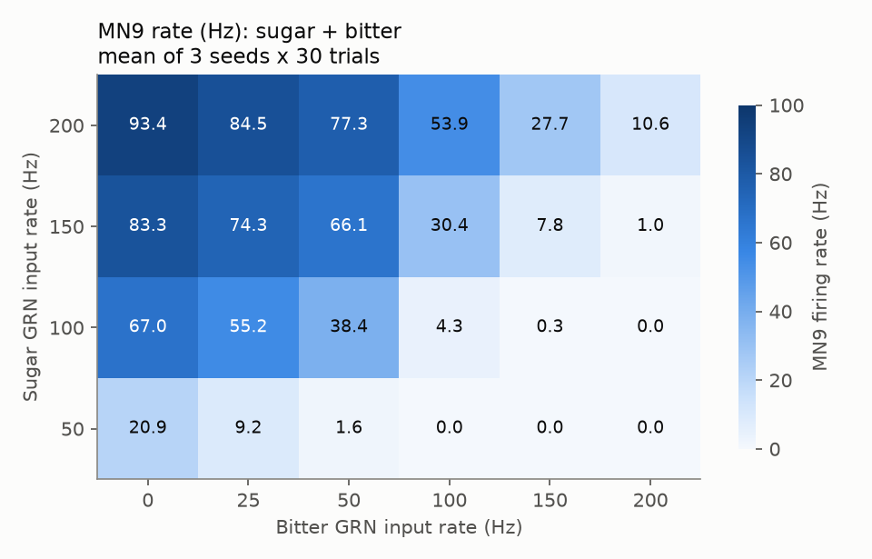
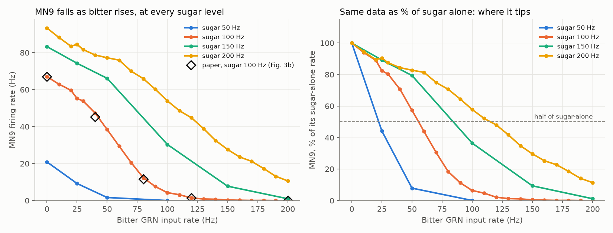
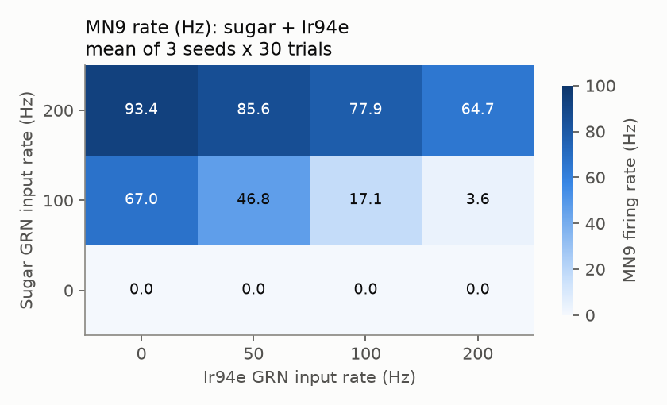
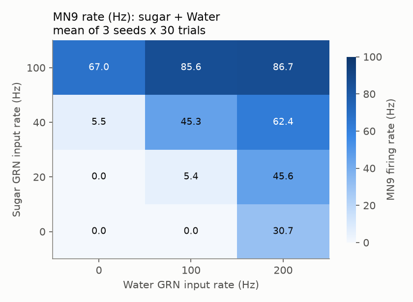
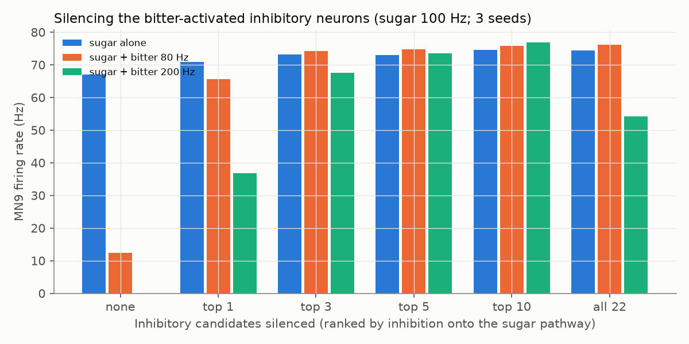

# Phase 5: competition between tastes

Prepared 2026-09-22. Model: the Shiu et al. 2024 whole-brain model, FlyWire snapshot 630,
run with our fast engine (`sim/fast_engine.py`). Every number below comes from our own runs,
saved under `experiments/phase5/competition/results/`. Labels: **VALIDATED** = re-run with 3
seeds, checked for bugs, compared with the paper and with fly biology. **PRELIMINARY** = at
least one of those checks is missing. **UNVERIFIED** = not checked against a source.

---

## 1. The short version

- **The paper's result reproduces.** Sugar taste neurons alone drive the feeding motor
  neuron MN9 to about 67 Hz. Adding bitter taste neurons pushes it down to 1.4 Hz, the same
  numbers as the paper within 2.5 Hz at every test point. **VALIDATED.**
- **The trade-off is steep but not all-or-nothing.** MN9 does not fall in a straight line as
  bitter goes up, and it does not flip like a light switch either. It follows an S-shaped
  curve. Going from "10% suppressed" to "90% suppressed" takes roughly a 3.3- to 4.6-fold
  increase in bitter input.
- **The tipping point sits where bitter input reaches about half the sugar input.** MN9
  drops to half its sugar-only rate when the bitter rate is about 0.47 to 0.56 times the
  sugar rate. This holds at all four sugar levels tested (50, 100, 150 and 200 Hz).
  Stronger sugar therefore needs proportionally stronger bitter to be overruled.
  **PRELIMINARY** (3 seeds, not yet compared with real fly behaviour curves).
- **In the model, one neuron carries most of the bitter "brake".** A glutamate (inhibitory)
  neuron labelled `CB0219` (root ID 720575940624600840, labelled left, on the same side as
  the stimulated taste neurons) gets 247 synapses straight from the bitter taste neurons.
  It then inhibits the sugar pathway's middle-stage neurons. Silencing just this neuron
  brings MN9 back from 12 Hz to 66 Hz (98% recovery) with sugar 100 Hz + bitter 80 Hz.
  **PRELIMINARY and surprising.** The Phase 6 checks we ran are in sections 7 and 9.

---

## 2. What we did

- **Inputs.** Each "condition" drives two groups of taste neurons (gustatory receptor
  neurons, GRNs) at chosen rates. The groups are the 21 sugar GRNs and one second group:
  21 bitter, 18 Ir94e or 18 water GRNs. All IDs are the paper's own lists, read straight
  from `sim/shiu_model.py`.
- **Readout.** MN9 (root ID 720575940660219265), the paper's proboscis motor neuron.
- **Trials.** 30 one-second trials per condition, each with different random input.
  Main grid: 3 random seeds (0, 1, 2), so 90 trials per point.
- **Grids.**
  - Sugar {50, 100, 150, 200} Hz x bitter {0, 25, 50, 100, 150, 200} Hz, plus the paper's
    bitter points 40, 80 and 120 Hz at sugar 100 Hz. 3 seeds.
  - Fine sweep for the tipping point: sugar 100 and 200 Hz x bitter 0 to 200 Hz in 10 Hz
    steps. 1 seed.
  - Smaller grids: sugar {0, 100, 200} x Ir94e {0, 50, 100, 200}, and sugar
    {0, 20, 40, 100} x water {0, 100, 200}. 3 seeds.
- **Scripts.** `experiments/phase5/competition/run_grid.py` runs the simulations,
  `analyze_competition.py` makes the tables and plots, and `suppressors.py` and
  `suppressor_robustness.py` search for the brake neurons.
  `job_server.py` builds the brain once and runs every script in the same process.

## 3. Check against the paper first

Seed 0, 30 trials, compared with the paper's Fig. 3b, 3c and 4e (numbers from
`docs/reference-notes.md`, section 4.3):

| Condition | Ours (Hz) | Paper (Hz) |
|---|---|---|
| Sugar 100 alone | 67.6 | 67.0 |
| Sugar 100 + bitter 40 | 47.7 | 45.3 |
| Sugar 100 + bitter 80 | 13.4 | 11.7 |
| Sugar 100 + bitter 120 | 1.4 | 1.5 |
| Sugar 100 + bitter 200 | 0.0 | 0.0 |
| Sugar 200 alone | 92.9 | 94.9 |
| Sugar 200 + bitter 200 | 10.7 | 11.2 |
| Bitter 200 alone | 0.0 | 0.0 |
| Sugar 100 + Ir94e 200 | 4.1 | 2.5 |
| Sugar 200 + Ir94e 200 | 65.0 | 64.3 |
| Sugar 40 alone | 6.1 | 6.3 |
| Sugar 40 + water 200 | 61.8 | 61.2 |
| Water 200 alone | 31.0 | 30.9 |

Every point matches in direction and lies within 2.5 Hz of the paper. The paper's numbers
also come from random input, so small differences are expected.

## 4. The sugar x bitter map

Each box is MN9's firing rate, averaged over 3 seeds x 30 trials. Darker means faster.
Across seeds the averages differ by at most about 1 Hz, so the pattern is stable.
The file is `results/bitter_summary.csv`.

Left panel: the same numbers as lines. The black diamonds are the paper's points, and they
sit on our sugar 100 Hz line. Right panel: each line divided by its own sugar-only rate, so
0% means fully suppressed.

## 5. Gradual trade-off or sharp switch?

We fitted a smooth S-shaped curve (a "Hill curve") to MN9 versus bitter rate at each sugar
level. Its two numbers answer the question directly:

- **b50** is the bitter rate that halves MN9. This is the tipping point.
- **n** measures steepness. An n near 1 is a gentle trade-off. An n of 4 or more behaves
  like a switch.

| Sugar rate | MN9 with sugar alone | b50, the tipping point | b50 / sugar rate | n, the steepness | 10%-to-90% span |
|---|---|---|---|---|---|
| 50 Hz | 20.9 Hz | 23 Hz | 0.47 | 3.3 | 3.9x |
| 100 Hz | 63 Hz (fit) / 67.0 (measured) | 54 +/- 2 Hz | 0.54 | 3.7 | 3.3x |
| 150 Hz | 79 Hz (fit) / 83.3 (measured) | 83 +/- 6 Hz | 0.56 | 3.4 | 3.7x |
| 200 Hz | 89 Hz (fit) / 93.4 (measured) | 112 +/- 7 Hz | 0.56 | 2.9 | 4.6x |

(3-seed grid; file `results/bitter_hill_fits.csv`. The fit slightly under-estimates the
sugar-alone rate because the curve bends a little at low bitter.)

**In plain English:** the suppression is **steep but graded.** Over roughly a 4-fold range
of bitter strength, MN9 goes from almost untouched to almost silent. Outside that range,
bitter either barely matters or wins completely. The tipping point **moves with sugar**:
bitter has to reach about half the sugar rate. So the model compares the two inputs by
their **ratio** rather than using one fixed bitter threshold.

**Fine sweep (bitter in 10 Hz steps, seed 0).** The finer sweep gives the same answer:

- **Sugar 100 Hz:** b50 = 56 +/- 1 Hz, n = 3.8. MN9 falls from 67.6 Hz (no bitter) to 47.7
  (40 Hz bitter), 13.4 (80 Hz), 4.4 (100 Hz) and 1.4 Hz (120 Hz). Most of the drop happens
  between 40 and 90 Hz of bitter.
- **Sugar 200 Hz:** b50 = 119 +/- 2 Hz, n = 3.1. The drop is spread more evenly:
  78.0 Hz at 50 Hz bitter, 53.6 at 100 Hz, 28.8 at 150 Hz and 10.7 at 200 Hz.

So the curve is **somewhat gentler at high sugar** (n about 3 instead of about 4). No
sudden jump appears anywhere: two neighbouring 10 Hz steps never differ by more than
about 10 Hz of MN9 firing. (`results/grid.csv`, rows with `seed` 0 and sugar 100 or 200;
the fits are in `results/bitter_hill_fits.csv`, source "fine sweep".)

## 6. Sugar + Ir94e and sugar + water

**Ir94e** (another aversive taste class; 3 seeds x 30 trials; `results/ir94e_summary.csv`):

- **With sugar at 100 Hz, Ir94e suppresses MN9 much like bitter, only somewhat weaker.**
  MN9 goes 67.0 -> 46.8 -> 17.1 -> 3.6 Hz at Ir94e 0 / 50 / 100 / 200 Hz. The tipping
  point is b50 = 68 Hz (bitter: 54 Hz), with steepness n = 2.7.
- **Strong sugar (200 Hz) shrugs Ir94e off.** Even Ir94e at 200 Hz only takes MN9 from
  93.4 to 64.7 Hz, which is 69% of the sugar-alone rate. Bitter at the same strength
  takes it to 10.6 Hz. This matches the paper: Ir94e inhibits but does **not** abolish
  strong sugar (Fig. 3c: 64.3 Hz). The Hill fit at sugar 200 is not meaningful (b50
  would lie far beyond the tested range), so we do not quote it.
- Ir94e alone never drives MN9 (0 Hz at every rate).

**Water** (3 seeds x 30 trials; `results/water_summary.csv`):

- **Water and sugar add up, and more than add up.**
  - Sugar 40 Hz alone gives 5.5 Hz. Water 100 Hz alone gives 0 Hz. Together they give
    45.3 Hz.
  - Sugar 20 Hz (0 Hz alone) plus water 200 Hz (30.7 Hz alone) gives 45.6 Hz.

  So two sub-threshold inputs combine into a strong response ("synergy"). This matches
  the paper's Fig. 4e point (sugar 40 + water 200: ours 62.4 Hz, paper 61.2 Hz).
- **At strong sugar the effect saturates.** Sugar 100 Hz gives 67.0 Hz alone and 85.6 to
  86.7 Hz with water.
- Biology: sugar and water GRNs share much of their downstream feeding circuit in the
  paper (Fig. 3f; 250 shared neurons). A thirsty or hungry fly extends its proboscis to
  either. Seed-to-seed spread in both grids is 1.7 Hz or less.

## 7. Which neurons carry the bitter suppression?

**How we searched.** In this model, only inhibitory neurons can push a neuron's voltage
down. The model counts GABA and glutamate as inhibitory, which is the paper's stated
assumption. So bitter must act through inhibitory neurons that bitter switches on. We
listed every inhibitory neuron that met two conditions with sugar 100 Hz + bitter 80 Hz:
it fires at least 2 Hz, and at least 2 Hz faster than with sugar alone. There were
22 such neurons. We ranked them by firing rate x the number of their synapses onto
neurons that are active in the sugar pathway. File: `results/suppressor_candidates.csv`.

**Top candidates** (rates with sugar alone -> sugar + bitter 80 Hz):

| Rank | Root ID | Label (630) | Transmitter | Side | Rate | Synapses onto the sugar pathway |
|---|---|---|---|---|---|---|
| 1 | 720575940624600840 | CB0219 | glutamate | left | 7.4 -> 62.6 Hz | 1,643 |
| 2 | 720575940620062288 | CB0219 | glutamate | right | 3.4 -> 30.2 Hz | 1,251 |
| 3 | 720575940633674135 | CB0408 | GABA | right | 35.4 -> 37.9 Hz | 626 |
| 4 | 720575940621771041 | CB0438 | GABA | left | 4.7 -> 12.2 Hz | 1,646 |
| 5 | 720575940610690372 | CB0812 | glutamate | left | 0 -> 11.1 Hz | 1,080 |

**The causal test: silence them and see whether MN9 comes back.** "Recovery" = how much of
the lost MN9 firing returns (0% = still suppressed, 100% = back to sugar-alone).

| Silenced | Sugar alone | Sugar + bitter 80 | Recovery | Sugar + bitter 200 | Recovery |
|---|---|---|---|---|---|
| nothing | 67.0 Hz | 12.4 Hz | 0% | 0.0 Hz | 0% |
| CB0219 left only | 70.9 Hz | 65.7 Hz | **98%** | 36.8 Hz | 55% |
| top 3 | 73.1 Hz | 74.2 Hz | 113% | 67.6 Hz | 101% |
| top 5 | 73.1 Hz | 74.7 Hz | 114% | 73.5 Hz | 110% |
| top 10 | 74.5 Hz | 75.9 Hz | 116% | 76.8 Hz | 115% |
| all 22 | 74.3 Hz | 76.2 Hz | 117% | 54.2 Hz | 81% |

(Mean of seeds 0, 1 and 2. The spread between seeds is at most 1.8 Hz. File:
`results/suppressor_recovery.csv`.) Silencing each of the other top-15 candidates one at a
time gave at most 10% recovery. The right-side CB0219 alone gave 9%.

**How the brake is wired** (from the connection list):
bitter GRNs -> CB0219-left (247 synapses; it gets none from the sugar GRNs) -> inhibits
five excitatory cells in the sugar pathway's middle stage. These are CB0393, CB0493, two
CB0762 cells and the descending-type DNge080. Together they get about 640 inhibitory
synapses from CB0219. With sugar alone they fire 31 to 63 Hz. With bitter added they fall
to 1 to 21 Hz. CB0219 makes **no** synapses onto MN9 itself. So the brake acts one step
upstream of the motor neuron. Researchers call this pattern "feed-forward inhibition".

Two side notes. First, silencing these neurons also raises MN9 a little with sugar alone
(67 -> 71 to 74 Hz), because CB0219 fires 7 Hz even without bitter. Second, silencing all
22 works *less* well at bitter 200 Hz than silencing the top 10. Some of the 22 must
inhibit other inhibitors, so removing them lets the remaining brakes work harder.

## 8. How this compares with real flies and the literature

- **Direction matches biology.** Real flies extend the proboscis less when bitter
  compounds are mixed into sugar, and the paper confirmed its bitter prediction
  experimentally (Shiu et al. 2024, Fig. 3).
- **A graded, dose-dependent suppression** fits the general picture of sugar-bitter
  mixture experiments. Background knowledge, not re-read: we did not find a published
  dose-response surface to compare the shape or the tipping ratio against, so that part is
  **UNVERIFIED**.
- **Mechanism: real flies have at least two more brakes that the model lacks.**
  1. *Presynaptic gain control.* Bitter recruits GABA neurons that act through GABA_B
     receptors on the sugar GRN terminals and turn down sugar GRN output
     (Chu et al. 2014, *Current Biology*, doi:10.1016/j.cub.2014.07.020).
     The model has no GABA_B receptors and no presynaptic inhibition. Its stimulated GRNs
     are driven so hard that inhibition onto them has almost no effect.
  2. *Peripheral suppression.* Bitter chemicals also inhibit sugar GRNs directly at the
     sensillum (French et al. 2015, *J. Neurosci.* 35:9542). The model cannot represent
     this because we stimulate neurons, not chemicals.

  So the model routes **all** of the suppression through central feed-forward
  inhibition, and in this wiring one neuron dominates it. Real flies probably spread the
  job across several mechanisms.
- **Is CB0219 a known neuron?** A quick web search found no published name or
  experiment for FlyWire type `CB0219`. Bohra et al. 2018 (*Current Biology*) describe a
  single pair of bitter-responsive SEZ interneurons. Whether that pair and CB0219 are
  the same cells is **UNVERIFIED**.

## 9. Validation status (PLAN.md Phase 6 checklist)

| Result | 3 seeds | Bug checks | Literature | Biology | Status |
|---|---|---|---|---|---|
| Sugar + bitter reproduces the paper | yes | IDs = paper's lists; int64 IDs; same engine that matches Brian2 | matches Shiu 2024 | matches | **VALIDATED** |
| Ir94e suppresses weaker sugar but not strong sugar | yes | as above | matches Shiu 2024 Fig. 3c | the paper reports Ir94e as feeding-inhibitory (background, not re-read) | **VALIDATED** |
| Sugar + water combine synergistically | yes | as above | matches Shiu 2024 Fig. 4e point | plausible | **VALIDATED** (direction); the full grid shape is **PRELIMINARY** |
| Steep, ratio-based tipping point (b50 about half the sugar rate, n about 3 to 4) | yes | fit checked against raw points | no dose-response surface found | plausible | **PRELIMINARY** |
| CB0219-left carries most of the suppression | yes (98 +/- 0.5% recovery) | sign = glutamate as inhibitory (confidence 0.68); holds at w_syn 80-120% (table below) | no published match found | real flies also use presynaptic and peripheral mechanisms | **PRELIMINARY / surprising** |

**Robustness of the CB0219 result to synapse strength** (sugar 100 Hz + bitter 80 Hz, 3 seeds
x 30 trials, `results/suppressor_robustness.csv`):

| w_syn | Sugar alone | + bitter 80 | + bitter 80, CB0219-left silenced | Recovery | CB0219-right silenced | Both silenced |
|---|---|---|---|---|---|---|
| 80% | 35.4 Hz | 1.4 Hz | 26.7 Hz | 74% | 1.6 Hz | 35.8 Hz |
| 100% | 67.0 Hz | 12.4 Hz | 65.7 Hz | 98% | 17.8 Hz | 72.3 Hz |
| 120% | 78.1 Hz | 27.5 Hz | 79.0 Hz | 102% | 40.7 Hz | 89.2 Hz |

The left CB0219 stays the dominant brake at all three synapse strengths. Silencing both
CB0219 cells always gives full recovery.

**Caveat on the transmitter.** The model calls CB0219 inhibitory only because its predicted
transmitter is glutamate. The prediction has confidence 0.68 to 0.73. Glutamate inhibits at
many fly central synapses through GluCl channels, but not at all of them. The paper itself
notes that making glutamate excitatory abolishes the bitter and Ir94e inhibition. That fits
our finding, because the key brake neuron is glutamatergic. Before anyone treats CB0219 as a
real "bitter brake", it needs an experiment: silencing it in a real fly should weaken bitter
suppression of feeding. Step 6 of Phase 6 (contacting anyone) is the owner's call.

## 10. Files

- `experiments/phase5/competition/results/grid.csv`: one row per condition x seed, with
  every trial's MN9 rate.
- `results/bitter_summary.csv`, `bitter_hill_fits.csv`, `ir94e_summary.csv`,
  `ir94e_hill_fits.csv`, `water_summary.csv`
- `results/suppressor_candidates.csv`, `suppressor_silencing.csv`,
  `suppressor_recovery.csv`, `suppressor_robustness.csv`
- Plots: `heatmap_sugar_bitter.png`, `curves_sugar_bitter.png`, `heatmap_sugar_ir94e.png`,
  `heatmap_sugar_water.png`, `suppressor_silencing.png`
