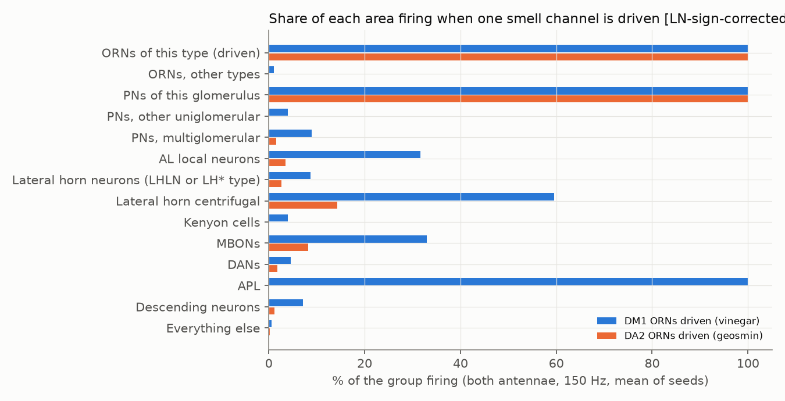
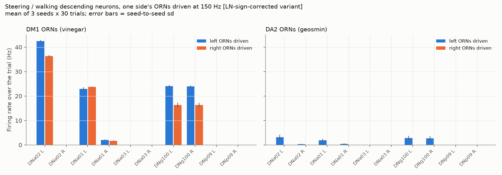
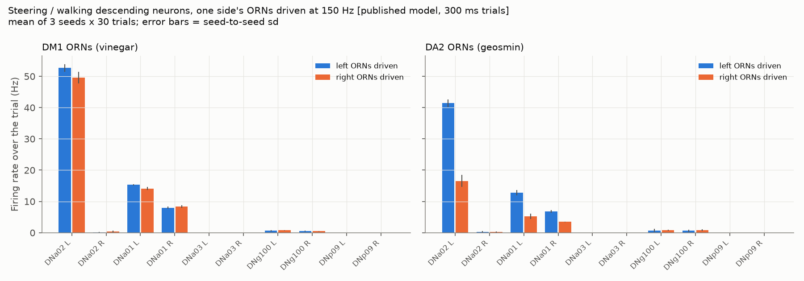

# Phase 5: an unexplored area, smell (olfaction)

Prepared 2026-09-22. Model: the Shiu et al. 2024 whole-brain model, FlyWire snapshot 630,
run with our fast engine. The paper did not study smell, and Phases 8 (learning) and 9 (body)
both depend on it. All numbers come from our own runs, saved in
`experiments/phase5/unexplored/results/`. Labels: **VALIDATED**, **PRELIMINARY** and
**UNVERIFIED**, as in `docs/phase5-competition.md`.

---

## 1. The short version

1. **As published, the model's smell system catches fire.** If just 3 of the 68 DM1 smell
   neurons fire a single spike each, about 8,200 neurons switch on. They keep firing on
   their own for the whole second with no further input: the antennal lobe, most
   projection neurons, 65% of all Kenyon cells, the lateral horn and more. Two spikes
   are not enough; three are. Real fly smell circuits do not behave like this.
   **The effect is real in the model and survives every check we ran (section 3).
   It is almost certainly a model artifact, not biology.**
2. **We found the cause: a transmitter guess.** The runaway needs 53 antennal-lobe local
   neurons (LNs). The model treats them as excitatory only because a machine-learning
   prediction guessed "serotonin" or "dopamine" for them, with low confidence (0.29 to
   0.53). They are lLN1 and lLN2T-type LNs, which the literature describes as GABAergic,
   i.e. inhibitory. Silencing those 53 stops the runaway completely. So does making
   them inhibitory, and that change leaves the sugar -> MN9 result exactly unchanged.
   **PRELIMINARY** (the GABA identity of these types is background knowledge; we did not
   re-read the primary papers in this pass).
3. **With those 53 LNs made inhibitory, smell looks realistic.** DM1 (vinegar) input then
   activates its own projection neurons strongly and only about 4% of Kenyon cells. That
   matches the sparse coding measured in real flies. It also reaches a third of the
   mushroom-body output neurons, the lateral horn, and about 90 descending neurons.
   DA2 (geosmin) input stays mostly in the lateral horn. **PRELIMINARY** (an exploratory
   variant, not the project's model).
4. **The big Phase 9 risk is real: the left/right signal is wrong-shaped.** With the fixed
   variant, driving *left* DM1 neurons or *right* DM1 neurons both make the **left** DNa02
   fire (42 vs 36 Hz). The right DNa02 stays silent either way. The side of the smell
   changes the steering neurons by only about 15%, while a fixed wiring bias sets which
   side wins. A simple "left DNa02 minus right DNa02" steering rule would therefore always
   turn the same way.
   In the published model (no fix) it is worse. Once the smell system catches fire, left-only
   and right-only DM1 smell give the same output: only 2 of 169 active descending neurons
   differ consistently, by at most 3 Hz. The left DNa02 still dominates (about 50 Hz,
   versus 0 on the right). **PRELIMINARY / surprising** (3 seeds x 30 trials; section 5).

---

## 2. What we did

- **Smell channels.** DM1 ORNs (olfactory receptor neurons; Or42b; fruity esters and
  vinegar, attractive) and DA2 ORNs (Or56a; geosmin, the smell of harmful mould,
  aversive). Background knowledge, not re-read: Semmelhack & Wang 2009 for DM1 and
  vinegar, Stensmyr et al. 2012 for DA2 and geosmin.
- **Checking the cell-type filters on the 630 labels.** The Phase 8 research doc's filter
  (`cell_type == "ORN_DM1"`) finds **nothing** in snapshot 630. In the 630 label file the
  ORN type sits in the `hemibrain_type` column instead, so the filter we used is
  `super_class == sensory`, `cell_class == olfactory`, `hemibrain_type == ORN_DM1`.
  - `ORN_DM1`: 68 neurons (35 labelled left, 33 right).
  - `ORN_DA2`: 39 neurons (16 left, 22 right, 1 unlabelled).
  - Projection neurons (`cell_class == ALPN`): 685. Only 2 carry a DM1 label
    (`DM1_lPN`, one per side) and 11 a DA2 label.
  - Kenyon cells: 5,177. MBONs: 97. DANs: 326. Counts match the Phase 8 doc to within a few.
- **Steering neurons** from `docs/phase9-body-research.md`, converted to 630 IDs in
  `experiments/phase5/unexplored/steering_ids.py`. DNa02 and DNp09 have the same IDs in
  630. The left DNa01, the left DNg100 (called `DNge162` in the 630 labels) and one DNb08
  were matched **by label**, not by wiring fingerprint.
- **Stimulation.** All ORNs of a type, then only the left ones, then only the right ones,
  at 150 Hz (the model's default input rate). 30 trials per run, seeds 0, 1 and 2.
  Trials are 1 s long for the LN-fix variant and 300 ms for the published model (see
  section 5b). We saved every descending neuron's rate in every trial, plus the spikes of
  descending neurons and PNs in 10 ms bins over the first 100 ms.
- **Scripts** (all in `experiments/phase5/unexplored/`): `run_olfaction.py` (simulations),
  `analyze_olfaction.py` (tables and plots), `olf_ignition.py`,
  `phase6_ignition_check.py` and `phase6_ignition_lesions.py` (the runaway checks),
  `al_wiring.py` and `olf_paths.py` (wiring only).

## 3. Finding 1: in the published model, smell input starts a self-sustaining fire

| Test (`results/ignition_summary.csv`, `phase6_ignition_check.csv`) | Neurons that fired | Still firing in the last 100 ms |
|---|---|---|
| 1 DM1 ORN fires once | 1 | 0 |
| 2 DM1 ORNs fire once | 2 | 0 |
| **3 DM1 ORNs fire once** | **8,154** | **7,664** |
| 10 DM1 ORNs fire once | 8,177 | 7,713 |
| DM1 ORNs at 1 Hz / 2 Hz / 150 Hz | 8,283 / 8,276 / 8,272 | about 7,800 in each case |
| 10 DA2 ORNs fire once | 10 | 0 |
| DA2 ORNs at 150 Hz, both sides (300 ms trials, `runs.csv`) | 8,472 | runaway, like DM1 |
| **Control:** all 21 sugar GRNs fire once | 32 | 0 |
| **Control:** sugar GRNs at 100 Hz for 1 s | 353 | 285, but only while the input lasts |

Within 50 ms the whole smell system is running flat out, and it stays there. The steady
state looks the same whether the input was one tiny volley or strong continuous
stimulation. So once the system is "on", it no longer carries any information about the
odor.

**Phase 6 checks we ran on it:**

1. **Seeds and parameters.** The runaway appears with seeds 0, 1 and 2, and with the
   synapse strength `w_syn` at 80%, 90%, 110% and 120% of the paper's value. The number
   of neurons that fire is 6,374 / 7,303 / 8,923 / 9,706 respectively; it always
   self-sustains.
2. **Bug check: is it our fast engine?** No. We wrote a second, deliberately simple
   simulator from scratch (`simple_sim` in `phase6_ignition_check.py`: the textbook
   solution of the model's two equations, a plain sparse-matrix loop and a delay
   buffer). It shows the same runaway: 8,031 neurons, 7,488 still firing at the end,
   versus 8,177 / 7,713 in the fast engine. It also agrees on the sugar control
   (32 neurons, dies out).
3. **Bug check: IDs, signs, indexing.** The ORN IDs come from the label table in the
   same row order as the brain (asserted in code). The sign used is the reference file's
   own sign. The cause turned out to be a sign issue in the data (next section), not in
   our code.
4. **Literature and biology.** Real antennal lobes keep odors separate: a DM1 odor
   drives DM1 projection neurons strongly and most other glomeruli weakly or not at
   all. Only about 5-10% of Kenyon cells respond to any one odor, because the
   inhibitory APL neuron keeps them sparse. Background knowledge, not re-read:
   Turner et al. 2008; Honegger et al. 2011; Lin et al. 2014. A model where 3 spikes
   ignite 65% of Kenyon cells contradicts all of this, so per PLAN.md we suspect the
   model first.

**What causes it** (`results/phase6_ignition_lesions.csv`; a 10-ORN DM1 volley each time):

| Silenced (output set to zero) | How many | Neurons that fired | Still firing at the end |
|---|---|---|---|
| nothing | 0 | 8,177 | 7,713 |
| **LNs predicted serotonin or dopamine** (model treats them as excitatory) | 53 | **26** | **0** |
| all LNs the model treats as excitatory | 150 | 26 | 0 |
| LNs predicted GABA or glutamate but marked excitatory in the reference file | 27 | 6,746 | 6,257 |
| LNs predicted acetylcholine | 79 | 6,769 | 6,126 |
| all 424 LNs | 424 | 26 | 0 |
| Kenyon cells (from the 20 Hz run) | 5,177 | 7,927 | 7,530 |
| all PNs except the DM1 ones (20 Hz run) | 683 | 1,923 | 1,728 |

The 53 LNs are types `lLN1_a`, `lLN1_b/c`, `lLN2T_b/c/e`, `v2LN30` and `v2LN36`, plus
15 without a type. Their predicted transmitter has mean confidence 0.29 to 0.53. Each one
makes thousands of output synapses across the whole antennal lobe. When the model makes
these broad inhibitory neurons excitatory, they turn one glomerulus's input into
lobe-wide excitation, which feeds back on itself.

**The "LN-fix" variant (exploratory).** For the rest of this report we also ran a variant.
Inside our own process only, and only for that run, it makes those 53 LNs inhibitory, then
restores the model and checks the restore. File: `results/lnfix_check.csv`.

- Sugar 100 Hz -> MN9 stays exactly the same (67.6 / 67.3 / 66.2 Hz for seeds 0 / 1 / 2).
  These LNs are not in the taste pathway.
- A 10-ORN DM1 volley no longer ignites anything: 24 neurons fire and all stop.

This is **not** a change to the project's model. Under the PLAN.md realism rule it would
count as a Phase 7-style upgrade: one change, sourced, re-checked against Phase 3. That
decision is the owner's.

## 4. Where smell activity goes (LN-fix variant, both antennae, 150 Hz, 3 seeds)

| Area | DM1 (vinegar): neurons firing | DA2 (geosmin): neurons firing |
|---|---|---|
| Projection neurons of that glomerulus | 2 of 2 (about 170-200 Hz) | 11 of 11 |
| Other PNs | 47 of 683 | 6 of 674 |
| AL local neurons | 134 of 424 | 15 of 424 |
| Lateral horn (LHLN or LH* types) | 96 of 1,099 | 29 of 1,099 |
| Lateral horn centrifugal | 25 of 42 | 6 of 42 |
| Kenyon cells | 205 of 5,177 (4%) | 0 |
| MBONs (mushroom-body output) | 32 of 97 | 8 of 97 |
| DANs (dopamine) | 15 of 326 | 6 of 326 |
| Descending neurons (brain -> body) | 92 of 1,287 | 16 of 1,287 |

(`results/region_map_lnfix.csv`; the top responders with labels are in
`top_responders_lnfix.csv`.)

- **DM1 looks realistic.** A strong, specific PN response. About 4% of Kenyon cells, which
  sits in the 5-10% range reported for real odors. A clear mushroom-body output. It also
  reaches the descending neurons that Phase 9 needs.
- **DA2 (geosmin) goes mainly to the lateral horn** (LHAV2d1, LHAD1f2 and LHAV3f1 are
  among its top responders) and reaches no Kenyon cells. The fly's innate aversion to
  geosmin is thought to run through the lateral horn. Background knowledge, not re-read:
  Stensmyr et al. 2012; Huoviala et al. 2020. In the model, DA2's descending output is
  small (16 DNs, all under about 7 Hz).
- **For comparison, the published model** (both antennae, 150 Hz, 3 seeds, 300 ms trials;
  `region_map_short.csv`, `region_map_short.png`):
  - DM1 and DA2 give almost identical pictures: about 3,300 Kenyon cells (64%),
    537-538 PNs, 350 AL local neurons, about 770 lateral-horn neurons, 66-68 MBONs,
    about 160 descending neurons, and both APL neurons at more than 300 Hz.
  - In other words, the odor's identity is gone. (A single 1-second run of DM1 at seed 0
    gave 8,720 active neurons.)

**Wiring distance** (`results/paths_hops.csv`; connections of 5 or more synapses): DM1 ORNs
reach DNa02, DNa01-left and DNg100 in 3 synaptic steps and DNp09 in 4. DA2 ORNs need 4 steps
to all of them. Left and right ORNs are the same distance from both sides' DNs.

## 5. Finding 2: left versus right (the Phase 9 question)

**Why it matters.** Phase 9's odor-steering plan reads left and right DNa02 (plus DNa01)
and turns toward the side that fires more. That only works if left-only smell and
right-only smell produce mirror-image steering signals.

### 5a. LN-fix variant (3 seeds x 30 trials, 150 Hz)

| Neuron | DM1 left ORNs driven | DM1 right ORNs driven | DA2 left | DA2 right |
|---|---|---|---|---|
| DNa02 left | **42.5 Hz** | **36.4 Hz** | 3.2 | 0 |
| DNa02 right | 0.0 | 0.0 | 0.3 | 0 |
| DNa01 left | 23.0 | 23.7 | 1.9 | 0 |
| DNa01 right | 2.0 | 1.7 | 0.4 | 0 |
| DNg100 left / right | 24.1 / 24.0 | 16.3 / 16.3 | 2.8 / 2.7 | 0 / 0 |
| DNp09, DNa03 (both sides) | 0 | 0 | 0 | 0 |

(Averaged over seeds 0, 1 and 2. Seed-to-seed spread is at most about 1 Hz. File:
`results/steering_lr_lnfix.csv`, with per-trial SDs and Welch-test p-values.)

What this means in plain English:

- **The left DNa02 always wins, whichever antenna smells the odor.** The smell's side
  changes it by only 6 Hz (42.5 vs 36.4; p < 0.001 in every seed). The right DNa02 never
  fires. The "turn signal" (left DNa02 minus right DNa02) is +42 Hz for a left odor and
  +36 Hz for a right odor. Both say "turn the same way".
- **Why:** a see-saw in the lateral accessory lobe. The GABA neuron `AOTU019` on the left
  fires about 112 Hz and makes 216 inhibitory synapses onto the right DNa02, which keeps it
  silent. Its right-side twin fires only 23 to 43 Hz and makes 121 synapses onto the left
  DNa02. The see-saw itself matches Rayshubskiy et al. 2025, who describe left and right
  DNa02 as a see-saw. But in this wiring the see-saw is tipped the same way every time.
- **The tipping starts at the very first synapse.** In the connectome, the left DM1 PN
  gets more ORN synapses from *both* antennae than the right DM1 PN does:
  - Left ORNs -> left PN: 2,062 synapses. Left ORNs -> right PN: 1,175.
  - Right ORNs -> left PN: 1,662 synapses. Right ORNs -> right PN: 1,275.

  So in the first 20 ms the left PN fires more whichever side is driven (198 vs 168 Hz
  for left-only; 192 vs 169 Hz for right-only). For DA2 the right PNs always get more
  (left DA2 ORNs make 143 synapses on left PNs and 334 on right PNs). Snapshot 783 has
  practically the same counts, so this is not a 630 problem. Real flies do the opposite
  at this step. The PN on the same side as the stimulated antenna fires 30-50% more and a
  few ms earlier, because each ORN spike releases about 40% more transmitter from its
  same-side branch (Gaudry et al. 2013, *Nature*, doi:10.1038/nature11747). The model has
  no such release asymmetry, and its synapse counts do not supply one. **UNVERIFIED:**
  whether these per-side synapse counts reflect biology, reconstruction completeness or
  the side labels of the ORNs.
- **Other descending neurons do carry side information, but not as mirror pairs.**
  - DM1: 55 of the 100 active descending neurons differ consistently between left-only
    and right-only smell (p < 0.01 in all 3 seeds). Only 32 of those 55 prefer the same
    side, which is close to chance.
  - Example: the right `DNb05` fires 31 Hz for a left odor and 3 Hz for a right odor,
    but its left twin does not do the reverse (2.9 vs 3.1 Hz).
  - `DNp06` and `DNp35` (both sides) fire only for right-side DM1.
  - DA2: right-side DA2 input reaches **no** descending neurons at all. Only 57 neurons
    fire, versus about 750 for left-side DA2.

  (`results/dn_lr_scan_lnfix.csv`)

### 5b. The published model (no LN fix)

Because the published model reaches its fixed runaway state within 50 ms (section 3), these runs
used **300 ms trials** (still 30 trials x 3 seeds, 150 Hz). That cut the compute time about
3-fold. Files end in `_short`.

| Neuron | DM1 left ORNs driven | DM1 right ORNs driven | DA2 left | DA2 right |
|---|---|---|---|---|
| DNa02 left | **52.7 Hz** | **49.6 Hz** | 41.4 | 16.6 |
| DNa02 right | 0.1 | 0.4 | 0.3 | 0.2 |
| DNa01 left | 15.3 | 14.1 | 12.8 | 5.3 |
| DNa01 right | 8.0 | 8.4 | 6.8 | 3.5 |
| DNg100 left / right | 0.6 / 0.5 | 0.8 / 0.5 | 0.7 / 0.6 | 0.8 / 0.8 |
| DNp09, DNa03 (both sides) | 0 | 0 | 0 | 0 |

(`results/steering_lr_short.csv`, `dn_lr_scan_short.csv`, `pn_ipsi_contra_short.csv`.)

- **DM1: left and right give the same output.** Of 169 active descending neurons, only
  2 differ consistently between left-only and right-only smell (p < 0.01 in all 3 seeds),
  and by at most 3.1 Hz. The runaway erases the side information. The left DNa02 fires
  about 50 Hz whichever side is driven, and the right one stays silent.
- **DA2: the sides differ, but not as a steering signal.** Right-side DA2 input starts
  the runaway later, and only in 20-24 of 30 trials (left-side input: 30 of 30). So
  everything is simply weaker. Even so, the left DNa02 still wins with either side.
- **The forward-walking neuron DNg100 barely fires (under 1 Hz)** in the runaway state.
  In the LN-fix variant it fires 16-24 Hz.
- **DM1 projection neurons in the first 20 ms.** The left PN fires more for both sides:
  240 vs 202 Hz for left-only smell, and 213 vs 201 Hz for right-only smell.

**Bottom line for Phase 9.** Neither version of the model turns a left odor and a right
odor into mirror-image steering commands. The published model loses the side completely
for DM1. The LN-fix variant keeps a little side information (about 15% in DNa02), but a
fixed left bias swamps it. The open risk flagged in `docs/phase9-body-research.md` is
therefore **confirmed** for DNa02, DNa01, DNg100 and DNp09 (DNp09 never fires).
**PRELIMINARY.**

## 6. What matches known biology, and what does not

| Observation | Real flies | Model | Verdict |
|---|---|---|---|
| One odor channel stays mostly in its glomerulus | yes | no (published); yes (LN-fix) | published model fails |
| Sparse Kenyon cell response (about 5-10%) | yes | 65% (published); 4% (LN-fix) | LN-fix plausible |
| Geosmin goes through the lateral horn | yes (background) | yes, no KCs | plausible |
| Same-side PN fires more (30-50%) | yes (Gaudry 2013) | a fixed side wins regardless | **fails** |
| Left/right DNa02 see-saw | yes (Rayshubskiy 2025) | see-saw present but stuck to one side | **fails for steering** |

## 7. Validation status (PLAN.md Phase 6)

| Result | 3 seeds | Bug checks | Literature | Biology | Status |
|---|---|---|---|---|---|
| Runaway smell activity in the published model | yes, + w_syn +/-20% | independent simulator agrees; IDs asserted | contradicts known AL/KC physiology | contradicts | **PRELIMINARY / surprising (model artifact)** |
| Caused by 53 LNs predicted serotonin/dopamine | lesion is deterministic (volley) | yes | GABAergic identity of lLN1/lLN2T: background, not re-read | fits | **PRELIMINARY** |
| LN-fix region map (DM1 4% KCs, DA2 -> LH) | yes | sugar result unchanged | fits (background) | fits | **PRELIMINARY (exploratory variant)** |
| Fixed left bias in DNa02; no mirror left/right response | yes (p < 0.001, all seeds) | IDs checked in 630 labels; per-side synapse counts checked in 630 and 783 | contradicts Gaudry 2013 | contradicts | **PRELIMINARY / surprising** |

Nothing here has been shared with anyone. Step 6 of Phase 6 is the owner's call.

## 8. What this means for the next phases (plain English)

- **Phase 8 (learning in the mushroom body).** Do not build on the published model's smell
  system as it stands. Any odor would light up 65% of Kenyon cells, so every odor would
  look the same to the learning circuit. Fixing the 53 LN signs first makes Kenyon cell
  responses sparse and odor-specific. Do it as one sourced upgrade under the realism
  rule, and re-check sugar -> MN9 after it.
- **Phase 9 (body).** Reading "left DNa02 minus right DNa02" will not steer toward an odor
  in this model: it always says "turn the same way". Options, from least to most work:
  1. subtract each DN's own average (a fixed-bias correction); this is a fudge, so label
     it that way;
  2. find a descending-neuron combination that really does flip with odor side (for
     example the right `DNb05`);
  3. add the known ipsilateral release asymmetry (Gaudry 2013) as a Phase 7-style upgrade
     and re-test.
- **Not verified:** everything here uses snapshot 630 labels, and the side labels of ORNs
  (whose cell bodies sit outside the brain) were not independently checked.

## 9. Files

- `experiments/phase5/unexplored/results/`
  - `runs.csv`: one row per run
  - `olf_*_rates.npy`: all-neuron rates
  - `olf_*_dn_trials.npy`: per-trial descending-neuron rates
  - `olf_*_dn_early.npy`, `olf_*_pn_early.npy`: 10 ms bins, first 100 ms
  - `ignition_*.csv`, `phase6_*.csv`, `lnfix_check.csv`
  - `region_map*.csv`, `top_responders*.csv`, `steering_lr*.csv`, `steering_turn_signal*.csv`,
    `dn_lr_scan*.csv`, `pn_ipsi_contra*.csv`, `paths_hops.csv`, `dn_inputs.csv`,
    `al_wiring.csv`
- Plots: `region_map_lnfix.png`, `steering_lr_lnfix.png` (LN-fix variant),
  `region_map_short.png`, `steering_lr_short.png` (published model, 300 ms trials)
