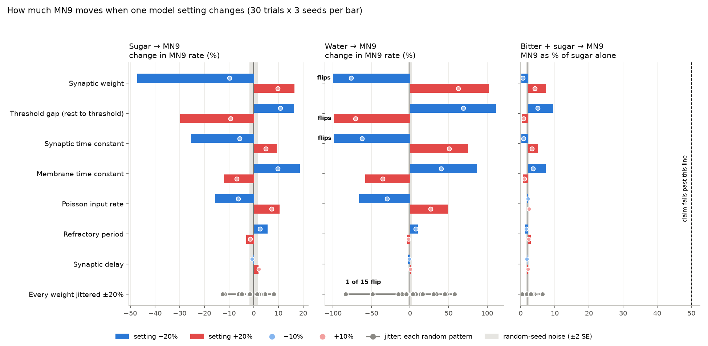
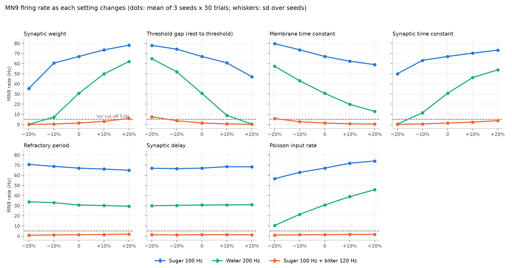
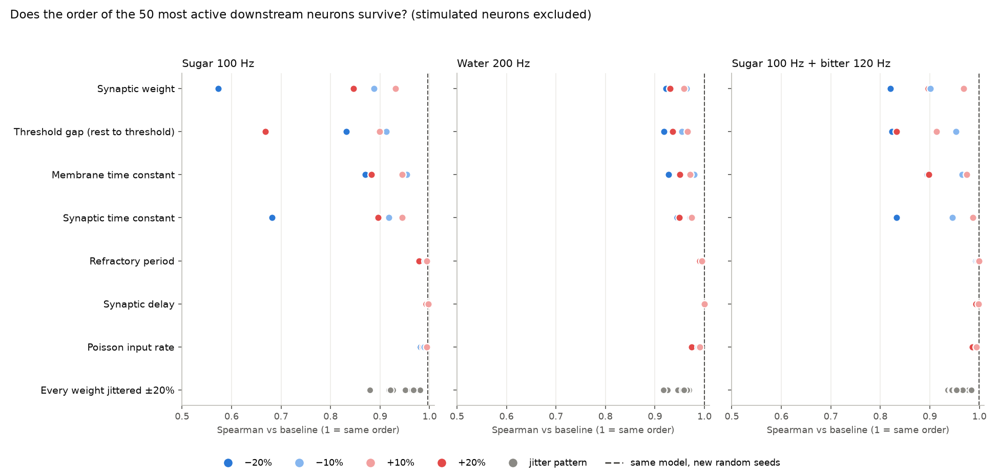

# Phase 5: Sensitivity. Do the paper's results survive changed settings?

**Status: PRELIMINARY.** Nothing here is a "finding" yet. PLAN.md Phase 6 lists the checks a result
must pass first. This work is Phase 6 step 1 ("re-run with different random seeds and parameter
variations") for the three paper results. Steps 2 to 6 have not been done.

Date: 2026-09-22. Model: the fast engine (`sim/fast_engine.py`), FlyWire snapshot 630 (the paper's).
All numbers come from `experiments/phase5/sensitivity/results/`.

## The question

The simulated brain has a handful of fixed settings: how strong one synapse is, how far a neuron's
voltage must rise before it fires, and so on. The reference paper chose one value for each. Real fly
neurons are not all identical, and nobody measured these values exactly. So we ask: **if every
setting were 10% or 20% different, would the paper's results still come out the same way?** PLAN.md
puts it bluntly: "results that flip easily aren't trustworthy."

## What was tested

**Three results from the paper.** MN9 is the motor neuron that extends the proboscis (the fly's
feeding tube).

| # | Result | How we run it | Baseline (ours) | Paper |
|---|---|---|---|---|
| 1 | Sugar turns MN9 on | 21 sugar-sensing neurons driven at 100 Hz | 67.0 Hz | 65.7 Hz |
| 2 | Water turns MN9 on | 18 water-sensing neurons at 200 Hz | 30.7 Hz | 30.7 Hz |
| 3 | Bitter suppresses the sugar response | sugar at 100 Hz plus 21 bitter-sensing neurons at 120 Hz | 1.4 Hz (2% of sugar alone) | 1.5 Hz |

**Seven settings, changed one at a time** by -20%, -10%, +10% and +20%:

| Setting | What it means | Default | Notes |
|---|---|---|---|
| Synaptic weight | how much one synapse pushes the next neuron | 0.275 mV per synapse | The input "kick" to the stimulated sensory neurons was held fixed, so only brain-internal connections changed. |
| Threshold gap | how far the voltage must climb from rest before a spike | 7 mV (rest -52 mV, threshold -45 mV) | We changed the **gap**, not the -45 mV value. 20% of -45 mV is 9 mV, which would put the threshold below rest and make every neuron fire on its own. So "+20%" means a 8.4 mV gap (threshold -43.6 mV). |
| Membrane time constant | how fast a neuron's voltage leaks back to rest | 20 ms | |
| Synaptic time constant | how long one incoming signal lasts | 5 ms | |
| Refractory period | the pause after each spike | 2.2 ms | The engine works in 0.1 ms steps, so the tested values were really 1.7, 1.9, 2.4 and 2.6 ms (-23%, -14%, +9%, +18%). |
| Synaptic delay | travel time from one neuron to the next | 1.8 ms | Rounded to 1.4, 1.6, 2.0, 2.2 ms (-22%, -11%, +11%, +22%). |
| Poisson input rate | how hard the sensory neurons are driven | 100 / 200 / 120 Hz | All three stimulus rates scaled together. |

**Weight jitter.** The connection strengths come from counting synapses in electron-microscope
images, and those counts have errors. To mimic that, every one of the 14.7 million connections got its
own random change between -20% and +20% (uniform), all at once. This was repeated with
15 different random patterns (5 were planned; 10 more were added after one of the first 5
landed exactly on the water cut-off, to see how often that happens). A "control" run applied the same bookkeeping with zero
jitter and gave numbers identical to the baseline, which proves the method itself changes nothing.

**Amount of simulation.** Every point is 3 random seeds x 30 trials x 1 simulated second, for each of
the three conditions: 12,420 one-second trials in all. We also re-ran the unchanged model
with 3 **new** seeds to measure how much the numbers move from randomness alone. That noise is tiny:
MN9 moved by 0.4% (sugar) and 1.0% (water).

## The rule for "holds" and "flips"

Written down before looking at the results, in `run_sensitivity.py`:

- **Sugar or water "turns MN9 on"** means MN9 averages at least **5 Hz** over 30 trials. (With no
  stimulus MN9 fires 0 Hz in this model; the paper's onset points sit around 1 to 10 Hz.)
- **Bitter "suppresses"** means MN9 with sugar plus bitter is at most **50%** of MN9 with sugar
  alone, using the same random input, and sugar alone is itself on.
- A variation **holds** only if the claim is true for **every** seed. One failing seed is enough
  for **flips**. This is deliberately strict.

## Results at a glance

| Result | Outcome over all variations | MN9 range seen | Verdict |
|---|---|---|---|
| Sugar turns MN9 on | holds in all 28 setting changes and all 15 jitter patterns | 35 to 80 Hz (baseline 67) | **Robust** (direction). The size is not: -47% to +19%. |
| Water turns MN9 on | **flips** in 3 of 28 setting changes and 1 of 15 jitter patterns | 0.0 to 65 Hz (baseline 31) | **Fragile.** |
| Bitter suppresses sugar | holds in all 28 setting changes and all 15 jitter patterns | sugar+bitter MN9 at most 10% of sugar alone (cut-off 50%) | **Robust.** |

The water result flips in these variations:

| Variation | Water-driven MN9 (baseline 30.7 Hz) | Seeds holding |
|---|---|---|
| Synaptic weight -20% | 0.02 Hz | 0 of 3 |
| Threshold gap +20% | 0.3 Hz | 0 of 3 |
| Synaptic time constant -20% | 0.4 Hz | 0 of 3 |
| Weight-jitter pattern 1 | 5.1 Hz (seeds: 5.4, 4.8, 5.0) | 1 of 3 (on the cut-off) |

Close calls that still held: synaptic weight -10% (7.2 Hz), threshold gap +10% (9.0 Hz), input rate
-20% (10.4 Hz), synaptic time constant -10% (11.6 Hz), membrane time constant +20% (12.8 Hz).

## Plot 1: which settings matter most



How to read it: each row is one setting. The blue bar shows what happened to MN9 when that setting
was lowered by 20%, the red bar when it was raised by 20%. The small dots are the 10% changes. The
grey band in the middle is how much MN9 moves from randomness alone; anything inside it is noise.
In the right panel, the bar positions are "MN9 as a percentage of sugar alone", and the dashed line
at 50% is where the bitter claim would fail. Bars marked **flips** broke the claim.

What it shows:

- **Four settings dominate**: synaptic weight, threshold gap, synaptic time constant and membrane
  time constant. They all change the same thing: how easily a signal gets from one neuron to the
  next. Weaker synapses, a higher threshold, a shorter-lasting synaptic signal or a leakier membrane
  all make the signal fade faster along the chain.
- **Refractory period and delay barely matter**: MN9 moved by at most about 10% (refractory) and
  2.5% (delay). The delay effects are about the size of the random noise.
- **Water swings from -100% to +111%** while sugar only moves -47% to +19% under the same changes.

## Plot 2: MN9 against each setting



Each small chart is one setting. Blue is sugar, green is water, orange is sugar plus bitter. The
dashed line is the 5 Hz "on" cut-off. The error whiskers (spread over the 3 seeds) are smaller than
the dots.

- The **blue sugar line never comes near the cut-off**. The lowest point is 35 Hz.
- The **green water line crashes to zero** at the left end of the weight and synaptic time constant
  charts and at the right end of the threshold chart. At -10% weight it is already down to 7 Hz.
- The **orange line stays near zero** everywhere (at most 7.5 Hz while sugar alone is 78 Hz): bitter
  always wins.

## Why water is fragile and sugar is not

The paper itself shows water is a weak driver: its MN9 response only starts around 130 Hz of input
(sugar starts around 35 Hz), and at 200 Hz it reaches just 31 Hz. So at the paper's operating point
water sits only a little above the level where MN9 switches on at all. Think of a ball just over the
top of a hill: a small push the wrong way and it rolls back. Sugar is far over the hill (the paper
tuned the synaptic weight so that sugar at 100 Hz gives about 80% of MN9's maximum), so the same
push only slows it down.

One note of fairness: because the synaptic weight was tuned on the sugar result, sugar is the one
result the model was built to get right. Water and bitter are true predictions, which makes the
bitter result's robustness the more meaningful of the two robust ones.

## Weight jitter

Fifteen random patterns, each giving every connection its own random change of up to 20% either
way, with every other setting at the paper's value. Seed noise is about 1%, so the differences
between patterns are real, not luck.

- **Sugar:** MN9 stayed between 58.5 and 72.5 Hz (baseline 67.0). Always on.
- **Bitter:** MN9 with sugar plus bitter stayed at or below 6% of sugar alone. Always suppressed.
- **Water:** MN9 ranged from **5.1 to 48.4 Hz** (baseline 30.7). In pattern 1 it fell to 5.1 Hz, so
  by the strict rule it flips; pattern 3 gave 15.7 Hz. The average over all 15 patterns (32.5 Hz)
  is close to the baseline: synapse-count errors do not push the water response up or down on
  average, they make it unpredictable.

So even with every setting exactly as in the paper, small random errors in the synapse counts can
nearly switch the water response off, while sugar and bitter barely notice.

## Plot 3: do the same downstream neurons light up?



For each condition we took the 50 most active neurons in the baseline (not counting the neurons we
stimulate directly) and asked whether they keep the same order when a setting changes. The number is
the Spearman rank correlation: 1 means exactly the same order, 0 means unrelated.

- With new random seeds and no setting changed, the order is essentially identical (0.996 or higher):
  that dashed line is the noise floor.
- **The water and bitter networks keep their order well** (never below 0.92 for water, 0.82 for
  sugar plus bitter).
- **The sugar network reshuffles the most**: 0.57 at -20% synaptic weight, 0.67 at +20% threshold
  gap, 0.68 at -20% synaptic time constant. Even then, 35 of the 50 top neurons stay in the top 50
  (overlap 0.70 or more everywhere).

In plain words: *which* neurons respond is stable; *how strongly each one responds relative to the
others* shifts with the settings. A claim like "neuron X is the 3rd most active" would not be
trustworthy; "neuron X is among the most active" mostly would.

## Bottom line (by the plan's standard)

- **Trustworthy (PRELIMINARY):** "sugar turns MN9 on" and "bitter suppresses the sugar response"
  hold under every single setting change of up to 20% and under every weight-jitter pattern tested.
- **Not trustworthy as a yes/no result:** "water turns MN9 on". It holds for 10% changes but flips
  for three of the fourteen 20% changes and for 1 of 15 random weight-jitter patterns (which left it at 5.1 Hz, right on the cut-off). The model predicts a water
  response only inside a fairly narrow range of settings.
- **Exact firing rates are not trustworthy for any result.** Sugar-driven MN9 ranges from 35 to 80
  Hz, water from 0 to 65 Hz. Matching the paper's numbers to the decimal (as we do) only shows the
  code matches the paper's code, not that the numbers are biologically right.

## Limits of this check

- **One setting at a time.** Real neurons would differ in several ways at once. Two small changes
  in the same direction (say -10% weight and +10% threshold gap) could flip water even though each
  alone does not. Not tested.
- **The cut-offs are our choice.** We re-scored everything with other cut-offs. With a 1 Hz
  cut-off, water still flips at the same three 20% changes (MN9 is 0.0 to 0.4 Hz there) but not for
  jitter pattern 1. With a 10 Hz cut-off it also flips at -10% synaptic weight, +10% threshold gap
  and -20% input rate. Sugar holds at 1, 5 and 10 Hz; bitter holds whether the limit is 25%, 50% or
  75% of sugar alone. So the verdicts do not hinge on the exact cut-off.
- **Only snapshot 630**, only the fast engine (which matches the reference Brian2 model; see
  `docs/fast-engine-explained.md`), and only one operating point per result.
- **Uniform, independent jitter** is a simple stand-in for real synapse-count errors, which may be
  larger for small counts or correlated between neighbouring connections.

## The validation kit (for every future result)

`sim/validation.py` packages this whole check so any lane can run it on its own result with one
call. You describe the experiment as a function, state the claim as a yes/no rule, and it re-runs
everything across seeds, one-at-a-time changes of every setting, and weight jitter, then prints a
"holds" / "flips" verdict per variation with the rule spelled out. It also flags any variation that
gave exactly the baseline's numbers, which usually means the experiment ignored that setting (a
silent bug). Example:

```python
from sim.fast_engine import FastBrain
from sim import validation as V

brain = FastBrain("630", n_threads=2)

def experiment(brain, params, seed):
    res = brain.run(excite=MY_IDS, duration_ms=1000, n_trials=30, seed=seed, params=params)
    return {"mn9": res.rate(720575940660219265)}

result = V.validate(experiment, brain, claims={"MN9 on": V.at_least("mn9", 5.0)},
                    cache_dir="experiments/my_lane/cache")
print(result.verdicts[["variation", "seeds_holding", "verdict"]])
```

Tests: `tests/test_validation.py` (tiny networks only, runs in about 15 seconds).

## Files

- `experiments/phase5/sensitivity/run_sensitivity.py`: the sweep (resumable; results cached per
  variation and seed in `cache/`).
- `experiments/phase5/sensitivity/analyze_sensitivity.py`: tables and plots from the cache.
- `experiments/phase5/sensitivity/results/`: `summary.csv` (one row per variation),
  `verdicts.csv`, `ranking.csv`, `table.csv` (every number), `summary.json` (key numbers).
- `experiments/phase5/sensitivity/logs/`: run logs.
