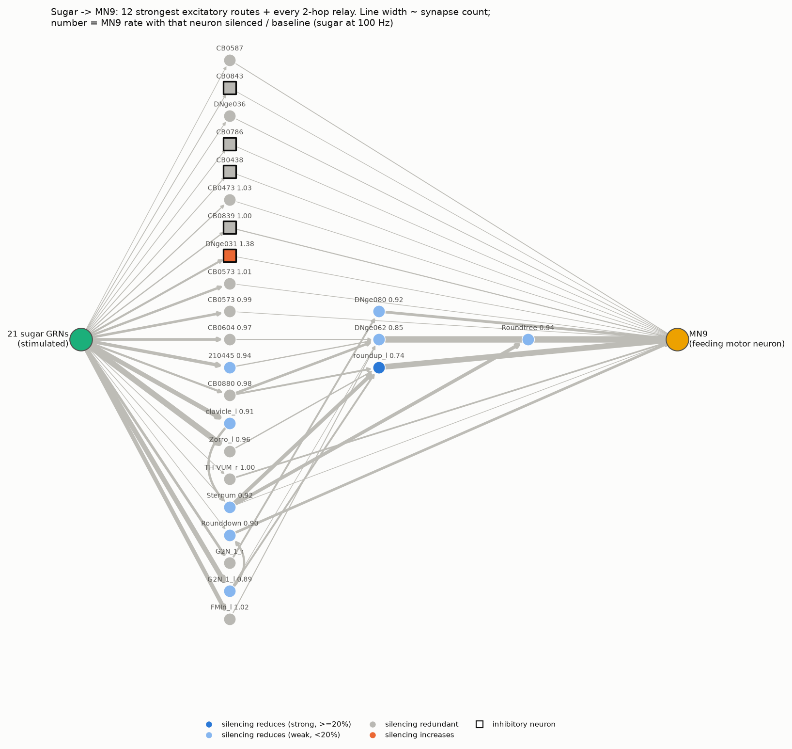
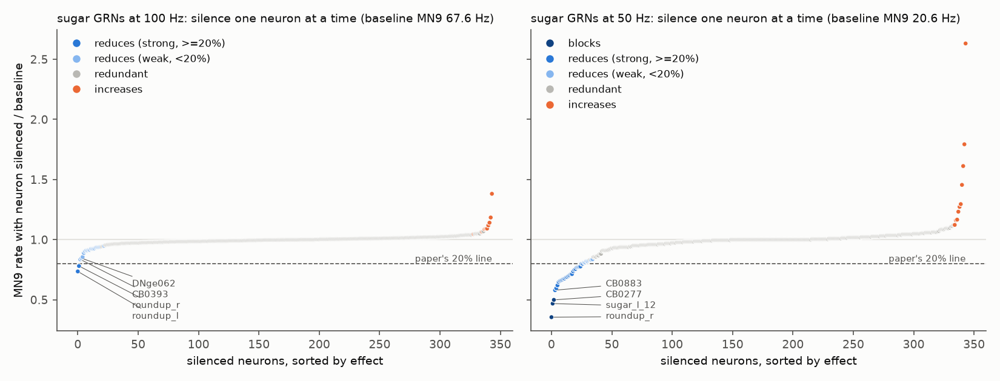
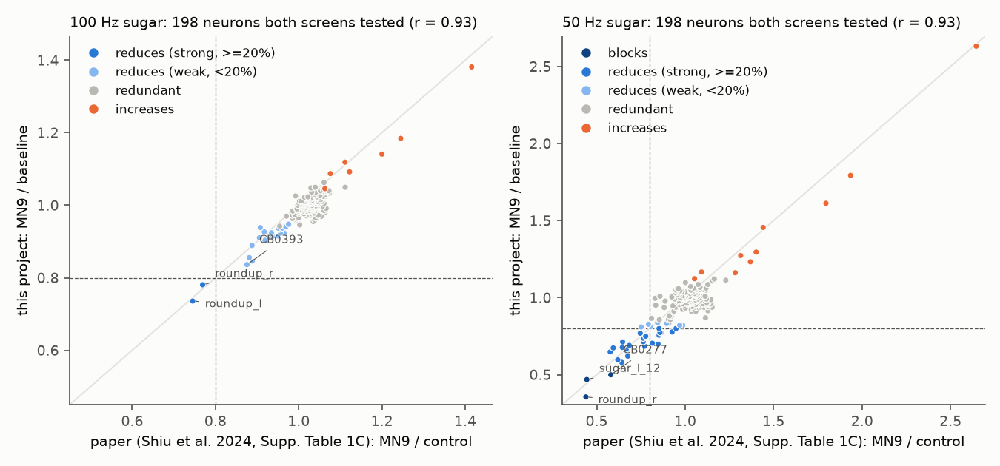
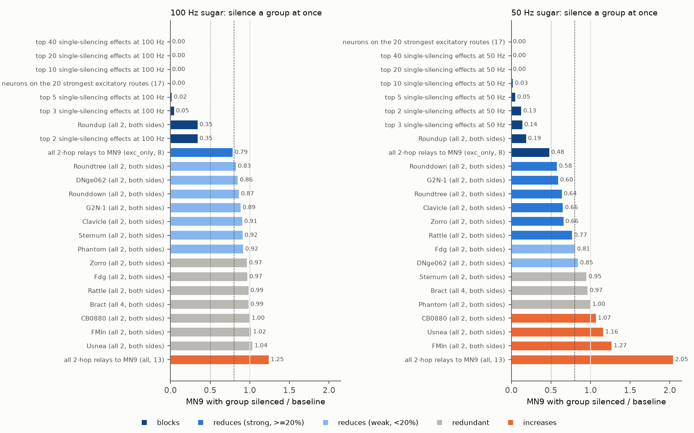

# Phase 5: the sugar to feeding pathway (pathway tracing and silencing)

*Written 2026-09-22. Everything here came from code and results in
`experiments/phase5/sugar_pathway/` (the file list is at the end). All simulations use the fast
engine (`sim/fast_engine.py`) on FlyWire snapshot 630, the paper's snapshot, with the paper's
settings. **Every result below is PRELIMINARY** in the sense of PLAN.md Phase 6. The
"What is validated" section says which checks were done and which were not.*

## The short answer

- **Wiring.** Taste signals from sugar reach MN9, the motor neuron that swings the proboscis
  out, in as few as **2 steps** (sugar neuron, then one relay neuron, then MN9). The
  **strongest** route is 3 steps: **sugar neurons, then G2N-1, then Roundup, then MN9**. G2N-1
  and Roundup are two of the neurons the paper and earlier fly experiments name in this
  circuit.
- **No single neuron is essential at normal sugar strength.** With the sugar neurons driven at
  100 Hz (the paper's standard setting), silencing any one of 344 sugar-activated neurons
  lowers MN9 by at most **26%** (the left Roundup). 314 of the 344 make no detectable
  difference. The circuit is **redundant**.
- **At weak sugar (50 Hz) single neurons matter more.** Three single silencings cut MN9 by
  half or more: the right **Roundup** (MN9 falls to 36% of normal), sugar neuron
  "sugar_l_12" (47%) and an unnamed neuron of type **CB0277** (50%). Another 24 cut it by
  20-50%.
- **Pairs and groups can block feeding.** Silencing **both Roundup neurons** together drops
  MN9 to 35% (100 Hz) or 19% (50 Hz). Silencing the 3 biggest single hits together leaves
  5%. Silencing the 17 neurons that sit on the 20 strongest wiring routes stops MN9
  completely (0 Hz).
- **Silencing some neurons makes MN9 fire more.** These are "brake" neurons. The biggest,
  **DNge031** (it releases GABA), raises MN9 by 38% at 100 Hz and 2.6 times at 50 Hz.
- **Matches the paper closely.** For the 198 neurons that both the paper and we silenced, our
  effect sizes correlate at **r = 0.93** with the paper's own published numbers, at both
  frequencies. The two neurons the paper found above its 20% line at 100 Hz are the same two
  we found (both Roundups).
- **One known conflict with real flies.** The model says Roundup is the circuit's bottleneck.
  In real flies, silencing Roundup did **not** stop feeding (Shiu, Sterne et al. 2022, as
  listed in the paper's Supplementary Table 2). The paper already reported this mismatch. We
  reproduce it and treat it as a model limitation, not a discovery.

## Background in one paragraph

The model treats each of the 127,400 neurons as a simple "leaky bucket" that fires a spike
when its voltage passes a threshold. Connections come from the FlyWire wiring diagram:
strength = number of synapses, sign = excitatory (acetylcholine) or inhibitory (GABA or
glutamate). To "taste sugar" we give the 21 sugar-sensing taste neurons (gustatory receptor
neurons, GRNs) random input at a set rate for 1 second, 30 times over ("trials"), and count
how fast MN9 fires. "Silencing" a neuron means cutting all of its outgoing connections. This
is the paper's method: the neuron can still fire, but nothing downstream hears it. Every
neuron in this model is silent unless something drives it.

## Part 1: pathway tracing (wiring only, no simulation)

Script: `trace_paths.py`. Results: `results/paths_*.csv`, `results/paths_summary.json`.

### (a) Fewest hops

| | main MN9 (the paper's readout) | second MN9 |
|---|---|---|
| Fewest hops from any sugar GRN | 2 | 2 |
| Number of 2-hop routes | 59 | 148 |
| Relay neurons on those routes | 13 (8 excitatory, 5 inhibitory) | 25 (15 excitatory, 10 inhibitory) |
| 2-hop routes using only excitatory neurons | 39 | 86 |

The 13 relay neurons for the main MN9, most-used first: two CB0573 neurons (one per side;
predicted dopamine, which the model counts as excitatory), DNge031 (GABA), CB0839 (GABA),
CB0473, CB0438 (GABA), TH-VUM (serotonin), CB0786 (GABA), **Sternum**, DNge036,
CB0843 (GABA), CB0587 and **Rounddown**. Only Sternum and Rounddown have names in the paper.

**A short route is not the same as an important route.** 5 of the 13 relays (CB0843,
CB0786, CB0438, DNge036 and CB0587) never fire when sugar is given at 100 Hz, so in the model
their direct link does nothing. Of the 8 that do fire, silencing any one lowers MN9 by at most
10% (Rounddown 0.90, Sternum 0.92). Six are redundant. The inhibitory relay DNge031 is a
brake: silencing it *raises* MN9 by 38%.

### (b) Strongest routes

Each connection gets a cost equal to minus the log of (synapses A to B divided by all input
synapses of B). The cheapest route is then the one where each neuron is the largest possible
share of the next neuron's input. The 21 GRNs are pooled into one source, so the first step
is the share of a neuron's input that comes from sugar GRNs. We list the 20 strongest routes
twice: over all neurons, and over excitatory neurons only. Only an all-excitatory route can
carry a "go" signal in this model, because nothing is active at rest and inhibiting a silent
neuron does nothing.

Strongest routes to the main MN9 (excitatory-only list):

| rank | route | input share at each step |
|---|---|---|
| 1 | sugar GRNs -> **G2N-1** (left) -> **Roundup** (left) -> MN9 | 26%, 0.7%, 7.6% |
| 2 | sugar GRNs -> CB0880 -> DNge062 -> MN9 | 2.9%, 3.3%, 10% |
| 3 | sugar GRNs -> **Zorro** (left) -> **Roundup** (left) -> MN9 | 31%, 0.2%, 7.6% |
| 4 | sugar GRNs -> **G2N-1** (left) -> **Rounddown** -> MN9 | 26%, 1.4%, 1.3% |
| 5 | sugar GRNs -> unlabelled neuron -> DNge062 -> MN9 | 10%, 0.4%, 10% |
| 6 | sugar GRNs -> **FMIn** (left) -> DNge062 -> MN9 | 14%, 0.2%, 10% |
| 7 | sugar GRNs -> **Clavicle** (left) -> **Sternum** -> **Roundup** -> MN9 | 17%, 5.5%, 3.7%, 7.6% |

Named neurons on the 20 strongest excitatory routes: G2N-1, Zorro, FMIn and Clavicle
(second-order taste neurons), and Roundup, Rounddown, Roundtree and Sternum (closer to the
motor neuron). Of the paper's ten named cell types, **Bract, Fdg, Phantom, Rattle and
Usnea are not on these routes.** Phantom is inhibitory. Rattle reaches MN9 only through an
inhibitory neuron. When inhibitory neurons are allowed, 12 of the 20 strongest routes to the
main MN9 pass through at least one inhibitory neuron (for example sugar -> CB0118 (GABA) ->
CB0862 (GABA) -> MN9). In this model those routes can only hold MN9 back.

*The diagram shows the 12 strongest excitatory routes plus every 2-hop relay. Squares are
inhibitory neurons. Line width follows synapse count. The number next to a neuron is MN9's rate
with that neuron silenced, divided by normal (sugar at 100 Hz).*

**How this compares with the paper.** The paper names G2N-1, Zorro, FMIn, Phantom and Usnea as
second-order sugar neurons and Roundup, Rattle, Bract and Clavicle as pre-motor neurons, with
Fdg as a feeding command neuron (paper Fig. 1b, Extended Data Fig. 2, Supplementary Table 2).
Its Supplementary Table 3 lists Roundup as 1 hop from MN9. Our strongest route, G2N-1 to
Roundup to MN9, uses two of those named neurons. The strongest routes do not reach every named
neuron, and the 2-hop routes mostly use neurons the paper does not name.

## Part 2: the silencing screen

Scripts: `worker.py` (runs simulations), `make_queue.py` (defines them), `analyze_screen.py`
(statistics). Results: `results/silencing_singles.csv`, `results/silencing_groups.csv`,
`results/runs.csv` (every trial).

### Which neurons were tested

The candidate list has **344 neurons**:
- **343** that fire at 1 Hz or more when the sugar GRNs are driven at 100 Hz (seed 0,
  30 trials);
- plus **1** extra neuron from the paper's own screen list (its top 200 at 200 Hz), so that
  198 of the paper's 200 neurons overlap with ours. The other 2 of the paper's 200 are the
  MN9s themselves, which we do not silence because MN9 is the readout.

The candidates include the 21 sugar GRNs. Each was silenced at **100 Hz** sugar (the task
protocol) and again at **50 Hz** sugar. The paper found single silencings matter most at low
sugar rates, and its Supplementary Table 2 reports 50 Hz. Our baselines match the paper: main
MN9 **67.6 +/- 4.6 Hz** at 100 Hz (paper 65.7 +/- 3.3), **20.6 +/- 6.1 Hz** at 50 Hz (paper
19.4 +/- 6.5) and 92.9 Hz at 200 Hz (paper 93.2).

### How the comparison works (statistics in plain English)

- **Identical random input.** Every run uses seed 0. With seed 0, trial 7 of "silence neuron
  X" receives exactly the same random sugar input as trial 7 of the normal run. Any difference
  therefore comes from the silencing and not from luck in the input.
- **Test.** The Wilcoxon signed-rank test compares the 30 pairs of trials (silenced vs normal).
- **Correction for many tests.** We tested hundreds of neurons, and some would look
  significant by chance. The Benjamini-Hochberg correction holds the expected share of false
  alarms to 5% (q < 0.05). It is applied across the whole family of neurons at each
  frequency.
- **Classes.** Ratio = MN9 with the neuron silenced divided by normal MN9.
  - **blocks**: q < 0.05 and MN9 falls to half or less (ratio <= 0.5).
  - **reduces (strong)**: q < 0.05 and ratio 0.5 to 0.8. The 0.8 line is the paper's own
    "required" threshold, a 20% drop.
  - **reduces (weak)**: q < 0.05 and ratio 0.8 to 1.
  - **increases**: q < 0.05 and ratio above 1. The silenced neuron was a brake.
  - **redundant**: no statistically detectable change.

### Two-stage design (changed part-way through to save time)

The first 137 neurons at 100 Hz were each run with the full 30 trials. At 19:52 the main
session asked for a faster two-stage design:

- **Stage 1**: each remaining single neuron, and each cell-type group, gets **10 trials**
  (seed 0), compared with the first 10 trials of the normal run. Those trials had identical
  input.
- **Flag for stage 2** if either (1) the paired MN9 change is more than **2 standard errors**
  from zero, or (2) MN9 falls outside **90-110%** of normal.
- **Stage 2**: every flagged item is re-run with the full **30 trials** (seed 0). Only flagged
  items are candidates for the 3-seed robustness check.
- **Results.** Stage 1 flagged **11 of 207** singles at 100 Hz, **68 of 329** at 50 Hz and
  **18 of 100** cell-type groups. Unflagged items keep their 10-trial result, and that result
  enters the family-wide correction.
- **Not run.** 15 neurons never fire at 50 Hz, so silencing them cannot change anything. We
  did not simulate them. A negative control confirmed this: silencing one of them gave a
  result bit-for-bit identical to the normal run.
- **The named-cell-type and pathway groups** in the tables below were run at 30 trials
  directly.
- **Caveat.** A 10-trial first pass can miss effects smaller than about 5-10%, so
  "redundant" means "no effect big enough to detect".

### Results: single neurons

| sugar rate | blocks | reduces (strong) | reduces (weak) | increases | redundant |
|---|---|---|---|---|---|
| 100 Hz (344 neurons) | 0 | 2 | 19 | 9 | 314 |
| 50 Hz (344 neurons) | 3 | 24 | 7 | 10 | 300 |

**Largest effects at 100 Hz** (full list in `results/tables.md`; "paper" = the paper's own
Supplementary Table 1C value for the same neuron):

| neuron | type | MN9 (x normal) | class | paper |
|---|---|---|---|---|
| Roundup, left | CB0553, excitatory | 0.74 | reduces (strong) | 0.75 |
| Roundup, right | CB0553, excitatory | 0.78 | reduces (strong) | 0.77 |
| unnamed | CB0393, excitatory | 0.84 | reduces (weak) | 0.88 |
| unnamed | DNge062, excitatory | 0.85 | reduces (weak) | 0.89 |
| sugar GRN sugar_l_12 | taste neuron | 0.86 | reduces (weak) | 0.88 |
| G2N-1, left | CB0616, excitatory | 0.89 | reduces (weak) | 0.89 |
| Rounddown | DNge080, excitatory | 0.90 | reduces (weak) | 0.92 |
| Clavicle, left | excitatory | 0.91 | reduces (weak) | 0.91 |
| Phantom, left | CB0062, **inhibitory** | 0.92 | reduces (weak) | 0.97 |
| DNge031 | **inhibitory** | **1.38** | increases | 1.42 |
| CB0480 (two neurons) | **inhibitory** | 1.18 and 1.14 | increases | 1.25 and 1.20 |

**Largest effects at 50 Hz:**

| neuron | type | MN9 (x normal) | class | paper |
|---|---|---|---|---|
| Roundup, right | CB0553 | 0.36 | **blocks** | 0.44 |
| sugar GRN sugar_l_12 | taste neuron | 0.47 | **blocks** | 0.44 |
| unnamed | CB0277 | 0.50 | **blocks** | 0.58 |
| unnamed | CB0883 | 0.58 | reduces (strong) | 0.64 |
| G2N-1, left | CB0616 | 0.60 | reduces (strong) | 0.62 |
| Clavicle, left | | 0.66 | reduces (strong) | 0.66 |
| Roundup, left | CB0553 | 0.67 | reduces (strong) | 0.67 |
| Zorro, left | CB0192 | 0.68 | reduces (strong) | 0.77 |
| Roundtree | CB0493 | 0.69 | reduces (strong) | 0.68 |
| Rounddown | DNge080 | 0.71 | reduces (strong) | 0.65 |
| Rattle, left | CB0499 | 0.77 | reduces (strong) | 0.86 |
| 10 more of the 21 sugar GRNs | taste neurons | 0.62 to 0.80 | reduces (strong) | 0.59 to 0.95 |
| FMIn, left | CB0366, excitatory | **1.27** | increases | 1.31 |
| DNge031 | inhibitory | **2.63** | increases | 2.64 |

At 100 Hz, silencing only 3 of the 21 sugar GRNs reduces MN9 (all weakly), and 18 are
redundant. At 50 Hz, 13 of the 21 reduce it: 1 blocks, 10 strongly and 2 weakly. With weak
input, each taste neuron carries a larger share of the signal.

### Side by side with the paper's screen

- **Overlap.** 198 neurons were silenced in both screens (same neuron IDs, same sugar rate).
  Correlation between our effect and the paper's: **r = 0.93** at 100 Hz and **r = 0.93** at
  50 Hz.
- **Size of the differences.** Average difference: 0.03 at 100 Hz (largest 0.09) and 0.06 at
  50 Hz (largest 0.25). At 50 Hz MN9 fires only about 20 times per second, so each 30-trial
  mean has more random noise.
- **The paper's 20% line.**
  - **100 Hz**: both screens put the same 2 neurons (both Roundups) below it.
  - **50 Hz**: the paper puts 21 below it, we put 27, and 19 are shared.
- **Every neuron the paper counts as "required".** That is 22 neurons below the line at *any*
  of its 8 rates (50 to 120 Hz). We put 19 of them below the line at 50 or 100 Hz. The other
  3 (DNge062, CB0177 and one unlabelled neuron) sit just above it in the paper, at 0.75 to
  0.80. They reach it only at rates we did not test.
- **Direction of effect.** Where the paper saw a change of more than 10%, we see the same
  direction in 12 of 12 neurons at 100 Hz and 53 of 69 at 50 Hz. At 50 Hz the disagreements
  are small effects near the noise level.

**The paper's ten named cell types.** "Real flies" is the paper's Supplementary Table 2 summary
of the experiments. "Paper model" is the paper's simulated value at 50 Hz. Our "single" value is
the most affected member of the type. "All" means every member silenced together (both sides).

| cell type | needed for feeding in real flies? | paper model, 50 Hz | ours single, 50 Hz | ours all, 50 Hz | ours single, 100 Hz | ours all, 100 Hz |
|---|---|---|---|---|---|---|
| Bract | No | 1.09 | 1.02 | 0.97 | 0.98 | 0.99 |
| Clavicle | Yes | 0.66 | 0.66 | 0.66 | 0.91 | 0.91 |
| Fdg | mixed (Yes: Flood 2013; No: Shiu, Sterne 2022) | 0.85 | 0.86 | 0.81 | 0.95 | 0.97 |
| FMIn | Yes (1 of 2 genetic lines) | 1.31 | 1.27 | 1.27 | 1.02 | 1.02 |
| G2N-1 | Yes | 0.62 | 0.60 | 0.60 | 0.89 | 0.89 |
| Phantom | No | 1.08 | 0.98 | 1.00 | 0.92 | 0.92 |
| Rattle | Yes | 0.86 | 0.77 | 0.77 | 0.99 | 0.99 |
| Roundup | **No** | 0.67 | 0.36 | **0.19** | 0.74 | **0.35** |
| Usnea | Yes | 1.23 | 0.94 | 1.16 | 1.01 | 1.04 |
| Zorro | Yes | 0.77 | 0.68 | 0.66 | 0.96 | 0.97 |

**Where model and experiment agree.** The model, ours and the paper's alike, gets Clavicle,
G2N-1, Zorro and Rattle right: silencing them reduces feeding. It also gets Bract and Phantom
right: silencing them has little effect.

**Where they disagree.** The model gets Roundup, Usnea and FMIn wrong. The paper discusses
Usnea and FMIn as possible neuropeptide or other effects the model cannot represent. Our
single-neuron numbers agree with the paper's model, not with the flies.

### Results: pairs and groups

| silenced together | MN9 at 100 Hz (x normal) | MN9 at 50 Hz (x normal) |
|---|---|---|
| both Roundup neurons | **0.35 (blocks)** | **0.19 (blocks)** |
| the 3 largest single effects | **0.05** | **0.14** |
| the 5 largest single effects | **0.02** | **0.05** |
| 17 neurons on the 20 strongest excitatory routes | **0.00** | **0.00** |
| the 8 excitatory 2-hop relays | 0.79 (strong) | **0.48 (blocks)** |
| all 13 two-hop relays (5 are inhibitory) | 1.25 (increases) | 2.05 (increases) |
| both G2N-1 | 0.89 | 0.60 |
| both Rounddown | 0.87 | 0.58 |
| both Roundtree | 0.83 | 0.64 |
| both Zorro | 0.97 (redundant) | 0.66 |
| all 4 Bract | 0.99 (redundant) | 0.97 (redundant) |

"The N largest single effects" is ranked separately at each frequency. At 50 Hz most single
values came from the 10-trial first pass.

**Cell-type groups.** We tested 100 FlyWire cell types that have 2 or more sugar-activated
members, silencing all active members of each type together (100 Hz only):
- **16 of the 100 are not redundant.**
- **Where the type matters though no single member does.** For **CB0821** (both members
  singly redundant; together MN9 falls to 0.87) and **CB0087** (both singly redundant;
  together MN9 rises to 1.06), only the pair shows an effect. This is the "the twin covers
  for it" redundancy the task asked about.
- **Where the pair is stronger than either member.** In the other non-redundant types, the
  pair is usually stronger than either member alone. For example, CB0480 is 1.14 and 1.18
  singly and 1.35 together, and DNge031 is 1.46 together.
- **The Roundup type (CB0553).** Its two members each reduce MN9 by 22-26%. Together they
  reduce it by 65%, much more than the sum of their single effects.

## Part 3: robustness (seeds 1, 2 and 3)

Scripts: `analyze_screen.py pick_robust` / `robust`. Results: `results/robustness_seeds.csv`,
`results/robustness_summary.csv`.

**What we re-ran.** 52 results were run again with 3 new random seeds (1, 2 and 3). Each seed
had its own normal run for comparison, with 30 trials each. The 52 were:
- every blocking or strongly-reducing single neuron or group;
- the 5 largest single effects at each frequency;
- the largest "increases" single at each frequency.

We left out top-k groups of 10 or more, because they already sit at MN9 = 0, and cell type
CB0553, because it is the same two Roundup neurons as the named Roundup group.

- **Direction.** All **52 of 52** reduce, or increase, in the same direction in all 4 seeds.
- **Significance.** 50 of 52 are significant (q < 0.05) in every new seed. The 2 exceptions
  are sugar GRNs at 50 Hz with small effects (sugar_l_8 and sugar_l_3, q up to 0.11).
- **Same class.** 42 of 52 land in the same class in all 4 seeds: **12 of 12 at 100 Hz** and
  30 of 40 at 50 Hz. The 10 that move sit close to a class line (0.5 or 0.8) and cross it in
  one seed or another. Example: CB0277 gives 0.50, 0.53, 0.53, 0.50.

| result | seed 0 | seeds 1 / 2 / 3 | same class in all 4? |
|---|---|---|---|
| both Roundup, 100 Hz | 0.35 | 0.34 / 0.34 / 0.34 | yes (blocks) |
| both Roundup, 50 Hz | 0.19 | 0.22 / 0.25 / 0.19 | yes (blocks) |
| top 3 singles together, 100 Hz | 0.05 | 0.05 / 0.05 / 0.05 | yes (blocks) |
| 17 strongest-route neurons, 100 and 50 Hz | 0.00 | 0.00 / 0.00 / 0.00 | yes (blocks) |
| 8 excitatory 2-hop relays, 50 Hz | 0.48 | 0.50 / 0.55 / 0.48 | no (blocks / strong) |
| Roundup right, 50 Hz | 0.36 | 0.40 / 0.35 / 0.37 | yes (blocks) |
| sugar GRN sugar_l_12, 50 Hz | 0.47 | 0.40 / 0.41 / 0.50 | no (3 blocks, 1 just above 0.5) |
| CB0277, 50 Hz | 0.50 | 0.53 / 0.53 / 0.50 | no (on the 0.5 line) |
| Roundup left, 100 Hz | 0.74 | 0.75 / 0.73 / 0.74 | yes (strong) |
| Roundup right, 100 Hz | 0.78 | 0.77 / 0.74 / 0.76 | yes (strong) |
| DNge031 (brake), 100 Hz | 1.38 | 1.37 / 1.41 / 1.39 | yes (increases) |
| DNge031 (brake), 50 Hz | 2.63 | 2.48 / 2.50 / 2.43 | yes (increases) |

**Selection bias check.** We picked these results because seed 0 showed a large effect, so
seed 0 could be exaggerated by luck. Among the reductions, seed 0 averaged 0.575 and the three
new seeds averaged 0.580. Almost no exaggeration shows.

**Synapse strength +/-20%** (`results/wsyn_check.csv`; 100 Hz, seed 0, each compared with
the normal run at the same strength). The one free parameter of the model, the strength per
synapse, was set 20% lower and 20% higher:

| silenced | w_syn 0.22 (-20%) | w_syn 0.275 (paper) | w_syn 0.33 (+20%) |
|---|---|---|---|
| normal MN9 rate | 36.6 Hz | 67.6 Hz | 79.7 Hz |
| Roundup left alone | 0.51 | 0.74 | 0.70 |
| both Roundup | **0.17** | **0.35** | **0.37** |
| 17 strongest-route neurons | **0.00** | **0.00** | **0.00** |

The Roundup-pair block and the route-set block hold across +/-20%. With weaker synapses, a
single Roundup matters even more (0.51). This fits the pattern that weaker drive leaves less
redundancy.

## Bug checks and controls

- **Positive control.** Silencing all 21 sugar GRNs leaves MN9 at exactly 0 Hz.
- **Negative control.** Silencing a neuron that never fires (at 50 Hz) gives a result
  identical to the normal run, trial by trial.
- **Silencing mechanism.** The fast engine's silencing had already been checked against the
  paper's own Brian2 silencing runs. That comparison (`experiments/fast_engine/`) covered 3
  neurons at 100 Hz, and MN9 matched within 0.7 Hz with a neuron-by-neuron r = 0.9997. All 3
  of those neurons are in our screen. Their MN9 rates here (63.97, 67.13 and 70.73 Hz) are
  identical to the benchmark's, because both used seed 0.
- **Sign check.** 17 of the 19 single silencings that raise MN9 (both frequencies together)
  are of inhibitory neurons, as expected for a brake. The two exceptions are excitatory:
  CB0791 (1.12 at 100 Hz) and FMIn (1.27 at 50 Hz). An excitatory neuron can act as a brake
  if it drives an inhibitory one. We did not trace that for CB0791. The paper's own screen
  shows the same two effects (1.11 and 1.31).
- **IDs.**
  - All IDs are handled as 64-bit integers.
  - The two MN9 IDs carry FlyWire type CB0701, and the paper's table calls them MN9_r and MN9_l.
  - Paper names (Roundup, G2N-1, ...) come from the paper's own ID-to-name tables
    (Supplementary Table 1A and the repository's SEZ file). No names were typed by hand.
  - Every connection's sign matches its sending neuron's sign (0 mismatches in 14.7 million
    connections).
- **Matches the paper's own numbers** (previous section). This is the strongest evidence that
  nothing is mis-indexed: 198 independent per-neuron comparisons agree closely.

## Phase 6 steps 1-5 for the notable results

Nothing here is a new discovery. Every notable result was already in the paper's own numbers
or discussion. We still ran steps 1-5 on the three results that stand out. Step 6, contacting
anyone, is the owner's call, and nothing here calls for it.

**A. The Roundup pair is the model's bottleneck, but real flies do not need Roundup.**
1. *Seeds and parameters:* it holds in 4 of 4 seeds at both frequencies (0.34-0.35 at
   100 Hz, 0.19-0.25 at 50 Hz). It also holds at w_syn -20% (0.17) and +20% (0.37).
2. *Bugs:*
   - The two IDs are the ones the paper's own table names roundup_l and roundup_r, and both
     carry FlyWire type CB0553.
   - Our single-neuron numbers match the paper's (0.74 vs 0.75, 0.78 vs 0.77 at 100 Hz).
   - The silencing code was verified against Brian2 earlier.
3. *Literature:*
   - The paper calls Roundup "the pre-MN with the strongest predicted silencing phenotype".
   - Its Supplementary Table 2 records that silencing Roundup in real flies did **not** reduce
     proboscis extension to sucrose (Shiu, Sterne et al. 2022).
   - So the conflict is already published. We only add that silencing *both* Roundups in the
     model cuts MN9 by 65-81%. We read only the paper and the tables it cites; we did no
     wider literature search.
4. *Biology:* this contradicts experiment, so we suspect the model first. Possible reasons,
   none tested:
   - The model has only the brain. MN9's inputs from the ventral nerve cord are missing.
   - It has no electrical synapses and no neuromodulators.
   - Its signs come from predicted neurotransmitters.
   - Genetic silencing in flies is chronic and may not reach every Roundup cell. The model's
     silencing is instant and complete.
5. *Write-up:* this document.

**B. FMIn silencing raises MN9 in the model (1.27 at 50 Hz), but FMIn is needed in real flies**
(1 of 2 genetic lines). The paper's model gives 1.31, so this too is a known model/biology
mismatch. We did not trace why an excitatory neuron acts as a brake here. Seed-0 result only.

**C. Silencing Phantom, an inhibitory neuron, slightly *lowers* MN9** (0.92 at 100 Hz, seed 0;
no effect at 50 Hz).
- *Explanation in the wiring:* the paper proposed Phantom -> Scapula (inhibitory) -> Roundup,
  so Phantom normally releases a brake on Roundup. We could not find a Scapula ID in our
  files. (A later literature check found that CB0219, 720575940624600840 left and
  720575940620062288 right, *is* Scapula: `docs/phase6-literature-check.md`, section 2.)
  We did find the same pattern in the connectome: Phantom (left) sends 66 synapses to
  CB0219, an inhibitory neuron that sends 47 synapses to Roundup (left). Phantom also sends
  116 synapses to CB0620, another inhibitory neuron that contacts Roundup.
- *Check:* silencing CB0219 on its own raises MN9 (1.07, significant), which is consistent
  with that chain.
- *Status:* small effect, seed 0 only, PRELIMINARY.

## What is validated and what is preliminary

**Checked (so these are as solid as this model gets):**
- **Reproduces the paper's screen.** Our per-neuron silencing effects match the paper's own
  published numbers (198 neurons, r = 0.93 at 50 and 100 Hz; same 2 neurons over the 20% line
  at 100 Hz).
- **Survives new seeds.** The blocking and strongly-reducing results survived 3 new seeds
  (52 of 52 same direction, 12 of 12 same class at 100 Hz). The key blocks (Roundup pair,
  strongest-route set) also survived w_syn +/-20%.
- **Controls pass.** Positive control, negative control, sign check and ID checks all pass.

**Still PRELIMINARY:**
- **Everything as a claim about real flies.** The model disagrees with experiments on
  Roundup, FMIn and Usnea.
- **Single-seed results.** The "reduces (weak)" and "increases" calls other than those listed
  in Part 3, the 100 cell-type group results, the Phantom disinhibition chain and CB0791 all
  rest on seed 0 only.
- **"Redundant" calls from the first pass.** These came from 10 trials: 196 of 344 neurons at
  100 Hz and 261 of 344 at 50 Hz. They can miss effects smaller than about 5-10%.
- **The strongest-route ranking.** It depends on the chosen cost (share of input synapses).
  Other reasonable costs could reorder routes. Hop counts do not depend on that choice.

**Not done:**
- The paper's other six sugar rates (60-120 Hz). The paper's "required" list uses any of 8
  rates; we used 2.
- A per-neuron activation ("is it sufficient?") screen.
- Snapshot 783.
- A full write-up of the second MN9. Its numbers are recorded in every CSV (columns `mn9b_*`,
  `class_mn9b`). For example, silencing the right Roundup drops the second MN9 to 0.40 at
  100 Hz.

## Files

- `experiments/phase5/sugar_pathway/`
  - `trace_paths.py`: pathway tracing.
  - `worker.py`: the single long-lived simulator process and its queue.
  - `make_queue.py`, `build_groups.py`: which experiments to run.
  - `analyze_screen.py`: statistics and classes.
  - `plot_results.py`: figures.
  - `summarize.py`: tables.
  - `paper_tables.py`: reads the paper's supplementary tables.
- `results/`
  - `runs.csv`: every trial of every condition.
  - `silencing_singles.csv`, `silencing_groups.csv`: one row per silencing.
  - `stage1_flagged.csv`, `robustness_*.csv`, `paths_*.csv`, `tables.md`, `fig_*.png`.
- `paper_reference/`: the paper's Supplementary Tables 1A, 1B, 1C, 2 and 3 as CSV. They were
  downloaded from Nature's supplementary file `41586_2024_7763_MOESM2_ESM.xlsx`.
