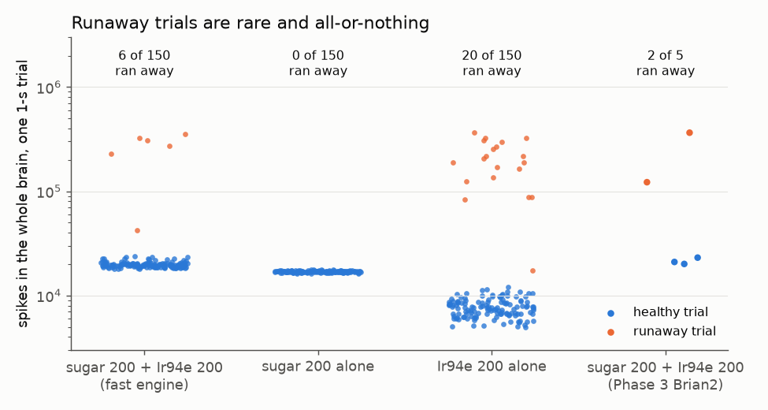
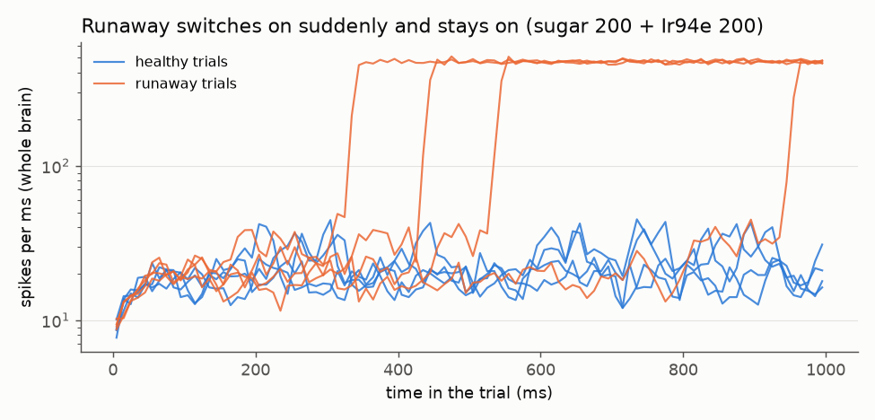
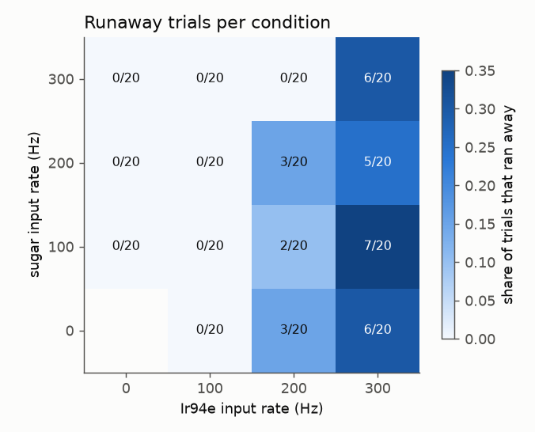
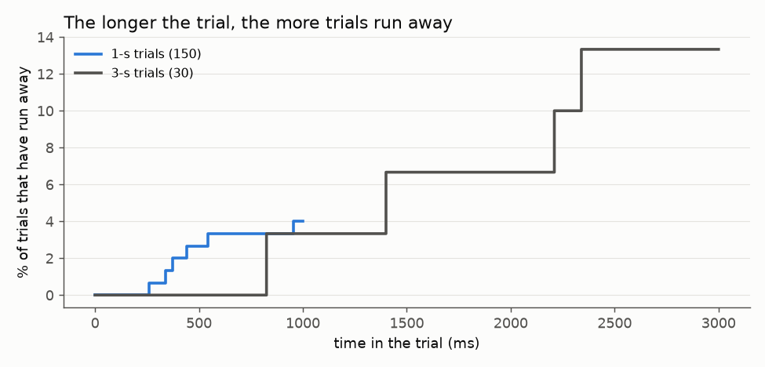
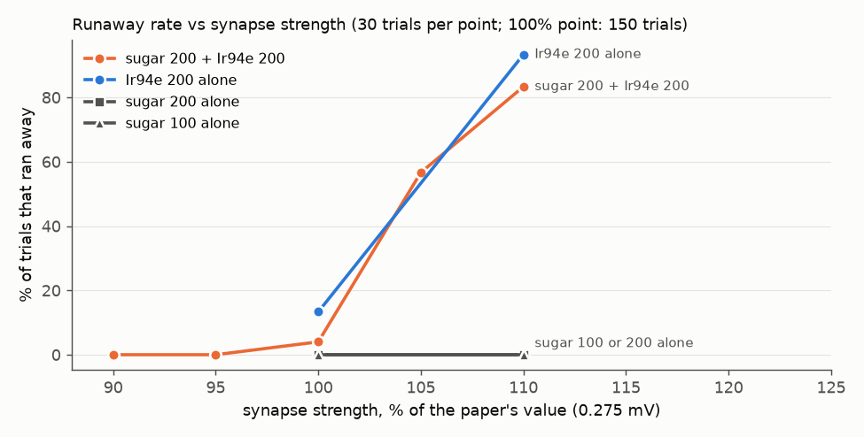

# Phase 6: the "runaway activity" surprise

*Written 2026-09-22. Scripts, raw results and plots: `experiments/phase6/runaway/`
(`results/summary_stats.txt` has every number below in one place).*

## The short version

In Phase 3, two of five trials of "sugar 200 Hz + Ir94e 200 Hz" suddenly switched the whole
simulated brain into a state where about 8,000 neurons (4,800-8,500 across trials) fire
non-stop. We checked it the way
PLAN.md Phase 6 asks. The answer:

- **The model really does this, and our code is not to blame.** Two separate programs (the Brian2
  port and the fast engine) produce exactly the same spikes, runaway included, when given the same
  input. The taste-neuron IDs, their signs and the indexing all check out.
- **It is much rarer than Phase 3 suggested.** Over 150 trials it happens in about 1 trial in 25
  (4%), not 2 in 5. Phase 3 drew an unlucky sample (about a 1.5% chance). It happens MORE often
  with Ir94e alone (13%) and never with sugar alone (0 of 150).
- **It is a tipping event, and once tipped the brain never recovers.** It can start at any moment,
  so longer trials tip more often, and once started it keeps going with no input at all.
- **It starts in the smell centre, not the taste centre.** Every runaway we traced begins among
  the local neurons of the antennal lobe (the fly's first smell-processing area). Silencing 38 of
  them, the "excitatory local neurons" (or even just 8 of those), stopped every runaway started by
  taste input or by a brief smell pulse, while silencing random neurons
  elsewhere changed nothing, and it left the paper's feeding result (sugar -> MN9) exactly as it
  was. It is the same state the Phase 5 olfaction lane called "ignition" (90% the same neurons),
  where a single spike from 3 smell neurons is enough to set it off.
- **It is not fly biology; it is how the model treats a few dozen neurons.** Real flies smell and
  taste all day without their brains locking into non-stop firing. The key local neurons (types
  lLN1_b/c and lLN2T) are either really inhibitory (the olfaction lane's reading: then the model's
  transmitter guess is wrong), or excitatory as FlyWire's own annotation says, in which case real
  flies pass their excitation on mainly through electrical contacts (gap junctions), which the
  model does not have. Either correction, tested here, removes every runaway and leaves the
  feeding result exactly as it was. The model also has no "tiring" of busy neurons, which would
  normally stop such a loop.
- **The model sits on a knife edge.** The paper's synapse strength sits on a cliff edge. 5% stronger
  synapses and more than half of the "sugar 200 + Ir94e 200" trials run away.

**Verdict: a real property of the published model, caused by missing or mislabelled biology in
one small circuit of the smell centre. Not a bug in our code, and not a discovery about flies.**

---

## 1. What we saw, and the setup

The model is the paper's, unchanged (every neuron is a "leaky integrate-and-fire" unit; each
synapse adds 0.275 mV; acetylcholine, dopamine, serotonin and octopamine neurons excite, GABA and
glutamate neurons inhibit). Snapshot 630, the one the paper used. We stimulated the 21 sugar
taste neurons and the 18 Ir94e taste neurons from the paper's code with random ("Poisson") input
at the stated rates, one-second trials, and ran everything on the fast engine
(`sim/fast_engine.py`), which gives the same spikes as Brian2 (shown again in section 3).

**What counts as "runaway".** In a healthy trial, no 10 ms slice ever has more than about 440
different neurons firing. In a runaway, every 10 ms slice has about 4,000. So a trial is called
runaway if, in any 10 ms slice, more than 1,500 different neurons fire. The two groups never
overlap (healthy trials top out at 442; runaways never drop below 3,741), so the exact threshold
does not matter. One trial started tipping in its final 10 ms and reached 1,370; it is counted as
healthy, so the Ir94e-alone rate below is, if anything, one trial too low. The **onset** is the
first millisecond with more than 200 spikes (a healthy trial has about 20 per ms). The Phase 3
rule ("more than 5x the median trial") agrees with this definition on 448 of 450 trials; the two
it misses are runaways that started in the last 50 ms.

## 2. Does it hold up? (Phase 6 step 1)

### 2a. More trials and seeds

30 trials x 5 random seeds = 150 one-second trials per condition:

| Condition | Runaway trials | Rate (95% range) | Typical spikes per trial |
|---|---|---|---|
| sugar 200 + Ir94e 200 | 6 of 150 (per seed 0, 1, 3, 2, 0) | 4.0% (1.5-8.5%) | healthy 19,600 / runaway 291,000 |
| sugar 200 alone | 0 of 150 | 0% (0-2.4%) | 17,000 |
| Ir94e 200 alone | 20 of 150 (per seed 4, 5, 1, 5, 5) | 13.3% (8.3-19.8%) | healthy 7,600 / runaway 197,000 |

So it holds up as a real, repeatable behaviour of the model, but it is rare, and the trigger is
the Ir94e input, not the sugar input. (Here, adding sugar made it rarer; the grid below does not
clearly confirm that.)

MN9 (the feeding motor neuron) in "sugar 200 + Ir94e 200": 65.2 spikes/s in healthy trials,
45.2 in runaway trials. Averaged over all 150 trials it is 64.4, against the paper's 64.3.

### 2b. When does it happen?

We ran every combination of sugar at 0, 100, 200, 300 Hz and Ir94e at 0, 100, 200, 300 Hz
(20 one-second trials each, a fresh seed), plus two other "two strong tastes" pairings:

| | Ir94e 0 | Ir94e 100 | Ir94e 200 | Ir94e 300 |
|---|---|---|---|---|
| **sugar 0** | - | 0 of 20 | 3 of 20 | 6 of 20 |
| **sugar 100** | 0 of 20 | 0 of 20 | 2 of 20 | 7 of 20 |
| **sugar 200** | 0 of 20 | 0 of 20 | 3 of 20 | 5 of 20 |
| **sugar 300** | 0 of 20 | 0 of 20 | 0 of 20 | 6 of 20 |

sugar 200 + bitter 200: 0 of 20. sugar 200 + water 200: 0 of 20.

So what matters is **how hard the Ir94e neurons are driven**: nothing at 100 Hz or below, about
1 in 10 at 200 Hz (8 of 80), about 1 in 3 at 300 Hz (24 of 80), whatever the sugar rate. Sugar on its own never does
it, and neither do the bitter or water pairings. (Step 2a hinted that adding sugar lowers the
rate, 4% versus 13%; the grid, with 20 trials per box, shows no clear sugar effect, so treat that
as unsettled.)

### 2c. Does trial length matter?

Yes. In one-second trials the runaways started anywhere from 217 to 985 ms (never in the first
200 ms). In 30 three-second trials, 4 ran away (13%), starting at 824, 1,399, 2,209 and 2,337 ms.
That is what a random "tipping" event with a roughly constant chance per second looks like
(about 4% per second): the longer you run, the more trials tip. The paper's 1-second protocol
hides most of it.

**Once it starts, it never stops, even with no input.** We re-ran 9 runaway trials (all 6 from
"sugar 200 + Ir94e 200" and 3 from "Ir94e 200 alone") with exactly the same input, but switched the
taste input off 20 ms after the onset and kept simulating for 2 seconds. All 9 kept firing to the
end: about 7,600 different neurons were still firing in the last 100 ms, more than a second after
the last input. Healthy trials with the input switched off go completely silent (0 neurons firing
in the last 100 ms, 3 of 3). So the runaway is a second stable state of the model that feeds
itself.

**The tip happens a little before it shows.** Switching the input off 20 ms *before* the onset
still gave a runaway in 9 of 9 trials, and 50 ms before in 7 of 9. So the process is already
locked in some 20-50 ms before the spike count visibly explodes; the build-up happens quietly in a
small group of neurons first (section 4).

### 2d. How close to a tipping point does the model sit?

Very close. We made every synapse slightly weaker or stronger (the paper's one tuned number,
0.275 mV per synapse) and re-ran 30 trials each with seed 0's inputs:

| Synapse strength | sugar 200 + Ir94e 200 | Ir94e 200 alone | sugar 200 alone | sugar 100 alone |
|---|---|---|---|---|
| 90% | 0 of 30 | not run | not run | not run |
| 95% | 0 of 30 | not run | not run | not run |
| 100% (paper) | 6 of 150 (4%) | 20 of 150 (13%) | 0 of 150 | 0 of 30 |
| 105% | **17 of 30** (57%) | not run | not run | not run |
| 110% | **25 of 30** (83%) | **28 of 30** (93%) | 0 of 30 | 0 of 30 |

The paper's value sits right on the edge of a cliff: 5% stronger and more than half of the
"sugar 200 + Ir94e 200" trials run away, although these very same 30 inputs gave none at the
paper's value (seed 0 happened to have 0 of 30). Weaker synapses gave none either, but 30 trials
cannot tell "never" from "4%", so all we can say is that weaker keeps it rare. Sugar alone
never runs away even at +10%: the sugar pathway does not reach the loop. The paper checked that its predictions survive a +/-30%
change of this number; at +5% and above, most Ir94e trials here are runaways, so the Ir94e
result in particular would be dominated by this artefact (we did not re-check the paper's other
predictions at +30%).

## 3. Is it a bug? (Phase 6 step 2)

- **The two programs agree exactly.** We took the Phase 3 Brian2 trials and fed the very same
  input kicks into the fast engine. All 5 trials came out spike-for-spike identical (21,000 to
  364,000 spikes each), both runaways included, starting at the same millisecond (778 ms and
  237 ms). So the runaway is not something either program invented.
- **So why 2 of 5 in Phase 3 but 6 of 150 now?** The Brian2 input itself was normal (each taste
  neuron fired about 195 times per second, independently, as it should). If the true rate is 4%,
  getting 2 or more runaways in 5 trials happens about 1.5% of the time; at the top of the 95%
  range (8.5%) about 6%. A Fisher test gives p = 0.02. So Phase 3 drew an unlucky sample; given
  identical input the programs behave identically, which rules out an engine difference.
- **Neuron IDs.** The 18 Ir94e and 21 sugar IDs are exactly the paper's, all present in snapshot
  630, no duplicates, no overlap between the two sets, and every ID round-trips (ID -> row ->
  ID). All 18 Ir94e neurons are gustatory sensory neurons in the labial nerve on one side, as
  expected. One caveat worth knowing: FlyWire's later official annotation (v783) calls these same
  18 neurons types LB1e (11, listed under "bitter") and LB2a-b / LB2c (7, "low-salt"), while the
  paper calls them Ir94e. That is a naming question for the paper, not an error on our side, and
  it does not change the conclusions here (the runaway is decided in the smell centre, section 4).
- **Signs.** 16 of the 18 Ir94e neurons are predicted cholinergic (excite) and 2 glutamatergic
  (inhibit). Our signs equal the reference file's signs for every one of the 127,015 neurons that
  make connections (100.00%), and no neuron has mixed signs. (For 1.5% of neurons the single
  "top" predicted transmitter points the other way, because the paper's rule decides the sign by
  the majority of a neuron's synapses, not by its top label. That is the paper's rule, copied
  faithfully; it matters for one neuron type in section 4c.)
- **Indexing.** Our neuron order equals the reference completeness file row for row. There are no
  zero-weight connections and no neuron connected to itself.

## 4. Where it starts and what keeps it going (Phase 6 step 3)

### 4a. Who fires first

For each runaway trial we listed the neurons that fire in it but in fewer than 5% of healthy
trials ("recruited" neurons), and timed their first spike against the onset. The same neurons
come first every time, about 10-20 ms before the onset, and they are all in the **antennal lobe**,
the first smell-processing area, on one side:

- the very first are antennal-lobe **local neurons** of types lLN2T_c, v2LN30, lLN2X03 and lLN2T_b,
  then projection neurons (PNs) of smell channels DP1l, VA6, VL2p, DP1m, DC1;
- of the first 30 recruited neurons in each runaway, 117 of 180 are antennal-lobe local neurons
  and 41 are antennal-lobe projection neurons; the rest are 21 unclassified central neurons and
  one mushroom-body output neuron. No taste neuron, no feeding neuron.

How does taste input reach the smell centre at all? Only weakly: counting only excitatory
connections of at least 5 synapses, the shortest route from an Ir94e neuron to one of these local
neurons is 3 steps, through connections of just 5, 13 and 7 synapses (via a descending neuron,
DNge075). That fits with the runaway needing a lucky coincidence, and being rare.

### 4b. The runaway state

About 8,500 neurons take part (in at least half of the runaways). The biggest groups: 3,290
Kenyon cells (the mushroom body, the learning centre), 535 antennal-lobe projection neurons, 423
lateral-horn local neurons, 349 antennal-lobe local neurons, 261 smell sensory neurons, 213
descending neurons, 130 dopamine neurons. Inhibitory neurons fire hard too
(70 spikes/s on average, versus 62 for excitatory ones), but cannot stop it.

This is the same state the Phase 5 olfaction lane found: of our 8,495 neurons, 8,043 are also in
their "ignition" set (overlap score 0.90). Their notes show it can be set off by just 3 smell
neurons (DM1) firing once.

### 4c. The loop: excitatory local neurons in the antennal lobe

The first-firing local neurons belong to types lLN1_b/c and lLN2T_a/b/c. FlyWire's curated
annotation lists these types as **cholinergic** (excitatory), citing antibody staining (Shang et
al. 2007); their automatic transmitter prediction is mostly serotonin or dopamine at low
confidence, which the model also treats as excitatory. Below we call them "eLNs" (excitatory local
neurons), because that is how the model treats them. Whether they really are excitatory is
discussed in 4d. There are 38 of them in snapshot 630 (some result files label the group "44",
the count in the newer annotation; the silenced set was always these 38).

**A warning about the first test we tried.** Re-running the 16 trials we knew had run away, each
with a group silenced, looked decisive at first (silence the eLNs: 0 of 16 still run away). But
silencing 38 *random* excitatory neurons from elsewhere also stopped 15 of 16. The reason: a
runaway is a rare tipping event, so if you change anything that fires early in the trial, the
trial takes a different path, and most paths do not tip. That test only proves "you changed the
trial". The fair tests are (1) the runaway **rate** over many trials, and (2) triggers that
ignite the intact model **every time**, compared against random control groups:

| What was changed | Ir94e 200 Hz: runaways in 60 trials | 10 DM1 smell neurons fire once | Sugar 100 Hz: MN9 (30 trials) |
|---|---|---|---|
| nothing (intact model) | 9 | ignites (445,000 spikes) | 67.63 spikes/s |
| silence the 38 eLNs | **0** | **no ignition** (26 spikes) | 67.63 |
| silence only the 8 lLN2T_a-c eLNs | **0** | **no ignition** | not run |
| silence 38 random excitatory neurons outside the antennal lobe (3 different random sets) | 9, 9, 9 | ignites, all 3 | not run |
| keep eLN chemical synapses only onto inhibitory neurons (how real eLNs are wired according to Yaksi & Wilson 2010, section 5; removes 16,257 connections) | **0** | **no ignition** (30 spikes) | 67.63 |
| silence the 13 neurons of the "one spike is enough" loops (below) | **0** | **no ignition** | not run |

(The difference 9 of 60 versus 0 of 60 has a Fisher test p of about 0.003. The random control
groups change nothing, so the effect is specific to these neurons. The feeding readout is
identical to two decimals because the sugar pathway never touches these neurons.)

So the **entry point** is a handful of excitatory antennal-lobe local neurons, just 8 of them
(lLN2T_a-c) are enough to block every natural trigger we tried. Making the 38 eLNs fire once, with
no other input at all, ignites the whole brain (665,000 spikes in the following second).

**What keeps the state going once it is lit?** We forced a strong kick (the 20 first-firing
neurons, or all 685 antennal-lobe projection neurons, firing once) while silencing bigger groups:

| Silenced | 20 first-firing neurons fire once | all 685 projection neurons fire once |
|---|---|---|
| nothing | ignites | not run (the smaller kick already ignites) |
| the 38 eLNs | still ignites | not run |
| all 150 antennal-lobe local neurons the model treats as excitatory | no ignition | **no ignition** |
| all 424 antennal-lobe local neurons | no ignition | **no ignition** |
| all 685 antennal-lobe projection neurons | no ignition | - |
| all Kenyon cells (mushroom body) | ignites | ignites |
| all lateral-horn local neurons | ignites | ignites |

So the self-sustaining engine is the antennal lobe's own excitatory loop: **excitatory local
neurons plus projection neurons, exciting each other**. The mushroom body and lateral horn join in
(they supply most of the 8,500 neurons) but are passengers, not the engine. The eLNs are the
door; the wider set of excitatory local neurons and projection neurons is the room.

**The tightest loops.** A spike raises a partner's voltage by only 0.043 mV per synapse, so a
connection needs about 162 synapses before ONE spike alone can make the partner fire. Among the
runaway neurons there are only 3 closed loops made purely of such connections, 13 neurons in
total, all in the antennal lobe: lLN2T_c eLNs send 400-520 synapses each to a local neuron of type
v2LN30, which sends 235-390 synapses to projection neurons (smell channels DP1l, VL2p, VA2), which
send about 190-310 back to the eLNs and v2LN30. A signal can go round such a loop for ever, each
spike re-firing the next neuron. Making just the 7 neurons of the biggest loop fire once ignites
the whole brain; silencing the 13 stops every trigger (table above).

**A transmitter question.** v2LN30, the hub of those loops, has an uncertain transmitter: the
automatic prediction says serotonin on one side (confidence 0.29) and glutamate on the other
(0.28), and nothing measured is on record. The model counts it as excitatory either way (its rule
looks at the majority of each neuron's synapses). Flipping just the two v2LN30 neurons to
inhibitory roughly halved the Ir94e runaways (4 of 60 instead of 9) but did not stop the
triggers, so the loop network has other routes. Likewise, making the 25 other antennal-lobe local
neurons that are predicted to use serotonin or dopamine inhibitory (only two serotonin neurons are
known in the real antennal lobe, so most of these predictions must be wrong) cut Ir94e runaways to
1 of 60 but the smell trigger still ignited. Uncertain transmitter labels in this circuit make the
model more prone to runaway, but they are not the whole story. Sugar -> MN9 was unchanged
(67.63 spikes/s) in both what-ifs.

### 4d. Same loop as the smell "ignition"? The 53 "serotonin/dopamine" local neurons

The olfaction lane (docs/phase5-olfaction.md) traced its ignition to 53 antennal-lobe local
neurons whose transmitter is predicted, at low confidence, to be serotonin or dopamine (so the
model makes them excitatory), and argued that these types are really GABAergic. We ran the same
change on the taste runaway (in our process only, restored afterwards):

| Change | sugar 200 + Ir94e 200 (150 trials) | Ir94e 200 (60) | smell trigger | 38 eLNs fire once | Sugar 100: MN9 |
|---|---|---|---|---|---|
| none | 6 | 9 | ignites | ignites | 67.63 |
| all 53 made inhibitory | **0** | **0** | no | no | 67.63 |
| only the 25 of the 53 that are NOT in the FlyWire-cholinergic types | 1 | 1 | ignites | ignites | 67.63 |
| 634 low-confidence serotonin/dopamine/octopamine neurons anywhere (not Kenyon cells, no measured transmitter) made inhibitory | **0** | **0** | no | still ignites | 68.83 (changed) |

**Answer: yes, it is the same loop.** The 53 contain 28 of our 38 eLNs; making them inhibitory
removes the taste runaway completely (0 of 210 trials) and leaves the feeding readout untouched
(MN9 65.2 in "sugar 200 + Ir94e 200", same as healthy trials before). Making only the other 25
inhibitory helps but does not stop the triggers: **the 28 eLN-type neurons are the part that
matters**. The broad "flip every doubtful monoamine neuron" what-if blocks the natural triggers,
but the loop can still be forced (eLN volley ignites) and it changes the feeding readout, so it is
too blunt. Across the whole runaway core (6,765 neurons), 3,210 are predicted to use a monoamine,
but 2,956 of those are Kenyon cells (known to be cholinergic, so their excitatory sign is right
anyway); only 53 antennal-lobe local neurons and 201 others remain.

**Where the two lanes disagree.** FlyWire's own curated annotation (Supplemental file 1, v783,
column `known_nt`) lists lLN1_b/c and lLN2T_a/b/c, exactly the 28 neurons that matter, as
**acetylcholine**, citing antibody staining in Shang et al. 2007. The olfaction lane's "they are
GABAergic" was, by its own note, background knowledge not re-checked. We did not re-read Shang et
al. 2007 either. So there are two possible stories, and our tests cannot choose between them:

1. *They are really GABAergic (inhibitory):* then the runaway is a transmitter-prediction error.
   Fix: flip those signs.
2. *They are really cholinergic, as FlyWire records:* then the sign is right but the wiring
   behaviour is wrong. Real eLNs reach projection neurons through electrical synapses and use
   their chemical synapses mainly on inhibitory neurons (Yaksi & Wilson 2010). Fix: model that.
   Our test of exactly this (section 4c, "keep eLN chemical synapses only onto inhibitory
   neurons") also removed every runaway and left MN9 at 67.63.

Both fixes work and both leave the paper's feeding result exactly intact. Either way the runaway
comes from how the model treats about 28-38 antennal-lobe local neurons, not from fly biology.
Deciding which story is true needs the real transmitter of lLN1_b/c and lLN2T (a literature or
Codex check, see section 7).

## 5. What is known elsewhere (Phase 6 step 4)

- **The paper itself** (Shiu et al. 2024, Nature; Methods and Discussion, read via PubMed
  Central): tuned the one free parameter so that sugar at 100 Hz gives about 80% of MN9's maximum;
  reports that sugar input at 10 Hz activates only 45 neurons; checked robustness with synapse
  strength +/-30% and inhibition strength +/-50%. It does **not** mention runaway, self-sustained
  or seizure-like activity. It lists as limitations: no gap junctions, no non-spiking neurons, no
  neuromodulation, all neurons silent at rest, and glutamate assumed inhibitory. Its Ir94e
  experiments used 1-second trials.
- **The paper's code repository** (philshiu/Drosophila_brain_model, 10 GitHub issues) and **Eon
  Systems' port** (eonsystemspbc/fly-brain, README, 7 issues, and their "embodied fly" write-up):
  no mention of runaway or unstable activity. Their backend checks compare firing rates to Brian2
  on sugar-type inputs only. So as far as we could find, **no peer-reviewed paper reports this**.
  One public, non-peer-reviewed report of the same state does exist: a hobby project on GitHub
  (September 2026) that runs the model on snapshot 783 and says it "did not localise the
  runaway" (found by the later literature check, `docs/phase6-literature-check.md`, section 3a).
  Our cause (the antennal lobe's excitatory local neurons) and our fix were not found anywhere.
- **Other whole-brain models:** a 2026 preprint fitting a FlyWire-based whole-brain model to real
  resting activity (Li, Ping, Zhang & Wang, bioRxiv 2026.08.21.745055) found that a sparse set of
  inhibitory hub neurons and their two-way links with excitatory partners are what keeps
  whole-brain activity in a healthy range, i.e. balance has to be built in (abstract only; the
  full text was not reachable). Pospisil et al. 2024 (Nature, "the effectome") analysed the
  connectome's scaled, signed synapse counts as a linear system; from the search summaries we saw
  no statement about runaway in it (not read in full).
- **Real flies:** brain-wide activity does happen, but tied to behaviour (for example walking,
  Aimon et al. 2019, PLoS Biology), and it stops when the behaviour stops. Self-sustaining,
  seizure-like activity in flies needs special conditions: "bang-sensitive" mutant flies after a
  mechanical shock, strong electrical shocks, or drugs that block GABA inhibition such as
  picrotoxin (e.g. Lee & Wu 2002, J Neurosci). Nothing we found says that a taste or a brief whiff
  of an odour sends a normal fly's brain into non-stop firing. In the real antennal lobe,
  Yaksi & Wilson 2010 (Neuron) showed that excitatory local neurons excite projection neurons
  through **electrical synapses** (gap junctions; the effect survives blocking chemical
  transmission and disappears with a gap-junction mutation), and make chemical synapses onto the
  **inhibitory** local neurons (from the paper's abstract). Real fly neurons and synapses also
  tire under strong drive; for example the smell-neuron to projection-neuron synapse depresses
  strongly (Kazama & Wilson 2008, Neuron; cited from memory, not re-read for this note).

So the runaway contradicts known biology, and PLAN.md says: suspect the model first.

## 6. Verdict (Phase 6 step 5)

**A real property of the published model, caused by missing biology. Not a bug. Not a finding
about flies.**

- *Real model property:* identical in two independent programs; reproducible across seeds;
  present in the paper's own model with the paper's own parameters (we changed nothing).
- *Not a bug:* IDs, signs and indexing all verified; the effect lives in a circuit (antennal-lobe
  excitatory local neurons) that none of our code treats specially.
- *Artefact of the model, not fly biology:* in the model, the antennal lobe's excitatory local
  neurons and projection neurons excite each other through plain chemical synapses, some strong
  enough that one spike re-fires the next neuron, with no electrical-synapse behaviour, no tiring
  (adaptation or synaptic depression) and no resting inhibition. That makes a closed excitatory
  loop that, once lit, feeds itself for ever and spreads to 8,500 neurons. Real flies do not do
  this. The whole effect hinges on about 28-38 antennal-lobe local neurons of types lLN1_b/c and
  lLN2T_a-c (the same ones behind the olfaction lane's ignition). Ranked by the evidence here:
  1. **How these local neurons are modelled: their sign or their wiring** (tested, most likely).
     Either they are really inhibitory (the olfaction lane's reading; then it is a transmitter
     label error, and flipping them removed all 210 taste runaways), or they are cholinergic as
     FlyWire's curated annotation says (then it is missing electrical-synapse biology: real eLNs
     reach projection neurons through gap junctions and use chemical synapses mainly on
     inhibitory neurons; modelling just that also removed every runaway). Both fixes left sugar
     -> MN9 exactly unchanged. Which one is true is not settled (section 7).
  2. **No tiring (spike-frequency adaptation / synaptic depression)**: the usual brake on
     reverberating loops in brain models, and it would explain why the state never ends. Not
     tested, because the engine does not have it yet.
  3. **Other uncertain transmitter labels** in the antennal lobe (the loop hub v2LN30, 25 other
     local neurons predicted serotonin or dopamine): making them inhibitory cut the runaway rate
     a lot but did not remove the triggers, so these contribute but are not the core cause.
  (The paper's "glutamate = inhibitory" assumption is not the culprit: if anything, more
  inhibition helps here.)

**Consequences for the project**

1. Any experiment that drives the smell system, or drives anything strongly for long, can tip
   the model into this state. Results from such runs are artefacts. Detector: more than 1,500
   different neurons firing in a 10 ms slice. This matters for Phase 5 olfaction results.
2. For Phase 7 (realism upgrades): add a check to the Phase 7 checkpoint: "the olfactory trigger
   (10 DM1 smell neurons firing once) must NOT ignite the brain, and Ir94e 200 Hz must not run
   away". First, settle the transmitter of lLN1_b/c and lLN2T (it decides between a sign fix
   and a wiring fix). Then good candidates: gap junctions for the antennal-lobe eLNs (PLAN.md
   7.5) and spike-frequency adaptation (7.3). Each must keep sugar -> MN9 intact; the sign flip
   and the eLN rewiring tests above already do (MN9 67.63 spikes/s, unchanged to the last
   decimal).
3. The Phase 3 "sugar 200 + Ir94e 200" number is fine: across 150 trials MN9 averages 64.4 against
   the paper's 64.3. The two Phase 3 runaways were an unlucky draw.

## 7. What was not verified

- **The real transmitter of lLN1_b/c and lLN2T.** FlyWire's annotation says acetylcholine (citing
  Shang et al. 2007); the olfaction lane says GABA from background knowledge. Neither lane re-read
  the primary papers. This decides whether the fix is a sign change or a wiring change.
- **The literature claims** were checked through abstracts, search summaries and the paper's
  PubMed Central text, not by reading every paper in full (Li et al. 2026 and Pospisil et al. 2024
  in particular; Kazama & Wilson 2008 is cited from memory). "Not reported anywhere" means "not
  found in the Shiu paper, its repository's issues, Eon Systems' repository and write-up, or web
  searches", not a full literature review.
- **Spike-frequency adaptation** as a cure was not tested (the engine does not have it).
- **Ir94e identity**: the paper's 18 "Ir94e" neurons are typed LB1e / LB2 in FlyWire's later
  annotation; we did not investigate which is right.
- **Snapshot 783** was not tested; everything here is snapshot 630.
- **Brian2 agreement** was checked on the 5 Phase 3 trials (spike-for-spike identical). The
  runaway *rate* was measured on the fast engine only; Brian2 at 150 trials would take 6 to 12
  hours on this laptop.
- **The borderline trial** (Ir94e alone, seed 1, trial 1) that started tipping in its last 10 ms is
  counted as healthy.
- The "which neurons fire first" ranking used the 6 runaway trials of "sugar 200 + Ir94e 200";
  the Ir94e-alone runaways were used for the lesion tests but not for the ranking.

## Files

`experiments/phase6/runaway/`: `server.py` (one long-lived simulator process), `common.py`
(helpers and the runaway definition), `s1_*.py` (step 1), `s2_*.py` (step 2), `s3*_*.py`
(step 3), `s4_stats.py` (all numbers -> `results/summary_stats.txt`), `s5_plots.py` (plots).
Main result tables: `results/reproduce_trials.csv`, `brian2_replay.csv`, `grid.csv`, `wsyn.csv`,
`duration.csv`, `persistence.csv`, `onset_ranking.csv`, `lesion_population.csv`,
`lesion_controls.csv`, `sustain_tests.csv`, `strong_loop_members.csv`, `strong_loop_edges.csv`,
`v2ln30_flip.csv`, `flip_tests.csv`, `static_checks.txt`.
