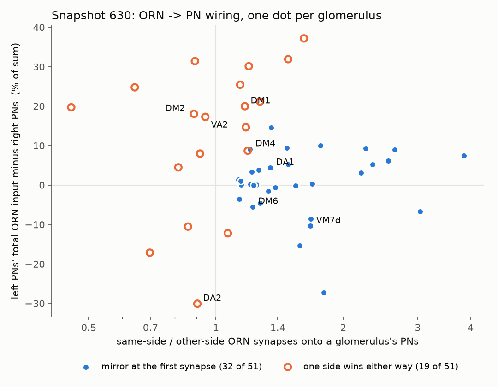
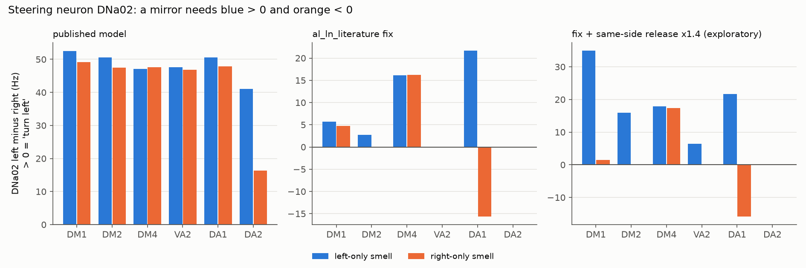

# Phase 6: "a smell on either side says turn left" (the steering result)

Prepared 2026-09-23. Model: the Shiu et al. 2024 whole-brain model, FlyWire snapshot 630,
run with our fast engine, with the validated sign fix
`sim/sign_fixes.build_brain(fix="al_ln_literature")` ("the fix") and without it ("the
published model"). All numbers come from our own runs, saved in
`experiments/phase6/steering/results/`. Labels as in the other Phase 6 docs:
**VALIDATED**, **PRELIMINARY**, **UNVERIFIED**.

---

## 1. The short version

The surprise: stimulating only the LEFT antenna's DM1 smell neurons, or only the RIGHT
antenna's, both make the LEFT DNa02 (a steering neuron) fire more than the right one. So
"left DNa02 minus right DNa02" says "turn left" whatever side the smell is on.

1. **It is not a bug in our code or in the labels.** The left/right labels pass every
   position and wiring check we could run (section 2). DNa02 and DNa01 are the right
   cells on the right sides. Snapshot 783 gives the same numbers.
2. **It is a real property of this wiring diagram, and it is not special to DM1.** Receptor
   neurons do connect more strongly to the projection neurons (PNs) on their own side, as
   in real flies (1.4-1.5 times more synapses overall). But in DM1 the LEFT glomerulus is
   simply much bigger: its PN gets 52% more receptor synapses than the right one, from
   BOTH antennae. That size difference beats the same-side advantage. Across the whole
   antennal lobe, 19 of 51 glomeruli have this problem at the very first synapse
   (section 3).
3. **The model then makes it worse.** Downstream, the left and right DNa02 inhibit each
   other (a "see-saw"). A small, fixed left bias at the input becomes "left always wins"
   at the output.
4. **One smell channel does steer correctly: DA1**, the channel for the pheromone cVA.
   With the fix, a left-only DA1 smell drives the left DNa02 (22.7 Hz vs 1.0 Hz) and a
   right-only one the right DNa02 (15.7 Hz vs 0.1 Hz), in every seed. 15 other pairs of
   descending neurons do the same (section 4). It survives synapse strength +/-10%, a
   weaker input, and silencing the il3LN6 local neurons (section 4d). DA1 is the channel
   the literature says has a dedicated left/right-comparison circuit (Taisz et al. 2023),
   although in the model the steering does not run through that circuit's il3LN6.
   **Catch:** when BOTH antennae smell DA1 (what a real fly in a gradient gets), DNa02 has
   a fixed left offset: equal smell on both sides already gives "turn left" (+17.9 Hz),
   and a stronger RIGHT smell (100 vs 150 Hz) still gives "turn left" (+4.7 Hz). Another
   descending-neuron pair, DNpe002, does get the direction right in 100% of 1-second trials
   for both 150/100 and 100/150 (section 4d), but nobody has shown what DNpe002 does in a
   real fly.
5. **For DM1, DM4, DM2, VA2 and DA2 the model gives no usable left/right signal**, with or
   without the fix.
6. **The most likely missing mechanism** is the one real flies use: each receptor-neuron
   spike releases about 40% more transmitter on its own side (Gaudry et al. 2013). The
   wiring diagram cannot contain that. Adding it (an exploratory test, not a model
   change) makes DM1's projection neurons mirror correctly, but the DM1 steering neurons
   still do not (section 5).

**Verdict: real connectome property (DM1's left glomerulus is bigger in this one fly)
plus a model limitation (no same-side release boost, and a see-saw that turns a small bias
into a fixed winner).** Not a code bug. **PRELIMINARY**: steps 1-4 of the Phase 6
checklist were done, but see section 8 for what is still unverified.

**For Phase 9:** turning toward a DM1 (vinegar) smell, or any of the other food-odour
channels tested, must be labelled **NOT brain-driven**. A brain-driven turn signal exists
only for DA1 (cVA) with the fix: left DNa02 minus right DNa02 works for a smell on one
side only; for both-antennae gradients the only read-out that works is a different pair,
DNpe002, whose job in a real fly is unknown. Details in section 7.

---

## 2. Step 1: bug checks (are the labels right?)

A "side label" says which half of the brain a neuron belongs to. For smell receptor
neurons (ORNs), whose cell bodies sit in the antenna outside the brain, FlyWire's label is
the side of the nerve they enter by. FlyWire's image volume is mirror-flipped relative to
the real fly (docs/reference-notes.md section 3.5), but that does not matter here: ORNs,
PNs and DNs all come from the same label table, so they are flipped together, and the
comparison "same side vs other side" is unaffected. What would matter is labels that
disagree with each other. We checked them against positions (the brain's midline is at
x = 523.6 um in snapshot 630).

| Check (`results/side_checks.csv`) | Result |
|---|---|
| PN cell bodies on the labelled side | 340 of 341 left, 344 of 344 right |
| PNs whose smell input sits mainly in the antennal lobe of their labelled side (783 synapse locations) | 335 of 340 left, 337 of 343 right |
| DNa02 left/right, DNa01 left/right: cell body side | all 4 correct (118-130 um from the midline) |
| DNa02 / DNa01: where their inputs sit (783) | each gets most input in the lateral accessory lobe (LAL) of its own side, e.g. DNa02 left: LAL_L 4,227 synapses |
| DNa01 identity | 630 type `VES006` = 783 type `DNa01`; left IDs differ between snapshots (matched by label in Phase 5), right ID identical |
| ORN "anchor" point on the labelled side | 1,000 of 1,114 left, 1,049 of 1,132 right |
| ORN fingerprint: an ORN should make more synapses onto same-side PNs (`results/orn_label_check_630.csv`) | median same-side share 0.58; two-thirds of ORNs above 0.5 |
| Whole lobe: ORN -> PN synapses, same side vs other side | 99,330 vs 65,842 (1.51x); if the ORN labels were swapped this would be below 1 |
| Whole lobe: ORN -> local neurons, same side vs other side | 63,575 vs 102,982 (other side 1.62x more), which matches the literature: other-side ORNs favour local neurons (Schlegel et al. 2021) |

The ORN "anchor" is a reference point FlyWire places somewhere on the neuron; the ~10% of
ORNs whose anchor sits across the midline mostly look like normal ORNs by the fingerprint
test, so the anchor is just placed on the far branch.

One oddity, recorded but not affecting our glomeruli: 108 of 2,227 ORNs (5%) send more
than 90% of their PN synapses to the side opposite their label. They are mostly small
fragments (median 17 PN synapses vs 59 for a typical ORN) in VA1v, VA1d and VA5. They may
be mislabelled or missing one branch; we cannot tell which from here (**UNVERIFIED**).
DM1, DM4, DM2 and VA2 have none of them; DA1 and DA2 have one each.

**DM1 specifically** (`pn_ipsi_contra_630.csv`, `pn_ipsi_contra_783.csv`):

| | onto the left DM1 PN | onto the right DM1 PN |
|---|---|---|
| from left-antenna ORNs (35) | **2,062** (783: 2,064) | 1,175 (783: 1,183) |
| from right-antenna ORNs (33) | 1,662 (783: 1,664) | **1,275** (783: 1,288) |
| total | 3,724 | 2,450 |

Each PN does get more from its own side (bold), so the labels behave correctly. But the
left PN gets more from BOTH sides: 52% more in total. All 35 left DM1 ORNs give most of
their PN synapses to left-side PNs, and so do 58% of the 33 right ones. **No bug: this is what
the data say, in both snapshots.**

## 3. Step 2: the whole antennal lobe (is DM1 special?)

For each of the 51 glomeruli with PNs on both sides we counted, per side, every ORN -> PN
synapse (`results/glomerulus_map_630.csv`; 783: 53 glomeruli, `glomerulus_map_783.csv`).
Then we asked the simplest "mirror" question: does a left-only smell give the left PNs
more input than the right PNs, AND does a right-only smell give the right PNs more?

| | snapshot 630 | snapshot 783 |
|---|---|---|
| glomeruli where same-side input is stronger | 41 of 51 | 43 of 53 |
| median same-side / other-side ratio | 1.25 | 1.27 |
| **glomeruli that mirror at the first synapse** | **32 of 51** | **33 of 53** |
| glomeruli where the left PNs get more input in total | 35 of 51 | 34 of 53 |

- **DM1 is not special.** It is one of 19 glomeruli where one side wins either way. What
  those 19 have in common is a big left/right size difference (median 20% of the total,
  versus 5% in the ones that mirror). In 15 of the 19 the LEFT side is the bigger one.
- **Three of the four attractive channels we simulate fail: DM1, DM2 and VA2.** DM4
  passes, but only just (a right-only smell gives the right PN 1,126 synapses and the left
  PN 1,125). DA2 (geosmin) fails the other way (the right side is 30% bigger).
- **DA1 mirrors** (ratio 1.34), and so do most others.
- **The literature's same-side advantage is present, but small next to the size
  differences.** Real flies: PNs get more synapses from same-side ORNs (Tobin et al.
  2017, 51 of 53 DM6 ORNs project to both sides; Schlegel et al. 2021; Taisz et al. 2023
  measured 5,184 vs 3,580 synapses, 1.45x, for DA1 PNs in FlyWire; our count for the same
  PNs is 3,090 vs 2,466, 1.25x, probably a different synapse filter, **UNVERIFIED**). But
  Tobin et al. also found the TOTAL input of the left and right DM6 glomerulus to be
  similar, while here DM1 differs by 52%. Whether that is real fly-to-fly variation or a
  reconstruction difference between the two sides of this one brain, we cannot tell.
- **What would fix it at this level:** if every same-side ORN -> PN synapse counted 1.4
  times (Gaudry et al. 2013: about 40% more transmitter per spike from the same-side
  branch), 42 of 51 glomeruli would mirror, DM1 included (just). 1.2x gives 35, 1.6x 45,
  2x 46.

## 4. Step 3: simulations (6 glomeruli, left-only vs right-only, 3 seeds x 30 trials)

`s2_simulate.py`: each glomerulus's ORNs of one side at 150 Hz; 1 s trials with the fix,
300 ms with the published model (it reaches its runaway state within 50 ms,
docs/phase5-olfaction.md). Every descending neuron's rate is saved per trial.
"turn" = left minus right, in Hz; positive means "turn left". A usable steering signal needs
turn > 0 for a left smell and turn < 0 for a right smell.

### 4a. With the fix (`results/steering_table.csv`)

| Glomerulus (odour) | DNa02 L / R, left smell | DNa02 L / R, right smell | turn: left / right smell | mirror? |
|---|---|---|---|---|
| DM1 (vinegar, attractive) | 6.7 / 0.9 | 7.3 / 2.5 | +5.7 / +4.8 | no (d' = 0.2) |
| DM4 (attractive) | 19.4 / 3.3 | 20.0 / 3.7 | +16.1 / +16.3 | no (d' = 0.0) |
| DM2 (attractive) | 3.0 / 0.3 | 0 / 0 | +2.7 / 0 | no (right smell reaches no DN) |
| VA2 (attractive) | 0 / 0 | 0.1 / 0 | 0 / +0.1 | no DN output |
| DA2 (geosmin, aversive) | 0 / 0 | 0 / 0 | 0 / 0 | no DN output |
| **DA1 (cVA pheromone)** | **22.7 / 1.0** | **0.1 / 15.7** | **+21.7 / -15.6** | **yes**, p < 0.001 in every seed, d' = 34 |

d' says how well ONE 1-second trial tells a left smell from a right smell (0 = not at all,
1 = often wrong, 3 or more = almost never wrong). DM1's DNa02 numbers repeat the Phase 7
audit (docs/phase7-neurotransmitter-audit.md 5d: 6.7 / 7.3 and 0.9 / 2.5 Hz).

DNa01 never mirrors either (DM1: turn +2.4 / +3.3 Hz; DM4 +7.6 / +6.9 Hz; DA1: silent).

**Search for any other steering read-out** (`dn_pair_scan.csv`, `dn_pair_candidates.csv`):
we tested all 463 cell types that have a descending neuron on each side. A pair counts
if its turn signal flips sign with the smell's side in all 3 seeds with p < 0.01.

| Glomerulus | active DNs | DNs that change with the smell's side | pairs that flip (toward / away) |
|---|---|---|---|
| DM1 | 52 | 1 | 0 / 0 |
| DM4 | 66 | 0 | 0 / 0 |
| DM2 | 25 | 25 (only because a right smell reaches no DN) | 0 / 0 |
| VA2, DA2 | 0 | 0 | 0 / 0 |
| **DA1** | 41 | 41 (36 prefer their own side) | **16 / 5** |

For DA1 the strongest flipping pairs are DNpe002 (turn +45.9 / -46.3 Hz), DNb05, DNge041,
DNge037, DNpe084, DNbe008, DNae007, DNbe010 and DNa02 (+21.7 / -15.6 Hz). No pair type
flips for any other glomerulus. **So there is no DM1 steering read-out anywhere in the
brain's output in this model.**

Why DNa02 behaves this way (`results/dn_drivers.csv`: input rate x signed synapses):

- **DM1:** the right DNa02 gets 1.3-1.8 times more inhibition than excitation whatever
  the smell's side, mostly from the left `AOTU019` and the right `LAL051` (both inhibitory).
  The left DNa02 gets more excitation than inhibition either way. This is the see-saw in
  the lateral accessory lobe; it is tipped to the left before the smell's side can matter.
- **DA1:** a different, short route. The same-side `DNae007` (itself a descending neuron)
  excites DNa02 on its own side only, and it is only active on the smelled side.

### 4b. Projection neurons (the first relay; `results/pn_ipsi_contra_rates.csv`)

Real flies: the same-side PN fires 30-50% more (Gaudry et al. 2013).

| Glomerulus | left smell: same-side / other-side PN (Hz) | right smell: same-side / other-side PN (Hz) |
|---|---|---|
| DM1 | 210 / 171 (1.23x) | 178 / 195 (**0.92x**, wrong way) |
| DM4 | 189 / 160 (1.19x) | 170 / 168 (1.01x) |
| DM2 | 141 / 115 (1.22x) | 98 / 143 (**0.69x**) |
| VA2 | 168 / 161 (1.04x) | 149 / 170 (**0.87x**) |
| DA1 | 85 / 59 (1.45x) | 73 / 79 (**0.92x**) |
| DA2 | 5 / 38 (**0.14x**) | 42 / 30 (1.42x) |

For every glomerulus one side's PNs win whichever antenna smells, as the synapse counts
predict. Even DA1's PNs (averaged over all 9 per side) do not mirror; its correct
steering must come from circuits further down (section 6 discusses the literature on
this).

### 4c. Published model (no fix)

Same design, 3 seeds x 30 trials of 300 ms (`none` rows of `steering_table.csv`). Every
one of the 6 glomeruli, from either side, sets off the runaway described in docs/phase5-olfaction.md (about 7,600-8,000
neurons firing in every trial).

| Glomerulus | DNa02 L / R, left smell | DNa02 L / R, right smell | turn: left / right smell |
|---|---|---|---|
| DM1 | 52.7 / 0.2 | 49.6 / 0.4 | +52.5 / +49.2 |
| DA1 | 51.0 / 0.4 | 48.2 / 0.3 | +50.6 / +47.9 |
| DM4 | 47.3 / 0.3 | 47.9 / 0.2 | +47.1 / +47.7 |
| DM2 | 50.9 / 0.2 | 47.8 / 0.3 | +50.6 / +47.5 |
| VA2 | 48.0 / 0.3 | 47.5 / 0.7 | +47.6 / +46.9 |
| DA2 | 41.4 / 0.3 | 16.6 / 0.2 | +41.1 / +16.3 |

- **"Hardest left turn" for every smell from every side.** The right DNa02 never passes
  1 Hz. DM1 repeats Phase 5 (52.7 / 49.6 Hz).
- **The runaway also destroys DA1's steering.** Only 2 pair types flip for DA1 (DNpe002
  and DNge222, by at most 4 Hz), none for the other glomeruli. So the working DA1 signal needs the fix, because
  the fix stops the runaway (it does not need il3LN6, section 4d).
- DA2 differs by side only because a right-side DA2 smell starts the runaway less
  reliably, as Phase 5 found; everything is weaker, not mirrored.

### 4d. Robustness of the DA1 signal, and both antennae smelling (`s6_checks.py`)

**One side only, parameter changes** (seed 0, 30 trials; `results/robustness_table.csv`):

| Condition | DNa02 turn: left / right smell | DNpe002 turn | DNb05 turn | mirror? |
|---|---|---|---|---|
| fix, standard (3 seeds) | +21.7 / -15.6 | +45.9 / -46.3 | +46.4 / -41.0 | yes |
| synapse strength 90% | +17.2 / -9.8 | +43.0 / -40.4 | +34.1 / -31.2 | yes |
| synapse strength 110% | +12.4 / -9.6 | +50.2 / -53.3 | +53.0 / -53.2 | yes |
| weaker smell (75 Hz) | +1.6 / -0.1 | +27.4 / -23.4 | +7.3 / -8.2 | yes (DNa02 barely fires) |
| both il3LN6 silenced | +21.5 / -17.4 | +48.2 / -39.9 | +49.0 / -45.1 | yes |

**Both antennae smell, one more strongly** (left/right ORN rates in Hz; 3 seeds x 30
trials; `results/graded_table.csv`, `graded_trial_stats_DA1.csv`). A correct read-out turns
toward the stronger side: positive for 150/100, negative for 100/150.

| Read-out (turn, Hz) | DA1 150/150 | DA1 150/100 | DA1 100/150 | 1-s trials right, 150/100 / 100/150 | DM1 150/150 | DM1 150/100 | DM1 100/150 |
|---|---|---|---|---|---|---|---|
| DNa02 | +17.9 | +21.0 | **+4.7 (wrong)** | 100% / 0% | +31.2 | +17.7 | **+16.2 (wrong)** |
| DNa01 | +5.6 | +0.7 | +0.6 (wrong) | - | +12.5 | +7.7 | **+7.3 (wrong)** |
| **DNpe002** | +3.0 | +16.8 | **-6.1** | **100% / 100%** | 0 | 0 | 0 |
| DNb05 | +11.9 | +28.9 | -5.4 | 100% / 96% | +1.8 | -3.1 (wrong) | +0.5 (wrong) |
| DNge041 | +9.7 | +23.6 | -1.7 | 100% / 74% | 0 | 0 | 0 |

- **DNa02 is not a usable DA1 read-out once both antennae smell.** It has a built-in left
  offset of about +18 Hz. In 50 ms windows (the body loop's window) it is silent in 10-31%
  of windows, and has the right sign in 86% of windows for 150/100 but only 18% for 100/150.
- **DNpe002 (left minus right) is the best lateralized read-out found.** Small offset
  (+3 Hz for equal smell), right sign in every 1-second trial both ways, d' = 19 between
  150/100 and 100/150. It is a pair of descending neurons predicted to be cholinergic
  (excitatory; hemibrain type VES068). We found no study of what it does in a real fly, so using it for turning is an
  assumption (**UNVERIFIED**). Its accuracy in 50 ms windows was not measured.
- **DM1 has nothing:** every read-out says "turn left" (or nothing) whatever the gradient.
  Equal smell on both sides gives the largest left turn of all (+31 Hz on DNa02).

## 5. The most likely missing mechanism, tested (exploratory, NOT a model change)

`al_ln_ipsi` in `s2_simulate.py`: the fix, plus every same-side ORN -> PN connection
multiplied by 1.4 in memory (11,570 connections, 99,296 -> 137,719 synapse-equivalents).
Source: Gaudry et al. 2013 (about 40% more release per spike from the same-side branch).

| Glomerulus | PN same/other, left smell | PN same/other, right smell | DNa02 turn, left / right smell |
|---|---|---|---|
| DM1 | 1.39x | 1.07x (now correct) | +35.0 / +1.5 Hz (still no mirror) |
| DM4 | 1.36x | 1.17x (now correct) | +17.9 / +17.3 Hz |
| DM2 | 1.41x | 0.85x | +15.9 / 0 |
| VA2 | 1.22x | 1.01x | +6.5 / 0 |
| DA1 | 1.80x | 1.19x (now correct) | +21.6 / -15.8 Hz (mirror, unchanged) |

- The release boost makes the first relay behave like a real fly for DM1, DM4 and DA1.
- It is **not enough for steering**: for DM1 the right smell now gives an almost balanced
  DNa02 pair (14.4 vs 12.9 Hz) instead of a clear right turn. 7 minor DN pairs do flip for
  DM1 (the best, DNae015, gives +14.1 / -2.0 Hz), which shows the side information now
  reaches the output, but only weakly.
- So the remaining problem is downstream: the tipped see-saw.

## 6. Step 4: what the literature says

Read in this pass (abstracts or full text):

- **Gaudry et al. 2013**, *Nature* 493:424 (doi:10.1038/nature11747). Each ORN spike
  releases about 40% more transmitter from the axon branch on its own side; the same-side
  PNs spike earlier and more; a walking fly turns toward the antenna that smells more.
- **Tobin, Wilson & Lee 2017**, *eLife* 6:e24838. EM of the left and right DM6 glomerulus:
  PNs receive more synapses from same-side ORNs ("a structural basis for odor
  lateralization"); 51 of 53 ORNs project to both sides; the total ORN -> PN synapse count
  was similar on the two sides even though one side had 3 PNs and the other 2.
- **Schlegel et al. 2021**, *eLife* 10:e66018 (hemibrain). Same-side ORNs make stronger
  connections onto PNs; other-side ORNs connect more to local neurons. We see both.
- **Taisz et al. 2023**, *Cell* (PMID 37236194; FlyWire). For DA1 (cVA): same-side ORN -> PN
  5,184 vs other-side 3,580 synapses; the left/right difference is sharpened by
  contralateral inhibition from the GABAergic local neuron il3LN6, which gets 5 times more
  input from other-side ORNs; the PNs encode the angular position of a male fly. The
  published model treats both il3LN6 as excitatory (the reference file's sign); the fix
  makes both inhibitory (docs/phase7-neurotransmitter-audit.md).
- **Rayshubskiy et al. 2025**, *eLife* (doi:10.7554/eLife.102230; bioRxiv 2020). Light on
  ONE antenna of flies whose ORNs carry a light-gated channel makes the fly steer toward
  that side; the same-side DNa02 fires more and the other one is suppressed (see-saw). Heat
  on one antenna gives the opposite. The shortest olfactory route to DNa02 they found runs
  through the mushroom-body output neuron MBON32. In our model MBON32 makes only 10-40
  synapses onto DNa02 and is not a main driver.
- Seen only as citations in search results (not read): Borst & Heisenberg 1982 (*J Comp
  Physiol* 147:479, "osmotropotaxis": walking flies compare the two antennae);
  Duistermars et al. 2009 (*Curr Biol*, flies need both antennae to follow odour in
  flight); a 2019 *Front Physiol* paper (10:851) reporting that lateral horn neurons sharpen
  the left/right contrast by contralateral inhibition.

**Does the model contradict biology?** Yes, for DM1: real flies turn toward a one-sided
vinegar smell; this model cannot. Per PLAN.md we suspect the model first. Most likely
causes, in order:

1. **No same-side release boost** (Gaudry 2013). The wiring diagram cannot contain it and
   the model uses synapse counts as weights. Adding it fixes the first relay (section 5).
2. **A tipped, winner-take-all see-saw with nothing else going on.** In a real fly the
   steering neurons get constant input from the heading and goal system (PFL3 cells,
   Rayshubskiy 2025), from vision and from the mushroom body. In the model everything is
   silent except the smell, so any fixed bias in the lateral accessory lobe decides the
   winner.
3. **Missing or wrong left/right-comparison circuitry.** DA1 has a documented one
   (contralateral inhibition by il3LN6 in the antennal lobe; third-order neurons in
   Taisz 2023) and it is the only channel that steers here. But the model's DA1 steering
   survives silencing il3LN6 and runs through a short same-side route (DNae007 -> DNa02),
   so the model gets the right answer for DA1 without the literature's mechanism. Whether
   DM1 has such a circuit in real flies, and what the model gets wrong about it, is
   unknown.
4. **Missing electrical synapses** (between sister PNs and from excitatory local neurons
   to PNs, Yaksi & Wilson 2010). These are same-side couplings; they would mainly spread
   activity within one lobe, not change which side wins. Low suspicion.
5. **The fix removing excitatory local-neuron chemical synapses.** Not the cause: the
   published model has the same fixed left winner (section 4c; also Phase 5 and 7).
6. **The data.** DM1's left glomerulus has 52% more ORN -> PN synapses than the right.
   Tobin 2017 found similar totals on the two sides of DM6. This could be real
   individual variation or a left/right reconstruction difference in this one brain.

## 7. Recommendation for the Phase 9 body loop

1. **Vinegar (DM1), the planned demo: label the turning NOT brain-driven.** No read-out in
   the model turns toward a DM1 smell: not DNa02, not DNa01, and none of the 463 left/right
   descending-neuron pairs; not with the fix, not without it; not for one-sided smells and
   not for gradients. The same holds for DM2, DM4, VA2 and DA2. The body loop's current
   result ("hardest left turn" or almost nothing, docs/phase9-body-loop.md) is exactly what
   this predicts. Use the hand-written turning rule the loop already has (`hand_rule`,
   FlyGym's odour-taxis example) and say on screen that turning is not brain-driven. The
   brain can still be shown reacting to the smell.
2. **Do not rescue DM1 by subtracting each neuron's average.** There is almost nothing left
   after subtracting: with the fix, DNa02's turn is +5.7 Hz for a left smell and +4.8 Hz
   for a right one (d' = 0.2; a coin toss would do about as well), and +17.7 vs +16.2 Hz
   for the two gradients.
3. **If a brain-driven turning demo is wanted, use DA1 (cVA) with the fix.**
   - Smell on one antenna at a time: the loop's existing formula (left DNa02 minus right
     DNa02, plus half of DNa01, which stays near zero for DA1) turns the right way in
     every seed and survives the parameter checks.
   - Smell on both antennae (a real gradient): DNa02 fails. The only working read-out is
     left DNpe002 minus right DNpe002, and because nothing is known about DNpe002 in a
     real fly, the turning must then be labelled "driven by a brain signal, but the
     brain-signal-to-turning link is our assumption, not biology". It is untested at the
     loop's 50 ms windows and for differences smaller than 150 vs 100 Hz (the two antennae
     are only 0.3 mm apart, so real differences are small).
   - Biology caveat: cVA is a male pheromone. Taisz et al. 2023 show that fly PNs encode
     where a cVA source is, but whether a fly simply walks toward cVA was not checked here
     (**UNVERIFIED**).
4. **What a real DM1 steering signal would need** (a Phase 7-style decision for the
   owner, not recommended now): the same-side release boost (Gaudry 2013) fixes the
   first relay but not the output (section 5), so the tipped see-saw downstream would also
   have to be dealt with, for example with background activity in the steering network,
   which the model does not have. That is a bigger project with no clear literature
   recipe.
5. **Phase 9 checkpoint** ("approaches food odour; stops when the responsible neurons are
   silenced"): cannot be met with brain-driven turning for food odours in this model. It
   could be attempted for one-sided DA1 smell, with DNa02 silencing as the control.

## 8. Validation status (PLAN.md Phase 6)

| Result | Seeds / parameters | Bug checks | Literature | Biology | Status |
|---|---|---|---|---|---|
| DM1: left DNa02 wins from either side | 3 seeds x 30 trials; fix and published model; two gradients | labels checked by cell body, synapse location and ORN fingerprint; 630 and 783 agree | contradicts Gaudry 2013 and Rayshubskiy 2025 | contradicts | **PRELIMINARY**: real wiring asymmetry plus model limitation |
| 19 of 51 glomeruli do not mirror at the first synapse | wiring counts, two snapshots | same | same-side advantage matches Tobin 2017, Schlegel 2021, Taisz 2023; the big left/right size differences do not match Tobin's DM6 | partly | **PRELIMINARY**; biology vs reconstruction **UNVERIFIED** |
| DA1: mirror in DNa02 and 15 other pairs (with the fix) | 3 seeds; w_syn 90/110%; 75 Hz; il3LN6 silenced | as above | direction fits Taisz 2023 and Rayshubskiy 2025; mechanism differs (not il3LN6) | fits in direction | **PRELIMINARY** |
| DA1 gradients: DNa02 fails, DNpe002 works | 3 seeds x 30 trials, 150/100 and 100/150 Hz | - | no study of DNpe002 found (one search) | unknown | **PRELIMINARY**; DNpe002 function **UNVERIFIED** |
| Same-side release boost fixes PNs, not steering | 3 seeds, one gain (1.4) | in-memory change, build note saved | Gaudry 2013 | - | **EXPLORATORY** (not a model change) |

Not verified in this pass:

- Whether DM1's 52% left excess is real biology or a reconstruction difference between
  the two sides of this one brain.
- The ORN side labels could only be checked indirectly (anchor point and synapse
  fingerprint), not by following each axon to its nerve.
- The 108 ORN fragments whose synapses are almost all on the side opposite their label.
- Our DA1 synapse counts (3,090 vs 2,466) are lower than Taisz et al. 2023 (5,184 vs
  3,580); we assume a different synapse filter, but did not check.
- Three papers were seen only as citations (Borst & Heisenberg 1982; Duistermars et al.
  2009; the 2019 *Front Physiol* lateral horn paper).
- DNpe002 in 50 ms windows and with small left/right differences.
- Phase 6 step 6 (sharing with the FlyWire community or the paper's authors) was not
  done; that is the owner's call. Nothing was shared and no one was contacted.

## 9. Files

`experiments/phase6/steering/`:

- `s1_anatomy.py`: side checks and the ORN -> PN map, snapshots 630 and 783 ->
  `side_checks.csv`, `glomerulus_map_{630,783}.csv`, `pn_ipsi_contra_{630,783}.csv`,
  `al_totals.csv`, `orn_side_detail_783.csv`
- `s1b_orn_label_check.py`: per-ORN fingerprint -> `orn_label_check_630.csv`,
  `orn_label_check_summary.txt`
- `s2_simulate.py`: the simulations -> `results/sim/*.npz` (per-trial rates of all 1,299
  descending neurons and 685 PNs, all-neuron mean rates), `*_build_note.txt`, log
  `s2_simulate.log`
- `s3_analyze.py` -> `steering_table.csv`, `flip_summary.csv`, `dn_pair_scan.csv`,
  `dn_pair_candidates.csv`, `dn_pair_candidates_by_type.csv`, `pn_lateralization.csv`,
  `pn_ipsi_contra_rates.csv`
- `s5_drivers.py` -> `dn_drivers.csv`
- `s6_checks.py`, `s7_checks_analyze.py` -> `results/checks/*.npz`, `graded_table.csv`,
  `robustness_table.csv`, log `s6_checks.log`
- `s4_plots.py` -> `plots/glomerulus_map.png`, `plots/steering_turn.png`
- `log-entry.md`: the EXPERIMENTS.md entry
