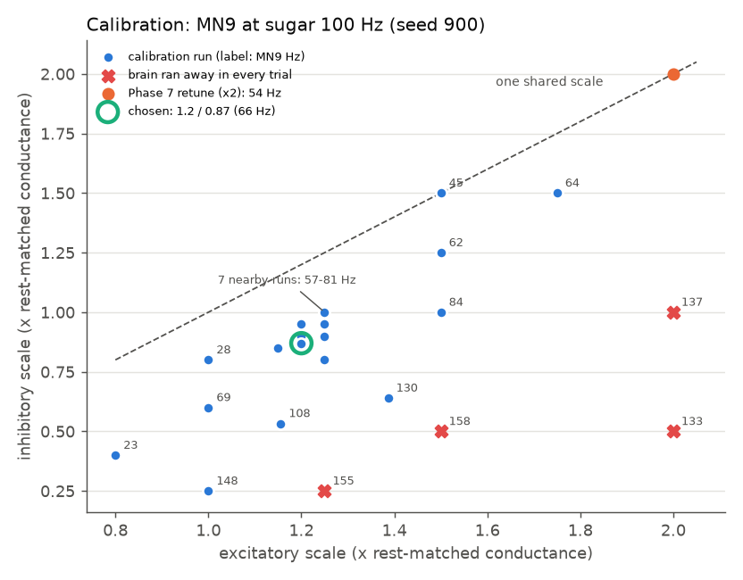
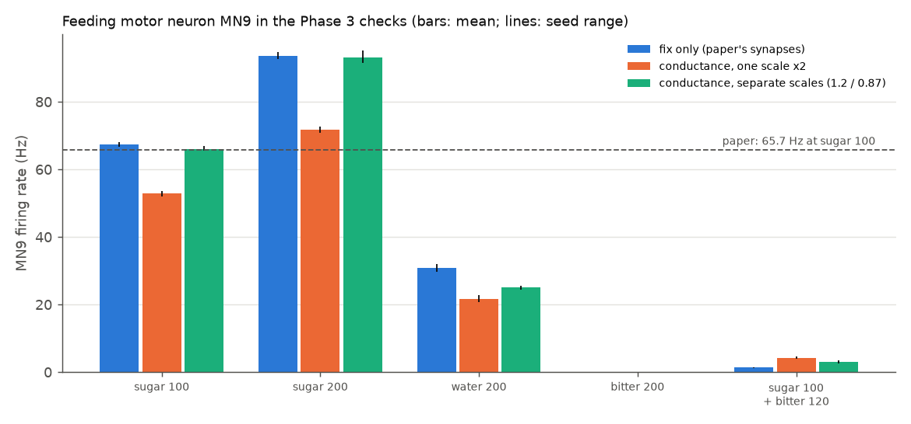
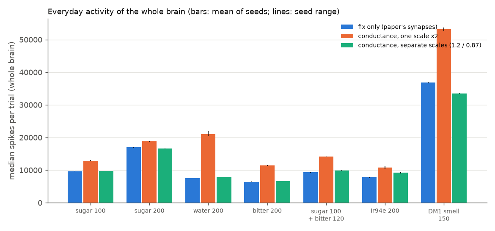
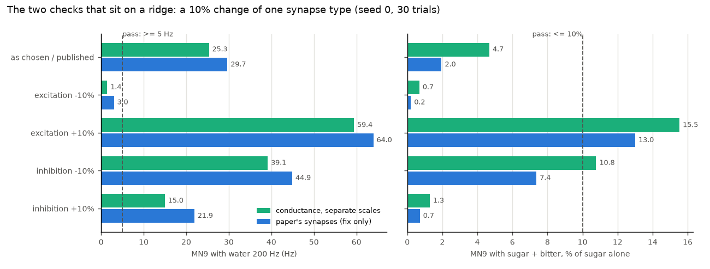

# Phase 7, upgrade 2 again: conductance-based synapses on top of the sign fix

*Written 2026-09-23. Code: `sim/realism.py` (additions only: two new settings, a builder for the
sign-fixed brain, and a named preset) and `tests/test_realism_conductance.py`. Scripts, raw
results and plots: `experiments/phase7_cond/`. Status: **PRELIMINARY** (section 8).*

## 1. The short version

**What upgrade 2 is.** In the paper's model every synapse gives the receiving neuron the same
fixed push, whatever that neuron's voltage is. Real synapses open ion channels, and the push
shrinks as the voltage gets close to the channel's "reversal potential" (the voltage where that
channel stops pushing): about 0 mV for the excitatory (acetylcholine) channels and about -60 mV
for the inhibitory (GABA and glutamate) chloride channels. The first attempt
(`docs/phase7-realism.md`) failed: switched on as it was, the feeding neuron MN9 barely fired
(6.8 Hz instead of ~66 Hz); making every synapse twice as strong fixed the feeding numbers but
made the brain "run away" (lock into non-stop firing) with water, bitter or sugar alone.

**Question 1: does the sign fix already cure that?** Yes, for the runaway. With the sign fix
`al_ln_literature` (docs/phase7-neurotransmitter-audit.md), the same twice-as-strong version ran
away in **0 of 90** trials each with water, bitter, sugar 100 Hz and sugar 200 Hz alone (the
unfixed brain: 19, 4, 2 and 2 of 90). It now passes every Phase 3 check and never runs away with any
input tested. But two problems stayed: MN9 still falls short of the paper's number (52.8 Hz
against 65.7 Hz; one strength setting can never reach it), and the everyday activity of the
whole brain is still raised (water: 2.8 times as many spikes as the fix-only model; bitter 1.8
times; sugar 100 Hz 1.3 times). So one strength knob is still not enough.

**The repair: separate strengths for excitation and inhibition.** Two numbers were tuned (the
most allowed; the paper tuned one): every excitatory synapse **x1.2** and every inhibitory
synapse **x0.87**, relative to the "rest-matched" starting point of the first attempt. They were
tuned only on sugar 100 Hz, on a random seed used for nothing else, to hit two targets: MN9 =
65.7 Hz (the paper's number) and the same total amount of brain activity as the fix-only model
under that same input. Everything else was held back as a test.

**Held-out tests (3 seeds x 30 one-second trials each): everything passed.**

* All six Phase 3 feeding checks pass on every seed (sugar 100 Hz: 66.1 Hz; sugar 200 Hz:
  93.1 Hz; water: 25.1 Hz; bitter alone: 0 Hz; sugar + bitter: 3.0 Hz, 5% of sugar alone).
* **0 runaways in 90 trials in each of 9 input conditions** (water, bitter, sugar 100 and 200,
  sugar + bitter, Ir94e 200 Hz, and DM1 smell at 150 Hz on both sides, left only, right only).
* The whole brain stays as busy as the fix-only model (0.91 to 1.17 times its spike count).
* Neuron by neuron it is almost the same brain as the fix-only model (correlation 0.982 to 0.996;
  42 to 48 of the 50 most active neurons are the same; two seeds of the fix-only model share
  47 to 50).

**Is it balanced on a knife edge?** Partly, and mostly in the same way as the paper's own model
(section 6). Stability is robust: none of 1,140 trials with either scale, or both, changed by
10% ran away. The feeding checks are not: they depend on the balance between excitation and
inhibition. 10% weaker excitation and water no longer drives MN9 (1.4 Hz, the bar is 5 Hz); 10%
stronger excitation, or 10% weaker inhibition, and bitter no longer holds sugar down enough (MN9
at 15.5% and 10.8% of sugar alone, the bar is 10%). But shifting the **paper's own** excitatory
synapses by 10% breaks exactly the same two checks (water 3.0 Hz; bitter 13%), so this edge is
inherited from the paper's model; the conductance synapses make it a little sharper. Changing
both scales together by 10% (the kind of change the paper's one tuned number makes) breaks
nothing.

**What is measured and what is tuned** (section 2): the two reversal potentials are published
fly measurements; the two strengths are tuned. No published fly measurement was found that
gives the strength of a single inhibitory synapse next to a single excitatory one, so the ratio
between the two could not be taken from data (section 7).

**Verdict: usable, as an optional and PRELIMINARY switch, not as the new default.** It passes
every held-out check on every seed and keeps the brain stable and close to the fix-only model,
which the first attempt could not do. It is not the default because its two strengths are fitted
rather than measured, and because the water and bitter results hang on the balance between them
(as they do in the paper's model, but a little more tightly). Use it together with the sign fix
(`build_realistic_brain("al_ln_literature", realism=CONDUCTANCE_SEPARATE_SCALES)`), and cross-check
any result that depends on it against the fix-only model.

---

## 2. What is measured and what is tuned

| Number | Value | Measured or tuned? | Source |
|---|---|---|---|
| Excitatory reversal potential | 0 mV | **measured** (nicotinic receptors are cation channels; +8.9 mV in cultured fly Kenyon cells) | Lee & O'Dowd 1999; Su & O'Dowd 2003 |
| Inhibitory reversal potential | -60 mV | **measured**, with a caveat: published fly values are -37 to -60 mV in whole-cell recordings, where the pipette sets the chloride level; -60 mV is the most negative; T4 neurons in living flies: -68 mV (GABA) and -71 mV (glutamate) | Rohrbough & Broadie 2002; McCarthy et al. 2011; Su & O'Dowd 2003; Groschner et al. 2022 |
| Rest -52 mV, threshold -45 mV, reset, 20 ms membrane and 5 ms synapse time constants, 1.8 ms delay | unchanged | taken from the paper's model | Shiu et al. 2024 |
| Paper's synapse strength (0.275 mV per synapse) | unchanged | **tuned by the paper** (its one free number) | Shiu et al. 2024 |
| "Rest-matched" starting point | one synapse at rest pushes exactly as in the paper | a **convention**, not data | `docs/phase7-realism.md` |
| Excitatory scale | **1.2** | **tuned here** | this document |
| Inhibitory scale | **0.87** | **tuned here** | this document |
| Sign fix | `al_ln_literature` | literature-based, validated in its own lane | `docs/phase7-neurotransmitter-audit.md` |

**Calibration targets** (both on sugar 100 Hz, seed 900, which no check uses):

1. MN9 fires at **65.7 Hz** (the paper's value; the same target the paper and Phase 7 used);
2. the brain fires the **same total number of spikes** as the fix-only model under that input
   (median 9,736 per one-second trial). This is a model-to-model target, not a measurement: it
   says "the new synapses should not make the brain as a whole busier or quieter". It was needed
   because one target cannot fix two numbers, and no measurement of the inhibition-to-excitation
   ratio was found.

**Held out as tests** (never used for tuning): sugar 200 Hz, water, bitter alone, sugar + bitter,
left/right MN9, every runaway rate, the neuron-by-neuron comparison, the one-spike triggers,
Kenyon cells and steering.

**What the tuned pair means physically.** Per synapse, in units of the neuron's own resting
("leak") conductance: excitatory 0.00635, inhibitory 0.0299 (4.7 times the excitatory one; the
rest-matched start had 6.5 times). Equivalently: each synapse pushes exactly as hard as in the
paper when the neuron sits at **-49.5 mV** (between rest, -52 mV, and threshold, -45 mV) instead
of exactly at rest, and then every synapse is made **14%** stronger (conductance synapses need a
little extra because excitation also "short-circuits" itself). At rest one excitatory synapse
pushes 1.2 times the paper's amount and one inhibitory synapse 0.87 times; near threshold 1.04
and 1.6 times.

## 3. Question 1: the one-scale "x2" version on the sign-fixed brain

3 seeds x 30 trials, the same seeds and inputs as Phase 3/7. "Runaway" uses the Phase 6
definition (more than 1,500 different neurons firing in some 10 ms slice); the Phase 7 rule
(more than 5 times the median spike count) gives the same answer here (0 in every condition).

| Input | runaway, unfixed brain (Phase 7) | runaway, sign-fixed brain | MN9, sign-fixed (Hz) | spikes per trial vs fix-only |
|---|---|---|---|---|
| water 200 Hz | 19 / 90 | **0 / 90** | 21.7 | 2.76x |
| bitter 200 Hz | 4 / 90 | **0 / 90** | 0.0 | 1.78x |
| sugar 100 Hz | 2 / 90 | **0 / 90** | 52.8 | 1.34x |
| sugar 200 Hz | 2 / 90 | **0 / 90** | 71.8 | 1.11x |

(The unfixed numbers used the Phase 7 rule; a Phase 7 water runaway had 298,967 spikes, far
above either bar.) The biggest trial of the fixed brain had 36,273 spikes (sugar 200 Hz),
nowhere near an ignition. So the sign fix removes these
runaways: they went through the antennal-lobe loop that the fix cuts. Phase 7 had found that
silencing only the 38 eLNs left 2 of 30 water runaways; the full fix, which covers the whole
population of excitatory antennal-lobe local neurons, leaves none.

What the fix does not change: MN9 at sugar 100 Hz stays 20% below the paper (52.8 Hz; Phase 7
showed that no single strength reaches 65.7 Hz, because past x2 the extra activity goes
elsewhere), the everyday activity stays high, and neuron by neuron the x2 brain differs clearly
from the fix-only model (correlation 0.84 to 0.95; 36 to 45 of the top 50; water most
different).

The rest of the checks for the x2 version (run last): it passes sugar + bitter on every seed
(4.2 Hz, 8% of sugar alone), so **with the sign fix the x2 version passes all six Phase 3 checks
and never runs away**: 0 of 90 also with Ir94e 200 Hz and with DM1 smell at 150 Hz. But it is
1.4-1.5 times as busy there as well, and neuron by neuron it differs most under Ir94e
(correlation 0.86; only 17 of the top 50 the same). Its one-spike triggers do not ignite (50, 93
and 2,943 spikes). The projection-neuron kick briefly makes 1,587 different neurons fire in one
10 ms slice, which the 1,500-neuron rule counts as a runaway, but that is the kick itself: 2,943
spikes in total and no neuron firing in the last 100 ms, against 400,000 or more in a real
ignition. So the x2 version is now stable but still off target and busier than the paper's brain;
the separate scales below fix both.

## 4. The calibration: why two scales, and where they landed



22 settings were tried on sugar 100 Hz, seed 900 (15 trials each while searching, 30 near the
answer; `results/fit.csv`). What they show:

* **Along the diagonal (one shared scale) the target is out of reach**, as Phase 7 found:
  x1.5 gives 45 Hz; x2 gives 53-54 Hz.
* **Weakening inhibition relative to excitation is what raises MN9.** At x1.5 excitation, going
  from x1.5 to x1.25 to x1.0 inhibition takes MN9 from 45 to 62 to 84 Hz.
* **Too little inhibition ignites the brain** (red crosses): e.g. x1.5 / x0.5, x1.25 / x0.25 and
  x2 / x1 ran away in every trial.
* **Many pairs hit 65.7 Hz** (a whole line of them), so a second target was needed to pick one:
  equal total activity. Solving both targets on the 5 nearby 30-trial points gave x1.196 /
  x0.866; rounded to **x1.2 / x0.87**, which gave **66.2 Hz** and **9,866** spikes per trial
  (targets 65.7 Hz and 9,736) on the calibration seed.

## 5. Validation of the chosen setting (held-out tests)

3 seeds x 30 one-second trials for every condition, the same seeds and inputs as the fix-only
model's runs in the sign-fix lane, whose numbers are used for comparison (they are not re-run).



### 5a. Phase 3 checks (MN9, the feeding motor neuron, Hz)

| Check (bar) | fix only | separate scales | per seed | holds? |
|---|---|---|---|---|
| sugar 100 Hz drives MN9 (>= 20 Hz; paper 65.7) | 67.3 | **66.1** | 65.5 / 66.0 / 66.9 | yes |
| sugar 200 Hz more than 100 Hz | 93.5 | **93.1** | 91.6 / 92.5 / 95.2 | yes |
| opposite-side MN9 above same-side | yes | yes | all seeds | yes |
| water 200 Hz drives MN9 (>= 5 Hz, below sugar 200) | 30.8 | **25.1** | 25.3 / 24.4 / 25.6 | yes |
| bitter 200 Hz alone: silent (<= 1 Hz) | 0.0 | **0.0** | 0 / 0 / 0 | yes |
| sugar 100 + bitter 120: near 0 (<= 10% of sugar alone) | 1.36 | **3.03** | 3.1 / 3.5 / 2.6 | yes |

Water drives MN9 18% less than in the fix-only model, and bitter lets a little more sugar
signal through (5% of sugar alone instead of 2%); both still pass comfortably.

### 5b. Runaway (Phase 6 definition)

| Input | fix only | separate scales | spikes per trial vs fix-only |
|---|---|---|---|
| sugar 100 Hz | 0 / 90 | **0 / 90** | 1.01x |
| sugar 200 Hz | 0 / 90 | **0 / 90** | 0.98x |
| water 200 Hz | 0 / 90 | **0 / 90** | 1.04x |
| bitter 200 Hz | 0 / 90 | **0 / 90** | 1.03x |
| sugar 100 + bitter 120 | 0 / 90 | **0 / 90** | 1.06x |
| Ir94e 200 Hz | 0 / 90 | **0 / 90** | 1.17x |
| DM1 smell 150 Hz, both sides | 0 / 90 | **0 / 90** | 0.91x |
| DM1 left only / right only | 0 / 90 each | **0 / 90 each** | |

0 of 90 has a 95% range of 0-4%. The largest single trial in any condition had 36,220 spikes
(DM1), against ~300,000 or more for a real ignition.



**One-spike triggers** (the sign-fix lane's test: kick a group of antennal-lobe neurons once and
see whether the brain ignites; one 1 s run each):

| Trigger | fix only | separate scales |
|---|---|---|
| 10 DM1 smell neurons fire once | 31 spikes | 36 spikes |
| the 44 eLNs fire once | 81 | 85 |
| all 685 projection neurons fire once | 3,589 | 2,154 |

Nothing ignites (the unfixed brain ignites with 445,000 to 746,000 spikes).

### 5c. Neuron by neuron, against the fix-only model

Spike rates of every neuron (the stimulated neurons left out), seed k of one model against seed
k of the other (same inputs), averaged over the 3 seeds. The "noise floor" is the fix-only model
against itself with a different seed.

| Input | correlation | same neurons in the top 50 | noise floor (correlation / top 50) | x2 version, for comparison |
|---|---|---|---|---|
| sugar 100 Hz | 0.991 | 45.7 | >= 0.999 / 49.3 | 0.925 / 36 |
| sugar 200 Hz | 0.991 | 47.7 | >= 0.999 / 49.3 | 0.946 / 40 |
| water 200 Hz | 0.993 | 46.7 | >= 0.999 / 50 | 0.840 / 41 |
| bitter 200 Hz | 0.996 | 47.7 | >= 0.999 / 49.3 | 0.914 / 44.7 |
| sugar 100 + bitter 120 | 0.988 | 42 | >= 0.999 / 49 | |
| Ir94e 200 Hz | 0.985 | 47 | 0.999 / 49.3 | |
| DM1 150 Hz | 0.982 | 44 | 0.999 / 47.3 | |

So the separate-scales brain is close to the fix-only brain but measurably different (the
correlations are below the noise floor): the changes are real but small. Measured as the gap to
a perfect correlation, they are 6 to 23 times smaller than those of the x2 version.

### 5d. Smell readouts (re-check of the sign-fix lane's sections 5c and 5d)

| Readout (DM1 smell 150 Hz) | fix only | separate scales |
|---|---|---|
| Kenyon cells firing per trial, both sides | 3.6% | 3.3% |
| Kenyon cells, one side | 2.1-2.2% | 2.1% |
| DNa02 left / right, left odour (Hz) | 6.7 / 0.9 | 6.5 / 1.7 |
| DNa02 left / right, right odour (Hz) | 7.3 / 2.5 | 9.4 / 5.7 |
| turn signal (left minus right), left / right odour | +5.7 / +4.8 | +4.9 / +3.7 |

The Phase 5 steering problem is unchanged: both odour sides still give a "turn left" signal. The
right DNa02 now responds more to a right-side odour (5.7 against 1.7 Hz, every seed), the right
direction, but not enough to beat the left bias.

## 6. Sensitivity: is it balanced on a knife edge?

All runs below: seed 0 x 30 one-second trials, the same inputs for every row. The chosen
setting's seed 0 is the reference. A check "breaks" when its bar from section 5a is missed.

**The chosen setting with its tuned scales changed by 10%:**

| Setting (excitatory / inhibitory scale) | sugar 100 | sugar 200 | water | sugar + bitter (% of sugar) | checks | runaway |
|---|---|---|---|---|---|---|
| chosen (1.2 / 0.87) | 65.5 | 91.6 | 25.3 | 3.1 (4.7%) | 6 of 6 | 0 / 210 |
| excitation -10% (1.08 / 0.87) | 38.8 | 73.5 | **1.4** | 0.3 (0.7%) | 5 of 6 (water) | 0 / 210 |
| excitation +10% (1.32 / 0.87) | 77.5 | 106.3 | 59.4 | **12.0 (15.5%)** | 5 of 6 (bitter) | 0 / 210 |
| inhibition -10% (1.2 / 0.78) | 73.9 | 104.2 | 39.1 | **8.0 (10.8%)** | 5 of 6 (bitter, just) | 0 / 210 |
| inhibition +10% (1.2 / 0.96) | 54.5 | 84.2 | 15.0 | 0.7 (1.3%) | 6 of 6 | 0 / 210 |
| both -10% (1.08 / 0.78) | 55.1 | 87.7 | 5.5 | 0.5 (0.8%) | 6 of 6 (water just) | 0 / 150 |
| both +10% (1.32 / 0.96) | 69.5 | 99.1 | 44.4 | 5.5 (7.9%) | 6 of 6 | 0 / 150 |

(MN9 in Hz. "Runaway" counts every condition run: the seven checks of section 5b for the
single-scale rows, the five taste inputs for the "both" rows. Bitter alone stayed at 0 Hz and
the opposite-side MN9 stayed above the same-side one in every row.)

**The same test on the paper's own synapses (fix-only model).** To see whether this sensitivity
comes from the upgrade, the paper's current-based synapses were rebuilt as a conductance model
with reversal potentials so far away (+-1,000 V) that the push never changes, which turns it back
into the paper's model (checked in `tests/test_realism.py`, and here: 67.8 / 93.9 / 29.7 / 1.4 Hz
against 68.2 / 94.7 / 29.7 / 1.3 Hz for the real thing). Then its excitatory or inhibitory
synapses were scaled on their own:

| Paper's synapses | sugar 100 | sugar 200 | water | sugar + bitter (% of sugar) | checks |
|---|---|---|---|---|---|
| as published | 68.2 | 94.7 | 29.7 | 1.3 (2.0%) | 6 of 6 |
| excitation -10% | 48.9 | 78.5 | **3.0** | 0.1 (0.2%) | 5 of 6 (water) |
| excitation +10% | 82.0 | 107.6 | 64.0 | **10.7 (13.0%)** | 5 of 6 (bitter) |
| inhibition -10% | 77.8 | 103.5 | 44.9 | 5.7 (7.4%) | 6 of 6 |
| inhibition +10% | 60.6 | 86.2 | 21.9 | 0.4 (0.7%) | 6 of 6 |
| all synapses -10% / +10% (other lanes) | 59.1 / 73.6 | | 7.2 at -10% | | 6 of 6 |

(Last row: the sign-fix lane's synapse-strength runs, 1 seed, and Phase 5's water number, 3
seeds; the taste results of the fixed and unfixed brains are identical.)

**What this says:**

* **Stability is not on a knife edge.** None of the 1,140 trials of the conductance model with a
  changed scale ran away, including Ir94e and DM1 smell input.
* **The feeding checks are on a ridge, and the ridge comes from the paper's model.** The water
  result needs enough excitation, the bitter result needs enough inhibition, and the paper's
  model sits between the two cliffs just like the new one: the same 10% shift of its excitatory
  synapses breaks exactly the same two checks. (Phase 5 had already found the water result
  "fragile" in the paper's model.)
* **The conductance version is somewhat more sensitive.** For a 10% change in excitation, MN9 at
  sugar 100 Hz moves by -41% / +18% (paper's model: -28% / +20%); and 10% less inhibition just
  breaks the bitter check (10.8%, bar 10%), which the paper's model survives (7.4%). One likely
  reason: conductance synapses near threshold give inhibition more pull (section 2: 1.6 times the
  paper's push), so the outcome rests on a tighter balance.
* **The overall strength is not on a knife edge.** Changing both scales together by 10% keeps
  every check, as in the paper's model.
* **Which bar?** Phase 7 required sugar + bitter to be at most 10% of sugar alone; Phase 5 used
  50%. Under the Phase 5 bar every row above passes the bitter check.



## 7. What published data could pin the two strengths, and why none did

The task asked for the strengths to come from data where possible: unitary synaptic potentials
or conductances for fly cholinergic versus GABA/glutamate-chloride synapses, and reversal
potentials measured in fly central neurons. What was found:

* **Excitatory synapses: good data exist, but only for one side.** In the olfactory system,
  projection neurons have an input resistance of 598 +/- 69 MOhm and rest at about -55 to -60 mV
  in the living fly, and each ORN-to-PN connection has many release sites (10-50) (Gouwens &
  Wilson 2009, J Neurosci 29:6239; PMC2709801). Projection-neuron to lateral-horn connections
  give single-spike potentials of 0.4 to 6.6 mV, predicted by the density and location of their
  synapses (Liu, Davoudian, Lizbinski & Jeanne 2022, Curr Biol 32:559; bioRxiv version). That
  study recorded **only cholinergic (excitatory)** connections.
* **Inhibitory synapses: no per-synapse measurement found.** Several searches found no fly
  paper that reports the size of one inhibitory synapse (or of an inhibitory connection with a
  known synapse count) in a form that can be set next to the excitatory numbers. (Searches are
  not proof of absence; this is the main literature gap.)
* **Reversal potentials: confirm the setup, not the strengths.** In T4 motion-detecting neurons
  of living flies, GABA currents reverse at -68 mV and glutamate (GluCl) currents at -71 mV, only
  3-6 mV below the cell's leak reversal (-65 mV), and removing the glutamate-gated chloride
  channel raises T4's input resistance from 5.28 to 6.70 GOhm (Groschner, Malis, Zuidinga &
  Borst 2022, Nature 603:119; PMC8891015). So fly inhibition sits
  close to rest and works largely by "short-circuiting" (shunting), as in the model (8 mV below
  rest). This explains why the rest-matched start needs such large inhibitory conductances (6.5
  times the excitatory ones) and why the result depends so much on how inhibition is scaled, but
  it does not give a number for either scale.

**Therefore the two scales are tuned, and said so everywhere.** One plausibility check on the
tuned pair: it is equivalent to matching the paper's synapse strength at -49.5 mV, inside the
range where the model neurons actually work (-52 mV rest to -45 mV threshold), rather than at
exactly -52 mV; the paper's own strength was itself fitted on spiking, which happens in that
range. That makes the tuned pair reasonable, not measured.

## 8. Validation status (PLAN.md Phase 6) and what was not verified

| Step | Status |
|---|---|
| 1. seeds and parameter variations | 3 seeds x 30 trials for every check; +-10% of each tuned scale and of both together (1 seed x 30 trials each), compared with the same changes to the paper's synapses; not varied: the reversal potentials, threshold, time constants |
| 2. bug checks | tests pass (section 9); with every switch off the new builder gives the sign-fixed brain spike for spike (whole brain); two equal scales give exactly the old one-scale model; each scale changes only its own synapses |
| 3. literature | section 7; all three new sources were read through a web tool that returns quoted key sentences, not line by line |
| 4. biology | taste results as in the paper; no runaway; Kenyon cells sparse (3.3%); steering still wrong (as before the upgrade) |
| 5. write-up | this document |
| 6. share | not done (owner's call) |

**Status: PRELIMINARY.** Not verified or not done:

* The inhibitory reversal potential was kept at -60 mV; the scales were not re-fitted for other
  published values (-50 or -70 mV), so how much the tuned pair depends on it is unknown.
* The +-10% runs used 1 seed x 30 trials each (the main setting has 3 seeds).
* The three new sources (Gouwens & Wilson 2009; Liu et al. 2022; Groschner et al. 2022) were
  read through a web tool that returns quoted key sentences, not line by line.
* Upgrade 2 was not stacked with upgrades 1 (delays) or 3 (adaptation): the Realism rule adds
  one upgrade at a time.
* Only snapshot 630 and the fast engine (no Brian2 cross-check of the conductance model on the
  whole brain; the small-network integration is checked against an ODE solver in
  `tests/test_realism.py`).
* The machine rebooted during the runs (03:09); every run resumed from its saved partial results
  (trial-by-trial files), and no trial was run twice (checked: 3,350 trials, no duplicate trial
  keys). `results/trials.csv` also holds 20 unused trials of a left-only smell run for one
  variant, started by the first run queue before the reboot and not needed. For about 90 minutes
  after the restart the machine ran very slowly (one 30-trial run took 90 minutes); the results
  do not depend on speed.

## 9. Files, tests and how to use it

* `sim/realism.py` (additions only): settings `cond_exc_scale` and `cond_inh_scale` (default 1.0
  = exactly the old behaviour), the preset `CONDUCTANCE_SEPARATE_SCALES`, and
  `build_realistic_brain(fix, ...)`, which builds the realistic engine on a sign-fixed brain.
  Also fixed: a sign-fixed brain looked for a neuron-position file named after the fix, so
  "sign fix + distance delays" could not be built (reported by the app lane); it now reads the
  plain snapshot's positions.
* `tests/test_realism_conductance.py`: 10 fast tests and 2 whole-brain tests. Fast: the two new settings
  at 1.0 change nothing, spike for spike (3 random networks), and are ignored when conductance is
  off; two equal scales of 2 give exactly the old single scale of 2; each scale changes only its
  own kind of synapse (x2 excitatory doubles the excitatory potential and leaves the inhibitory
  one identical, and the other way round); the summary output (`describe()`) is unchanged unless
  the new settings are used; the preset equals the validated configuration; a sign-fixed brain
  finds the plain snapshot's positions. Whole brain: the new builder with every switch off gives
  exactly the spikes of `sign_fixes.build_brain("al_ln_literature")` and of the untouched
  baseline engine; "sign fix + distance delays" builds and runs. Last runs (2026-09-23, after the final code
  edit): fast `28 passed, 3 deselected` (18 old + 10 new) and whole brain `3 passed, 28
  deselected` (1 old + 2 new); `tests/test_realism.py` itself is unchanged.
* `experiments/phase7_cond/`: `run_cond.py` (all runs; resumable), `analyze.py` (tables and
  plots), `queue_*.sh` (the run order actually used), `results/` (`trials.csv` one row per
  trial, `fit.csv` the calibration, `counts/` spikes per neuron, `table_*.csv`, `summary.md`,
  `log_*.txt`; `fit_misaligned_v1.csv` is the first calibration file, whose columns a
  bookkeeping bug shifted, so `fit.csv` was rebuilt from the run logs), `plots/`, `log-entry.md`
  (the EXPERIMENTS.md entry).

```python
from sim.realism import build_realistic_brain, CONDUCTANCE_SEPARATE_SCALES
brain = build_realistic_brain("al_ln_literature", n_threads=2,
                              realism=CONDUCTANCE_SEPARATE_SCALES)
res = brain.run(excite=sugar_ids, rate_hz=100, n_trials=30, seed=0)
brain.run_baseline(...)   # the same brain with the paper's synapses, for comparison
```
