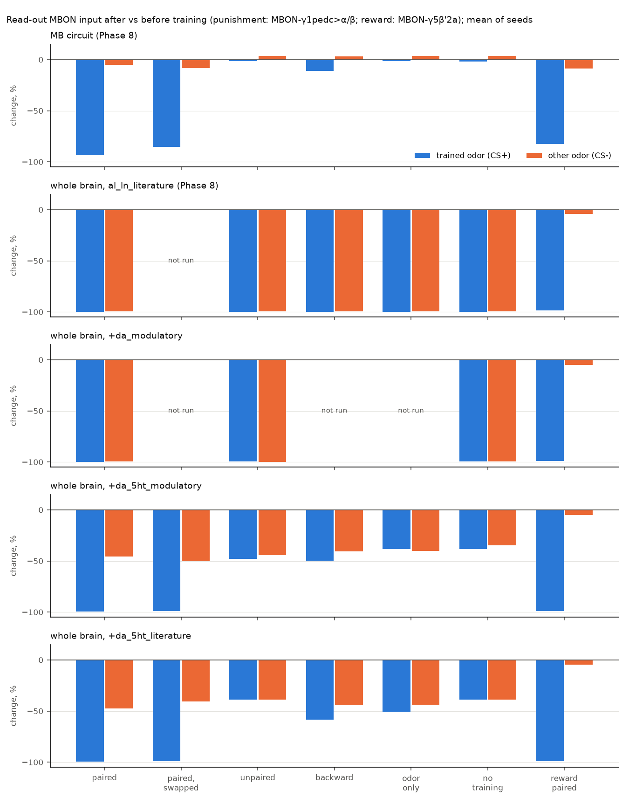

# Phase 7 item 5: dopamine and serotonin cells as "slow" signals, not fast pushes

*Written 2026-09-23. Code: `sim/sign_fixes.py` (three new fix names; tests:
`tests/test_neuromod.py`). Experiments, raw results and plots: `experiments/phase7_neuromod/`
(what changes, identity checks, Phase 3 / Phase 6 checks) and `experiments/phase8_aversive/`
(the Phase 8 learning experiments again). Every number below comes from our own runs and is
saved there.*

**Status: PRELIMINARY.** 3 seeds each, controls included, but not independently reviewed
(PLAN.md Phase 6), and several points below rest on assumptions that are listed in section 8.

---

## 1. The short version

- **The problem.** The published model treats every cell that is not GABA- or
  glutamate-using as a fast "push" (excitation), including dopamine and serotonin cells. In
  Phase 8 this blocked punishment learning in the whole brain: a smell alone made the
  "punishment" dopamine neurons PPL1-γ1pedc fire about 16 spikes per sniff, more than the
  artificial punishment, so every smell looked "bad" after one sniff.
- **Who was pushing them? Mostly serotonin cells, not dopamine cells.** The biggest outside
  push came from SMP384, whose machine-guessed transmitter is dopamine (63-65% confidence),
  but whose literature entry in FlyWire says **serotonin**; the second biggest, SMP504, is
  guessed acetylcholine but is also **serotonin** in the literature entry. Both entries come
  from one source of the weaker kind (a matching single-cell image in a serotonin-neuron
  genetic line, Chiang et al. 2011), not from antibody staining. SMP384's cell body sits
  among antibody-confirmed serotonin cells. So this is a "wrong transmitter" question AND a
  "fast or slow" question at the same time; for the model both lead to the same change.
- **What the papers say.** Every known fly dopamine and serotonin receptor is a slow
  receptor (it works through chemical messengers inside the cell, over tenths of a second to
  minutes), and no dopamine- or serotonin-gated fast channel has been reported in flies.
  Some of these cells also release a fast transmitter, and where that is known it is not a
  push: fly dopamine neurons also release GABA or glutamate, which act as brakes. Octopamine
  cells mostly also release glutamate, so they were left alone.
- **Three new model versions** (all start from the recommended `al_ln_literature`; nothing
  else changes): dopamine cells lose their fast outputs (`+da_modulatory`, 494 cells);
  dopamine and serotonin cells lose them (`+da_5ht_modulatory`, 997 cells); and the same,
  but only for cells whose transmitter is known from the literature, not just guessed
  (`+da_5ht_literature`, 445 cells).
- **Checks against the paper's results.** All three keep sugar -> feeding, bitter -> no
  feeding, sugar + bitter -> almost no feeding, no runaway, and sparse smell responses in
  the learning centre. The two versions that include merely *guessed* dopamine cells weaken
  water -> feeding by 28% (31 -> 22 spikes/s); the cause is three taste-area cells guessed
  "dopamine" with no literature support. The literature-only version leaves water (and
  sugar) essentially untouched: **it passes every check.**
- **Punishment learning in the whole brain.** Removing dopamine cells' fast outputs alone does
  **not** help (PPL1-γ1pedc still fires about 13 spikes per sniff; every condition still ends
  near -100%). Also removing the literature serotonin cells' fast outputs does: PPL1-γ1pedc
  no longer fires on the first sniff (0 spikes; about one stray spike per 8-10 later sniffs).
  Pairing an odor with punishment then wipes out that odor's input to the "approach" output
  neuron (-99%), while the other odor's input falls much less (-41% to -47%, close to the
  -39% it falls with no training at all). This held in all 6 paired runs (3 simulated flies,
  each odor once as the punished one); net of no training, 5 of the 6 count as clearly
  learned. Unpaired and punishment-only training single out neither odor; odor-only and
  backward training do so weakly, in one fly of three. Reward learning still works (-99% vs
  -5%), and unpaired reward teaches nothing. Removing *only* SMP384 and SMP504 (4 cells) is
  enough to silence PPL1-γ1pedc during a sniff.
- **What is still off.** With no training at all, the test sniffs alone weaken that output
  neuron's input by about 39% on average (circuit model: about 2%), because another
  punishment-type dopamine neuron (PPL1-γ1, PPL102) fires 2-5 spikes per sniff of odor B and
  PPL1-γ1pedc fires a stray spike now and then.
- **Learning switched on during the sugar experiment changes nothing** (identical spikes in
  60 of 60 trials; not one connection changed).

**Checkpoint (PLAN.md Phase 8: the fly "learns" in the same direction real flies do, and
does not learn when odor and reinforcement are not paired) in the whole brain, with
`+da_5ht_literature`: passes, with caveats** (the learned effect is clear in 5 of 6 paired
runs, not 6 of 6; odor-only and backward training weakly single out an odor in 1 of 3 flies;
test sniffs alone weaken the read-out by about 39%). **PRELIMINARY.** The project default (`RECOMMENDED_FIX = "al_ln_literature"`)
was **not** changed; whether to switch is the owner's call.

---

## 2. Why this matters, in plain words

A neuron can affect its partners in two ways. A **fast** synapse opens an ion channel and
pushes (or brakes) the partner within a few milliseconds; that is what the model simulates for
every connection. A **slow (modulatory)** synapse activates a receptor that starts a chemical
chain reaction inside the partner; it changes how the partner responds, or how strong its
synapses are, over hundreds of milliseconds to minutes. Dopamine in the mushroom body is the
textbook slow case: it does not make the output neuron fire, it weakens the Kenyon-cell
synapses onto it (Hige et al. 2015), which is exactly what `sim/plasticity.py` models.

Treating a slow cell as a fast push adds activity the real brain does not have. In Phase 8
this extra push made the punishment dopamine neurons fire to every smell.

---

## 3. Identity checks: who drives PPL1-γ1pedc during a sniff? (task 1)

From the Phase 8 trace (`experiments/phase8/results/trace_ppl1_brain_alln.csv`: input to
the 2 PPL1-γ1pedc cells during the first sniff of each odor, 3 seeds, whole brain with
`al_ln_literature`) and the labels (`experiments/phase7_neuromod/results/identity_ppl101_inputs.csv`):

| input cells | push per sniff (spikes x synapses) | machine guess (confidence) | literature transmitter (FlyWire `known_nt`) | treated as |
|---|---|---|---|---|
| Kenyon cells (4 types) | about +17,600 | dopamine / acetylcholine | acetylcholine + sNPF (literature, incl. antibody staining) | fast push, correct |
| **SMP384** (2 cells) | **+4,238** | dopamine (0.63-0.65) | **serotonin** (Chiang et al. 2011) | fast push |
| **SMP504** (2) | **+2,904** | acetylcholine (0.82-0.84) | **serotonin** (Chiang et al. 2011) | fast push |
| CRE069 (2) | +2,403 | acetylcholine (0.65-0.70) | none | fast push |
| SMP385 (2) | +370 | acetylcholine / dopamine | none | fast push |
| PPL107 (2; a dopamine neuron) | +365 | dopamine (0.70-0.80) | dopamine (antibody) | fast push |
| APL (brake cell) | about -17,500 | GABA | GABA | brake |
| CRE102, SMP115 | -3,715, -1,850 | glutamate | none | brake |

(The net push was about +4,000 per sniff, nearly all from outside the mushroom-body
circuit.)

What we found about SMP384, the biggest outside push:

- **It is not a confirmed dopamine neuron.** Only the machine guess says dopamine, at 63-65%
  confidence (low for this classifier). FlyWire's curated literature column says
  **serotonin**, citing Chiang et al. 2011 (FlyCircuit: the cell was matched to a single-cell
  image taken in a serotonin-neuron genetic line). That is weaker evidence than antibody
  staining: two steps (the genetic line's accuracy, and the shape match) could each be wrong.
- **Where it sits fits serotonin.** Its two cell bodies lie 7-11 µm from the antibody-confirmed
  serotonin cells 5-HTPMPD01 (Sitaraman et al. 2008) and close to four other
  literature-serotonin cell types (SMP503, SIP087, SMP504, SMP505); none of the 40 cell bodies
  nearest to it belongs to a literature-dopamine cell. (Assumes FlyWire's 4 x 4 x 40 nm
  voxel units for the soma coordinates.) This is supportive, not proof.
- **SMP504** is the same story with the guess the other way: guessed acetylcholine (0.82-0.84),
  literature serotonin (same source).
- **Known serotonin input to these dopamine neurons does exist in real flies, and it is
  slow.** A pair of serotonin neurons (the SPN) excites PPL1-γ1pedc (called MP1 there)
  through the slow 5-HT2A receptor, and only matters for long-term memory, over minutes
  (Scheunemann et al. 2018). FlyWire links the SPN to cell type DNg30, which has no synapses
  onto PPL1-γ1pedc in this connectome, so SMP384/SMP504 are not the SPN.

**Verdict on task 1:** the two biggest outside pushes are most likely serotonin cells, not
dopamine cells and not fast cholinergic cells. The transmitter call for SMP384 is
"dopamine" only in the machine guess, and for SMP504 "acetylcholine" only in the guess; the
literature says serotonin for both. Either way the question becomes: should a serotonin
cell give a fast push?

---

## 4. The evidence: fast or slow? (task 2)

| transmitter | receptors known in the fly | fast co-transmitter? | what we did |
|---|---|---|---|
| **dopamine** | Dop1R1, Dop1R2 (DAMB), Dop2R, DopEcR: all slow (G-protein-coupled). In the mushroom body its measured effect is the change in Kenyon-cell -> output synapses (Hige et al. 2015; Handler et al. 2019, who showed the two receptors behind it) | yes, but brakes: PAM neurons also release GABA, PPL1 neurons (including PPL1-γ1pedc) glutamate, and both act "in an inhibitory manner" (Yamazaki, Maeyama & Tabata 2023). Some also release nitric oxide, another slow signal (Aso et al. 2019) | fast push removed |
| **serotonin** | 5-HT1A, 5-HT1B, 5-HT2A, 5-HT2B, 5-HT7: all slow (Blenau et al. 2017; review Tierney 2018). Insects are not known to have the fast 5-HT3 channel that vertebrates have | CSD neuron (antennal lobe): likely also releases acetylcholine (Zhang & Gaudry 2016). DPM: also GABA (FlyWire literature entry) | fast push removed, except CSD and DPM (kept as the model had them; DPM's literature entry names GABA, so the rule leaves it) |
| **octopamine, tyramine** | all slow (OAMB, Octβ1-3R, TyrR ...) | yes: most octopamine neurons also release glutamate (Sherer et al. 2020), a real fast output whose sign at brain synapses is unknown | **not changed** |
| **any** | Drosophila's family of fast transmitter-gated channels is predicted to respond to acetylcholine, GABA, glutamate, histamine and pH (Jones et al. 2010); we found no report of a fly dopamine-, serotonin- or octopamine-gated channel (worms have some; flies have not been shown to) | | |

Examples asked about in the task:

- **Dopamine onto output neurons (MBONs):** acts through slow receptors and changes synapse
  strength (Hige et al. 2015; Handler et al. 2019; Cohn et al. 2015). We did not find a report
  of a fast dopamine-evoked current in an MBON.
- **Serotonergic CSD neuron in the antennal lobe:** serotonin itself acts through slow
  receptors on specific neuron classes (Sizemore & Dacks 2016; Salman et al. 2025 preprint:
  serotonin changes the excitability of three local-neuron types), but CSD most likely also
  releases acetylcholine, a fast push (Zhang & Gaudry 2016). So CSD keeps its fast outputs.
- **Octopamine VPM neurons:** octopamine acts through slow receptors (e.g. OA-VPM4 inhibits
  MBON-γ1pedc>α/β via Octβ1R; Sayin et al. 2019, cited from memory, not re-read), but most
  octopamine cells co-release glutamate (Sherer et al. 2020). Not changed.

**Verdict on task 2:** the evidence supports removing the fast *push* of dopamine and
serotonin cells. It does not support making them fast *brakes* instead (the GABA/glutamate
co-release is shown by genetic knock-downs and behaviour, not by measured synaptic strengths),
so that part is left out and listed as a gap.

---

## 5. What was built (task 3)

Three new fix names in `sim/sign_fixes.py` (old fixes, their numbers and the default are
unchanged; `tests/test_sign_fixes.py` still passes unchanged):

| fix | starts from | then removes the fast outputs of | cells | connections removed | synapses removed |
|---|---|---|---|---|---|
| `al_ln_literature+da_modulatory` | `al_ln_literature` | dopamine cells | 494 (378 literature, 116 guess only) | 136,260 | 239,393 |
| `al_ln_literature+da_5ht_modulatory` | `al_ln_literature` | dopamine + serotonin cells | 997 (445 literature, 552 guess only) | 205,612 | 402,094 |
| `al_ln_literature+da_5ht_literature` | `al_ln_literature` | dopamine + serotonin cells known from the literature | 445 (378 dopamine, 67 serotonin) | 122,500 | 220,590 |

(Totals, including the 51,539 connections `al_ln_literature` itself removes: 187,799 /
257,151 / 174,039 connections removed out of 14,687,178. No sign is flipped beyond
`al_ln_literature`'s own 13 cells. Per cell type: `experiments/phase7_neuromod/results/removed_by_type_*.csv`.)

How a cell is picked ("literature first"):

1. If FlyWire's literature column names a transmitter, it decides. If it names a fast
   transmitter (e.g. Kenyon cells: acetylcholine; DPM: GABA + serotonin), the cell is never
   touched. If it names only dopamine (or only serotonin), the cell counts as that.
2. Only if the literature names no transmitter is the machine guess used (not in the
   literature-only fix). A literature entry naming only a neuropeptide counts as "no
   transmitter" (so, for example, the clock neurons l-LNv, literature "PDF", guessed
   serotonin, are included in `+da_5ht_modulatory`).
3. Never touched: antennal-lobe local neurons (the `al_ln_literature` rule handles them;
   Eckstein et al. 2024 think their serotonin/dopamine guesses are wrong), sensory neurons
   known only from the guess (580 cells; Eckstein et al. 2024: many sensory neurons were
   mispredicted as serotonin), CSD (fast acetylcholine reported), cells the model already
   treats as brakes or that have no outgoing connections (65 together), and all
   octopamine/tyramine cells (175 with a push).

**One technical detail (learning runs only).** `sim/plasticity.py` needs the 305
mushroom-body dopamine neurons' connections to know how their dopamine splits between the
two brain halves, and it switches their outputs off itself. So the learning runs build the
brain with those 305 cells' connections kept (`keep_outputs`). We checked that this gives
exactly the same activity as removing them: identical spikes, spike for spike, in 2 sniffs
for each fix (`experiments/phase8_aversive/results/equiv_*.json`).

**Tests** (`tests/test_neuromod.py`, 7 tests): the old fixes and the default are unchanged
(and refuse the new `keep_outputs` option); each new fix equals `al_ln_literature` with
exactly the chosen cells' outgoing connections removed, order and signs kept, counts matching
the report; the rules hold (no Kenyon cell, antennal-lobe local neuron, CSD, guess-only
sensory cell, or literature-fast cell is touched; the literature-only fix touches only
literature cells); named cells land where they should (PPL1-γ1pedc in all three; SMP384 and
SMP504 only in the two serotonin fixes; the three guessed-dopamine taste-area cells only in
the two fixes that use guesses; DPM, CSD, octopamine VPM cells, APL, CRE069 in none).

---

## 6. Checks against the paper's results (task 4)

Each fix alone versus `al_ln_literature`, 3 seeds x 30 one-second trials, the same seeds and
trials as the Phase 7 sign audit (`experiments/phase7_neuromod/results/table_validation.md`).
First, as a control, 70 `al_ln_literature` trials re-run here were identical to the stored
ones.

| check | al_ln_literature | +da_modulatory | +da_5ht_modulatory | +da_5ht_literature |
|---|---|---|---|---|
| sugar 100 Hz -> MN9 | 67.3 spikes/s | 66.7 | 66.6 | 68.1 |
| sugar 200 Hz -> MN9 | 93.5 | 93.2 | 92.8 | 94.1 |
| water 200 Hz -> MN9 | 30.8 | **22.3 (-28%)** | **22.9 (-26%)** | 30.9 |
| bitter 200 Hz alone -> MN9 | 0 | 0 | 0 | 0 |
| sugar 100 + bitter 120 -> MN9 | 1.36 | 1.01 | 0.91 | 1.48 |
| runaway, Ir94e 200 Hz | 0 of 90 | 0 of 90 | 0 of 90 | 0 of 90 |
| runaway, DM1 smell 150 Hz | 0 of 90 | 0 of 90 | 0 of 90 | 0 of 90 |
| Kenyon cells active, DM1 150 Hz | 187 (3.6%) | 163 (3.1%) | 161 (3.1%) | 161 (3.1%) |

(Paper: sugar 100 Hz -> MN9 65.7 spikes/s.)

**Verdicts.** `+da_5ht_literature`: **passes every check.** Water is unchanged (30.9 vs 30.8;
no neuron's rate changed by more than 1 spike/s in the water runs, and 7 neurons in the
sugar runs). `+da_modulatory` and `+da_5ht_modulatory`: pass all checks except water ->
feeding, which still works but is 26-28% weaker (our pass mark: within 10%). The cause
(`experiments/phase7_neuromod/water_culprits.py`): three taste-area cells, CB0573, CB0461 and
CB0088, whose only evidence for "dopamine" is the machine guess (confidence 0.50-0.71), fire
12-23 spikes/s during water input and push the feeding pathway; removing their outputs
weakens it. Whether they really are dopamine cells is unknown; the literature-only fix keeps
them as they were.

Smell: 13-14% fewer Kenyon cells respond to strong DM1 input (3.6% -> 3.1% of all Kenyon
cells), still sparse and still no runaway.

**With learning switched on** (`+da_5ht_literature` only; Phase 8's check: 3 seeds x 10
one-second sugar trials at 100 and 200 Hz, learning brain vs plain engine on the same input):
identical spikes in 60 of 60 trials, MN9 67.0 and 93.2 spikes/s, and not a single Kenyon-cell
-> output-neuron connection changed (`experiments/phase8_aversive/results/regression_da_5ht_literature.csv`).

---

## 7. Punishment learning in the whole brain, again (task 5)

Exactly the Phase 8 experiments (same learning rule and calibrated numbers, same odors,
protocols, seeds and read-outs; functions imported from `experiments/phase8/run_phase8.py`),
3 simulated flies (seeds 0-2) per condition. Punishment read-out: the "approach" output
neuron MBON-γ1pedc>α/β (MBON11); reward read-out: MBON-γ5β'2a (MBON01). "Change" = its
Kenyon-cell input after training vs before; "net" = minus the change in the no-training run
of the same fly. Full tables: `experiments/phase8_aversive/results/summary_all.md`.

**First: does the smell still switch on the punishment neurons?**
(first sniff of each odor, 3 seeds, learning off; `results/sniff_ppl1_*.csv`)

| brain | PPL1-γ1pedc spikes per sniff | Kenyon cells responding |
|---|---|---|
| al_ln_literature (Phase 8) | 15.8 | 4.4-5.0% |
| +da_modulatory | 12.7 | 4.1-4.7% |
| +da_5ht_modulatory | 0.17 | 4.1-4.8% |
| +da_5ht_literature | 0 | 4.0-4.7% |
| diagnostic: al_ln_literature minus SMP384 and SMP504 only (4 cells) | 0 | 4.2-4.9% |

(For scale: one artificial punishment makes these neurons fire about 10-14 spikes.) So the
dopamine-only fix barely helps (it removes only PPL107's small push), and **SMP384 + SMP504
alone account for the smell-driven firing**.

**Then: conditioning.**

| condition | +da_modulatory: CS+ / CS- | +da_5ht_modulatory: CS+ / CS- (net) | **+da_5ht_literature**: CS+ / CS- (net) |
|---|---|---|---|
| paired (odor A + punishment) | -99.7% / -99.6% | -99.5% / -45.4% (net -61% / -11%) | **-99.5% / -47.2%** (net -61% / -9%) |
| paired, odors swapped | not run | -98.8% / -50.3% (net -64% / -12%) | **-98.8% / -40.8%** (net -60% / -2%) |
| unpaired | -99.5% / -99.7% | -47.8% / -44.1% (net -9% / -10%) | -38.8% / -38.7% (net 0% / 0%) |
| backward (punishment first) | not run | -49.7% / -40.6% (net -11% / -6%) | -58.5% / -44.1% (net -20% / -5%) |
| odor only | not run | -38.3% / -40.0% (net 0% / -5%) | -50.5% / -43.9% (net -12% / -5%) |
| punishment only | not run | -38.3% / -34.6% (net 0% / 0%) | -38.8% / -38.7% (net 0% / 0%) |
| no training | -99.5% / -99.6% | -38.3% / -34.6% | -38.8% / -38.7% |
| reward paired (MBON01) | -99.1% / -4.8% | -98.8% / -5.0% | -98.8% / -4.7% |
| reward unpaired (MBON01) | not run | +1.1% / -1.3% | +1.4% / -0.5% |
| **learned score**, paired: mean (range); flies below -20% | about 0 | -50% (-86 .. -24); 3 of 3 | **-52% (-90 .. -10); 2 of 3** |
| learned score, odors swapped | not run | -52% (-79 .. -6); 2 of 3 | **-58% (-74 .. -30); 3 of 3** |
| learned score, controls: unpaired / backward / odor only / punishment only (means) | not run | 0% / -5% / +5% / 0%; 1 of 12 flies below -20% | 0% / -14% / -6% / 0%; 2 of 12 flies below -20% |

"Learned score" = the trained odor's net change minus the other odor's net change, per fly
(net = minus the same fly's no-training run); below -20% counts as "learned".

(`+da_modulatory` was run with 4 conditions only, because its first sniff test already showed
PPL1-γ1pedc firing to every smell; all 4 look like Phase 8's: -100% everywhere except reward.)



*Blue: the trained odor; orange: the other odor. Mean of seeds, not net of no training.*

**What this shows, in plain words** (literature-only fix, `+da_5ht_literature`).

1. **The fly learns which odor was punished.** In all 6 paired runs (3 simulated flies, each
   with odor A and, separately, odor B as the punished one) the punished odor's input to the
   "approach" output neuron almost disappears (-99%), while the other odor's input falls
   much less (-32% to -72%, about what it falls with no training at all). Net of no
   training, the learned score is -55% on average and below -20% in 5 of 6 runs (-30% to
   -90%). In the sixth run (fly 2, odor A punished) the untrained fly already loses 76% of
   odor A's input, so there was little left to learn (-10%).
2. **No pairing, (mostly) no odor-specific learning.** Unpaired training and punishment
   alone give a learned score of about 0 in all 3 flies. Odor-only and backward training
   (punishment first) are close to 0 on average (-6% and -14%), but in one fly (fly 0) odor A
   lost about a third more than with no training in both (-32%, -35%). For comparison, the
   circuit model gave -9% for backward training, and real flies (Hige et al. 2015) none.
3. **Reward learning still works** (-99% for the rewarded odor vs -5% for the other, 3 of 3
   flies; unpaired reward: +1% / -1%, nothing learned), and the reward neurons are still not switched on by smells.
4. **The remaining flaw: the test sniffs themselves weaken the output neuron.** With no
   training at all, its average input over the 4 test sniffs of an odor after the (empty)
   training period is 39% lower than over the 4 test sniffs before (3% to 76% depending on
   fly and odor; circuit model: about 2%). The runs show why: PPL1-γ1pedc still fires a
   stray single spike about once every 8-10 sniffs, and PPL1-γ1 (PPL102, a punishment-type
   dopamine neuron whose γ1 compartment holds part of this output neuron's Kenyon-cell
   synapses) fires 2-3 spikes per sniff of odor B; the calibrated learning rule is sensitive
   enough that a few spikes matter. A trace of PPL102's inputs (first sniff, learning off;
   `results/trace_ppl102_da_5ht_literature.csv`) gives 0 spikes for odor A and 3-5 for odor
   B in all 3 flies; its input during odor B is about 2.5 times that during odor A, mostly
   from outside the mushroom-body circuit. Its biggest outside inputs (LAL185, CRE011,
   SMP385, SMP177, CRE078) are not literature dopamine or serotonin cells (CRE011, CRE078 and
   SMP177 use acetylcholine, SMP385 is guessed acetylcholine or dopamine, LAL185 was not
   looked up), so this fix does not, and should not, touch them. Whether real PPL1-γ1
   neurons respond to these odors is unknown. In real flies an odor given without
   punishment also loses some response (about 25% of spikes in Hige et al. 2015), so a partial
   drop is not absurd, but ours comes from the wrong neurons firing, and it shrinks the
   netted numbers.
5. **The dopamine-only fix does not help at all**, and the guess-including fix
   (`+da_5ht_modulatory`) gives much the same learning as the literature-only one (table),
   but it fails the water -> feeding check (section 6).

---

## 8. What stays an assumption

- **SMP384 and SMP504 are serotonergic**: one literature source of the weaker kind (genetic
  line + shape match, Chiang et al. 2011), plus supportive cell-body position. Antibody
  staining or a genetic intersection for these two cell types would settle it. If they turn
  out to be cholinergic, this fix is wrong for them and punishment learning is blocked again.
- **"No fast effect at all"**: dopamine neurons' fast GABA/glutamate co-release (a brake)
  is known but not modelled (no synapse-level strengths published); serotonin cells other
  than CSD and DPM might co-release something fast that nobody has looked for.
- **Slow effects are missing, not modelled.** Removing the fast push is not the same as
  adding the slow effect. Only dopamine's effect on Kenyon-cell -> MBON synapses (Phase 8) is
  modelled. Serotonin's slow effects (e.g. the SPN's 5-HT2A excitation of PPL1-γ1pedc for
  long-term memory, serotonin's gain changes in the antennal lobe) are not.
- **Guess-only cells** (116 dopamine, 436 serotonin, mostly low confidence 0.4-0.7) are
  changed in two of the three fixes; the literature-only fix leaves them as they were. The
  water -> feeding drop shows that at least some of them matter.
- **Octopamine/tyramine cells** still give a fast push (175 cells, about 280,000 synapses).
- **Neuropeptide-only literature entries** fall back to the machine guess.
- **The learning rule's numbers** (dopamine lingering time, learning speed) are the Phase 8
  ones, calibrated in the circuit model; single stray spikes of punishment neurons matter a
  lot with them (section 7, point 4).
- 3 seeds only. The Phase 3 sugar -> MN9 check with learning switched on was re-run for
  `+da_5ht_literature` only (section 6), not for the other two fixes.

---

## 9. How to re-run

With the project's Python, one brain in memory at a time:

```
pytest tests/test_neuromod.py tests/test_sign_fixes.py
cd experiments/phase7_neuromod
python count_changes.py                  # what each fix removes; PPL1-γ1pedc input identities
python run_validation.py                 # Phase 3 / runaway / Kenyon-cell checks (~25 min)
python analyze_validation.py             # tables; which neurons changed
python water_culprits.py                 # which cells carry the water -> MN9 drop
cd ../phase8_aversive
python run_aversive.py equiv da_5ht_literature trace da_5ht_literature cond da_5ht_literature
python run_aversive.py trace_diag alln_minus_smp384_smp504
python run_aversive.py regression da_5ht_literature trace_type da_5ht_literature PPL102
python analyze_aversive.py               # summary_all.md + plots/aversive_compare.png
```

Everything saves as it goes and resumes where it stopped.

## Sources

- Hige T, Aso Y, Modi MN, Rubin GM, Turner GC (2015) Heterosynaptic plasticity underlies
  aversive olfactory learning in Drosophila. *Neuron* 88:985-998.
- Handler A et al. (2019) Distinct dopamine receptor pathways underlie the temporal
  sensitivity of associative learning. *Cell* 178:60-75.
- Cohn R, Morantte I, Ruta V (2015) Coordinated and compartmentalized neuromodulation shapes
  sensory processing in Drosophila. *Cell* 163:1742-1755.
- Yamazaki D, Maeyama Y, Tabata T (2023) Combinatory actions of co-transmitters in
  dopaminergic systems modulate Drosophila olfactory memories. *J Neurosci* 43:8294-8305.
- Aso Y et al. (2019) Nitric oxide acts as a cotransmitter in a subset of dopaminergic
  neurons to diversify memory dynamics. *eLife* 8:e49257 (via FlyWire's literature entry
  for PPL101; not re-read).
- Scheunemann L, Plaçais PY, Dromard Y, Schwärzel M, Preat T (2018) Dunce phosphodiesterase
  acts as a checkpoint for Drosophila long-term memory in a pair of serotonergic neurons.
  *Neuron* 98:350-365.
- Zhang X, Gaudry Q (2016) Functional integration of a serotonergic neuron in the
  Drosophila antennal lobe. *eLife* 5:e16836 (abstract).
- Sizemore TR, Dacks AM (2016) Serotonergic modulation differentially targets distinct
  network elements within the antennal lobe of Drosophila melanogaster. *Sci Rep* 6:37119
  (abstract).
- Salman et al. (2025) Connectivity of serotonin neurons reveals a constrained inhibitory
  subnetwork within the olfactory system. *bioRxiv* 10.1101/2025.08.19.671125 (preprint;
  abstract).
- Blenau W et al. (2017) Dm5-HT2B: pharmacological characterization of the fifth serotonin
  receptor subtype of Drosophila melanogaster. *Front Syst Neurosci* 11:28; Tierney AJ (2018)
  Invertebrate serotonin receptors: a molecular perspective on classification and
  pharmacology. *J Exp Biol* 221:jeb184838 (both via search summaries, not read in full).
- Sherer LM et al. (2020) Octopamine neuron dependent aggression requires dVGLUT from
  dual-transmitting neurons. *PLoS Genet* 16:e1008609 (abstract).
- Jones AK, Bera AN, Lees K, Sattelle DB (2010) The cys-loop ligand-gated ion channel gene
  superfamily of the parasitoid wasp, Nasonia vitripennis. *Heredity* 104:247-259 (statement
  about Drosophila's channel family, via search summary).
- Chiang AS et al. (2011) Three-dimensional reconstruction of brain-wide wiring networks in
  Drosophila at single-cell resolution. *Curr Biol* 21:1-11 (source of FlyWire's serotonin
  entries for SMP384/SMP504; not read, used through FlyWire).
- Sitaraman D et al. (2008) Serotonin is necessary for place memory in Drosophila. *PNAS*
  105:5579-5584 (source of FlyWire's serotonin entry for 5-HTPMPD01; not read).
- Eckstein N et al. (2024) Neurotransmitter classification from electron microscopy images
  at synaptic sites in Drosophila melanogaster. *Cell* 187:2574 (via
  docs/phase7-neurotransmitter-audit.md).
- Sayin S et al. (2019) A neural circuit arbitrates between persistence and withdrawal in
  hungry Drosophila. *Neuron* 104:544 (from memory, not re-read: UNVERIFIED).
- Data and model: FlyWire snapshot 630, annotations v1.1.0 and v783 (`known_nt`,
  Schlegel et al. 2024); Shiu et al. 2024 (*Nature*).
