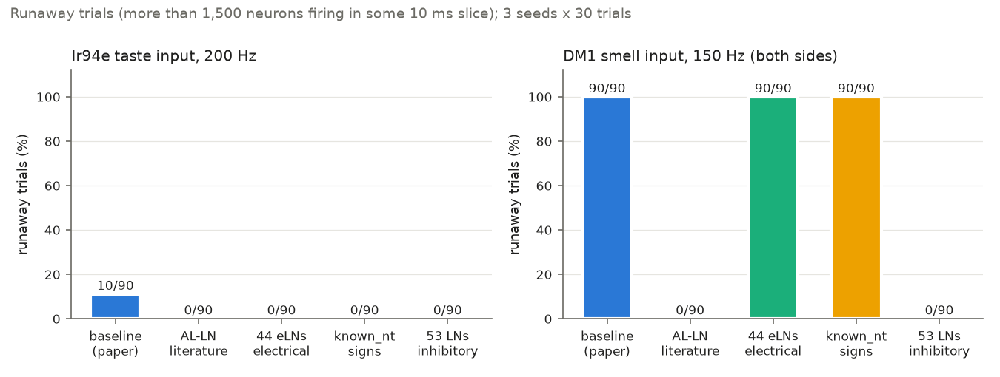
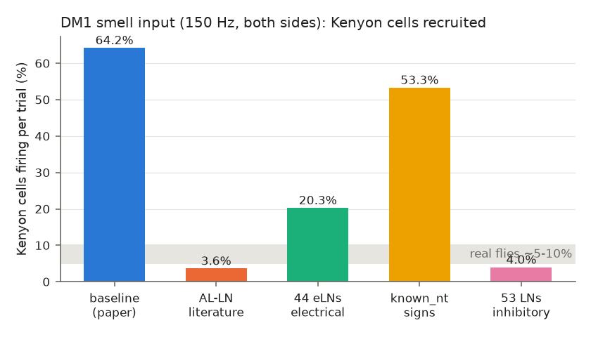
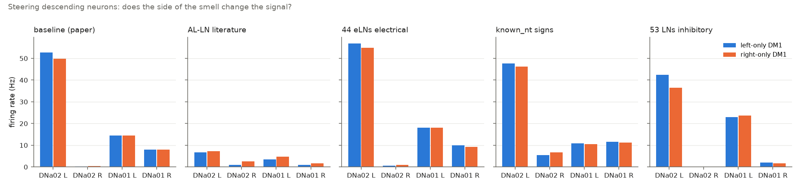

# Phase 7, upgrade 5: which neurons excite and which inhibit? (neurotransmitter audit)

*Written 2026-09-22/23. Code: `sim/sign_fixes.py` (the switchable fixes) and
`tests/test_sign_fixes.py`. Scripts, raw results and plots: `experiments/phase7_signs/`
(tables `results/table_*.csv`, audit `results/audit_*.{csv,txt}`). Status: **PRELIMINARY**
(section 8).*

## 1. The short version

- **The question.** Phase 6 traced the model's "runaway" (the whole brain locking into
  non-stop firing) to the 38 excitatory local neurons as labelled in snapshot 630 (44 in
  FlyWire's newer annotation, which adds 6 cells typed lLN2X03; section 2a). These are
  antennal-lobe local neurons of types lLN1_b/c and lLN2T, the smell centre's "local" cells.
  The model makes them excitatory. One earlier lane said they
  are really inhibitory (GABA); another said they are excitatory (acetylcholine) but talk to
  their neighbours mainly through electrical contacts, which the model does not have.
  Neither lane had read the original papers.
- **What the papers say.** They are **excitatory (cholinergic)**. The antibody study that
  discovered them (Shang et al. 2007) found "a previously unidentified population of
  cholinergic local neurons", FlyWire's literature column records exactly these 44 cells
  as acetylcholine, and the paper that made the machine-learning transmitter guesses
  (Eckstein et al. 2024) says its serotonin/dopamine guesses for them are probably wrong
  and that they look like "reported cholinergic local neurons". **The "they are GABAergic"
  reading is not supported by any source we found.** How they excite projection neurons
  (the antennal lobe's output cells) is **disputed**: Yaksi & Wilson 2010 (full text read)
  found it is "mainly or purely electrical", with their chemical synapses aimed at
  inhibitory local neurons; Huang et al. 2010 (abstract only) found both chemical and
  electrical connections onto projection neurons.
- **What we built.** `sim/sign_fixes.py` builds the brain with a named fix, in memory only
  (data files untouched). `"none"` is the paper's model, spike for spike (tested). The
  **recommended fix, `"al_ln_literature"`**, keeps every excitatory antennal-lobe local
  neuron excitatory but lets its chemical synapses reach only inhibitory neurons (the Yaksi
  & Wilson picture), and makes the 13 local neurons that the model calls excitatory but
  the literature records as GABA or glutamate inhibitory. It changes 51,539 of 14,687,178
  connections (removed) plus 10,455 (sign flipped), all inside the antennal lobe's local
  neurons.
- **What it does (3 seeds x 30 one-second trials per check).** Every Phase 3 taste result
  is **identical** to the baseline (sugar 100 Hz -> MN9 67.28 Hz, the same spikes trial by
  trial). Runaway: Ir94e 200 Hz **0 of 90** trials (baseline 10 of 90); DM1 smell input
  150 Hz **0 of 90** (baseline 90 of 90). Kenyon cells recruited by DM1: **3.6%** per
  trial (baseline 64%; real flies roughly 5-10%). It holds at synapse strength -10%, +10%
  and +20% (section 5e).
- **The narrower fix is not enough.** Applying the electrical rule only to the 44
  literature-typed eLNs (`"eln_electrical"`) stops the taste-triggered runaway (Ir94e 0 of
  90) but **not** strong smell input: DM1 still runs away in 90 of 90 trials, through the
  other ~100 local neurons the model treats as excitatory. That is why the recommended fix
  covers the whole population.
- **Steering is still one-sided.** Under the recommended fix, left-only and right-only
  DM1 smell both make the *left* DNa02 fire more than the right one (turn signal +5.7 Hz
  for a left odour, +4.8 Hz for a right odour). The right DNa02 does respond to a right
  odour (2.5 vs 0.9 Hz, significant in all 3 seeds), so side information exists, but a
  fixed left bias still wins. Phase 5's conclusion stands.
- **Wider audit.** 1,334 neurons have a model sign that contradicts their literature
  transmitter (mostly visual-system neurons: 456 should inhibit, 878 should excite); none
  of them is active in the paper's taste experiments. The `"known_nt"` fix applies them.
  The paper's other assumptions (dopamine/serotonin/octopamine = fast excitation;
  histamine photoreceptors = excitation) are listed, not changed.

---

## 2. What the papers say (PLAN.md Phase 6 step 3)

**What was read.** Full text: Shang et al. 2007 (Cell 128:601-612; PMC author manuscript
PMC2866183), Yaksi & Wilson 2010 (Neuron 67:1034-1047; PMC2954501), Chou et al. 2010 (Nat
Neurosci 13:439-449; PMC2847188), Tobin et al. 2017 (eLife 6:e24838), Schlegel et al. 2021
(eLife 10:e66018), and Eckstein et al. 2024 (Cell 187:2574, the paper behind the model's
transmitter guesses; PMC11106717). **Abstract only:** Huang et al. 2010 (Neuron
67:1021-1033); the publisher blocked automated access, so only the PubMed abstract was read.
FlyWire's `known_nt` / `known_nt_source` columns were read straight from the v783 annotation
file (`data/flywire/Supplemental_file1_neuron_annotations.tsv`).

### 2a. Which transmitter do lLN1_b/c and lLN2T use? Acetylcholine (excitatory).

- **Shang et al. 2007**, the discovery paper, stained the local neurons of several fly
  lines for the acetylcholine-making enzyme (ChAT) and for GABA:
  - "We describe a previously unidentified population of cholinergic local neurons (LNs)
    with multiglomerular processes." (abstract)
  - "The fractions of cholinergic neurons in the GFP-expressing cell populations were
    substantial at 71 and 63 % in KL107-GAL4 and krasavietz-GAL4, respectively."
  - In krasavietz flies with a ChAT reporter, "eight to 11 large, brightly fluorescent
    neurons extending a visible process into the lobe were identified as cholinergic ...
    whereas one or two smaller cells lacked dsRed".
- **Yaksi & Wilson 2010** confirm the same cell population is partly non-GABA and
  acetylcholine-making: "about half of the LNs labeled by krasavietz-Gal4 are GABA-negative
  (58–61%)" and "some GABA-negative krasavietz LNs are Cha-positive, implying that these
  cells do synthesize acetylcholine."
- **Chou et al. 2010** (a survey of about 1,500 single local neurons): "the vast majority
  of LNs are GABAergic; however, there are a few cholinergic cells, and a larger minority
  that are neither GABAergic nor cholinergic", and "a few dopaminergic and a large number
  of (mostly ventral) glutamatergic LNs". So cholinergic local neurons exist, but are a
  minority.
- **Linking these cells to the model's type names.** None of the physiology papers uses the
  connectome names (lLN1_b/c, lLN2T). Schlegel et al. 2021 created those names from cell
  lineage and shape ("ALLNs derive from three main neuroblast clones: the lateral neuroblast
  lineage ('l' and 'l2' from ALl1) ..."), without assigning transmitters. The link comes from
  two later sources:
  - FlyWire's literature column lists exactly **44 neurons** (30 lLN1_bc, 4 lLN2T_b,
    4 lLN2T_c, 6 lLN2X03 = hemibrain lLN2T_a) as "acetylcholine", source
    "Shang et al., 2007 (immuno)". All 44 are present in snapshot 630. Phase 6's 38 are the
    30 lLN1_bc plus the 8 lLN2T_b/c; the other 6 are typed lLN2X03 (hemibrain lLN2T_a in
    the v783 annotation) and carry no hemibrain type in the 630 labels.
  - **Eckstein et al. 2024**, the authors of the machine-learning guesses themselves:
    "many first-order sensory neurons and antennal lobe local neurons were mispredicted for
    serotonin rather than acetylcholine in both datasets"; "Serotonin and dopamine in the
    antennal lobe have been well-studied but no reports of either in local neurons exist in
    the literature"; "Positioned closely among them are other local lLN1_bc neurons that are
    predicted to be dopaminergic. We suspect that some cholinergic local neurons have been
    mispredicted dopaminergic"; "among them are ~13 lLN2T_abc neurons that have a cell body
    placement and general morphology most similar to reported cholinergic local neurons.
    The remainder is most likely GABAergic"; and "18%–27% of antennal lobe local neurons may
    be cholinergic".
- **Verdict:** lLN1_b/c and lLN2T are **cholinergic, i.e. excitatory**. The model already
  gives them the excitatory sign (for the wrong reason: a low-confidence serotonin/dopamine
  guess, which the model also treats as excitatory). **The olfaction lane's "they are
  GABAergic" is not supported by any source we read.** Caveat: the step from "krasavietz
  cholinergic LNs" to these exact connectome types is a shape-and-position match made by
  the annotators, not a stain of these exact cells. (Chou et al. 2010's "a few
  dopaminergic" LNs slightly contradicts Eckstein's "no reports"; it does not affect these
  types.)

### 2b. How do they talk to projection neurons? Disputed: mainly electrically (Yaksi & Wilson) or chemically plus electrically (Huang et al.).

- **Shang et al. 2007** assumed, but did not test, chemical synapses: "long-range signaling
  between neurons in different glomeruli is likely to require chemical synaptic
  connections."
- **Yaksi & Wilson 2010** (paired recordings, drugs, a gap-junction mutant):
  - "eLN-to-PN synapses transmit both hyperpolarization and depolarization, are not
    diminished by blocking chemical neurotransmission, and are abolished by a gap junction
    mutation ... This implies that lateral excitation is mediated by electrical synapses
    from eLNs onto PNs. In addition, eLNs form synapses onto inhibitory LNs." (abstract)
  - "This implies that eLN-to-iLN synapses are largely cholinergic, whereas eLN-to-PN
    synapses are mainly or purely electrical."
  - "synapses onto PNs are largely or purely electrical, whereas synapses onto iLNs are
    largely chemical with a smaller electrical component."
  - Their own hedge: "We found it was difficult to determine conclusively whether eLN-to-PN
    synapses have a small cholinergic component."
- **Huang et al. 2010** (abstract only): "Paired recordings of krasavietz eLNs and PNs
  showed reciprocal excitatory connections mediated by dendrodendritic cholinergic synapses
  and gap junctions. Reciprocal connections were also found between two krasavietz eLNs but
  were rare between krasavietz eLNs and inhibitory LNs."
- **Tobin et al. 2017** (electron microscopy of one glomerulus) does not identify eLNs:
  "ORNs contribute almost 75% of the synaptic input to PNs, with the remaining 25% arising
  mainly from local neurons", most of which "are probably inhibitory local neurons".
- **Verdict:** both recording papers agree there are **electrical synapses (gap junctions)
  from eLNs to projection neurons**, which the model lacks. They disagree on whether there
  is also a real chemical (acetylcholine) connection to projection neurons, and on whether
  eLNs talk much to inhibitory LNs. Yaksi & Wilson's evidence is the more direct (chemical
  blockers had no effect; a gap-junction mutant abolished the connection), and it is the
  only one of the two we could read in full, so the fix follows it. The electron-microscope
  wiring does show many chemical output sites from these cells onto projection neurons
  (18,248 connections, 162,261 synapses for the 44 eLNs); why they would transmit little, as
  Yaksi & Wilson found, is not known.

## 3. The fixes (all in `sim/sign_fixes.py`, applied in memory only)

| Fix | What changes | Connections changed (of 14,687,178) | Evidence |
|---|---|---|---|
| `none` | nothing | 0 | the paper's model |
| `eln_electrical` | the 44 literature eLNs keep their excitatory sign; their chemical synapses onto neurons that are not inhibitory are removed | 18,248 removed (162,261 synapses) | Shang 2007 + FlyWire (transmitter), Yaksi & Wilson 2010 (synapse mode) |
| **`al_ln_literature`** (recommended) | (1) the 13 antennal-lobe local neurons the model calls excitatory but the literature calls GABA/glutamate become inhibitory (9 lLN2P_b: GABA, Sizemore et al. 2023 and Croset et al. 2018; 2 il3LN6: GABA, Tanaka et al. 2012; 2 v2LN36: glutamate, Chou et al. 2022; these are FlyWire's citations, not re-read); (2) all remaining 137 excitatory local neurons (including the 44) follow the eLN rule of `eln_electrical` | 51,539 removed (351,448 synapses) + 10,455 sign-flipped (49,260 synapses) | as above; rule (2) extends the eLN measurement to all excitatory LNs (an inference) |
| `known_nt` | every neuron whose literature transmitter names one fast transmitter with the opposite sign is flipped (1,334 neurons: 456 to inhibitory, 878 to excitatory) | 107,380 sign-flipped | FlyWire `known_nt` (section 6) |
| `ln53_inhibitory` | Phase 5's "LN-fix": the 53 serotonin/dopamine-guessed local neurons made inhibitory | 32,409 sign-flipped | **contradicted** by section 2a for the 34 eLNs among them; kept for comparison |

Tests (`tests/test_sign_fixes.py`): `none` reproduces `FastBrain("630")` spike for spike
(sugar input and an igniting smell volley); each fix changes exactly the connections it
lists (every removed or flipped connection counted and pinned) and nothing else.

## 4. Why the narrow eLN fix is not enough

A quick check (`diag_variants.py`, 2 trials each): all 68 DM1 smell neurons at 150 Hz,
switched off after 300 ms. Does the brain keep firing on its own?

| Variant | Neurons still firing 100-700 ms after the input stopped (seed 0 / 1) | Kenyon cells firing while the input was on (mean of the 2) |
|---|---|---|
| none (paper) | 8,012 / 8,018 | 3,290 |
| 44 eLNs electrical (`eln_electrical`) | 3,676 / 3,641 | 958 |
| + the 13 literature-GABA/glutamate LNs inhibitory | 2,854 / 2,848 | 520 |
| 44 eLNs electrical + the other 19 of the 53 made inhibitory | 89 / 0 | 184 |
| all 150 excitatory LNs electrical | 309 / 399 | 178 |
| **all excitatory LNs electrical + the 13 inhibitory (`al_ln_literature`)** | **0 / 0** | 179 |
| 53 LNs inhibitory (`ln53_inhibitory`) | 0 / 320 | 198 |

So the loop is not just the 44: the other 106 local neurons that the model treats as
excitatory keep it going. They are the 13 with a literature GABA/glutamate entry, plus 93
with no literature entry (59 guessed acetylcholine, 17 guessed serotonin, and 17 guessed
GABA or glutamate but made excitatory by the paper's per-synapse majority rule). Only the
whole-population rule removed the loop completely in both seeds.

## 5. Validation of each fix alone (PLAN.md Phase 6 step 1)

3 seeds x 30 one-second trials per check; the same seeds as Phase 3/7 (taste), Phase 6
(Ir94e) and Phase 5 (DM1). Tables: `experiments/phase7_signs/results/table_*.csv`.
Cross-checks: `none` reproduces the Phase 7 baseline MN9 numbers and the Phase 6 Ir94e
runaway counts (4/5/1 per seed) exactly, and `ln53_inhibitory` reproduces Phase 5's
LN-fix steering numbers exactly (42.5 / 36.4 Hz), so the builder matches both earlier lanes.

### 5a. Phase 3 taste results (MN9, the feeding motor neuron, Hz)

| Condition | baseline | al_ln_literature | eln_electrical | known_nt | ln53_inhibitory | expected |
|---|---|---|---|---|---|---|
| sugar 100 Hz | 67.28 | 67.28 | 67.28 | 67.28 | 67.28 | paper 65.7 +/- 3.3 |
| sugar 200 Hz | 93.53 | 93.53 | 93.53 | 93.53 | 93.53 | higher than 100 Hz |
| water 200 Hz | 30.79 | 30.79 | 30.79 | 30.79 | 30.79 | MN9 active |
| bitter 200 Hz | 0.00 | 0.00 | 0.00 | 0.00 | 0.00 | 0 |
| sugar 100 + bitter 120 | 1.36 | 1.36 | 1.36 | 1.36 | 1.36 | near 0 |

Every fix leaves every taste result unchanged. For `al_ln_literature`, `eln_electrical` and
`ln53_inhibitory` the per-trial spike totals are identical in all 450 taste trials, and a
direct comparison of 10 trials per condition found **every spike identical** for
`al_ln_literature` (`results/identity_check_al_ln_literature.csv`): the taste-to-feeding
pathway never touches the antennal lobe's local neurons. `known_nt` changes a few spikes in
the water condition (7,515.0 vs 7,515.2 spikes per trial) but not MN9.

### 5b. Runaway (more than 1,500 different neurons firing in some 10 ms slice)

| Input | baseline | al_ln_literature | eln_electrical | known_nt | ln53_inhibitory |
|---|---|---|---|---|---|
| Ir94e 200 Hz | 10 / 90 (4/5/1) | **0 / 90** | 0 / 90 | 0 / 90 | 0 / 90 |
| DM1 150 Hz, both sides | 90 / 90 | **0 / 90** | 90 / 90 | 90 / 90 | 0 / 90 |
| DM1 left only | 90 / 90 | **0 / 90** | 90 / 90 | 90 / 90 | 0 / 90 |
| DM1 right only | 90 / 90 | **0 / 90** | 90 / 90 | 90 / 90 | 0 / 90 |

0 of 90 has a 95% range of 0-4%; the Ir94e drop from 10 of 90 has Fisher p = 0.0015.

**One-spike triggers** (`table_volleys.csv`; one trial each, 1 s):

| Trigger | baseline | al_ln_literature | eln_electrical | known_nt | ln53_inhibitory |
|---|---|---|---|---|---|
| 10 DM1 smell neurons fire once | ignites (444,790 spikes) | 31 spikes | 30 | ignites | 24 |
| the 44 eLNs fire once | ignites (705,223) | 81 | 73 | ignites | 44 |
| all 685 projection neurons fire once | ignites (745,729) | 3,589, then silent | **ignites** (208,348) | ignites | 3,060, then silent |

### 5c. Kenyon cells under DM1 smell input (the learning centre)

| | baseline | al_ln_literature | eln_electrical | known_nt | ln53_inhibitory |
|---|---|---|---|---|---|
| Kenyon cells firing per trial | 64.2% | **3.6%** | 20.3% | 53.3% | 4.0% |

Real flies: roughly 5-10% of Kenyon cells respond to one odour (Turner et al. 2008;
Honegger et al. 2011; background knowledge carried over from Phase 5, not re-read here).
The recommended fix gives a sparse response a little below that range.

### 5d. Left/right steering (re-check of docs/phase5-olfaction.md section 5)

Left-only versus right-only DM1 smell at 150 Hz, 3 seeds x 30 trials, rates in Hz
(left odour / right odour):

| Neuron | baseline | al_ln_literature | eln_electrical | known_nt | ln53_inhibitory |
|---|---|---|---|---|---|
| DNa02 left | 52.8 / 49.8 | 6.7 / 7.3 | 56.9 / 54.9 | 47.6 / 46.3 | 42.5 / 36.4 |
| DNa02 right | 0.3 / 0.4 | **0.9 / 2.5** | 0.6 / 0.9 | 5.4 / 6.8 | 0.0 / 0.0 |
| DNa01 left | 14.5 / 14.5 | 3.4 / 4.8 | 18.0 / 18.1 | 10.8 / 10.5 | 23.0 / 23.7 |
| DNa01 right | 7.9 / 8.0 | 1.0 / 1.6 | 9.9 / 9.3 | 11.5 / 11.2 | 2.0 / 1.7 |
| DNg100 left | 0.9 / 0.9 | 4.7 / 7.3 | 3.3 / 3.7 | 1.0 / 1.0 | 24.1 / 16.3 |
| turn signal (DNa02 left minus right) | +52.5 / +49.4 | **+5.7 / +4.8** | +56.3 / +54.0 | +42.1 / +39.5 | +42.5 / +36.4 |

**Under the recommended fix the Phase 5 finding still holds: both odour sides give a
"turn left" signal.** Two things did change: the steering neurons fire far less (DNa02 left
about 7 Hz instead of 42-53 Hz), and the right DNa02 now responds to a right-side odour
(2.5 vs 0.9 Hz, p < 0.03 in all 3 seeds), which is the correct direction but far too weak
to beat the fixed left bias. The Phase 9 steering risk remains open.

### 5e. Parameter variation (recommended fix; synapse strength, 1 seed x 30 trials)

| Synapse strength | sugar 100 Hz -> MN9 | Ir94e 200 Hz runaway | DM1 150 Hz runaway | Kenyon cells (DM1) | one-spike triggers |
|---|---|---|---|---|---|
| 90% | 59.1 Hz | 0 / 30 | 0 / 30 | 2.7% | none ignite |
| 100% | 67.3 Hz (3 seeds) | 0 / 90 | 0 / 90 | 3.6% | none ignite |
| 110% | 73.6 Hz | 0 / 30 | 0 / 30 | 4.6% | none ignite |
| 120% | 77.4 Hz | 0 / 30 | 0 / 30 | 5.4% | none ignite |

For comparison, the paper's model at 110% runs away in 28 of 30 Ir94e trials (Phase 6). The
fix removes the knife edge Phase 6 found. (MN9 changes with synapse strength as it does in
the unfixed model; that is the paper's own tuning, not the fix.)

## 6. Wider audit: where else do the signs look wrong? (task item 2)

`experiments/phase7_signs/audit_signs.py` compared every neuron's model sign with FlyWire's
literature transmitter (mapped from v783 to snapshot 630 via each neuron's supervoxel;
127,218 of 127,400 neurons matched, 77,161 have a literature entry) and with the
prediction's own top label. "Active" = above 0.5 Hz on average in our baseline runs of the
five Phase 3 taste conditions. Full list: `results/audit_by_type.csv` (517 rows, one per
group and cell type); summary: `results/audit_summary.txt`.

| Group | Neurons | Outgoing synapses | Active in the paper's taste experiments | Handled by |
|---|---|---|---|---|
| A. Literature transmitter has the opposite sign | 1,334 (456 should inhibit, 878 should excite) | 409,927 | **0** | `known_nt` fix |
| B. No literature; the prediction's top label has the opposite sign (the paper's per-synapse majority rule) | 695 | 218,821 | 7 (4,882 synapses) | not changed |
| C1. Literature says dopamine / serotonin / octopamine / tyramine; model: fast excitation | 599 | 540,185 | 10 | assumption, not changed |
| C2. Guessed monoamine, no literature; model: fast excitation | 1,171 | 313,423 | 23 | assumption, not changed |
| D. Literature says histamine (photoreceptors); model: excitation | 3,308 | 105,027 | 0 | assumption, not changed |
| E. Sign right, label wrong (guessed monoamine, literature acetylcholine: Kenyon cells, the eLNs) | 5,975 | 1,221,331 | 0 | nothing to fix |

Ranked by how much they could matter:

1. **Antennal-lobe local neurons** (all active whenever smell or Ir94e input reaches the
   antennal lobe): 13 literature-GABA/glutamate cells made excitatory (il3LN6 24,019
   synapses, lLN2P_b 20,735, v2LN36 4,506), more guessed GABA/glutamate but made
   excitatory by the per-synapse rule (lLN2F_a 34,771, lLN2X04 22,474, v2LN30 11,306 ...),
   and serotonin guesses with no literature (lLN2T_e 23,165, lLN2X11 19,810, lLN2X05
   15,982, lLN1_a 11,366). These are the runaway loop; `al_ln_literature` handles all of them.
2. **Group A outside the antennal lobe**: mostly the visual system (861 optic-lobe
   neurons, 301 lamina L1-L5, 37 Mi1; acetylcholine per Davis et al. 2020 but made
   inhibitory by the per-synapse rule), the central complex (59, mostly glutamate made
   excitatory), and a few big ones: PS130 and PS123 (GABA by EASI-FISH, Nern et al. 2024,
   but guessed acetylcholine at 0.92-0.96 confidence) and DPM (GABA + serotonin, made
   excitatory; 15,707 synapses). None is active in the paper's taste experiments. Applying
   them (`known_nt`) changes no taste result and on its own stops the Ir94e runaway, but
   not the smell runaway.
3. **Monoamine neurons (group C)**: the paper treats dopamine, serotonin and octopamine as
   fast excitation. Several are active in taste runs, e.g. CB0573 (guessed dopamine,
   75.7 Hz), DNpe007, CB0262. This is a **known modelling assumption** (these transmitters
   mostly act slowly through other receptors), listed here, not "fixed". (The 52 taste
   sensory neurons guessed serotonin are, per Eckstein et al. 2024, probably acetylcholine;
   the sign is the same either way.)
4. **Group B elsewhere**: small (7 active neurons, e.g. PS116, CB0207, CB0722); low
   confidence; no literature to decide.

## 7. Recommendation, and what stays an assumption

**Recommended default: `al_ln_literature`** (`sim.sign_fixes.RECOMMENDED_FIX`), built with
`sim.sign_fixes.build_brain("al_ln_literature")`. `build_brain("none")` stays available and
identical to the paper. Whether it becomes the project default is the owner's call.
Owen approved it on 2026-09-23: `build_brain()`, `build_realistic_brain()` and the app now default to it.

Evidence: it follows the transmitter literature (keeps cholinergic cells excitatory; makes
cells inhibitory only where a measurement says GABA/glutamate), follows the one full-text
measurement of how excitatory local neurons connect (Yaksi & Wilson 2010), leaves every
Phase 3 result spike-for-spike identical, removes every runaway we tested (Ir94e 0/90, DM1
0/270, three one-spike triggers, synapse strength 90-120%), and gives a sparse Kenyon-cell
response (3.6%). The Phase 5 `ln53_inhibitory` fix gives similar runaway numbers but
contradicts the transmitter literature for 34 of its 53 cells, so it is not recommended.

**What stays an assumption or a gap:**

- **The missing electrical synapses.** The fix removes the eLNs' chemical excitation of
  projection neurons but cannot add the gap-junction excitation (the engine has no
  electrical synapses). So the model now has **no** lateral excitation between smell
  channels, whereas real flies have some. Adding eLN-PN gap junctions (PLAN.md 7.5) is the
  natural next upgrade.
- **Extending the eLN rule to all 137 excitatory local neurons** is an inference: only the
  krasavietz eLNs were ever recorded, and some of the other 93 may really be GABAergic
  (Eckstein et al. 2024 think the serotonin-guessed ones mostly are).
- **Huang et al. 2010 disagrees** on the chemical part and was read as an abstract only.
- The link from "krasavietz cholinergic LNs" to lLN1_bc / lLN2T is the annotators'
  shape-and-position match, not a stain of these exact cells.
- Monoamine neurons as fast excitation, histamine photoreceptors as excitation, and
  glutamate as always inhibitory stay the paper's assumptions.

## 8. Validation status (PLAN.md Phase 6) and what was not verified

| Step | Recommended fix |
|---|---|
| 1. seeds and parameter variations | done: 3 seeds x 30 trials for every check; synapse strength 90/110/120% (1 seed). Threshold, time constants and weight jitter not varied. |
| 2. bug checks | tests pass; `none` = baseline spike for spike; changed connections counted and pinned; taste runs spike-identical; builder reproduces Phase 5, 6 and 7 numbers exactly |
| 3. literature | done (section 2); Huang et al. 2010 abstract only |
| 4. biology | runaway gone (fits); Kenyon cells 3.6% (a little sparse vs ~5-10%); left/right steering still wrong (contradicts Gaudry et al. 2013, as in Phase 5) |
| 5. write-up | this document |
| 6. share | not done (owner's call) |

**Status: PRELIMINARY** (no independent review; one key paper read as abstract only; the
137-neuron extension is an inference). Not verified: Huang et al. 2010 full text; the
papers FlyWire cites for the 13 GABA/glutamate cells (Sizemore 2023, Croset 2018, Tanaka 2012, Chou 2022)
and for the visual-system transmitters (used only as FlyWire's citations); the Kenyon-cell
5-10% figure (background); snapshot 783 (everything here is 630); Brian2 (fast engine only;
the fix does not touch the engine, and `none` matches it spike for spike); the supervoxel
mapping of `known_nt` (90% of matched neurons carry the same hemibrain type in both
annotation versions; the rest are mostly renames, not checked one by one); persistence
after strong smell input is switched off was checked for 2 trials only (section 4).

## 9. Files

- `sim/sign_fixes.py`: `build_brain(fix)`, `apply_fix`, `neuron_table` (labels including
  `known_nt` mapped to 630), `FIXES`, `RECOMMENDED_FIX`.
- `tests/test_sign_fixes.py`.
- `experiments/phase7_signs/`: `run_validation.py` (all runs), `diag_variants.py`
  (section 4), `check_identity.py` (spike identity), `audit_signs.py` (section 6),
  `analyze.py` (tables and plots), `common.py`, `log-entry.md` (EXPERIMENTS.md entry).
- Results: `results/trials.csv` (every trial), `volleys.csv`, `table_phase3.csv`,
  `table_runaway.csv`, `table_kc.csv`, `table_steering.csv`, `table_volleys.csv`,
  `table_params.csv`, `diag_variants.csv`, `identity_check_al_ln_literature.csv`,
  `audit_by_type.csv`, `audit_summary.txt`, `fix_reports.json`, `counts/` (spikes per neuron).
- Plots: `plots/fig1_runaway.png`, `fig2_kenyon_cells.png`, `fig3_steering.png`.
