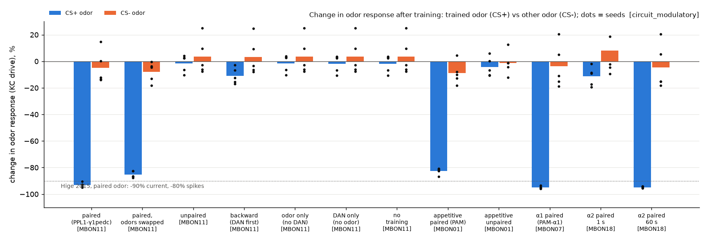
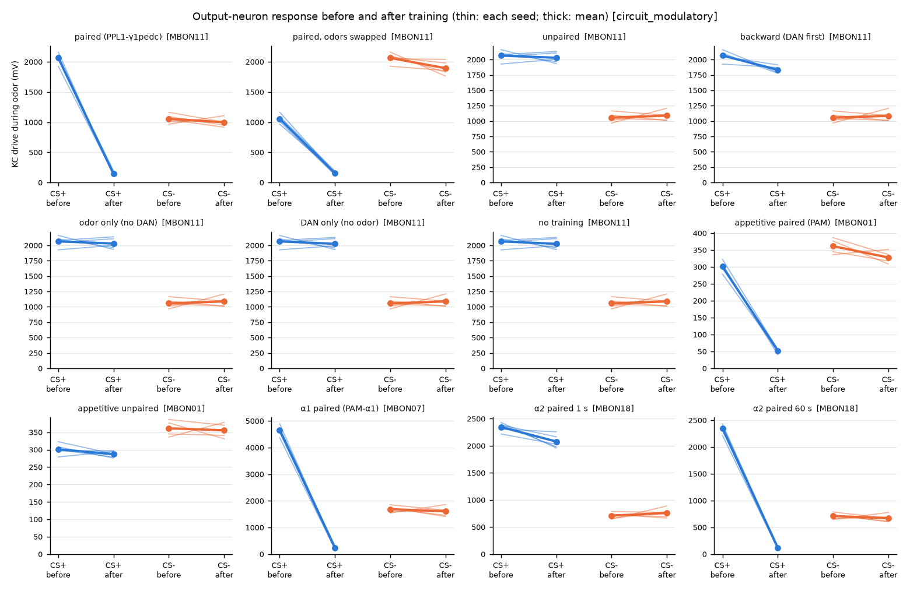
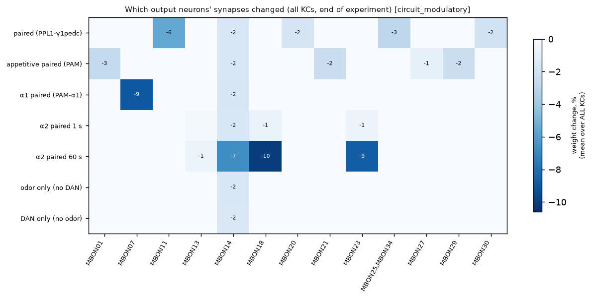
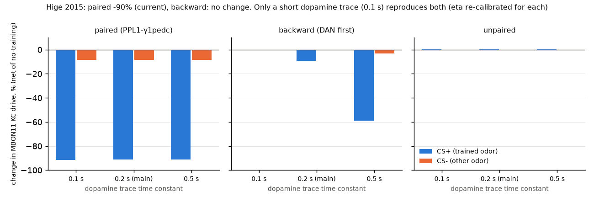
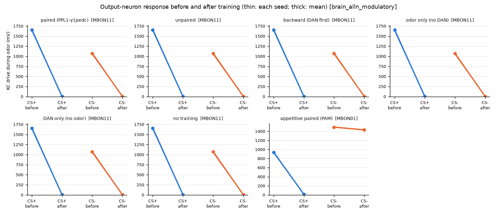
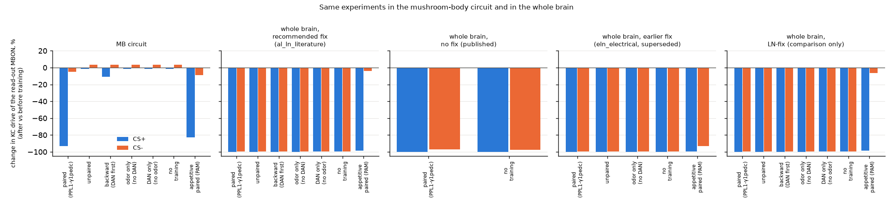

# Phase 8: real learning in the mushroom body

*Written 2026-09-22/23. Code: `sim/plasticity.py` (tests: `tests/test_plasticity.py`).
Experiments, raw results and plots: `experiments/phase8/`. Background research:
`docs/phase8-mushroom-body-research.md`. Every number below comes from our own runs and is
saved in `experiments/phase8/results/`.*

**Status: PRELIMINARY.** The results were re-run with several random seeds, controls and
one parameter sweep, but they have not been independently reviewed (PLAN.md Phase 6), and
several model parameters could not be measured and had to be chosen (listed in section 8).

---

## 1. The short version

- **The simulated fly now learns smells, the way real flies do, in the mushroom-body
  circuit.** We gave the model the published learning rule: when a "punishment" dopamine
  neuron fires while a Kenyon cell is active, that Kenyon cell's connection to the output
  neuron of the same compartment weakens. Then we trained it like a real fly: odor A together
  with the punishment neuron PPL1-γ1pedc, odor B alone.
- **It learned the right thing, and only when it should.** Afterwards the output neuron
  MBON-γ1pedc>α/β got about **91% less input** from odor A (5 of 5 simulated flies), and
  only about **9% less** from odor B. Hige et al. 2015 measured 90% less input (80% fewer
  spikes) in real flies. With the odors swapped the result is the same (-89% vs -6%). The
  match with Hige is by design: we set the learning speed from Hige's 90%, on separate
  seeds (`experiments/phase8/results/calibration.json`, section 2.3). The real test is that
  nothing is learned without pairing (next point).
- **No pairing, no learning.** Dopamine and odor at separate times: +0.2%. Odor alone: +0.2%.
  Dopamine alone: 0.0%. Nothing at all: 0.0% (by definition the reference).
- **Reward works the same way, in different compartments.** Odor A with the reward neurons
  PAM-γ5 + PAM-β'2a weakened odor A's input to the "avoid" output neuron MBON-γ5β'2a by 78%
  (odor B: 8%), so the net pull of odor A shifts toward approach, as it should. PAM-α1 did the
  same in its own compartment (-94% vs -12%). Each dopamine neuron changed only the output
  neurons of its own compartment.
- **Slow and fast compartments.** As in Hige 2015, a single 1-s pairing in the α2
  compartment did little (-10%), while 1 minute of pairing did a lot (-94%). This one was
  partly built in: we set α2's learning speed from that same experiment.
- **One mismatch, and what it tells us.** When the dopamine comes *before* the odor
  ("backward" training), real flies show no change. Our model shows a small one (-9%). It
  depends on how long dopamine lingers, a number nobody has measured for us: with 0.1 s
  instead of our 0.2 s the backward effect vanishes (-0.5%), with 0.5 s it becomes large
  (-59%). So the real experiment tells us dopamine's signal must be short in this rule.
- **The whole brain: reward yes, punishment not yet.** With the recommended sign fix
  (`al_ln_literature`), smell input stays sparse (about 5% of KCs) and reward learning
  works as in the circuit: MBON-γ5β'2a lost 98% of odor A's input and 4% of odor B's (3 of 3
  simulated flies). Punishment learning cannot be seen: in the whole brain a smell alone
  makes the punishment neurons fire about as much as our artificial punishment does, so
  after one sniff every smell looks "bad", trained or not (section 5). Without any fix (the published brain) smell runs away (62% of KCs respond) and
  nothing about learning can be read. **Update:** with the later `+da_5ht_literature`
  switch, punishment learning does appear in the whole brain (passes with caveats,
  PRELIMINARY; `docs/phase7-neuromodulators.md`).
- **Nothing else changed.** With learning switched on but no training, the paper's sugar ->
  feeding result (MN9) is spike-for-spike identical in all 60 test trials, in the published
  brain and in the recommended-fix brain.

**Checkpoint verdict (PLAN.md Phase 8):** in the mushroom-body circuit, **passed**: the fly
learns in the same direction as real flies, and does not learn when odor and reinforcement
are not paired. In the whole brain with the recommended fix: **partly**: reward learning
passes; punishment learning cannot be tested there yet, because the smell itself switches
on the punishment neurons. PRELIMINARY in both cases.

---

## 2. What we built

### 2.1 The learning rule (`sim/plasticity.py`)

Think of every Kenyon cell (KC) as carrying a small "I was just active" tag, and every
compartment of the mushroom body as having a dopamine level.

1. **Tag.** Each time a KC fires, its tag goes up by 1. The tag fades with a half-life of
   about 0.7 s (time constant 1 s). Source: Handler et al. 2019 saw learning when dopamine
   came 0 or 0.5 s after the odor, and almost none at 6 s.
2. **Dopamine.** Each spike of a dopamine neuron (DAN) raises the dopamine level of its
   compartment(s), divided by how many cells that DAN type has (so it means "average spikes
   per DAN cell"). It fades with a time constant of 0.2 s (chosen, not measured; section 4.2).
3. **Weakening.** At every time step, each KC -> output-neuron (MBON) connection in a
   compartment shrinks by a factor that depends on *tag x dopamine*. If either is zero,
   nothing happens. Connections shrink smoothly and never flip sign or go below zero.
4. **Memory.** Nothing recovers during an experiment (Hige 2015: the change lasted at least
   40 minutes). There is no strengthening rule yet (Handler 2019 found one for "dopamine
   first", through a second receptor); it is left out on purpose so this checkpoint tests
   only the core rule.
5. **Only KC -> MBON connections learn.** All 62,177 of them (256,550 synapses). Every other
   connection in the brain stays fixed.

**Which connection is in which compartment.** The connectome says how many synapses a KC
makes onto an MBON, not where. We put each KC -> MBON connection in the compartments that the
MBON's input branches occupy *and* that the KC's axon runs through (γ KCs run only through
the γ lobe, α/β KCs through α/β and the peduncle, α'/β' KCs through α'/β'). Compartment names
come from the hemibrain names listed in the research doc. A connection sits in the KC's own
brain half. Dopamine neurons, it turns out, often reach both brain halves (the two PPL1-γ1pedc
cells put 54% and 75% of their KC synapses in the left mushroom body), so each DAN's dopamine is split between the
halves in proportion to its measured KC synapses on each side.

**Check of the compartment tables.** DANs also make some direct synapses onto MBONs. If our
tables are right, those should mostly join a DAN and an MBON of the same compartment: 87.8%
of 14,459 such synapses do (`results/census.md`). Weak spots (about 50-65%): PAM-β'2a
(PAM02), PAM-β2β'2a (PAM03), PAM-β'2p (PAM05, whose main MBON target is MBON-β'2d), PAM15 and
PPL1-γ1 (PPL102). MBON28 has no compartment in its name; we placed it in α'3 because its
main DAN input is PPL1-α'3 (PPL104). **UNVERIFIED.** PPL107, PPL201-203 and 13 untyped DANs
have no known compartment and do not feed the dopamine signal.

### 2.2 A decision: what dopamine neurons' own connections do

The published model gives every dopamine neuron's output connections a "+1" (excite) sign,
because it treats every transmitter except GABA and glutamate as excitatory. Real dopamine
works through slow receptors (Dop1R1 and Dop1R2) and its measured effect here is the change
in KC -> MBON strength, not a fast push on the KCs (Hige 2015 found the change in the
synapse, not in KC excitability). So by default (`dan_mode="modulatory"`) we switch off the
fast output connections of the 305 DANs that have a known compartment; their spikes act only
through the dopamine signal. Their inputs are untouched. We also ran everything with the
published treatment (`dan_mode="fast"`, fast excitation *plus* the dopamine signal): in the
mushroom-body circuit every result changed by less than 1 percentage point
(`results/summary_circuit_fast.md`). In these experiments the DANs' fast synapses onto KCs
are too weak to make KCs fire.

### 2.3 Calibration (`results/calibration.json`)

- **Learning speed.** Set once, on 5 seeds not used anywhere else (900-904), so that
  Hige's exact protocol (1 s of odor, four short dopamine-neuron "light pulses" at 2 Hz
  starting 0.2 s after odor onset) cuts the KC input to MBON-γ1pedc>α/β by 90% for the
  paired odor. 90% is Hige's number for the synaptic current; 80% is the spike number. We
  used the current because it is the like-for-like measure (section 3.2).
- **Slow compartments (α2, α3).** Set so that the same 1-s pairing weakens α2 by only 5%
  on average (Hige: "no change"). Result: α2/α3 learn about 95 times more slowly
  (`slow_ratio` 0.0105). Aso & Rubin 2016 also found α3 slow.
- **A light pulse.** We do not know how many spikes one 1-ms light pulse gave in Hige's
  DANs. We model it as 10 ms of strong drive, about 3 spikes. **UNVERIFIED.** It only sets
  the scale of the learning speed, which is calibrated anyway.

---

## 3. The set-up

### 3.1 Two odors and the circuit

- **Odors.** "Odor A" = glomeruli DM1, DC1, VA2, DM4; "odor B" = DP1m, DM2, DL1, VA6. No
  overlap. They were picked so both reach the KCs about equally (about 43,000
  projection-neuron -> KC synapses each; 215 smell receptor neurons each). They stand for
  "two different smells", not for any real chemical.
- **The mushroom-body circuit** (the main model): all 685 projection neurons, 5,177 KCs,
  97 MBONs, 326 DANs, the APL and DPM neurons, and all 570,433 connections among them,
  copied unchanged from the whole brain (snapshot 630). The odor is given to the odor's
  projection neurons (uniglomerular PNs), 100 spikes/s each for 1 s. PLAN.md's Realism rule
  allows running a new mechanism on just the circuit it belongs to.
- **Sparseness check.** An odor should switch on only a small fraction of KCs (roughly
  5-10% in real flies; research doc, UNVERIFIED figure). Here odor A activates 5.4% and
  odor B 4.3% of KCs (`results/odor_check_circuit.csv`); about 9% of odor A's reliable KCs
  also respond to B. Good: that is what makes learning odor-specific.

### 3.2 What we measure, and why not just spikes

For each output neuron type we record two things during every 1-s test odor:
- **KC drive:** the total input it gets from KCs = KC spikes x current connection strength.
  This is the model's version of the synaptic current Hige measured.
- **Spikes.**

In the mushroom-body circuit most MBONs barely fire to these odors: MBON-γ1pedc>α/β fires
0 spikes, because its voltage is pushed *below* rest during the odor (to about -58 mV) by
inhibition from the APL neuron and from other MBONs, which in this model outweighs the
excitation from about 5% of KCs. Real MBONs fire spontaneously and respond to odors, so this
is a limitation of the model (every synapse has the same small strength, and there is no
spontaneous activity). KC drive does not depend on that, so it is our main read-out; spikes
are reported where there are any (MBON-α1 and MBON-α2sc).

### 3.3 The experiment, for one simulated fly (one random seed)

1. Before: odor A and odor B, 4 times each, alternating, 1 s each.
2. Training (depends on the condition, table below).
3. After: the same 8 test presentations, with new random input.

Learning stays ON the whole time, tests included, as in a real fly. Each condition was run
with the same 5 seeds, so the same seed gets the same random test input in every condition.
We therefore report each change **net of the "no training" run with the same seed**: that
cancels the random trial-to-trial wobble (raw numbers are in the summary files too).

| condition | training |
|---|---|
| paired | odor A + PPL1-γ1pedc pulses (Hige protocol); then odor B alone |
| paired, odors swapped | odor B + PPL1-γ1pedc; odor A alone |
| unpaired | PPL1-γ1pedc pulses alone; odor A alone; odor B alone (separate trials, i.e. far apart) |
| backward | PPL1-γ1pedc pulses; odor A starts 0.5 s after the last pulse (Hige's backward protocol); odor B alone |
| odor only (no DAN) | odor A alone; odor B alone |
| DAN only | PPL1-γ1pedc pulses, no odor |
| no training | nothing |
| appetitive paired | odor A + PAM-γ5 (PAM01) + PAM-β'2a (PAM02) pulses (Aso & Rubin 2016); odor B alone |
| appetitive unpaired | PAM01+PAM02 pulses alone; A alone; B alone |
| α1 paired | odor A + PAM-α1 (PAM11) pulses; B alone |
| α2 paired, 1 s | odor A + PPL1-α'2α2 (PPL105) pulses; B alone |
| α2 paired, 60 s | 60 s of odor A with 120 PPL105 pulses; 60 s of B alone (Hige's long protocol) |

"CS+" below = the odor that was (or in a control would have been) paired; "CS-" = the other.

---

## 4. Results in the mushroom-body circuit

5 seeds each, DAN mode "modulatory", dopamine time constant 0.2 s. Change = after vs
before, net of no training; mean (standard deviation over seeds). Full tables:
`results/summary_circuit_modulatory.md`.

| condition | read-out MBON | CS+ change | CS- change | learned (CS+ minus CS-), range over seeds |
|---|---|---|---|---|
| paired (PPL1-γ1pedc) | γ1pedc>α/β (MBON11) | **-91.3%** (5.7) | -8.6% (1.8) | -83% (-88 .. -75), 5 of 5 |
| paired, odors swapped | MBON11 | **-88.8%** (13.3) | -6.3% (1.7) | -83% (-101 .. -72), 5 of 5 |
| unpaired | MBON11 | +0.2% (0.3) | 0.0% (0.1) | +0.2% (-0.1 .. +0.7) |
| backward | MBON11 | -9.2% (3.4) | -0.4% (0.2) | -8.8% (-14 .. -6) |
| odor only (no DAN) | MBON11 | +0.2% (0.2) | 0.0% (0.1) | +0.2% (-0.1 .. +0.5) |
| DAN only | MBON11 | 0.0% | 0.0% | 0.0% |
| appetitive paired | γ5β'2a (MBON01) | **-77.8%** (6.0) | -7.6% (1.1) | -70% (-80 .. -65), 5 of 5 |
| appetitive unpaired | MBON01 | +0.5% (0.6) | 0.0% | +0.5% |
| α1 paired (PAM-α1) | α1 (MBON07) | **-94.0%** (7.4) | -12.2% (2.2) | -82% (-91 .. -71), 5 of 5 |
| α2 paired, 1 s | α2sc (MBON18) | -10.3% (1.8) | -0.7% (0.3) | -9.5% |
| α2 paired, 60 s | MBON18 | **-93.8%** (6.5) | -13.3% (3.3) | -80% (-91 .. -71), 5 of 5 |

Raw (not netted) changes for the main result: CS+ -93.0%, CS- -4.9%.
Hige 2015 for comparison: paired odor current -90%, spikes -80%; unpaired odor spikes -25%;
backward: no change; α2 1 s: nothing; α2 1 min: "robust, stimulus-specific" weakening.



*Blue: the trained odor. Orange: the other odor. Dots: individual seeds (raw, not netted,
so they include the trial-to-trial wobble that the table removes).*



*Each panel: the read-out MBON's KC drive before and after training, for the trained odor
(left pair) and the other odor (right pair). Thin lines: each seed; thick: mean.*

**What this shows, in plain words.**
- Pairing an odor with punishment makes the "approach" output neuron MBON-γ1pedc>α/β almost
  deaf to that odor, and barely changes its response to the other odor. That is exactly
  the change Hige et al. measured in real flies after one pairing.
- The other odor changes a little (-6 to -9%) because about 9% of its KCs also respond to
  the trained odor. Real flies showed more (-25% in spikes); spikes change more than input
  does, so the two numbers are not directly comparable.
- Without pairing nothing changes, because the rule needs tag and dopamine at the same time.
  That is built into the rule, so these controls mainly show there is no hidden leak in the
  code or the circuit (for example, odors do not switch on PPL1-γ1pedc by themselves here).
- **Compartments stay separate.** Punishment in γ1pedc changed only MBONs with γ1 or
  peduncle inputs (MBON11, 20, 25/34, 30); reward in γ5/β'2a changed only γ5 / β'2a MBONs
  (MBON01, 21, 27, 29); PAM-α1 only MBON07 (plot below). The one change seen everywhere, a
  1.5-2% weakening of MBON-α3 (MBON14), comes from the odors themselves: odor A makes the
  α3 dopamine neuron PPL1-α3 fire a few spikes through the KC -> DAN connections, and it
  appears in the no-training run too.



**Approach vs avoidance.** Adding up the KC drive of the approach MBONs (MBON11, MBON12) and
of the avoidance MBONs (MBON01-04) (Aso et al. 2014), the "approach minus avoidance" change
for the trained odor is -0.83 after punishment training (the other odor: -0.07) and +0.10
after reward training (other odor: +0.03). So the trained odor's balance moves toward
avoidance after punishment and toward approach after reward: the right direction both
times (`results/valence_circuit_modulatory.csv`). This is a read-out of the output neurons'
input only; the model has no body yet (Phase 9) to show the behaviour itself.

### 4.1 Published DAN treatment ("fast")

Same experiments with the DANs' own fast excitatory connections left on: every number
within 1 percentage point of the table above (paired -91.5% vs -8.6%; unpaired +0.4%; DAN
only 0.0%; `results/summary_circuit_fast.md`).

### 4.2 How long does dopamine linger? (the one mismatch)



We re-ran the key conditions with the dopamine time constant at 0.1 s and 0.5 s,
re-calibrating the learning speed each time (to 1.63 and 0.36, vs 0.81 at 0.2 s):

| dopamine time constant | paired CS+ | backward CS+ | unpaired CS+ |
|---|---|---|---|
| 0.1 s | -91.4% | **-0.5%** | +0.1% |
| 0.2 s (main) | -91.3% | **-9.2%** | +0.2% |
| 0.5 s | -91.3% | **-58.9%** | +0.1% |

Real flies show no change after backward training (Hige 2015), and even a strengthening when
dopamine comes 1.2 s before the odor (Handler 2019, through a second receptor we do not
model). In this rule the dopamine signal therefore has to fade within about 0.1 s; our
pre-chosen 0.2 s leaves a small backward effect. This makes the backward control a
constraint on an unmeasured parameter rather than an independent test. A realistic next step
is to add Handler's "dopamine-first" strengthening, which would make the result less
sensitive to this number.

---

## 5. The whole brain

**What was run.** The same learning code, the same calibrated numbers, the same two odors
(given to the smell receptor neurons of the same glomeruli), the same test-train-test
schedule, 3 seeds (0-2), now in the full published brain model. DAN fast outputs are off
("modulatory"), as in the circuit. One brain in memory at a time (`whole_brain_batch.py`).
Four versions of the brain:

1. **Recommended sign fix, `al_ln_literature`**: the `RECOMMENDED_FIX` in
   `sim/sign_fixes.py` since 2026-09-23 (evidence: `docs/phase7-neurotransmitter-audit.md`).
   **This is the main whole-brain model.** All 7 conditions.
2. **No fix**: the published brain as it is. Only paired and no-training, because it runs
   away and each run took about 10 minutes.
3. **`eln_electrical`**: the fix that was recommended on 2026-09-22 and has since been
   replaced. It was run before the change and is kept for the record. 5 conditions.
4. **"LN-fix" (`ln53_inhibitory`, Phase 5). Comparison only**: the audit found that it
   treats 34 cells as inhibitory that the literature says are excitatory. 7 conditions.

**Main numbers** (mean of 3 seeds; a "sniff" = one 1-s odor test; PPL1-γ1pedc = the
"punishment" dopamine neurons, 2 cells, spikes of both counted together; changes are after
vs before training, not net of the no-training run; A = the trained odor):

| brain | KCs responding (A / B) | PPL1-γ1pedc spikes per sniff | MBON-γ1pedc>α/β input from A, 1st -> 2nd sniff (no training) | paired: A / B | unpaired: A / B | no training: A / B | reward (PAM), MBON-γ5β'2a: A / B | seeds |
|---|---|---|---|---|---|---|---|---|
| MB circuit (for scale) | 5.4% / 4.2% | 0 | 2,038 -> 2,052 | -93% / -5% | -2% / +4% | -2% / +4% | -83% / -9% | 5 |
| whole brain, recommended fix (al_ln_literature) | 4.9% / 4.2% | 16 | 6,555 -> 46 | -100% / -100% | -100% / -99% | -100% / -100% | -99% / -4% | 3 |
| whole brain, no fix (published) | 61.9% / 61.8% | 492 | 205,529 -> 3 | -100% / -97% | not run | -100% / -98% | not run | 3 |
| whole brain, earlier fix (eln_electrical, superseded) | 22.2% / 18.8% | 178 | 35,913 -> 26 | -100% / -100% | -100% / -100% | -100% / -100% | -100% / -93% | 3 |
| whole brain, LN-fix (ln53, comparison only) | 5.3% / 4.4% | 11 | 7,217 -> 73 | -100% / -100% | -100% / -100% | -100% / -100% | -98% / -6% | 3 |

For scale: in the circuit a sniff makes PPL1-γ1pedc fire **0** spikes, and one artificial
punishment (the training light pulses) makes it fire about 11.



*Recommended-fix brain. "Before" is the average of the 4 test sniffs before training,
almost all of it from the first sniff. In every punishment panel, MBON-γ1pedc>α/β's input
from both odors ends at zero, whatever the training. In the reward panel (bottom right),
only the trained odor's input to MBON-γ5β'2a disappears.*

**What we found, in plain English.**

1. **With the recommended fix, smell input is sparse, as it should be.** 4.9% of KCs respond
   to odor A and 4.2% to odor B (circuit: 5.4% and 4.2%; real flies: roughly 5-10% per the
   research doc). No runaway.
2. **Reward learning works in the whole brain.** Odor A with the reward neurons PAM-γ5 +
   PAM-β'2a: the "avoid" output neuron MBON-γ5β'2a lost 98.5% of odor A's input and only 4%
   of odor B's (net of the no-training run: -97.5% vs -4.6%; 3 of 3 seeds). Circuit: -78% vs
   -8%. The summed approach-minus-avoid input moves toward approach for odor A (+0.13)
   more than for odor B (+0.01). The reward neurons are not switched on by the smell itself
   (0 spikes per sniff), which is why this works.
3. **Punishment learning cannot be seen, because the smell itself switches on the
   punishment neurons.** Even with the fix, a sniff alone makes PPL1-γ1pedc fire about 16
   spikes, more than one artificial punishment (about 11). So every sniff, including every
   *test* sniff, is itself a punishment trial for whatever smell is present, and the
   output neuron stops listening to both smells after the first sniff. Odor A's input to
   MBON-γ1pedc>α/β in the no-training run: 6,555 on the first sniff, 46 on the second. All
   7 conditions end at -100% for both odors, so paired, unpaired, backward, odor only, DAN
   only and no training cannot be told apart. In the circuit, which has the PNs, KCs,
   MBONs, DANs, APL and DPM but nothing else, these DANs stay silent during a sniff, so the
   drive comes from neurons outside the mushroom body. A trace of the first sniff of each
   odor (3 seeds; `trace_ppl1.py`, `results/trace_ppl1_brain_alln.csv`) confirms this:
   inside the circuit, excitation from KCs (about 17,600 synapse-weighted spikes per sniff)
   and inhibition from other circuit neurons cancel almost exactly (net about 0), and the
   whole net push, about 4,000, comes from neurons outside it. The three largest outside
   inputs are SMP384, SMP504 and CRE069. SMP384, the largest, has "dopamine" as its
   predicted transmitter (confidence 0.63-0.65), which the published model counts as
   excitatory; whether a fast excitatory synapse is right for it is the same question as
   our DAN decision in section 2.2. **This is a lead, not a tested fix (UNVERIFIED).** In real flies a smell
   alone does not wipe out this output neuron's smell response: in Hige 2015 the smell
   given without pairing lost only about 20-25% of its response.
4. **Without any fix (published brain).** Smell runs away completely: 62% of KCs respond to either odor, about 540,000
   spikes fire per sniff, and PPL1-γ1pedc fires about 490 spikes per sniff. The first sniff
   of odor A wipes out MBON-γ1pedc>α/β's input (205,529 -> 3), and most of odor B's with it
   (199 on B's first sniff, which came right after A's): with 62% each, at least a quarter
   of all KCs respond to both odors. Paired and no training both end at -100% (A) and about
   -97% (B). Nothing about learning can be read from this brain.
5. **The two other brains.** `eln_electrical` (superseded): smell runs away (22% / 19% of
   KCs, about 236,000 spikes per sniff, PPL1-γ1pedc about 180 spikes per sniff); every
   condition ends at -100% for both odors, and even reward is not odor-specific (-100% vs
   -93%). LN-fix (comparison only): the same picture as the recommended fix, punishment
   hidden (about 11 PPL1-γ1pedc spikes per sniff), reward odor-specific (-98% vs -6%, 3 of 3
   seeds).



*Change after vs before training (not net of the no-training run) in the read-out output
neuron's input, for the trained odor (blue) and the other odor (orange). In the whole brain
the no-training bars are already at -100% for punishment: the test sniffs alone did it.*

**What this means.** The learning code runs unchanged in the whole brain, and only KC ->
MBON connections change. With the recommended sign fix, whole-brain **reward** learning is
odor-specific and goes in the right direction, as in the circuit. Whole-brain **punishment**
learning cannot be tested yet: in this model a smell by itself switches on the punishment
neurons about as strongly as the artificial punishment, so after one sniff the fly
"learns" that every smell is bad. Before that can be tested, the smell -> PPL1-γ1pedc
pathway has to be checked against the literature and, if it is a model artifact, fixed
with a literature-backed change. That is outside Phase 8 and was **not** done here.

---

## 6. Phase 3 check: sugar -> MN9 with learning switched on

Published brain (snapshot 630, no sign fix), sugar taste neurons at 100 and 200 Hz, 3 seeds
x 10 one-second trials each, learning ON (no training), with both DAN treatments, compared
spike for spike with the untouched baseline engine on the same random input
(`results/regression_brain_none.csv`):

| sugar rate | MN9 baseline | MN9 learning on (modulatory) | MN9 learning on (fast) |
|---|---|---|---|
| 100 Hz | 68.3 ± 5.5 Hz | 68.3 ± 5.5 Hz | 68.3 ± 5.5 Hz |
| 200 Hz | 93.3 ± 4.1 Hz | 93.3 ± 4.1 Hz | 93.3 ± 4.1 Hz |

All 60 trials were identical spike for spike in both modes, and not a single connection
strength changed: sugar input does not make any compartment's dopamine neuron fire. (Paper:
65.7 and 93.2 Hz.) The same check on the recommended-fix brain (`al_ln_literature`,
`results/regression_brain_alln.csv`) and on the earlier `eln_electrical` brain
(`results/regression_brain_eln.csv`) gave the same result: 60 of 60 trials identical spike
for spike in both modes, MN9 68.3 and 93.3 Hz, no connection changed (neither fix touches
the sugar pathway).

---

## 7. Checkpoint (PLAN.md Phase 8)

> The simulated fly "learns" in the same direction real flies do in published conditioning
> experiments, and doesn't learn when odor and reinforcement aren't paired.

| check | MB circuit | whole brain, recommended fix (`al_ln_literature`) |
|---|---|---|
| paired odor response drops much more than the unpaired odor's | **yes** (-91% vs -9%, 5/5 seeds; swapped odors -89% vs -6%) | **no**: -100% vs -100% (3 seeds); the smell alone already does it |
| no learning without pairing (unpaired, odor only, DAN only) | **yes** (all within ±0.5%) | **cannot tell**: every control, even no training, is also -100% |
| backward pairing gives no change | **partly** (-9% at 0.2 s; -0.5% at 0.1 s) | **cannot tell**: -100% / -100%, like every control |
| reward in PAM compartments changes the right MBONs | **yes** (MBON01 -78% vs -8%; MBON07 -94% vs -12%) | **yes**: MBON01 (γ5β'2a) -98.5% vs -4% (net -97.5% vs -4.6%), 3/3 seeds |
| compartment specificity | **yes** | not checked separately |
| slow α2 compartment | yes, but calibrated on the same experiment | not run (too slow) |
| sugar -> MN9 unchanged with learning on | **yes**, identical spikes (published brain) | **yes**, identical spikes in 60/60 trials, no connection changed |

**Verdict: PASSED in the mushroom-body circuit. In the whole brain (recommended fix):
PARTLY: reward learning passes (odor-specific, right direction); punishment learning
cannot be tested, because the smell by itself drives the punishment dopamine neurons, so
the "no learning without pairing" check cannot be made there. PRELIMINARY.**

---

## 8. What is solid, what is not

**Solid (tested):**
- The learning code does what it says: 20 automated tests (`tests/test_plasticity.py`),
  including: with learning off, spikes and voltages identical to the baseline engine; only
  KC -> MBON connections in the dopamine neuron's own compartment and brain half ever change;
  the size of a single change matches the formula to within 1%.
- The mushroom-body results hold across 5 seeds, both odor assignments, and both DAN
  treatments.

**PRELIMINARY / chosen, not measured (UNVERIFIED):**
- Dopamine time constant (0.2 s main; 0.1 s fits Hige's backward result better).
- Spikes per light pulse (about 3); learning speeds (calibrated, not measured directly).
- Compartment placement uses the MBON's and KC's lobes, not real synapse positions; MBON28
  placed in α'3 from its DAN input; some PAM types only 50-65% consistent in the cross-check.
- The two "odors" are made-up sets of 4 glomeruli, not real chemicals.
- MBON spikes: most MBONs are silent in the circuit model, so the main read-out is KC drive
  (input), not firing. Behaviour (approach/avoid) is only inferred from MBON input.
- No strengthening ("dopamine first") rule, no forgetting, no extinction.
- The research doc's "5-10% of KCs per odor" figure was not re-checked against the papers.
- Whole brain: 3 seeds only; the published (no-fix) brain only paired and no-training. The
  smell -> PPL1-γ1pedc drive was traced once (6 sniffs); the SMP384 "dopamine" lead is a
  predicted transmitter, not checked against the literature or tested.

**Not done:** whole-brain punishment learning (blocked by the smell-driven punishment
signal, section 5); comparison with published models (Jiang & Litwin-Kumar 2021); real odor
response tables (DoOR); the α2 60-s protocol in the whole brain (too slow);
Phase 6 step 6 (sharing) is not appropriate yet.

---

## 9. How to re-run

From `experiments/phase8/` with the project's Python:

```
python odor_check.py circuit 50 100 150        # sparseness before learning
python run_phase8.py calibrate                  # learning speed (results/calibration.json)
python run_phase8.py conditioning circuit modulatory 0,1,2,3,4 <conditions>
python run_phase8.py conditioning circuit fast 0,1,2,3,4 <conditions>
python run_phase8.py calibrate 100              # dopamine time-constant sweep (also 500)
python whole_brain_batch.py reg_alln alln reg_none none   # main whole-brain runs (~1.5 h)
python whole_brain_batch.py reg_eln eln ln53    # the superseded fix + LN-fix comparison
python trace_ppl1.py brain_alln                 # what drives PPL1-γ1pedc during a sniff
python analyze_phase8.py circuit_modulatory ... # tables + plots
python compare_phase8.py                        # cross-run plots
python census.py                                # what learns, compartment cross-check
```

Everything saves as it goes and resumes where it stopped.

## Sources

- Hige T, Aso Y, Modi MN, Rubin GM, Turner GC (2015) Heterosynaptic plasticity underlies
  aversive olfactory learning in Drosophila. *Neuron* 88:985-998.
- Handler A et al. (2019) Distinct dopamine receptor pathways underlie the temporal
  sensitivity of associative learning. *Cell* 178:60-75.
- Cohn R, Morantte I, Ruta V (2015) Coordinated and compartmentalized neuromodulation
  shapes sensory processing in Drosophila. *Cell* 163:1742-1755.
- Aso Y, Rubin GM (2016) Dopaminergic neurons write and update memories with
  cell-type-specific rules. *eLife* 5:e16135.
- Aso Y et al. (2014) Mushroom body output neurons encode valence and guide memory-based
  action selection in Drosophila. *eLife* 3:e04580.
- Compartment names: hemibrain instance names via flyconnectome/flywire_annotations
  (see `docs/phase8-mushroom-body-research.md`).
- Model and data: Shiu et al. 2024 (*Nature*), FlyWire snapshot 630.
