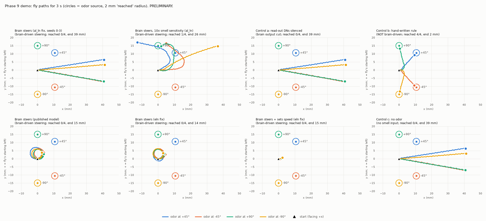

# Phase 9, first steps: the closed brain-body loop

*Written 2026-09-23. Code: `sim/body/` (package), tests: `tests/test_body_loop.py`,
scripts and raw results: `experiments/phase9/`. Status of every result below:
**PRELIMINARY** (not validated per PLAN.md Phase 6).*

## The short version

- **Built:** a working closed loop. FlyGym's physics fly smells an odor with its
  antennae (the published FlyGym 1.x smell formula, added back). The smell drives the
  left/right DM1 smell neurons of the whole-brain model. The brain runs in 50 ms windows
  and keeps its state between them. Its steering neurons (DNa02/DNa01, left vs right) set
  the body's left/right walking drive. Walking itself (legs, rhythm, speed) is FlyGym's
  controller: **NOT brain-driven**.
- **Controls built in:** (a) steering neurons silenced; (b) FlyGym 1.x's hand-written
  steering rule (**NOT brain-driven**); (c) no odor.
- **Result: the brain-driven fly does NOT walk to the odor better than chance or
  better than the silenced fly.** With the recommended sign fix, the smell never reaches
  the steering neurons: 0 spikes in 480 windows, so the fly walks straight, just like
  the silenced fly. When the smell does reach them (stronger smell, or the published
  model), they say "turn LEFT" whether the odor is on the left or the right.
  - The hand-written rule, in the same body, reached the odor 4 of 4 times.
  - This confirms, with a body, the Phase 5 wiring finding: no brain-driven left/right
    steering signal exists in this read-out.
  - The Phase 9 checkpoint is **not passed**.
- **Status: PRELIMINARY** (4 start layouts per condition; no Phase 6 validation).

---

## 1. What was built, in plain English

### 1.1 A separate environment for the body

- The body model is **FlyGym 2.1.0** (NeuroMechFly, EPFL; Wang-Chen et al. 2024,
  *Nature Methods*), chosen in `docs/phase9-body-research.md`.
- It lives in its own environment, `.venv-body`, so the verified brain setup in `.venv`
  is untouched. `.venv-body` has every package the main project pins, at the same
  versions, plus FlyGym and what it pulls in (pinned in `requirements-body.txt`).
- `.venv-body/` is listed in `.gitignore`. It was added by another lane during this
  work; this lane did not edit `.gitignore`.
- FlyGym's walking works here: `experiments/phase9/walk_and_sign_check.py` walked the
  fly for 0.5 s three times (table in section 3.1).

### 1.2 Smell, added back

FlyGym 2.x has no smell. We re-added the **published FlyGym 1.x odor model**, copied
from the released flygym-gymnasium 1.3.2 package (read on 2026-09-22):

- odor strength at a sensor = peak strength × distance⁻², summed over sources
  (`OdorArena.get_olfaction`, default `diffuse_func = lambda x: x**-2`);
- 4 sensors at the same places FlyGym 1.x put them: two antennae (on the funiculus)
  and two maxillary palps (on the rostrum);
- the odor source sits 1.5 mm above the ground, as in FlyGym 1.x's odor-taxis example.

It is a smooth, steady "odor cloud": no wind, no plume, no turbulence (same as 1.x).
Code: `sim/body/odor.py`.

### 1.3 The loop

The trial is cut into **50 ms windows** (FlyGym 1.x's odor-taxis decision interval).
Every window:

1. **Body → senses.** Where are the antennae? How strong is the odor there?
2. **Senses → brain.** Each antenna's odor strength becomes a firing rate for the
   DM1 smell neurons (ORNs) on that side: 35 "left" and 33 "right" DM1 ORNs (snapshot
   630 labels, `hemibrain_type == ORN_DM1`). The whole brain (127,400 neurons) then runs
   for 50 ms.
3. **Brain → drive.** The spikes of 8 descending neurons (DNs) in that window are
   turned into FlyGym's two-number walking drive [left, right].
4. **Drive → body.** FlyGym's own walking controller moves the legs for 50 ms with that
   drive.

**Carrying the brain's state from window to window.** The project's brain engine
(`FastBrain` in `sim/fast_engine.py`) **cannot** do this: every run starts all neurons
from rest. We were not allowed to edit it, so `sim/body/brain_stepper.py` contains a
copy of the engine's inner loop that keeps the state (voltages, fading synaptic inputs,
spikes still in flight) between windows. It reuses FastBrain's connection data and
constants, so the model itself is not re-implemented.

- **Proof it is exact:** a run cut into windows gives *spike for spike* the same result
  as one uninterrupted FastBrain run. Tested on small random networks with windows of
  0.1 ms to 300 ms (unit tests), and once on the **full brain** in the runaway regime
  (300 ms, 129,098 spikes, 95,927 neurons touched: identical;
  `experiments/phase9/results/stepper_full_brain_check.txt`).
- **Cost of this workaround:** about 100 lines copied from `fast_engine.py` that must
  stay in step with it. The spike-for-spike test fails if `fast_engine.py` ever changes
  its rules, so a drift cannot go unnoticed.
- **The alternative we did not use** ("replay": re-run from time 0 every window and keep
  the last 50 ms) is exact too, but for a 3 s trial it would simulate 91.5 s of brain
  time instead of 3 s (about 30× slower).

### 1.4 The two translation tables (explicit, fixed before the first run)

Code: `sim/body/mapping.py`. None of these numbers were tuned after seeing results.

**Senses → brain (`SensorMapping`)**

| Item | Choice | Why |
|---|---|---|
| Which neurons | left / right DM1 ORNs (Or42b; vinegar-type odors, attractive) | Recommended first odor; DM1 is antennal |
| Rate formula | rate = 150 Hz × I / (I + 0.01) | Saturating, like real ORNs. 150 Hz = the model's default input rate |
| Half-rate strength | 0.01 = strength 10 mm from the source | So rates span ~30 Hz (20 mm) to ~140 Hz (2 mm) |
| Spontaneous rate | 0 Hz | The published model has no background activity anywhere |
| Sensors used | antennae only (palps only feed the hand-written rule) | DM1 ORNs sit on the antenna |

**Brain → body (`DriveMapping`)**

| Item | Choice | Why |
|---|---|---|
| Turning signal | s = [(DNa02_L − DNa02_R) + 0.5 × (DNa01_L − DNa01_R)] / 20 Hz; turn = tanh(s) | More left DNa02 → turn left (ipsilateral steering; Rayshubskiy et al. 2025, *eLife*). DNa01 = slower, weaker steering neuron of the same paper, half weight |
| Turn → drive | lower ONE side's drive by 0.8 × \|turn\| | Exactly how FlyGym 1.x's odor-taxis example steers |
| Forward drive (main demo) | fixed at 1.0: **NOT brain-driven** | The model has no spontaneous activity, so a brain-set speed would make the fly stand still with no odor, which would mix "does it walk" with "does it steer" |
| Forward drive (exploratory run) | min(1, mean of DNg100 L/R and DNp09 L/R / 20 Hz) | DNg100 = walking command neuron (Pugliese et al. 2025, bioRxiv); DNp09 = forward walking (Bidaye et al. 2020) |
| Legs | FlyGym's hybrid turning controller: **NOT brain-driven** | No brain-to-leg wiring in our model (no nerve cord) |

**Sign check:** in FlyGym, a lower LEFT number turns the fly LEFT (measured, section
3.1), and more LEFT DNa02 lowers the left number (unit test). So "more left DNa02 =
turn left" holds end to end.

### 1.5 Controls built in from day one

| Condition | What changes | Brain-driven? |
|---|---|---|
| `brain` | nothing: the recommended sign fix `al_ln_literature` (its 8 tests passed at run time), brain seeds 0-3 | steering yes; speed and legs NOT |
| `brain_seedB` | same, brain seeds 10-13 | same |
| `brain_dns_off` (control a) | the 8 read-out DNs silenced: their output is cut in the brain, and the body receives 0 Hz from them | no steering at all |
| `brain_no_odor` (control c) | same brain, every odor source off | nothing to smell |
| `hand_rule` (control b) | FlyGym 1.x's hand-written taxis rule replaces the brain (a test checks it equals the published example code) | **NOT brain-driven** |
| `brain_published` | the published model, no sign fix | steering yes |
| `brain_strong_odor` (sensitivity check, added after seeing the `brain` result) | smell neurons 10× more sensitive (half rate at 0.001 instead of 0.01) | steering yes |
| `brain_eln`, `brain_dns_off_eln`, `brain_no_odor_eln` | as above, with the `eln_electrical` fix (the recommendation when the first batch ran) | as above |
| `brain_fwd_dns_eln` (exploratory) | like `brain_eln`, but speed also from DNg100 + DNp09 | steering and speed yes; legs NOT |

**Test layout:** the fly starts at (0, 0) facing +x. The odor source is 15 mm away at
+45°, −45°, +90° or −90° (+ = the fly's left). The layout is balanced left/right on
purpose: a fly that always turns the same way cannot look good on average. Trial k uses
walking-controller seed k and brain seed k (10 + k for `brain_seedB`). 3 s per trial; a trial stops early if the fly gets within 2 mm (FlyGym
1.x's "reached" distance).

### 1.6 What is brain-driven and what is not

| Part | Source |
|---|---|
| Odor world, antenna positions, physics | FlyGym + the published 1.x odor formula |
| Odor strength → DM1 ORN rates | our fixed formula (section 1.4) |
| ORNs → ... → DNa02 / DNa01 firing | **the whole-brain model (brain-driven)** |
| DN firing → left/right drive | our fixed formula (section 1.4) |
| Walking speed (main demo) | fixed number: **NOT brain-driven** |
| Leg movements, walking rhythm, how a drive difference becomes a turn | FlyGym's controller: **NOT brain-driven** |
| `hand_rule` steering | hand-written rule: **NOT brain-driven** |

---

## 2. Before closing the loop: an open-loop check (no body)

`experiments/phase9/open_loop_check.py`: drive only the brain for 1 s (50 ms windows,
state carried), seeds 0-2, and read the steering neurons over the last 500 ms. Mean of
3 seeds, in Hz (`results/open_loop_check.csv`). "turn" is what the drive mapping makes
of it (+1 = hardest left turn).

| Brain | DM1 input | DNa02 L | DNa02 R | DNa01 L | DNa01 R | turn |
|---|---|---|---|---|---|---|
| published (`none`) | left only 150 Hz | 48.0 | 0.0 | 10.7 | 6.0 | +1.0 |
| published | right only 150 Hz | 56.7 | 0.0 | 12.0 | 12.0 | +1.0 |
| published | left 80 / right 70 Hz | 48.0 | 0.0 | 14.7 | 9.3 | +1.0 |
| published | left 70 / right 80 Hz | 53.3 | 0.7 | 15.3 | 10.7 | +1.0 |
| `eln_electrical` (recommended) | left only | 64.0 | 1.3 | 18.0 | 10.0 | +1.0 |
| `eln_electrical` | right only | 57.3 | 1.3 | 19.3 | 8.7 | +1.0 |
| `eln_electrical` | left 80 / right 70 | 54.0 | 0.7 | 16.7 | 13.3 | +1.0 |
| `eln_electrical` | left 70 / right 80 | 60.0 | 2.0 | 19.3 | 8.7 | +1.0 |
| `al_ln_literature` | left only | 1.3 | 0.0 | 0.7 | 0.0 | +0.1 |
| `al_ln_literature` | right only | 5.3 | 0.0 | 4.0 | 0.7 | +0.3 |
| `al_ln_literature` | left 80 / right 70 | 0.0 | 0.0 | 0.7 | 0.0 | 0.0 |
| `al_ln_literature` | left 70 / right 80 | 0.0 | 0.0 | 0.0 | 0.0 | 0.0 |

What it says, before any body is involved:

- **The right DNa02 almost never fires, whichever antenna smells the odor.** This
  repeats the Phase 5 finding (`docs/phase5-olfaction.md` section 5) with the loop's own
  code and rates.
- With the published model and with the recommended `eln_electrical` fix, the smell
  system still **runs away** (about 90,000-98,000 neurons touched within 1 s), and the
  steering command is "hardest left turn" for **every** input, including odor from the
  right.
- With the stricter `al_ln_literature` fix there is no runaway, but the steering neurons
  barely fire (0-7 Hz), and when they do, it is again the left one.
- **So a brain-driven left/right steering signal does not exist in this model for DM1
  smell.** The loop was still built and run, because an honest "no" from the full loop
  is the Phase 9 result either way.

---

## 3. Checks that ran

### 3.1 FlyGym walks here, and the turn sign

`experiments/phase9/walk_and_sign_check.py` (0.5 s each, fly facing +x, +y = its left;
`results/walk_and_sign_check.csv`):

| Drive [left, right] | forward (mm) | sideways (mm) | heading change | wall time |
|---|---|---|---|---|
| [1.0, 1.0] | +5.95 | +1.26 | +9° | 33 s |
| [0.2, 1.0] | +1.89 | +2.87 | **+76° (left)** | 29 s |
| [1.0, 0.2] | +2.03 | −2.35 | **−71° (right)** | 29 s |

- Lower left number → left turn; lower right number → right turn. Confirmed.
- The left antenna sensor is on the fly's left (y = +0.158 mm; right: −0.159 mm). The
  two antennae are 0.317 mm apart.
- Speed: about 60 s of computer time per 1 s of fly time for the body, i.e. ~0.017×
  real time (other jobs were running on the machine).

### 3.2 Tests

`tests/test_body_loop.py`, 21 tests: the windowed brain equals one FastBrain run spike
for spike (6 window sizes); Poisson input per window; the 1/distance² rule; sensor
placement follows the head's rotation; the sensor → rate curve; the DN → drive sign
and symmetry; the forward-drive formula; the hand-written rule equals FlyGym 1.x's
example code; silencing the DNs cuts what the body receives; one very short (20 ms)
closed-loop trial with a toy brain wired "left smell → left DNa02" that must produce a
left-turn command. The FlyGym tests are skipped in the main `.venv` (no FlyGym there).

---

## 4. The closed-loop demo: does the brain-driven fly walk to the odor?

`experiments/phase9/run_demo.py`, analysed by `analyze_demo.py`. Every condition used the
same 4 start layouts (odor at +45°, −45°, +90°, −90°, 15 mm away), 3 s of fly time each,
50 ms windows. Raw data: `results/demo_windows.csv` (one row per window: position,
heading, antenna odor, ORN rates, every read-out DN's rate, turn command, drive),
`results/demo_trials.csv`, `results/demo_summary.csv`, log `results/demo.log`.

**Which sign fix.** The run first used `eln_electrical`, the recommended fix at the time.
While it ran, the sign-fix lane changed its recommendation to `al_ln_literature`, the fix
that stops the smell runaway (`tests/test_sign_fixes.py`: 8 passed, both times). The main
conditions were then re-run with `al_ln_literature`. The `eln_electrical` runs are kept
and labelled `*_eln`.



*One panel per condition. Each colour is one start layout: the ring is its odor source
(2 mm = "reached"), and the line is the fly's path over 3 s, starting at the black
triangle, facing right.*

| Condition (4 trials each) | Reached odor | Mean closest approach (mm) | Mean end distance (mm) | Mean net turn in 3 s | Left DNa02 / right DNa02 (Hz) |
|---|---|---|---|---|---|
| `brain` (`al_ln_literature`, seeds 0-3) | 0/4 | 11.8 | 38.8 | −1° | 0 / 0 |
| `brain_seedB` (same, seeds 10-13) | 0/4 | 11.8 | 38.8 | −1° | 0 / 0 |
| `brain_strong_odor` (10× smell sensitivity) | 1/4 (the +90° odor, on its left) | 7.9 | 25.5 | +139° | 12.8 / 1.9 |
| `brain_dns_off` (control a) | 0/4 | 11.8 | 38.8 | −1° | (cut) |
| `brain_no_odor` (control c) | 0/4 | 11.8 | 38.8 | −1° | 0 / 0 |
| `hand_rule` (control b, **NOT brain-driven**) | **4/4** | 1.5 | 1.5 | −5° (left and right turns) | n/a |
| `brain_published` (no fix) | 0/4 | 11.9 | 14.8 | +441° | 51.0 / 0.2 |
| `brain_eln` (`eln_electrical`) | 0/4 | 11.8 | 14.3 | +447° | 57.7 / 1.2 |
| `brain_fwd_dns_eln` (speed from DNs too) | 0/4 | 14.3 | 14.6 | +17° (barely moved) | 56.8 / 0.8 |
| `brain_dns_off_eln` / `brain_no_odor_eln` | 0/4 | 11.8 | 38.8 | −1° | (cut) / 0 |

(`results/demo_summary.csv`. The start distance is 15 mm in every trial. Paths of the
silenced, no-odor and recommended-fix flies are identical because in all three the drive
was exactly [1, 1] in every window, and the physics is deterministic.)

### 4.1 What happened, condition by condition

- **Brain with the recommended fix (`al_ln_literature`): the fly ignores the odor.**
  Over the 3 s, the DM1 smell neurons fired at 7-88 Hz (the odor was 8.6-46 mm away).
  **Not one read-out neuron fired a single spike in any of the 240 windows.** Those
  neurons are DNa02, DNa01, DNg100 and DNp09, left and right. So the turn command stayed
  exactly 0, and the fly walked straight. Its path is the same, to the last digit, as the
  path with the DNs silenced. The second set of brain seeds (10-13) did the same.
- **Brain with 10× more sensitive smell neurons (a sensitivity check, added after the
  result above).** Now the DM1 neurons fire 83-132 Hz, and the steering neurons respond:
  the left DNa02 fires in 98 of 237 windows, the right one in 20. **But the fly turns
  left whichever side the odor is on.** Only 3 of 237 windows asked for a right turn.
  It reached the odor once, and that was the +90° layout, where the odor was straight to
  its left. For the −90° odor (to its right) it turned slightly left and walked away. The
  turn command follows how *strong* the smell is (correlation +0.42 with the mean ORN
  rate), much more than *which side* it is on (+0.16 with the left-minus-right ORN rate
  difference, which averaged only 0.5 Hz; `results/demo_turn_correlations.csv`).
  Against the silenced fly, it got closer for the two odors on its LEFT (4.4 vs 8.6 mm;
  1.3 vs 15 mm), not as close for −45° (11.0 vs 8.7 mm), and tied at −90° (15 mm).
- **Published model (no fix) and the older `eln_electrical` fix: the fly spins in
  circles to the left.** The smell system runs away, the left DNa02 fires about 51-58 Hz
  and the right one about 0-1 Hz, so the command is a left turn in 97-98% of the
  windows (mean command +0.93 to +0.95). The fly turns about 440° in 3 s, in a small circle near where it started, and
  never reaches the odor.
- **Brain also sets the walking speed (`brain_fwd_dns_eln`, exploratory).** DNg100 fires
  only about 3 Hz and DNp09 not at all, so the forward drive is 0 in most windows (mean
  0.08), and the fly shuffles 1.6 mm in 3 s.
- **Control (a), steering DNs silenced, and control (c), no odor:** the fly walks
  straight. It gets as close as the path happens to pass: 8.6-8.7 mm for the ±45° layouts, and
  it never gets closer than its 15 mm start for ±90°. It reached the odor 0 of 4 times.
- **Control (b), the hand-written rule (NOT brain-driven), in the same body:** it reached
  the odor **4 of 4 times**, in 1.6-1.9 s, turning left or right as needed. So the body,
  the odor world and the drive "knob" are all able to produce odor taxis. The missing
  piece is a side-specific signal from the brain.

### 4.2 A trap in the numbers: "ends closer" is not "steers better"

The circling brain flies (published model and `eln_electrical`) **end** closer to the
odor than the silenced fly in 4 of 4 layouts, by 24 mm on average. That is **not**
steering. A fly that spins on the spot stays about 15 mm from the odor, while a fly
walking straight past it ends up 31-47 mm away. Their **closest** approach is the same
as the silenced fly's (closer in 2 of 4 layouts, mean difference 0.0 mm), and they
reached the odor 0 times. Whether the fly *reached* the odor, and how close it *ever* got,
are the honest measures here.

### 4.3 Answer to the Phase 9 question

**Does the brain-driven fly approach the odor better than chance and better than when
silenced? No.**

- With the recommended fix, the brain produces no steering output at all at these odor
  strengths. Brain-driven and silenced are the same fly.
- With stronger smell, or with the runaway models, the brain produces a steering output,
  but it is a **left turn for odor on either side**. It found the odor only when the odor
  happened to be on the left (1 of 4 layouts). That is what a fly that always turns left
  would do by chance.
- The **PLAN.md Phase 9 checkpoint is NOT passed**: no behavior matched real fly behavior
  in the right direction.

This is the result that `docs/phase5-olfaction.md` predicted from the wiring. Left-only
and right-only DM1 smell both drive the LEFT DNa02 and never the right one. The
closed-loop test confirms it with a body: in this model, the DNa02/DNa01 read-out has no
brain-driven left/right steering signal for DM1 odor. **PRELIMINARY:**

- n = 4 layouts per condition, one brain seed each (plus a second seed set for the
  recommended fix);
- no Phase 6 validation (seeds × parameter sweeps, literature check);
- the side labels of the ORNs and DNs were not independently checked.

### 4.4 What the Phase 6 steering study recommends (and what we did with it)

`docs/phase6-steering.md` appeared after these runs had finished. It scanned all 463
left/right descending-neuron pairs and found no read-out that turns toward a DM1 smell,
with or without the fix. Its section 7 recommendation for this loop, and how we followed
it:

1. **Vinegar (DM1): label the turning NOT brain-driven, and use the hand-written rule.**
   - That rule is already in the loop: `steering="hand_rule"`, control (b) above. It
     reached the odor 4 of 4 times.
   - Any DM1 odor-taxis demo from this loop must therefore be shown as **"turning NOT
     brain-driven"**. The brain can still be shown reacting to the smell.
   - Our closed-loop result is what that study predicts.
2. **Do not rescue DM1 by subtracting each neuron's average.** Not done here.
3. **Optional: a brain-driven turning demo with DA1 (cVA), which the study found to
   work.**
   - It works with smell on one antenna. With both antennae, it needs a different
     read-out (left minus right DNpe002), which is untested at 50 ms windows.
   - cVA is a male pheromone, and whether flies walk toward it is **UNVERIFIED**.
   - **Not run here.** The loop can now do it without code changes:
     `TrialConfig(orn_type="ORN_DA1", drive_mapping=DriveMapping(neuron_ids=...,
     turn_weights=...))`. Both the smell neurons and the read-out are single config
     entries.

---

## 5. Limits and things NOT verified

- **Walking and leg control are not brain-driven** in any condition except the
  exploratory one where speed comes from DNg100 + DNp09. Even there the legs themselves
  are FlyGym's controller.
- **The sensor → rate curve was chosen, not measured** (saturating curve, half rate at
  10 mm). With it, the recommended brain never activates the read-out DNs. The 10×
  sensitivity check shows that stronger input does not fix the side problem. Other
  curves were not tried.
- **Antenna geometry.** The two antenna sensors are only 0.317 mm apart, so the
  left/right odor difference is small: about 0.5-1 Hz of ORN rate, around 1%. Real flies
  also have small differences to work with. They are known to use asymmetric transmitter
  release to sharpen them (Gaudry et al. 2013; background knowledge, not re-read), and the
  model has no such mechanism.
- **The FlyGym 1.x sensor offsets were applied in the FlyGym 2.x body frames.** These
  frames may not be identical to 1.x's. The effect is at most ~0.1 mm on sensor
  position. Not checked.
- **ORN side labels** ("left" = the left antenna) and the label-matched left DNa01 and
  left DNg100 were **not independently verified**.
- **Brain-seed variability:** one Poisson seed per layout (two for the recommended fix).
- **Speed:** the body runs at about 0.017× real time (≈60 s of computer time per fly
  second). The brain adds 1-15 s per 3 s trial with the recommended fix, and 25-55 s per
  trial for the runaway models. One trial takes about 3-4 minutes.
- Not built yet: vision in the loop, a 3D view in the app, bitter taste, and the
  Phase 8 + 9 combination.

## 6. How to run it

```
py -3.13 -m venv .venv-body
.venv-body\Scripts\python.exe -m pip install -r requirements-body.txt
.venv-body\Scripts\python.exe -m pytest tests/test_body_loop.py -q
.venv-body\Scripts\python.exe experiments/phase9/walk_and_sign_check.py
.venv-body\Scripts\python.exe experiments/phase9/stepper_full_brain_check.py none
.venv-body\Scripts\python.exe experiments/phase9/open_loop_check.py none eln_electrical al_ln_literature
.venv-body\Scripts\python.exe experiments/phase9/run_demo.py [condition ...]
.venv-body\Scripts\python.exe experiments/phase9/analyze_demo.py
```
