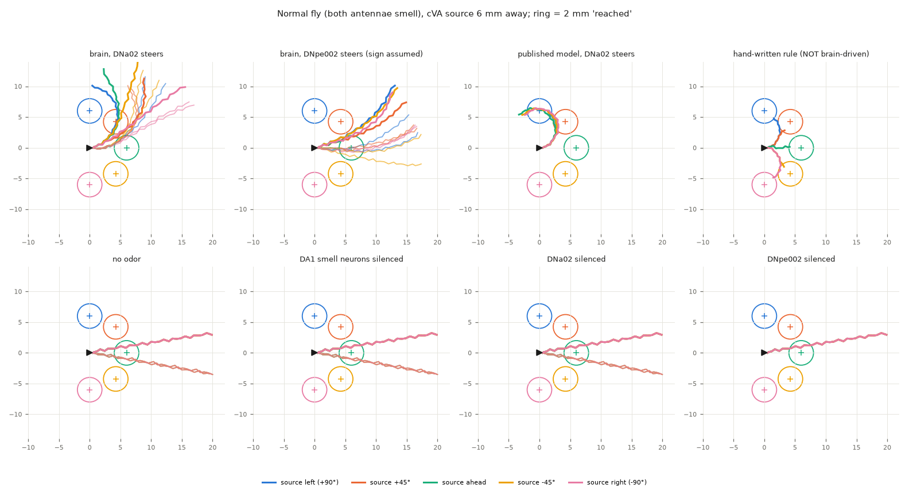
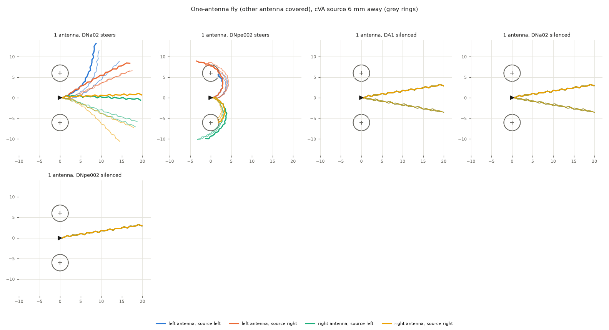
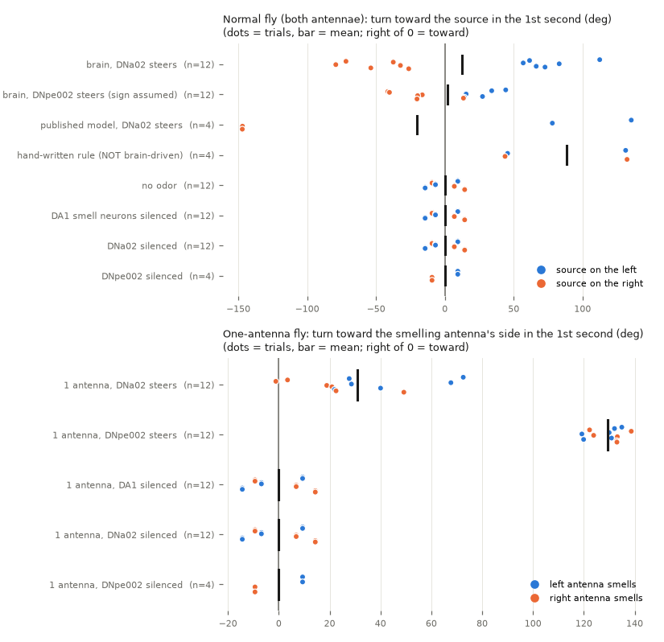

# Phase 9: can the brain steer the body with the cVA smell channel (DA1)?

Prepared 2026-09-23. Model: the Shiu et al. 2024 whole-brain model, FlyWire snapshot 630,
with the sign fix `al_ln_literature` (`sim/sign_fixes.build_brain`). Body: FlyGym 2.1.0
(NeuroMechFly) in `.venv-body`, the closed loop of `docs/phase9-body-loop.md`. Everything
here is **PRELIMINARY** (see section 7). Files: `experiments/phase9_da1/`.

## The short version

- **Question.** The Phase 6 steering study found one smell channel that gives the model a
  left/right steering signal: DA1, which smells the pheromone cVA. Can the brain steer
  the physics fly toward cVA, and does that stop when the responsible neurons are
  silenced (the PLAN.md Phase 9 checkpoint)?
- **Expected behaviour, decided first (section 1):** turn toward cVA and approach it, as
  virgin females do (Lebreton 2014), with the known catch that attraction depends on
  context. More DNa02 on one side turns the fly to that side (Rayshubskiy 2025).
- **Normal fly, both antennae smell: NO.** The brain-driven fly turns LEFT in every trial
  (15 of 15), whether the cVA is on its left or its right. It turns toward the source
  only by chance (6 of 12) and gets no closer than a silenced fly (4.1 vs 4.2 mm,
  p = 0.87). The two antennae are 0.3 mm apart, so they smell almost the same (0.4 Hz
  difference in smell-neuron firing), and the model's built-in left bias wins. The
  second read-out, DNpe002, also fails (7 of 12).
- **One-antenna fly (one antenna covered, a standard lab manipulation): YES, weakly.** It
  turns toward the side of the antenna that can smell: left antenna -> left turn, right
  antenna -> right turn. It turned toward the smelling side outright in 11 of 12 trials,
  and further than the silenced fly of the same seed in all 12 (+31° in the first
  second vs 0°, p = 0.0006). With the DA1 smell neurons or DNa02
  silenced, the turn disappears completely. The right side is weaker than the left, and
  the fly turns but does not reach the source.
- **Hand-written rule (NOT brain-driven):** reached the cVA source 5 of 5 times in the
  same body, so the body and smell world are able to do it.
- **Checkpoint verdict: PARTIAL** (the pre-registered rule, section 1): the behaviour
  appears in the expected direction and vanishes when silenced, but only in a
  one-antenna fly, not in a normal fly walking in a cVA gradient. **PRELIMINARY.**
- **Not brain-driven, in every condition:** walking speed, leg movements, walking rhythm
  and how a left/right drive becomes a turn (FlyGym's controller). The brain only chooses
  left vs right.

---

## 1. Biology first: what should a female fly do? (written BEFORE any closed-loop run)

This section was written at about 02:25 on 2026-09-23, after the brain-only check of
section 2 and before the first closed-loop trial (started 02:27, `results/da1.log`). It was
not changed afterwards.

**The smell.** cVA (11-cis-vaccenyl acetate) is a pheromone that males make and transfer
to females at mating. Its main receptor neurons are the Or67d neurons, which all go to
one glomerulus, DA1. FlyWire is one adult female; whether she was mated is not stated in
anything we found (one search; **UNVERIFIED**).

**What real females do with cVA while walking. It depends on context:**

| Source | What they found | Context |
|---|---|---|
| Lebreton et al. 2014, *Sci Rep* 4:7119 | Virgin females walk toward cVA (Y-tube choice). Shortly after mating they no longer do; that switch runs through a second receptor, Or65a, which inhibits DA1. | walking; cVA on a **vinegar (food) background** |
| Bartelt et al. 1985, *J Chem Ecol* (background knowledge, not re-read) | cVA is an aggregation pheromone: both sexes gather at food marked with it. | with food |
| Kurtovic et al. 2007, *Nature* (background knowledge, not re-read) | Or67d / DA1 is needed for cVA's effects; in females cVA through Or67d makes them more receptive to courtship. | courtship, not steering |
| Taisz et al. 2023, *Cell* (bioRxiv 2022 version read) | DA1 projection neurons encode where a male is (left or right). Walking flies of **both sexes turn AWAY** from a male 2-5 mm away (about 3:1), less so when Or67d neurons are blocked; no bias beyond 5 mm. The authors read it as collision avoidance in the dark. | a real male, in darkness, 2-5 mm |

**Decision (the expected behaviour we test against):**

1. **Primary expectation: turn toward the cVA and approach it** (an attracted fly), as for
   virgin females in Lebreton 2014 and the aggregation effect of Bartelt 1985.
2. **Known conflict, stated up front:** that attraction was seen with food odour present,
   and our arena has only cVA. Up close (2-5 mm) to a real male, real flies turn **away**
   (Taisz 2023). Mated females lose the attraction. So even a "turns toward cVA" result
   matches real flies only in one context (virgin, food around). A turn-away at 2-5 mm
   would match Taisz 2023 instead.
3. **Steering direction of DNa02:** more DNa02 activity on one side turns the fly toward
   that side (Rayshubskiy et al. 2025, *eLife*, doi:10.7554/eLife.102230: light on one
   antenna's smell neurons makes the fly steer to that side, with the same-side DNa02
   firing more). This is the sign already built into the loop.
4. **DNpe002:** no study of it in a real fly was found (docs/phase6-steering.md). "More
   left DNpe002 = turn left" is **our assumption** (by analogy with DNa02). So if the
   DNpe002-driven fly approaches cVA, the brain has only told left from right; the
   *direction* (toward, not away) would be our choice, not the brain's. **A DNpe002
   result therefore cannot pass the checkpoint on its own.**
5. **One-antenna fly.** Covering one antenna is a real lab manipulation (Borst &
   Heisenberg 1982; Duistermars et al. 2009; seen only as citations). Stimulating one
   antenna makes a walking fly steer toward that side (Rayshubskiy 2025, with
   light-activated smell neurons; Gaudry et al. 2013). Expected for an attracted fly:
   it turns toward the side of the antenna that can still smell, wherever the source is.

**Pass rule for the PLAN.md Phase 9 checkpoint, fixed now:**

- **PASS (still PRELIMINARY)** only if, with both antennae smelling (a normal fly), the
  **DNa02-driven** fly turns toward the source in its first second more than the control
  flies (no odor; DA1 smell neurons silenced), with p < 0.05, gets closer to it, and the
  effect is gone when DA1 smell neurons or DNa02 are silenced.
- **PARTIAL** if that works only for the one-antenna fly (a lab manipulation), or only
  with the DNpe002 read-out (direction assumed).
- **NOT PASSED** otherwise.

---

## 2. Brain-only check first (no body): what the antennae will really send

`open_loop_da1.py` (results `results/open_loop_summary.csv`, `open_loop_sweep_summary.csv`).
The two antennae of the body fly are only 0.317 mm apart, so a source to one side smells
almost the same to both. We fed the brain the DA1 rates the body would produce (same
sensor curve as the loop), in the loop's 50 ms windows, 2 s x 3 seeds per stimulus.

| Stimulus (DA1 ORN rate, left / right) | DNa02 left - right | DNpe002 left - right | Right sign / wrong sign (DNa02; DNpe002), % of 50 ms windows |
|---|---|---|---|
| source 5 mm to the LEFT, both antennae (121 / 118 Hz) | +18.3 Hz | +6.3 Hz | 89 / 0; 35 / 5 |
| source 5 mm to the RIGHT, both antennae (118 / 121 Hz) | **+17.0 Hz (says left)** | **+4.3 Hz (says left)** | 1 / 79; 4 / 24 |
| source 10 mm left / right, both (76 / 74 and 74 / 76 Hz) | +3.7 / +2.8 Hz | +8.7 / +7.0 Hz | mostly silent; 46 / 2 and 7 / 40 |
| source 15 mm left / right, both (47 / 45 Hz) | 0 / 0 | +12.8 / +11.0 Hz | silent; 62 / 2 and 5 / 55 |
| equal smell, 75 / 75 Hz | +1.8 Hz | +7.3 Hz | (a left bias) |
| **LEFT antenna only**, 100 / 115 / 130 Hz | +12.8 / +17.2 / +20.2 Hz | +35.0 / +38.5 / +42.2 Hz | 64-91 / 0; 100 / 0 |
| **RIGHT antenna only**, 100 / 115 / 130 Hz | -5.3 / -9.3 / -12.5 Hz | -31.2 / -35.5 / -40.3 Hz | 27-62 / 0; 100 / 0 |
| one antenna only, 75 Hz (10 mm) | +1.8 (left) / 0 (right) | +27.7 / -23.0 | DNa02 barely fires |

What this means before any walking:

- **With both antennae smelling, neither read-out tells left from right.** The left/right
  difference in smell is only 1-3 Hz (about 2%). Both DNa02 and DNpe002 carry a bigger
  built-in "turn left" bias (DNa02 about +17 Hz up close; DNpe002 about +4 to +13 Hz). So
  the brain says "turn left" for a source on either side. We expect the normal fly to
  circle left, not to approach.
- **With one antenna covered, both read-outs point to the smelling side**, in every seed:
  DNpe002 in 99-100% of windows, DNa02 only when the smell is strong (100 Hz or more,
  i.e. closer than about 7 mm) and more weakly for the right side.
- These numbers fixed two design choices before the closed loop: the source is placed
  **6 mm** away (ORN rate about 110 Hz, where DNa02 answers a one-sided smell), and the
  one-antenna fly is run as the "one-sided" test.

---

## 3. The closed-loop experiment (what was run)

`run_da1.py` (raw data `results/da1_windows.csv`, one row per 50 ms window;
`results/da1_trials.csv`, one row per trial; log `results/da1.log`), analysed by
`analyze_da1.py`.

- **The loop** is the one in `docs/phase9-body-loop.md`, with two config changes: the
  smell drives the **DA1** smell neurons (60 left, 66 right) instead of DM1, and one pair
  of descending neurons steers. Every 50 ms: antennae smell -> DA1 firing rates -> whole
  brain runs 50 ms -> left minus right firing of the steering pair -> left/right walking
  drive -> the body walks 50 ms.
- **What is NOT brain-driven, in every condition:** the leg movements, the walking rhythm,
  the walking speed (fixed at full), and how a left/right drive becomes a turn. All of
  that is FlyGym's built-in controller. The brain only chooses left vs right.
- **Arena A, a normal fly (both antennae smell).** The fly starts at the centre facing
  right; the cVA source is 6 mm away, to its left (+90°), front-left (+45°), straight
  ahead (0°), front-right (-45°) or right (-90°). Left and right are balanced, so a fly
  that always turns one way cannot look good.
- **Arena B, a one-antenna fly** (the other antenna covered). Left antenna only, or right
  antenna only, each with the source 6 mm to the left or to the right. A fly that steers
  by its smelling antenna should turn toward that antenna's side wherever the source is.
- **Replicates:** replicate r uses walking-rhythm seed r and brain seed r (r = 0, 1, 2).
  All three for the brain conditions and for no odor, DA1 silenced and DNa02 silenced;
  replicate 0 only for DNpe002 silenced, the hand-written rule and the published model
  (to save compute). 142 trials in all. 1.5 s of fly time per trial; a trial stops when
  the fly is within 2 mm of the source.
- **Conditions:**

| Name | Steering | Arena |
|---|---|---|
| `dna02` | brain: left minus right DNa02 (sign from Rayshubskiy 2025) | A |
| `dnpe002` | brain: left minus right DNpe002 (**sign assumed**) | A |
| `no_odor` | brain (DNa02), source switched off | A |
| `orns_off` | brain (DNa02), all DA1 smell neurons silenced | A |
| `dna02_off` / `dnpe002_off` | that DN pair silenced in the brain, and the body gets 0 Hz from it | A |
| `hand_rule` | FlyGym 1.x's hand-written odor rule: **NOT brain-driven** (reference) | A |
| `published_dna02` | published model (no sign fix), DNa02 | A |
| `one_dna02`, `one_dnpe002` | brain, one antenna covered | B |
| `one_orns_off`, `one_dna02_off`, `one_dnpe002_off` | controls, one antenna covered | B |

- **Measures** (fixed before the runs): turning in the first second, signed so that
  "toward the source's side" is positive (arena A, source left or right) or "toward the
  smelling antenna's side" is positive (arena B); closest approach to the source; reached
  (within 2 mm) and time to reach. **Final distance is not used**: a fly circling near its
  start can end closer than a fly that walked past (docs/phase9-body-loop.md 4.2).
- **Tests:** Mann-Whitney U (two-sided) of each brain condition against each control; a
  sign test of "turned toward in more than half of the trials".

---

## 4. Results

### 4.1 Normal fly (both antennae smell): it circles LEFT, wherever the cVA is



*One panel per condition. Each colour is one source position (the ring is the 2 mm
"reached" zone around it); thick line = replicate 0, thin lines = replicates 1-2. The fly
starts at the black triangle facing right. In the silenced and no-odor panels all paths
lie on top of each other (the same straight walk).*

| Condition | Trials | Reached | Closest approach, mean (mm) | Turned LEFT in 1st s | Turned toward the source in 1st s (source left or right) | Mean turn toward source, 1st s |
|---|---|---|---|---|---|---|
| brain, DNa02 steers | 15 | 2/15 | 4.1 | **15/15** (mean +60°) | 6/12 | +13° |
| brain, DNpe002 steers (sign assumed) | 15 | 3/15 | 4.2 | 12/15 (mean +18°) | 7/12 | +2° |
| no odor | 15 | 3/15 | 4.2 | 5/15 (the body's own drift: about +9°, -7°, -14° for seeds 0, 1, 2) | 6/12 | 0° |
| DA1 smell neurons silenced | 15 | 3/15 | 4.2 | 5/15 (same drift) | 6/12 | 0° |
| DNa02 silenced | 15 | 3/15 | 4.2 | 5/15 (same drift) | 6/12 | 0° |
| DNpe002 silenced (seed 0 only) | 5 | 1/5 | 4.3 | 5/5 (seed 0's drift) | 2/4 | 0° |
| hand-written rule, **NOT brain-driven** (seed 0 only) | 5 | **5/5** | 1.3 | 2/5 | 4/4 | +88° |
| published model, DNa02 steers (seed 0 only) | 5 | 2/5 | 3.7 | 5/5 (mean +131°) | 2/4 | -20° |

(`results/da1_condition_table.csv`. "Reached" = within 2 mm. Every reach by a brain fly
or a control was the source straight ahead, where walking straight gets there by itself
in 0.3-0.45 s.)

- **The brain-driven fly turns left in every trial, whether the cVA is on its left or on
  its right.** Source on the left: it turns toward it and gets closer than the
  straight-walking control (+45°: 2.1-2.8 mm vs 3.2-4.7 mm). Source on the right: it
  turns away (-45°: 4.4-5.3 vs 3.3-4.9 mm; -90°: 5.9-6.0 vs 5.8-6.0 mm). Source ahead: it
  veers off and misses it once in three. Averaged over the balanced layouts, it does no
  better than the silenced fly (closest approach 4.1 vs 4.2 mm, p = 0.87; turn toward the
  source p = 1.0; section 4.3).
- **Why:** exactly what the brain-only check predicted (section 2). The two antennae
  differ by only 0.4 Hz of smell-neuron firing on average (99.8 vs 99.4 Hz), while the
  left DNa02 fires 11.2 Hz and the right one 0.3 Hz whatever the side. That is the
  model's built-in left bias (docs/phase6-steering.md), not a smell direction.
- **The DNpe002 read-out** has a smaller left bias (left 32.6 Hz vs right 25.1 Hz on
  average), so the fly drifts left more gently, but it still does not turn toward the
  source more than chance (7 of 12).
- **Per 50 ms window** (`results/da1_window_toward.csv`) the DNa02 command pointed toward
  the source's side in 34% of windows and away in 17%. That looks better than it is: a
  fly that turns away from a source on its right walks out of the smell, and the command
  then goes quiet. The per-trial first-second turn is the fair measure.

### 4.2 One-antenna fly: it turns toward the side of the antenna that smells



*Same layout as above. Colours: which antenna can smell, and where the source is.*

| Condition | Trials | Turned toward the smelling antenna's side in 1st s | Mean turn toward that side, 1st s | Reached the source when it was on the smelling side | Closest approach then (mm) |
|---|---|---|---|---|---|
| brain, DNa02 steers | 12 | **11/12** (12/12 compared with the same-seed control) | **+31°** | 0/6 | 5.9 |
| brain, DNpe002 steers (sign assumed) | 12 | 12/12 | +129° | 6/6 | 1.5 |
| DA1 smell neurons silenced | 12 | 6/12 (the body's own drift) | 0° | 0/6 | 5.9 |
| DNa02 silenced | 12 | 6/12 | 0° | 0/6 | 5.9 |
| DNpe002 silenced (seed 0 only) | 4 | 2/4 | 0° | 0/2 | 5.85 |

DNa02 read-out, heading change in the first second (+ = left), replicates 0 / 1 / 2. The
silenced flies drift by +9° / -7° / -14° (walking-rhythm seeds 0 / 1 / 2) with every
antenna and every source position:

| Which antenna smells | Source left (+90°) | Source right (-90°) |
|---|---|---|
| left antenna only (should turn LEFT) | +73°, +68°, +40° | +28°, +29°, +22° |
| right antenna only (should turn RIGHT) | -3°, -19°, -23° | +1°, -21°, -49° |

Compared with the silenced fly of the same seed, every one of the 12 DNa02 trials turned
further toward the smelling side: by 18-75° with the left antenna, by 8-35° with the
right antenna (`results/da1_paired_trials.csv`).

- **A left-antenna fly turns left and a right-antenna fly turns right**, wherever the
  source is, as a real fly with one stimulated antenna is expected to (section 1, point
  5). The silenced flies walk exactly the same straight path in every case.
- **The two sides are not equal.** The left antenna drives the left DNa02 at 2.7-10.7 Hz;
  the right antenna drives the right DNa02 at only 0.7-4.7 Hz, so right turns are weaker
  (8-14° beyond the drift in 5 of 6 trials). The same left bias as above, now visible as
  a weaker right side.
- **With DNa02 it does not bring the fly to the source** (0 of 6 reached when the source
  was on the smelling side; never closer than 5.6 mm). That is not a failure of the
  test: a fly that turns toward its one smelling side is expected to curve around, so
  the turn, not the approach, is the behaviour tested here.
- **With DNpe002 the one-antenna fly turns hard (about 130° in the first second) toward
  the smelling side in all 12 trials, and reaches the source in all 6 trials where it was
  on that side.** Remember that DNpe002's turning direction is our assumption (section
  1, point 4): this shows that DNpe002 reports the smelling side reliably, not that the
  brain chose to approach.

### 4.3 Statistics



*Each dot is one trial; the bar is the mean; right of 0 = turned toward the source (top)
or toward the smelling antenna's side (bottom). Blue = the smell is on the left, orange =
on the right. Top: the DNa02 fly's blue dots are all right of 0 and its orange dots all
left of 0, i.e. it turns left every time. Bottom: both colours right of 0 = it turns
toward whichever antenna smells.*

Per-trial numbers, `results/da1_stats.csv` (Mann-Whitney U, two-sided),
`da1_paired_tests.csv` (Wilcoxon signed-rank, each brain trial minus the silenced trial
with the same layout and seed) and `da1_sign_tests.csv`.

| Question | Brain condition | Compared with | Result | p |
|---|---|---|---|---|
| Normal fly: turns toward the source in the 1st s? | DNa02 (12 lateral trials) | no odor / DA1 silenced / DNa02 silenced (12 each) | +13° vs 0°; 6 of 12 toward | 1.0 (paired vs no odor 0.38; sign test 1.0) |
| Normal fly: turns toward the source? | DNpe002 (12) | the same controls | +2° vs 0°; 7 of 12 toward | 0.66 (sign test 0.77) |
| Normal fly: gets closer? | DNa02 (15) | the same controls (15 each) | 4.1 vs 4.2 mm | 0.87 |
| Normal fly: gets closer? | DNpe002 (15) | the same controls | 4.2 vs 4.2 mm | 0.98 |
| Normal fly: turns LEFT whatever the side? | DNa02 (15) | 50/50 | 15 of 15 left | 0.00006 (sign test) |
| Normal fly: turns LEFT whatever the side? | DNpe002 (15) | 50/50 | 12 of 15 left | 0.035 (sign test) |
| One antenna: turns toward the smelling side? | DNa02 (12) | DA1 silenced (12) | +31° vs 0° | **0.0006**; paired 12 of 12, **0.0005** |
| One antenna: turns toward the smelling side? | DNa02 (12) | DNa02 silenced (12) | +31° vs 0° | **0.0006** |
| One antenna: turns toward the smelling side? | DNpe002 (12) | DA1 silenced (12) / DNpe002 silenced (4) | +129° vs 0° | 0.00004 / 0.004 |
| One antenna, source on the smelling side: gets closer? | DNa02 (6) | DA1 silenced (6) | 5.9 vs 5.9 mm | 1.0 |
| One antenna, source on the smelling side: gets closer? | DNpe002 (6) | DA1 silenced (6) | 1.5 vs 5.9 mm | 0.005 |

Mann-Whitney unless marked. These are small samples (3 seeds; the DNpe002-silenced
control 1 seed) and no correction for the number of tests was applied. The one-antenna
DNa02 result would survive a Bonferroni correction for all 11 rows (0.0006 x 11 = 0.007).

### 4.4 Checks on the controls

- **The silenced and no-odor flies never got a turn command.** In every one of their 50 ms
  windows the body received exactly the straight drive [1, 1]
  (`results/da1_drive_check.csv`).
- **Their paths are identical.** For each walking-rhythm seed, every control trial (any
  control, any source position) followed the same path to the last digit: 0.0 mm and
  0.0° apart (`results/da1_control_identity.csv`; 32 trials for seed 0, 23 each for seeds 1
  and 2). So the physics is deterministic and the only thing that differs between a brain
  fly and its control is the brain's turn command.
- **What "silenced" means here:** the neurons' outgoing connections are cut in the brain
  and the body receives 0 Hz from them. They can still fire (for example the silenced
  DNa02 of the normal fly fired 8.2 Hz left and 0.3 Hz right on average); that firing reaches nothing.
- **A caveat about what silencing proves.** The model has no other activity, so cutting
  any link of the chain (the DA1 smell neurons, or the steering pair) has to give the
  straight walk. The controls show that the turning runs through DA1 -> brain -> DNa02
  and does not come from the body or the arena; they are not a strong test of the brain's
  internal wiring.

### 4.5 Reference conditions: the hand-written rule and the published model

- **Hand-written rule (NOT brain-driven), normal fly, seed 0:** reached the source in
  5 of 5 layouts (closest 1.1-1.5 mm), turning left for sources on the left and right for
  sources on the right (+131°, +46°, -1°, -44°, -132° in the first second). The same body
  and smell world can do cVA taxis; what is missing is a side signal from the brain when
  both antennae smell.

- **Published model (no sign fix), DNa02 read-out, normal fly, seed 0:** the smell
  activity runs away, as it did for vinegar (docs/phase9-body-loop.md): the left DNa02
  fires 38-53 Hz and the right one 0-0.7 Hz. The fly spins hard to the left (+78° to
  +147° in the first second) in all 5 layouts, and reaches the source only when it is on
  its left (+90° and +45°: 2 of 5). DNpe002 does not tell left from right at all here
  (62-68 Hz left, 68-71 Hz right).

---

## 5. Verdict on the PLAN.md Phase 9 checkpoint

The checkpoint: *the embodied fly shows at least one behavior that matches real fly
behavior in the right direction, and the behavior disappears when the responsible
neurons are silenced.* The pass rule was fixed in section 1 before any closed-loop run.

**Verdict: PARTIAL, and PRELIMINARY. Not passed for a normal fly.**

1. **Normal fly (both antennae smell, a real cVA gradient): NOT passed**, with either
   read-out. The brain-driven fly turned left in 15 of 15 trials (DNa02) whatever side
   the cVA was on; it turned toward the source in 6 of 12 (DNa02) and 7 of 12 (DNpe002)
   trials, which is chance, and got no closer than the silenced fly (p = 0.87 and 0.98).
   The turning is brain-driven, but what drives it is the model's fixed left bias, not
   the direction of the smell. The two antennae are too close together (0.3 mm) for the
   model to tell left from right when both smell.
2. **One-antenna fly, DNa02 read-out (turn direction from biology): the behaviour
   appears, in the expected direction, and disappears when silenced.** A fly that can
   smell cVA with only its left antenna turns left, and one that can smell only with its
   right antenna turns right: 11 of 12 trials raw, 12 of 12 against the same-seed
   control, +31° in the first second vs 0° (p = 0.0006 vs DA1 smell neurons silenced
   and vs DNa02 silenced, 12 trials each). With the DA1 smell neurons or DNa02 silenced, the turn
   is gone completely (the exact straight path). This matches the direction expected for
   an attractive smell on one antenna (Rayshubskiy 2025; Gaudry 2013) and for cVA in
   virgin females (Lebreton 2014).
3. **Why only PARTIAL:** (a) "one antenna covered" is a lab manipulation, not a fly in a
   natural cVA gradient; (b) the right side is much weaker than the left (the same left
   bias); (c) with DNa02 the one-antenna fly turns but does not reach the source; (d) the
   real-fly evidence is indirect: a one-antenna female's response to cVA specifically
   was not found, cVA attraction depends on context (virgin, food around), and close to a
   real male flies turn away (Taisz 2023); (e) the silencing controls are weak tests in
   this model (section 4.4).
4. **DNpe002** gives a much stronger one-antenna result (12 of 12, reached the source 6
   of 6 times when it was on the smelling side), but its turning direction is our
   assumption, so it cannot count toward the checkpoint (pre-registered, section 1).
5. **Not brain-driven, in every condition:** walking speed (fixed), leg movements,
   walking rhythm and the turn mechanics (FlyGym's controller). Only the left/right
   choice comes from the brain.

In one sentence: **the brain can steer the body toward the side that smells cVA when only
one antenna smells, and that steering vanishes when the smell neurons or DNa02 are
silenced; a normal fly with both antennae does not find the cVA, because the model has no
usable left/right signal when both antennae smell.**

---

## 6. What is brain-driven here, and what is not

| Part of the behaviour | Where it comes from |
|---|---|
| Which way to turn (left or right), in the `dna02`, `dnpe002` and `one_*` brain conditions | **Brain-driven**: DA1 smell neurons -> the whole-brain model -> left minus right firing of one descending-neuron pair |
| How strongly a firing difference turns the fly (20 Hz difference = 76% of the maximum turn) | our modelling choice (`sim/body/mapping.py`), fixed before the runs |
| That more LEFT DNa02 means a LEFT turn | biology (Rayshubskiy et al. 2025) |
| That more LEFT DNpe002 means a LEFT turn | **our assumption** (no study of DNpe002 found) |
| How strongly the antenna fires for a given smell | our modelling choice (same curve as the first body demo, not fitted to cVA neurons) |
| Walking speed (always full) | fixed number: **NOT brain-driven** |
| Leg movements, walking rhythm, how a left/right drive becomes a turn | FlyGym's built-in controller: **NOT brain-driven** |
| Everything in `hand_rule` | a hand-written rule: **NOT brain-driven** |

## 7. Validation status (PLAN.md Phase 6) and what is NOT verified

**Status: PRELIMINARY.** Phase 6 steps done: several seeds (3 walking-rhythm + brain
seeds for the brain conditions and for the no-odor, DA1-silenced and DNa02-silenced
controls; 1 seed for the DNpe002-silenced control, the hand-written rule and the published
model), bug checks (the
tests below; the controls' drive checked window by window), literature (section 1),
comparison with biology (section 5). Not done in the closed loop: parameter variations
(the brain-only Phase 6 study varied synapse strength +/-10% and smell strength for
one-sided DA1 smell, docs/phase6-steering.md 4d). Nothing was shared and no one was
contacted.

Not verified:

- Whether the FlyWire fly was a virgin or mated female (it decides whether real cVA
  attraction is expected at all; Lebreton 2014).
- The "left"/"right" labels of the DA1 smell neurons (checked only indirectly in
  docs/phase6-steering.md).
- What DNpe002 does in a real fly.
- Whether a real one-antenna female turns toward its intact antenna for cVA specifically.
  The general rule (steer toward the stimulated antenna) comes from vinegar-type odours
  and light-activated smell neurons (Gaudry 2013; Rayshubskiy 2025), and Borst &
  Heisenberg 1982 / Duistermars 2009 were seen only as citations.
- The smell world: a smooth, still 1/distance² cloud with no wind. Real cVA is a heavy,
  barely volatile pheromone that flies detect only within a few mm (Taisz 2023: 2-5 mm).
  The cloud here reaches the fly at 6 mm and beyond, which is generous.
- The smell-to-firing curve was chosen for the first (vinegar) demo and not fitted to
  cVA (Or67d) neurons.
- Brain-only numbers in section 2 assume the source is 0.5 mm above the antennae (an
  approximation of the body geometry).

## 8. Files and how to run

`experiments/phase9_da1/`:

- `open_loop_da1.py` -> `results/open_loop_summary.csv`, `open_loop_windows.csv`,
  `open_loop_sweep_summary.csv`, `open_loop_sweep_windows.csv`, `open_loop.log`
- `run_da1.py` -> `results/da1_trials.csv`, `da1_windows.csv`, `da1.log`,
  `da1_stdout.log` (resumable; the run was stopped twice, by a Windows-update reboot at
  03:09 and a stall at 07:17, and resumed from the saved trials both times)
- `analyze_da1.py` -> `results/da1_condition_table.csv`, `da1_stats.csv`,
  `da1_sign_tests.csv`, `da1_paired_trials.csv`, `da1_paired_tests.csv`,
  `da1_window_toward.csv`, `da1_drive_check.csv`, `da1_control_identity.csv`;
  `plots/trajectories_A.png`, `plots/trajectories_B.png`, `plots/turn_first_second.png`
- `log-entry.md`: the EXPERIMENTS.md entry

Code added (additive; old behaviour unchanged): `sim/body/mapping.py`
(`SensorMapping(antennae=...)`, `DNPE002_IDS`, `dna02_drive_mapping()`,
`dnpe002_drive_mapping()`), and one line plus a docstring note in `sim/body/loop.py`
(the loop records the per-side rates after the covered antenna is applied).

```
.venv-body\Scripts\python.exe -m pytest tests/test_body_loop.py -q
.venv-body\Scripts\python.exe experiments/phase9_da1/open_loop_da1.py
.venv-body\Scripts\python.exe experiments/phase9_da1/open_loop_da1.py sweep
.venv-body\Scripts\python.exe experiments/phase9_da1/run_da1.py [condition ...]
.venv-body\Scripts\python.exe experiments/phase9_da1/analyze_da1.py
```
