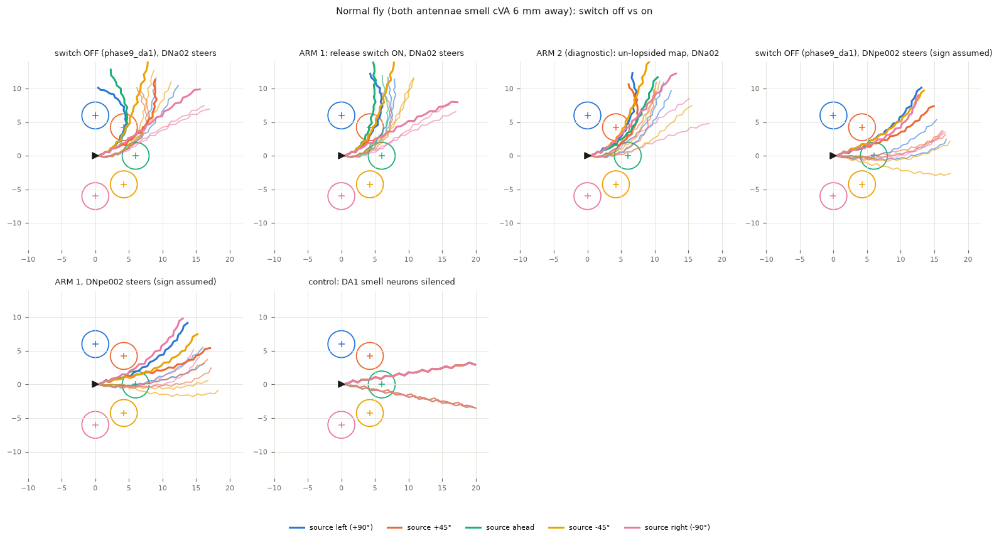
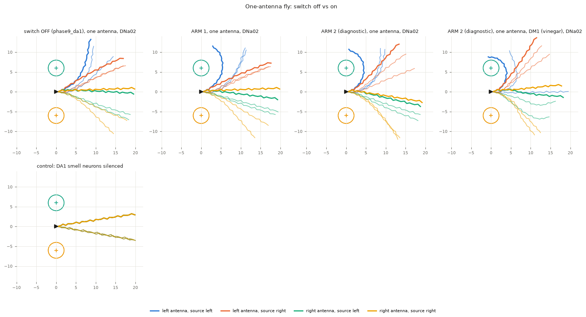
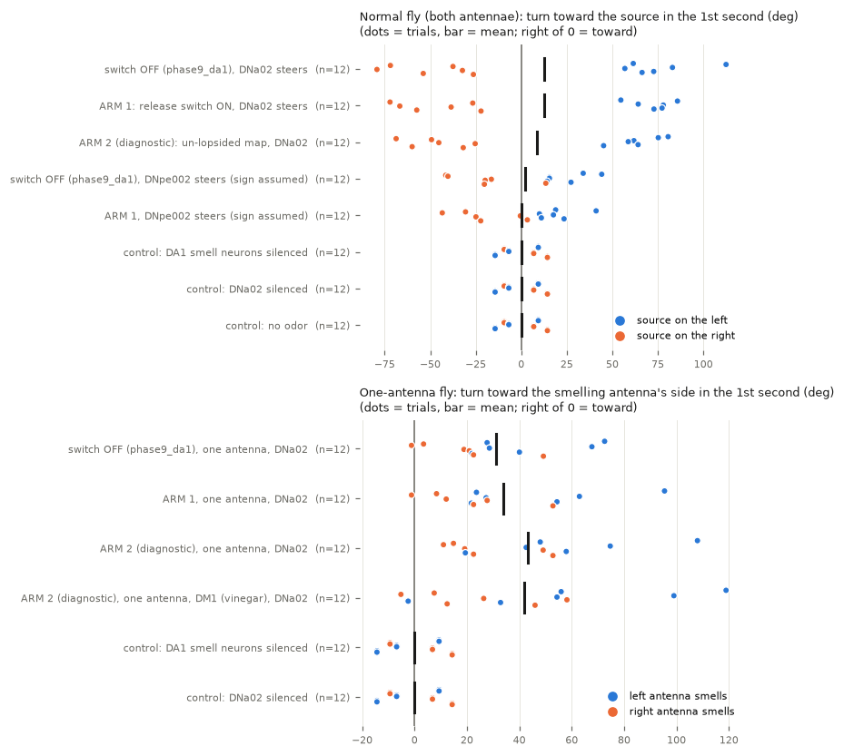

# Phase 9: can the brain steer the body once the same-side release boost is added?

Prepared 2026-09-23. Model: the Shiu et al. 2024 whole-brain model, FlyWire snapshot 630,
with the sign fix `al_ln_literature` (`sim/sign_fixes.build_brain`). Body: FlyGym 2.1.0
(NeuroMechFly) in `.venv-body`, the closed loop of `docs/phase9-body-loop.md` with the cVA
(DA1) settings of `docs/phase9-da1-demo.md`. Files: `experiments/phase9_sameside/`.
Labels as in docs/phase5-competition.md: **VALIDATED** = checked two independent ways and
against the literature; **PRELIMINARY** = at least one of those checks is missing;
**UNVERIFIED** = not checked against a source.

## The short version

**The question.** Our simulated fly's brain can steer its simulated body, but a normal fly
(both antennae smelling) circles left whichever side the cVA smell (a fly pheromone) is
on (docs/phase9-da1-demo.md). One suspected cause: in a real fly, each spike of a smell
receptor neuron releases about 40% more transmitter on its own side of the brain than on
the other side (Gaudry et al. 2013). A wiring diagram cannot show that, so the model lacks
it. Once it is added, does the fly steer like a real one? The words are defined in 1.1;
the expectations and the pass rule were written down at 19:05, before any run (section 1).

**Answer: no, not a normal fly.** **PRELIMINARY** (3 seeds per condition).

- **Arm 1, the realism upgrade.** An on/off "release switch" makes every same-side
  receptor-to-projection-neuron connection 1.39 times stronger (Gaudry et al. 2013,
  Fig. 3e: same-side currents 39% larger). Switched off, it is the old model exactly. At
  x1.0 the brain matches the old one spike for spike, and with the switch on the earlier
  sugar -> feeding-motor-neuron (MN9) test is unchanged to the last spike. **VALIDATED.**
  With the body, the switch changed nothing. The normal fly still turned left in 15 of
  15 trials (p = 0.00006) and toward the source in only 6 of 12 (+12.4° vs 0° for the
  silenced control flies, p = 1.0). It got no closer (4.14 vs 4.22 mm, p = 1.0). A fly
  with one antenna covered still turns toward the side that smells: +34.0° vs 0°
  (p = 0.0006), 12 of 12 against its same-seed silenced twin. That turn is gone when the
  smell neurons or the steering neuron DNa02 are silenced, but the fly still does not
  reach the source (p = 0.93). The second read-out, DNpe002 (its turning direction is
  our assumption), does not steer the normal fly either (7 of 12 toward, p = 0.66).
  **Verdict: PARTIAL**, the same as with the switch off.
- **Arm 2, DIAGNOSTIC (not a realism claim): "if our fly's map weren't lopsided".**
  Same-side connections x1.81 (the release boost times 1.30, which lifts FlyWire's
  same-side wiring to the level of the three other mapped flies), and every smell
  glomerulus's left/right size difference removed. The normal fly still circled left
  (15 of 15). It turned toward the source in 6 of 12 (+8.8°, p = 1.0) and got no closer
  (4.14 vs 4.22 mm, p = 0.97). **Verdict for the normal fly: NOT PASSED.** By the rule
  the arm is PARTIAL, like arm 1: its one-antenna fly turned toward the smell in 12 of 12
  trials (p = 0.00006) without getting closer.
- **Why.** The left lean is not in the receptor-to-projection-neuron map. With equal smell
  on both sides, the left and right cVA projection neurons fire within about 3% of each
  other, yet DNa02 fires about 12 Hz on the left and almost nothing on the right. The same lean
  appears when those projection neurons are driven directly, even with the right ones
  driven 50% harder. It arises after or beside them; which connections carry it was not
  traced (**UNVERIFIED**).
- **Vinegar (DM1).** It can be tested the same way, cheaply. With the switch alone, the
  pre-registered brain-only check failed (right antenna alone -> "left" in 2 of 3 seeds),
  so it was not run. With the diagnostic map, a one-antenna vinegar fly turned toward its
  smelling side both ways: +42.0° vs 0°, p = 0.002, 11 of 12 against its twin. It did
  not approach (p = 0.33). That run was added after the screen and was not
  pre-registered.

**How sure.** The switch and its checks are exact. All five pre-registered predictions
came true. The weak points are 3 seeds, a smell-to-firing curve not fitted to cVA or
vinegar neurons, and a factor measured in one glomerulus (DM6) applied to all. Part of
that factor may already be in the wiring counts, so it may be counted twice. The main
negative result does not rest on any of these: even the hand-balanced x1.81 map leaves
the fly circling left.

---

## 1. Pre-registration (written at 19:05 on 2026-09-23, BEFORE any run in this lane)

This section was written before any simulation of this lane (brain-only or with the body)
and is not changed afterwards.

### 1.1 Words used here

- **ORN** (olfactory receptor neuron): a smell receptor neuron in the antenna. Most ORN
  axons branch: one branch ends in the antennal lobe on their own side, one crosses to the
  other side.
- **PN** (projection neuron): carries the smell from the antennal lobe to the rest of the
  brain. **Same-side** = an ORN from the left antenna and a left PN (or right and right).
- **Glomerulus**: the ball of synapses where one ORN type meets its PNs, one per side.
  DA1 = the cVA (pheromone) channel; DM1 = a vinegar channel.
- **Release boost**: each ORN spike releases more transmitter onto the PNs on its own
  side than onto those on the other side (Gaudry et al. 2013). A wiring diagram counts
  synapses, so it cannot contain this.
- **DNa02**: a pair of descending neurons (brain to nerve cord) whose left-minus-right
  firing steers the body in this loop (more left = turn left; Rayshubskiy et al. 2025).
- **Same-side factor / size factor** (docs/banc-asymmetry.md section 1): from a
  glomerulus's four ORN -> PN counts, how much more a PN gets from its own side's ORNs
  (w), and how much more the LEFT PNs get than the right ones from both antennae (rho).

### 1.2 What is changed

**Arm 1, the realism upgrade: an on/off "release switch".** Source: Gaudry, Hong, Kain,
de Bivort & Wilson 2013, *Nature* 493:424 (doi:10.1038/nature11747, PMC3590906):

- **Fig. 3e** (the number used): two DM6 PNs, one on each side, recorded at the same time
  with one antenna removed; each spontaneous ORN spike gives a current in both. "Averaged
  across all experiments, ipsilateral sEPSCs were 39% larger than their contralateral
  counterparts" (n = 15 pairs, p < 0.05, Wilcoxon signed-rank). Fig. 3c: 98.3% vs 96.4% of
  the events are paired, so the same ORN spikes reach both sides.
- Abstract: "each ORN spike releases ~40% more neurotransmitter from the axon branch
  ipsilateral to the soma". Fig. 2d-g: same-side PNs fire about 30-50% more.
- Fig. 4a: a marker of release sites (synaptobrevin:GFP) is 41 +/- 16% brighter on the
  same side (n = 5).

The switch multiplies every same-side ORN -> PN connection by **1.39** (every glomerulus;
ORN -> local neuron and every other connection unchanged). Switch off = the old model,
exactly. Weights are kept exact (every synapse count x 1024, weight per synapse / 1024,
Poisson input kick unchanged), so with a factor of 1.0 the brain should be the old one
spike for spike; that is checked before anything else.

Caveat decided now: Fig. 4a says part of the 39% comes from MORE release sites, and an
electron-microscopy count sees release sites (Tobin et al. 2017 found more same-side
ORN -> PN synapses in DM6). So part of the 39% may already be in FlyWire's counts, and
x1.39 on top of them may count it twice. Arm 1 is the upper end of what the source
supports, not a cautious version.

Realism rule (PLAN.md): re-check the Phase 3 sugar -> MN9 result with the switch on
(sugar at 100 and 200 Hz, 3 seeds x 30 trials, as the Phase 7 lanes did). Pass: MN9 still
fires for sugar and its rate stays within the switch-off seed-to-seed spread.

**Arm 2, DIAGNOSTIC (not a realism claim).** "If FlyWire's smell map were not lopsided,
would the brain steer the body?" Arm 1 plus two changes to the antennal lobe:

1. Same-side ORN -> PN connections x a further 1.30, because FlyWire's median same-side
   ratio (1.25 in snapshot 630) is below the other three flies' (about 1.63,
   docs/banc-asymmetry.md). Total same-side factor x1.81 (= 1.39 x 1.30, the "about 1.8x"
   of docs/banc-asymmetry.md section 9).
2. Each glomerulus's left/right size imbalance removed: ORN -> PN input to its left PNs
   x 1/sqrt(rho), to its right PNs x sqrt(rho) (rho from
   `experiments/banc_asymmetry/results/flywire_630_glomerulus_map.csv`, 51 glomeruli).
   This leaves the same-side factor unchanged. DA1: rho = 1.094 (left 9% bigger), w = 1.345.

### 1.3 Expected behaviour and the pass rule (reused unchanged)

Real-fly expectation: as docs/phase9-da1-demo.md section 1 (turn toward cVA and approach
it, as virgin females do, Lebreton 2014; a one-antenna fly turns toward its smelling
antenna's side). The pass rule is copied from that section:

- **PASS (still PRELIMINARY)** only if, with both antennae smelling (a normal fly), the
  **DNa02-driven** fly turns toward the source in its first second more than the control
  flies (no odor; DA1 smell neurons silenced), with p < 0.05, gets closer to it, and the
  effect is gone when DA1 smell neurons or DNa02 are silenced.
- **PARTIAL** if that works only for the one-antenna fly (a lab manipulation), or only
  with the DNpe002 read-out (direction assumed).
- **NOT PASSED** otherwise.

How it is scored (as in docs/phase9-da1-demo.md section 3): turn in the first second,
signed + toward the source's side (the 12 trials with the source left or right) or toward
the smelling antenna's side (arena B); Mann-Whitney U, two-sided, against each control;
a sign test of "toward in more than half". "Gets closer" = a lower closest approach than
the controls (15 trials each) with p < 0.05. For arm 2 the same rule is applied, but any
pass is labelled DIAGNOSTIC: it would say what a less lopsided map can do, not that the
model matches a fly.

### 1.4 Run plan (same conditions and seeds as experiments/phase9_da1)

1. Checks: switch at factor 1.0 = old model spike for spike; Phase 3 sugar -> MN9 with
   the switch on.
2. Brain-only screen (as docs/phase9-da1-demo.md section 2): both arms, plus arm 2's two
   parts separately, with the antenna rates the body gives (source 5 mm to the left or
   right, equal smell, one antenna only), 3 seeds x 2 s in 50 ms windows; DNa02, DNpe002,
   DA1 PNs and DNae007 recorded per side. The closed loop below runs whatever this shows.
3. Closed loop: arena A (normal fly, source 6 mm away at +90, +45, 0, -45, -90 degrees)
   and arena B (one antenna covered: left or right antenna, source left or right).
   Replicate r = walking-rhythm seed r = brain seed r, r = 0, 1, 2; 1.5 s; stop within
   2 mm. Priority: arm 1 `dna02` (15 trials), arm 1 `one_dna02` (12), DA1-silenced
   controls A and B (27), arm 2 `dna02` (15), DNa02-silenced controls A and B (27),
   no-odor A (15), arm 2 `one_dna02` (12), then arm 1 `dnpe002` if time allows.
   A control fly receives the straight drive in every window whatever the brain
   (docs/phase9-da1-demo.md 4.4), so a control not re-run in time is taken from
   experiments/phase9_da1 and marked "reused"; each re-run control is checked against
   its old twin.
4. DM1 (vinegar): brain-only with the switch on (one antenna left or right; both
   antennae with one side stronger). A closed-loop DM1 run only if DNa02 then mirrors
   (left-only -> left turn and right-only -> right turn in all 3 seeds).

### 1.5 Predictions (written before the runs)

1. Phase 3: MN9 unchanged. The switch touches only ORN -> PN connections, and no ORN
   fires in the taste tests.
2. Arm 1, normal fly: **NOT PASSED.** At 5-6 mm the two antennae differ by about 1.3%
   of their summed ORN rate. The boost roughly doubles how much of that reaches the PNs
   (from 2 x (1.34 - 1) / (1.34 + 1) = 0.29 to 2 x (1.87 - 1) / (1.87 + 1) = 0.61 of it),
   so the left and right PN input still differ by under 1%, far below DNa02's built-in
   left offset (+17 Hz at equal smell). Expected: left turns in 12 or more of 15, toward
   the source in about 6 of 12.
3. Arm 1, one-antenna fly: **PARTIAL** again. Toward the smelling side in 10 or more of
   12, p < 0.01 against the silenced flies; the right side perhaps a little stronger.
4. Arm 2 (diagnostic), normal fly: most likely still **NOT PASSED** (about 65%). DA1's
   own size imbalance is small (9%), and Phase 6 found a see-saw downstream of the
   antennal lobe that turns a small bias into a fixed winner. A pass would mean the left
   lean does sit in the map.
5. DM1: DNa02 does not mirror with the switch on (Phase 6's exploratory x1.4 gave +35.0 /
   +1.5 Hz for left-only / right-only smell), so no closed-loop DM1 run.

---

## 2. Checks before any body trial (`check_switch.py`)

**The switch changes only what it should.** Arm 1 changed 11,570 connections, all of them
same-side ORN -> PN (99,296 -> 138,020 synapse-equivalents); nothing else moved. Arm 2
changed all 19,370 ORN -> PN connections (same-side 99,296 -> 178,297) and nothing else
(`results/check_switch.log`). **VALIDATED** (counted directly).

**Anatomy with the switch** (`results/anatomy_summary.csv`, `anatomy_glomeruli.csv`; the
Phase 6 "mirror" test: a left-only smell gives the left PNs more input AND a right-only
smell gives the right PNs more):

| | glomeruli that mirror (of 51) | median same-side factor | DA1: same-side / size factor | DM1: same-side / size factor |
|---|---|---|---|---|
| old model (switch off) | 32 | 1.25 | 1.34 / 1.09 | 1.16 / 1.49 |
| arm 1 (release x1.39) | 42 | 1.74 | 1.87 / 1.09 | 1.61 / 1.49 |
| arm 2 (diagnostic) | 50 | 2.27 | 2.43 / 1.00 | 2.09 / 1.00 |

The old-model row repeats docs/phase6-steering.md section 3 (32 of 51; 42 of 51 with
x1.4). Our table matches `experiments/banc_asymmetry/results/flywire_630_glomerulus_map.csv`
exactly in 50 of 51 glomeruli, DA1 and DM1 included; in glomerulus V two numbers differ by
24 and 34 synapses (a small difference in which receptor neurons are counted; V is not
used here). With arm 1, DM1 mirrors at the first synapse (1.61 > 1.49), as Phase 6 found
for x1.4.

**Spike-for-spike identity** (`results/identity_check.csv`). **VALIDATED.**

- The weight machinery alone (every count x1024, weight per synapse / 1024, factor 1.0)
  reproduces the old model exactly: sugar 200 Hz, 30 trials, all 511,602 spikes at the same
  neurons and times; DA1 input in 20 of the loop's 50 ms windows, identical read-outs.
- With the switch ON (x1.39), the sugar 200 Hz run is still identical spike for spike.

**Phase 3 baseline with the switch ON** (`results/phase3_check.csv`; 3 seeds x 30 trials,
the Phase 7 lanes' seeds): every number is the same as with the switch off, to the last
digit. **Passes the Realism rule. VALIDATED**, and expected: no smell neuron fires in the
taste tests, so the changed connections are never used. The check therefore cannot fail
for this switch; it confirms that nothing else was touched.

| Taste test | MN9, switch ON (Hz) | switch OFF (Hz) | paper |
|---|---|---|---|
| sugar 100 Hz | 67.28 (68.2 / 66.9 / 66.8) | 67.28 | 65.7 (Shiu et al. 2024, Fig. 1) |
| sugar 200 Hz | 93.53 | 93.53 | |
| water 200 Hz | 30.79 | 30.79 | |
| bitter 200 Hz | 0.00 | 0.00 | 0 expected |
| sugar 100 + bitter 120 Hz | 1.36 | 1.36 | near 0 expected |

The old model stays runnable: `sameside.build("off")` is `build_brain("al_ln_literature")`
unchanged, and nothing in `sim/` was edited.

## 3. Brain-only screen: what the steering neurons say before any walking (`open_loop_sameside.py`)

Same design as docs/phase9-da1-demo.md section 2: the DA1 (or DM1) smell neurons get the
rates the body's antennae would produce, the brain runs 2 s in 50 ms windows, 3 seeds
(`results/open_loop_summary.csv`; per-window data `results/open_loop_<variant>.csv`). The
old model's numbers repeat the DA1 demo's exactly (source 5 mm left / right: +18.3 /
+17.0 Hz), so the screen is the same test. "Turn" = left DNa02 minus right DNa02, in Hz;
positive says "turn left".

**DA1 (cVA), DNa02 turn signal** (mean over 3 seeds; in brackets: the correct sign?):

| Stimulus (left / right smell-neuron rate, Hz) | old model | arm 1 (release x1.39) | arm 2 (diagnostic map) | arm 2, same-side part only | arm 2, size-balance part only |
|---|---|---|---|---|---|
| both antennae, source 5 mm LEFT (121 / 118) | +18.3 (yes) | +18.2 (yes) | +15.0 (yes) | +16.7 (yes) | +17.5 (yes) |
| both antennae, source 5 mm RIGHT (118 / 121) | **+17.0 (no)** | **+16.8 (no)** | **+16.0 (no)** | **+19.3 (no)** | **+15.2 (no)** |
| both antennae, source 3 mm left / right (139 / 136) | +18.5 / **+18.0** | +18.8 / **+15.7** | +19.0 / **+17.3** | +17.2 / **+17.2** | +17.3 / **+16.3** |
| equal smell (120 / 120) | +17.8 | +15.5 | +16.2 | +16.3 | +16.7 |
| graded 150 / 100, then 100 / 150 | +21.7 / **+6.0** | +20.3 / **+11.2** | +16.7 / **+13.0** | +18.8 / **+12.5** | +20.0 / **+11.5** |
| LEFT antenna only (115 / 0) | +17.2 (yes) | +17.3 (yes) | +18.3 (yes) | +18.2 (yes) | +18.2 (yes) |
| RIGHT antenna only (0 / 115) | -9.3 (yes) | -10.3 (yes) | -10.3 (yes) | -9.8 (yes) | -10.7 (yes) |

With the source on the right, DNa02 pointed right in **0% of the 50 ms windows in every
variant**. What the relay layers do with equal smell on both antennae (Hz, left / right):

| Equal smell (120 / 120 Hz) | old model | arm 1 | arm 2 | same-side part only | size-balance part only |
|---|---|---|---|---|---|
| DA1 projection neurons, per PN (9 left, 8 right; `pn_drive_check.py` A) | 104.6 / 101.3 | 117.4 / 115.6 | **126.9 / 129.9** | - | - |
| DNae007 (the relay from DA1 to DNa02, docs/phase6-steering.md 4a) | 18.8 / 0.5 | 16.7 / 0.8 | 7.3 / 0.3 | 7.8 / 0.0 | 15.7 / 0.3 |
| DNa02 | 18.3 / 0.5 | 16.7 / 1.2 | 17.3 / 1.2 | 17.3 / 1.0 | 17.0 / 0.3 |

(A correction made during the analysis: the screen's own "PN" columns average the right
side over 9 neurons that include one multi-glomerular PN, M_lvPNm44, which gets only 47
receptor synapses and fires 13-20 Hz. That made the right side look 9-15 Hz weaker. The
per-PN row above uses only the DA1-type PNs: 9 on the left, 8 on the right.)

What this means before any walking:

- **The release switch does not give the normal fly a direction.** DNa02 still says "turn
  left" for a source on either side (+18.2 vs +16.8 Hz), as prediction 2 said. The right
  antenna's extra smell (about 3 Hz out of 120) is far too small next to a left offset of
  about 16 Hz. **PRELIMINARY** (3 seeds, one smell curve).
- **Neither does the diagnostic "un-lopsided" map, and the reason is informative.** With
  arm 2 the DA1 projection neurons are no longer lopsided at all (right 129.9 vs left 126.9
  Hz per neuron with equal smell), yet the left DNae007 still fires and the right one does
  not (7.7 vs 0.2 Hz in the same run) and DNa02 still says "left" (+15 to +19 Hz). Even in
  the old model the per-neuron difference is small (3%). So the left lean that decides the
  turn is **not in the receptor-to-projection-neuron map**; it arises after (or beside)
  the DA1 projection neurons, where an all-or-nothing step makes the left side win.
  **PRELIMINARY.**
- **Driving the projection neurons directly** (`pn_drive_check.py` B; old model, smell
  neurons silent, the 9 left and 8 right DA1-type PNs given Poisson input): DNae007 stays
  silent in every case, so the smell's route to DNa02 also needs more than these PNs (for
  example other antennal-lobe outputs). DNa02 still leans left whichever side is driven:
  +2.5 Hz with equal drive per PN, +4.0 Hz with equal total drive, **+11.7 Hz when the
  RIGHT PNs are driven 50% harder** (100 vs 150 Hz), +1.5 Hz with the right PNs alone.
  Which connections carry the lean was not traced (**UNVERIFIED**).
- **One antenna works in every variant**, as before (+17 to +18 Hz left, -9 to -11 Hz
  right).
- **DNpe002** (direction assumed) gets the graded stimuli right in every variant (150/100
  +16.5 to +17.7 Hz; 100/150 -6.3 to -7.7 Hz) but, as before, leans left at 3-5 mm
  (+2 to +7 Hz for a source on either side).
- **The closed loop was run anyway, as pre-registered**; this screen predicts a fly that
  still circles left in both arms.

**DM1 (vinegar), DNa02 turn signal** (per-seed signs in brackets):

| Stimulus | old model | arm 1 | arm 2 (diagnostic) | same-side part only | size-balance part only |
|---|---|---|---|---|---|
| LEFT antenna only (115 / 0) | +0.8 (DNa02 silent 100% of windows) | +20.7 (3 of 3 left) | +26.7 (3 of 3) | +34.8 (3 of 3) | +2.5 (mostly silent) |
| RIGHT antenna only (0 / 115) | +1.2 (silent 90%) | **+2.8 (1 of 3 right)** | **-10.3 (3 of 3 right)** | -2.0 (3 of 3, weak) | -0.2 (1 of 3) |
| equal smell (120 / 120) | +9.8 | +32.2 | +25.2 | +41.3 | +8.2 |
| graded 150 / 100, then 100 / 150 | +15.8 / **+27.8** | +41.8 / **+30.3** | +35.7 / **+25.3** | +46.0 / **+38.0** | +24.3 / **+16.7** |

- **Arm 1 fails the pre-registered DM1 rule** (a right-antenna-only smell says "left" in 2
  of 3 seeds), so **no closed-loop DM1 run** (section 1.4, step 4). The switch makes DNa02
  answer DM1 at all (+20.7 Hz for the left antenna, where the old model gave under 1 Hz),
  but mostly on the left.
- **Only the diagnostic map makes a one-antenna DM1 fly steer correctly** in the brain-only
  test (+26.7 / -10.3 Hz, every seed right), and it needs both parts (each part alone is
  weak or wrong). With both antennae smelling, DM1 still says "left" in every variant,
  even when the right side smells 50% more.

## 4. Closed loop: results (`run_sameside.py`, `analyze_sameside.py`)

Same arenas, conditions, seeds (walking-rhythm seed = brain seed = 0, 1, 2), 1.5 s trials
and measures as docs/phase9-da1-demo.md section 3; only the brain differs. The DA1
demo's switch-off trials are shown alongside for comparison (`old` in the result files).
The whole pre-registered run plan (1.4 step 3) ran, 138 trials between 19:32 and 21:29,
plus the 12-trial DM1 diagnostic (4.3), which was moved ahead of the DNa02-silenced and
no-odor controls at 20:25. 150 trials in all, each saved as it finished.

### 4.1 Normal fly (both antennae smell): it still circles LEFT, switch on or off



*One panel per condition. Each colour is one source position (the ring is the 2 mm
"reached" zone); thick line = replicate 0, thin lines = replicates 1-2. The fly starts at
the black triangle facing right. With the switch off or on, the paths bend up (left)
whether the source is up (left) or down (right).*

| Condition | Trials | Reached | Closest approach, mean (mm) | Turned LEFT in 1st s | Turned toward the source in 1st s (source left or right) | Mean turn toward the source, 1st s |
|---|---|---|---|---|---|---|
| switch OFF (phase9_da1), DNa02 steers | 15 | 2/15 | 4.12 | 15/15 (mean +60°) | 6/12 | +12.7° |
| **ARM 1, switch ON, DNa02 steers** | 15 | 3/15 | 4.14 | **15/15** (mean +61°) | **6/12** | +12.4° |
| ARM 2 (DIAGNOSTIC map), DNa02 steers | 15 | 2/15 | 4.14 | **15/15** (mean +52°) | **6/12** | +8.8° |
| switch OFF (phase9_da1), DNpe002 steers (direction assumed) | 15 | 3/15 | 4.22 | 12/15 (mean +18°) | 7/12 | +2.1° |
| ARM 1, switch ON, DNpe002 steers (direction assumed) | 15 | 3/15 | 4.25 | 12/15 (mean +15°) | 7/12 | +0.3° |
| control: DA1 smell neurons silenced (switch ON, re-run) | 15 | 3/15 | 4.22 | 5/15 (the body's own drift) | 6/12 | 0° |
| controls: DNa02 silenced, no odor (switch ON, re-run) | 15 each | 3/15 | 4.22 | 5/15 | 6/12 | 0° |

Arm 1, heading change in the first second (+ = left), replicates 0 / 1 / 2: source left
(+90°) +86° / +78° / +73°; +45° +55° / +64° / +77°; ahead +87° / +86° / +30°; -45° +72° /
+67° / +57°; right (-90°) +27° / +39° / +22°. Every one is a left turn: toward the source
when it is on the left, away from it when it is on the right. The reaches are two at +45°
and one straight ahead, where a fly turning left passes close by.

- **The switch changed nothing measurable in the normal fly.** Against the switch-off fly:
  turn toward the source +12.4° vs +12.7° (p = 0.93), size of the left turn +61° vs +60°
  (p = 0.71), closest approach 4.14 vs 4.12 mm (p = 0.97). **PRELIMINARY.**
- **Why:** as the brain-only screen predicted (section 3). In these trials the two
  antennae's DA1 rates differed by 0.4 Hz on average (99.3 vs 98.9 Hz), while the left
  DNa02 fired 12.2 Hz and the right one 0.2 Hz. The release boost roughly doubles the part
  of a 0.4 Hz difference that reaches the projection neurons; that is still nothing next
  to a fixed 12 Hz lean that arises after or beside them (section 3).
- **Arm 2 (DIAGNOSTIC, the un-lopsided map) circles left too.** Left turn in 15 of 15
  trials; replicates 0 / 1 / 2: source left +75° / +59° / +45°; +45° +81° / +62° / +64°;
  ahead +68° / +22° / +20°; -45° +69° / +45° / +60°; right +49° / +25° / +32°. Toward the
  source in 6 of 12 (+8.8° vs 0°, p = 1.0), closest approach 4.14 vs 4.22 mm (p = 0.97).
  Its left turns are a little smaller than with the switch off (+52° vs +60°, p = 0.38),
  and DNa02 still fired 11.2 Hz left vs 0.6 Hz right. So **a symmetric receptor-to-
  projection-neuron map would not be enough for this brain to steer the body**, which
  fits section 3: the lean arises after or beside the DA1 projection neurons.
  **PRELIMINARY.**
- **The DNpe002 read-out (arm 1; its turning direction is our assumption) does not steer
  the normal fly either.** Left in 12 of 15 trials (sign test p = 0.035); toward the
  source in 7 of 12 (+0.3° vs 0°, p = 0.66; paired p = 0.97); closest approach 4.25 vs
  4.22 mm (p = 0.98). With the source on the right (-90°) it turned left (+43° / +25° /
  +22°). Same as with the switch off (+2.1°; p = 0.67 against arm 1). **PRELIMINARY.**

### 4.2 One-antenna fly: it still turns toward the side that smells



*Same layout as above. Colours: which antenna can smell, and where the source is.*

| Condition | Trials | Turned toward the smelling antenna's side in 1st s | Mean turn toward that side, 1st s | Left antenna / right antenna | Closest approach when the source was on the smelling side (mm) |
|---|---|---|---|---|---|
| switch OFF (phase9_da1), DNa02 | 12 | 11/12 (12/12 against the same-seed control) | +31.0° | +43.1° / +19.0° | 5.90 (0/6 reached) |
| **ARM 1, switch ON, DNa02** | 12 | **11/12 (12/12 against the same-seed control)** | **+34.0°** | +47.6° / +20.4° | 5.82 (0/6 reached) |
| ARM 2 (DIAGNOSTIC map), DNa02, cVA | 12 | **12/12** (12/12 against the same-seed control) | +43.3° | +58.4° / +28.2° | 5.68 (0/6 reached) |
| ARM 2 (DIAGNOSTIC map), DNa02, **vinegar (DM1) instead of cVA**, added after the screen (4.3) | 12 | 10/12 (11/12 against the same-seed control) | +42.0° | +59.8° / +24.2° | 5.34 (0/6 reached; closest single trial 2.65) |
| controls: DA1 smell neurons silenced, DNa02 silenced (switch ON, re-run) | 12 each | 6/12 (the body's own drift) | 0° | -3.9° / +3.9° (drift) | 5.92 (0/6) |

Arm 1, heading change in the first second (+ = left), replicates 0 / 1 / 2 (the silenced
flies drift +9° / -7° / -14°):

| Which antenna smells | Source left (+90°) | Source right (-90°) |
|---|---|---|
| left antenna only (should turn LEFT) | +95°, +63°, +54° | +24°, +27°, +22° |
| right antenna only (should turn RIGHT) | -8°, -12°, -23° | +1°, -28°, -53° |

- **Unchanged by the switch**: toward the smelling side in 11 of 12 trials raw and 12 of 12
  against the same-seed silenced fly, as with the switch off. Against the switch-off fly:
  left antenna +47.6° vs +43.1° (p = 0.82), right antenna +20.4° vs +19.0° (p = 0.81). The
  right side is still the weaker one, and the fly still turns without reaching the source.
  **PRELIMINARY.**
- **Arm 2 (DIAGNOSTIC), one antenna, cVA: toward the smelling side in all 12 trials**
  (+43.3° vs 0°, p = 0.00006; paired p = 0.0005). Both sides are a little stronger than
  with the switch off (left +58.4° vs +43.1°, p = 0.39; right +28.2° vs +19.0°,
  p = 0.52), the right side is still the weaker one, and the fly still does not approach
  (5.68 vs 5.92 mm, p = 0.87). Per seed (+ = left): left antenna, source left +108° /
  +75° / +58°, source right +48° / +43° / +19°; right antenna, source left -15° / -19° /
  -23°, source right -11° / -49° / -53°. **PRELIMINARY, DIAGNOSTIC.**

### 4.3 DIAGNOSTIC, added after the screen (not pre-registered): vinegar (DM1), one antenna, diagnostic map

**Why it was run.** The screen (section 3) showed that the diagnostic map is the only
variant in which DNa02 mirrors for a one-antenna vinegar smell, and the task asked for DM1
"if cheap". So 12 trials were added: the one-antenna arena, the same layouts and seeds,
the arm 2 brain, and the DM1 smell neurons instead of the DA1 ones. At 20:25 they were
moved ahead of the remaining control re-runs, which cannot change (section 4.5). The
controls are the silenced flies of 4.2. They walk straight: with its smell neurons
silenced this brain gets no input and DNa02 stays silent, whichever smell is used, and a
DNa02-silenced fly gets the straight drive. A DM1-specific silenced run was not done.

Heading change in the first second (+ = left), replicates 0 / 1 / 2:

| Which antenna smells | Source left (+90°) | Source right (-90°) |
|---|---|---|
| left antenna only (should turn LEFT) | +119°, +99°, -2° | +56°, +54°, +33° |
| right antenna only (should turn RIGHT) | -8°, -26°, -12° | +5°, -58°, -46° |

- **The one-antenna vinegar fly turns toward its smelling side, both ways.** 10 of 12
  trials raw (sign test p = 0.04), 11 of 12 against the same-seed silenced fly (paired
  p = 0.001); +42.0° vs 0° (p = 0.002 against each control). Left antenna +59.8°, right
  antenna +24.2°: the right side is again the weaker one. **PRELIMINARY, DIAGNOSTIC.**
- **It does not approach.** Closest approach when the source was on the smelling side
  5.34 vs 5.92 mm (p = 0.33), 0 of 6 reached (one trial came within 2.65 mm).
- DNa02 fired 12.0 Hz left vs 5.7 Hz right on average. DNae007, the DA1 relay, stayed
  silent in every trial, so vinegar reaches DNa02 by another route.
- Under the pre-registered rule this would be the PARTIAL pattern (one-antenna fly only),
  but the map was balanced by hand, so it says what a less lopsided map could do, not
  that the model matches a fly.

### 4.4 Statistics



*Each dot is one trial; the bar is the mean; right of 0 = turned toward the source (top)
or toward the smelling antenna's side (bottom). Blue = the smell is on the left, orange =
on the right. Top: in every brain condition the blue dots sit right of 0 and the orange
dots left of 0, i.e. the fly turns left every time.*

Per-trial numbers: `results/ss_stats.csv` (Mann-Whitney U, two-sided), `ss_sign_tests.csv`,
`ss_paired_tests.csv` (Wilcoxon signed-rank, each brain trial minus the DA1-silenced trial
with the same layout and seed) and `ss_brain_vs_brain.csv`.

| Question | Brain condition | Compared with | Result | p |
|---|---|---|---|---|
| Normal fly: turns toward the source in the 1st s? | arm 1 (12 lateral trials) | DA1 silenced / DNa02 silenced / no odor (12 each) | +12.4° vs 0°; 6 of 12 toward | 1.0 (paired 0.38; sign test 1.0) |
| Normal fly: gets closer? | arm 1 (15) | the same controls (15 each) | 4.14 vs 4.22 mm | 1.0 |
| Normal fly: turns LEFT whatever the side? | arm 1 (15) | 50/50 | 15 of 15 left | 0.00006 (sign test) |
| Normal fly: turns toward the source? | arm 2, DIAGNOSTIC (12) | the same controls | +8.8° vs 0°; 6 of 12 toward | 1.0 (paired 0.34; sign test 1.0) |
| Normal fly: gets closer? | arm 2, DIAGNOSTIC (15) | the same controls | 4.14 vs 4.22 mm | 0.97 |
| Normal fly: turns LEFT whatever the side? | arm 2, DIAGNOSTIC (15) | 50/50 | 15 of 15 left | 0.00006 (sign test) |
| Did the switch change the normal fly? | arm 1 vs switch off (12 / 15) | - | turn toward +12.4° vs +12.7°; closest 4.14 vs 4.12 mm | 0.93; 0.97 |
| Normal fly, DNpe002 read-out: turns toward the source? | arm 1 (12) | the same controls | +0.3° vs 0°; 7 of 12 toward | 0.66 (paired 0.97; sign test 0.77) |
| Normal fly, DNpe002 read-out: gets closer? | arm 1 (15) | the same controls | 4.25 vs 4.22 mm | 0.98 |
| One antenna: turns toward the smelling side? | arm 1 (12) | DA1 silenced / DNa02 silenced (12 each) | +34.0° vs 0° | **0.0006** each; paired 12 of 12, **0.0005**; sign test 11 of 12, 0.006 |
| One antenna, source on the smelling side: gets closer? | arm 1 (6) | DA1 silenced (6) | 5.82 vs 5.92 mm | 0.93 |
| Did the switch change the one-antenna fly? | arm 1 vs switch off | - | left antenna +47.6° vs +43.1°; right +20.4° vs +19.0° | 0.82; 0.81 |
| One antenna, cVA: turns toward the smelling side? | arm 2, DIAGNOSTIC (12) | DA1 silenced / DNa02 silenced (12 each) | +43.3° vs 0°; 12 of 12 toward | **0.00006** each; paired 12 of 12, **0.0005**; sign test **0.0005** |
| One antenna, cVA, source on the smelling side: gets closer? | arm 2, DIAGNOSTIC (6) | DA1 silenced (6) | 5.68 vs 5.92 mm | 0.87 |
| One antenna, vinegar (DM1): turns toward the smelling side? | arm 2, DIAGNOSTIC, added after the screen (12) | DA1 silenced / DNa02 silenced (12 each) | +42.0° vs 0° | **0.002** each; paired 11 of 12, **0.001**; sign test 10 of 12, 0.04 |
| One antenna, vinegar, source on the smelling side: gets closer? | arm 2, DIAGNOSTIC (6) | DA1 silenced (6) | 5.34 vs 5.92 mm | 0.33 |

Small samples (3 seeds), no correction for the number of tests. The one-antenna arm-1 result
survives a Bonferroni correction for all 45 tests in this table (0.0006 x 45 = 0.03), and so
does the arm 2 one-antenna result (0.00006 x 45 = 0.003); the
DM1 diagnostic survives it only in the paired test (0.001 x 45 = 0.04).

### 4.5 Checks on the controls

- **All five controls were re-run with the switch on, 69 trials; none was reused**
  (`results/ctrl_source.csv`): DA1 smell neurons silenced (15 in arena A + 12 in arena
  B), DNa02 silenced (15 + 12) and no odor (15). Every one walked exactly the path of its
  phase9_da1 twin (0.0 mm and 0.0° apart in every window) and received the straight
  drive [1, 1] in every window (`results/control_vs_old.csv`). **VALIDATED.**
- **Why a control cannot change:** with the smell neurons' output cut, the smell is off
  or DNa02's output cut, the body receives the straight drive whatever the brain does,
  so for a given walking-rhythm seed the path is fixed. The re-runs above confirm it.

## 5. Verdicts against the pre-registered rule (section 1.3)

The checkpoint, as in docs/phase9-da1-demo.md section 5: *the embodied fly shows at least
one behaviour that matches real-fly behaviour in the right direction, and the behaviour
disappears when the responsible neurons are silenced.*

**Arm 1, the realism upgrade (release switch on, x1.39): PARTIAL, and PRELIMINARY. The
same verdict as with the switch off. Not passed for a normal fly.**

1. **Normal fly (both antennae smell): NOT passed.** It turned left in 15 of 15 trials
   whatever side the cVA was on (sign test p = 0.00006). It turned toward the source in 6
   of 12 trials, which is chance (+12.4° vs 0° for each control, p = 1.0; paired
   p = 0.38), and got no closer than the controls (4.14 vs 4.22 mm, p = 1.0). Against the
   switch-off fly, no measure moved (p = 0.71 to 0.97).
2. **One-antenna fly: the behaviour appears, in the expected direction, and disappears
   when silenced**, exactly as with the switch off: toward the smelling antenna's side in
   11 of 12 trials raw and 12 of 12 against the same-seed silenced fly, +34.0° vs 0°
   (p = 0.0006 against DA1 smell neurons silenced and against DNa02 silenced; paired
   p = 0.0005). It still does not get closer (5.82 vs 5.92 mm, p = 0.93).
3. **Why only PARTIAL**: the reasons of docs/phase9-da1-demo.md section 5 point 3, all
   still true: one antenna covered is a lab manipulation; the right side is weaker
   (+20.4° vs +47.6° for the left); the fly turns but does not approach; the real-fly
   evidence for cVA and one antenna is indirect; the silencing controls are weak tests.
4. **The realism rule is met**: with the switch on, the Phase 3 sugar -> MN9 result is
   unchanged to the last spike (section 2). **VALIDATED** (switch at 1.0 = old model
   spike for spike; sugar identical at 1.39).
5. **Answer to the lane question for arm 1: no.** Adding the missing same-side boost does
   not make the normal fly steer toward cVA. It changes nothing measurable in the closed
   loop, because the boost acts on a left/right difference of about 0.4 Hz out of 99 Hz,
   while the model's left lean (DNa02 about 12 Hz left vs 0.2 Hz right) arises after or
   beside the DA1 projection neurons (section 3).
6. **The DNpe002 read-out** (turning direction assumed, so it could only ever have given
   PARTIAL) does not steer the normal fly either: toward the source in 7 of 12 (+0.3° vs
   0°, p = 0.66), closest approach 4.25 vs 4.22 mm (p = 0.98).

**Arm 2, DIAGNOSTIC (same-side x1.81 and every glomerulus's size imbalance removed):
PARTIAL by the rule, like arm 1. NOT PASSED for a normal fly. PRELIMINARY.** Normal fly:
left in 15 of 15 trials (p = 0.00006); toward the source in 6 of 12 (+8.8° vs 0°,
p = 1.0; paired p = 0.34); closest approach 4.14 vs 4.22 mm (p = 0.97). One antenna
(cVA): toward the smelling side in all 12 trials (+43.3° vs 0°, p = 0.00006; paired
p = 0.0005), no approach (p = 0.87). So the answer to "if our fly's map weren't lopsided, would the brain
steer the body?" is **no**: a symmetric receptor-to-projection-neuron map is not enough.
The brain-only checks say why (section 3): with equal smell the left and right DA1
projection neurons already fire within 3% of each other (126.9 vs 129.9 Hz with the
diagnostic map), and when the DA1 projection neurons themselves are driven equally,
DNa02 still leans left (+2.5 to +4.0 Hz). The lean arises after or beside them.

**DM1 (vinegar), one-antenna fly with the diagnostic map (DIAGNOSTIC, added after the
screen, not pre-registered): the PARTIAL pattern.** It turns toward its smelling side
(+42.0° vs 0°, p = 0.002; 11 of 12 against the same-seed control, paired p = 0.001) but
does not approach (5.34 vs 5.92 mm, p = 0.33). It is not scored against the checkpoint:
it was not pre-registered, and its map was balanced by hand. The pre-registered DM1 test
(arm 1) was not run, because arm 1 failed its brain-only rule (section 6).

**One-line answer.** Can the brain-driven body steer like a real fly once the missing
same-side effect is added? **Not for a normal fly.** The switch is sourced, exact and
harmless to the earlier results, but it changes nothing in the closed loop: the normal
fly still circles left, and the one working behaviour (a one-antenna fly turning toward
its smelling side) was already there without it. The obstacle is not in the
receptor-to-projection-neuron map but after or beside the DA1 projection neurons.

**The five pre-registered predictions (section 1.5) all came true.** (1) Phase 3
unchanged. (2) Arm 1, normal fly: NOT PASSED; left in 15 of 15 (predicted 12 or more),
toward the source in 6 of 12 (predicted about 6). (3) Arm 1, one antenna: PARTIAL; 11 of
12 toward, p = 0.0006 (predicted 10 or more, p < 0.01); the right side only a little
stronger than with the switch off (+20.4° vs +19.0°, p = 0.81). (4) Arm 2: NOT PASSED
(predicted, at about 65%). (5) DM1 does not mirror with the switch alone, so no
pre-registered DM1 closed loop.

## 6. DM1 (vinegar): can it be tested the same way?

**Yes, and cheaply**: the loop takes any smell channel (the one-antenna condition with
`orn_type="ORN_DM1"`, about a minute per trial), with the same arenas, seeds and measures.
The smell-to-firing curve is the same as for cVA (fitted to neither). The real-fly
expectation is clearer than for cVA: flies turn toward the side whose antenna gets more
of an attractive smell (Gaudry et al. 2013 Fig. 1, with DM1 receptor neurons).

- **Pre-registered test (arm 1): not run**, because the rule of section 1.4 step 4 was
  not met: with the switch on, a right-antenna-only DM1 smell makes DNa02 say "left" in
  2 of 3 seeds (+2.8 Hz; section 3).
- **Diagnostic (arm 2), added after the screen and not pre-registered:** the diagnostic
  map was the only variant whose DNa02 mirrored for DM1 (+26.7 / -10.3 Hz, every seed
  right), so the one-antenna DM1 fly was run with it (12 trials, section 4.3):
  the fly turned toward its smelling antenna's side in 10 of 12 trials (11 of 12 against
  the same-seed control), +42.0° vs 0° (p = 0.002; paired p = 0.001; left antenna +59.8°,
  right +24.2°), but got no closer (5.34 vs 5.92 mm, p = 0.33). **PRELIMINARY,
  DIAGNOSTIC.**
- **Normal fly with DM1: not run.** In the brain-only screen, with both antennae
  smelling, DNa02 says "left" in every variant, even when the right antenna gets 50% more
  (+16.7 to +38.0 Hz toward the left). A closed-loop run would circle left like the cVA
  fly.

## 7. What is brain-driven here, and what is not

Unchanged from docs/phase9-da1-demo.md section 6. **Brain-driven:** which way to turn
(left or right): smell neurons -> whole-brain model -> left minus right firing of DNa02.
**Our choices, fixed before the runs:** how strongly a firing difference turns the fly
(20 Hz difference = 76% of the maximum turn), the smell-to-firing curve (not fitted to
cVA or vinegar neurons), and in arm 2 every change to the map (DIAGNOSTIC). **NOT
brain-driven:** walking speed (always full), leg movements, walking rhythm and how a
left/right drive becomes a turn (FlyGym's built-in controller).

## 8. Validation status (PLAN.md Phase 6) and what is NOT verified

**Status: PRELIMINARY.** Phase 6 steps done: several seeds (3 walking-rhythm + brain seeds
for every brain condition and for the re-run controls); bug checks (the switch reproduces
the old model spike for spike at factor 1.0 and leaves the taste tests identical at 1.39;
our glomerulus table matches the banc_asymmetry lane's in 50 of 51 glomeruli; the old
model's brain-only numbers reproduce the DA1 demo's exactly; all 69 re-run controls walk
exactly the paths of their phase9_da1 twins; a screen
error, one weakly wired right-side neuron lowering the right-side average, was caught by
a per-neuron check and corrected, section 3); literature (Gaudry et al. 2013 read for the
factor, section 1.2); comparison with biology (section 5). Not done: other release factors
(only 1.39, and 1.81 in the diagnostic), a factor per glomerulus, parameter variations in
the closed loop, tracing the connections that carry the left lean. Nothing was shared
and no one was contacted.

Not verified:

- **Double counting.** Gaudry et al.'s Fig. 4a and Tobin et al. 2017 suggest part of the
  39% is more same-side release sites, which FlyWire's synapse counts may already
  contain. If so, arm 1 overstates the upgrade. The main conclusion does not depend on
  it: even x1.81 with balanced glomeruli (arm 2) leaves the normal fly turning left.
- **Other glomeruli.** The 39% was measured in DM6 projection neurons (the behaviour in
  Fig. 1 used DM1 receptor neurons); applying it to DA1 and every other glomerulus is an
  assumption.
- **Where the left lean sits.** Section 3 places it after (or beside) the DA1 projection
  neurons; the connections that carry it were not traced.
- **Whether a real fly could steer in this arena.** 6 mm from the source the two
  antennae's DA1 rates differ by at most about 3 Hz out of 110 (with a smell-to-firing curve not
  fitted to cVA neurons), so with the switch on the two lobes' total receptor input
  differs by under 1%. Gaudry et al. showed that "a walking fly can detect a 5% asymmetry
  in total ORN input"; a smaller one was not reported in what we read.
- **The vinegar (DM1) run.** Only with the hand-balanced diagnostic map; the same
  smell-to-firing curve as for cVA (not fitted to vinegar neurons); its controls are the
  cVA runs' silenced flies (they walk straight whichever smell is used; a DM1-specific
  silenced run was not done); not pre-registered.
- **The source text.** Gaudry et al. 2013 was read through an automated extract of the
  PubMed Central full text (figure legends and results), not the printed pages.
- Everything listed in docs/phase9-da1-demo.md section 7 (virgin or mated female, the
  side labels of the smell neurons, what DNpe002 does in a real fly, whether a
  one-antenna female turns toward its intact antenna for cVA, the still 1/distance^2
  smell cloud).

## 9. Files and how to run

`experiments/phase9_sameside/` (all new; nothing in `sim/`, `app/`, `tests/` or any other
doc was changed):

- `sameside.py`: the switch. `build("off")` = the old model; `build("release")` = arm 1;
  `build("map")` = arm 2 (DIAGNOSTIC); `build("unit")` = the identity check. Source and
  factor in the docstring.
- `check_switch.py` -> `results/anatomy_glomeruli.csv`, `anatomy_summary.csv`,
  `identity_check.csv`, `phase3_check.csv`, `check_switch.log`, `check_switch_stdout.txt`
- `open_loop_sameside.py` -> `results/open_loop_<variant>.csv`, `open_loop_summary.csv`,
  `open_loop.log`, `open_loop_stdout.txt`; `show_open_loop.py` prints its tables
- `pn_drive_check.py` -> `results/pn_rates_equal_smell.csv`, `pn_drive_summary.csv`,
  `pn_drive.log`, `pn_drive_stdout.txt`
- `run_sameside.py` -> `results/ss_trials.csv`, `ss_windows.csv`, `ss.log`,
  `ss_stdout.log` (resumable; imports the conditions, layouts and measures of
  `experiments/phase9_da1/run_da1.py` unchanged)
- `analyze_sameside.py` -> `results/ss_condition_table.csv`, `ss_stats.csv`,
  `ss_sign_tests.csv`, `ss_paired_tests.csv`, `ss_brain_vs_brain.csv`,
  `ss_window_offsets.csv`, `control_vs_old.csv`, `ctrl_source.csv`;
  `plots/trajectories_A.png`, `plots/trajectories_B.png`, `plots/turn_first_second.png`;
  `show_results.py` prints its tables
- `log-entry.md`: the EXPERIMENTS.md entry

```
.venv-body\Scripts\python.exe experiments/phase9_sameside/check_switch.py
.venv-body\Scripts\python.exe experiments/phase9_sameside/open_loop_sameside.py
.venv-body\Scripts\python.exe experiments/phase9_sameside/pn_drive_check.py
.venv-body\Scripts\python.exe experiments/phase9_sameside/run_sameside.py [variant/condition ...]
.venv\Scripts\python.exe experiments/phase9_sameside/analyze_sameside.py
```
