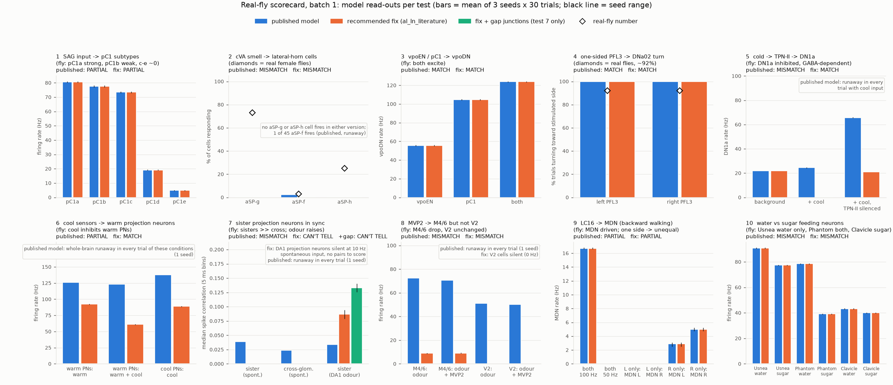

# Real-fly scorecard, batch 1: the first 10 tests, run and scored

*Written 2026-09-23. Code, raw results and plot: `experiments/scorecard_batch1/`
(`prep.py` looks up the cells and wiring, `run_batch1.py` runs the model, `analyze.py`
scores it). The tests come from `docs/real-fly-scorecard.md` (the catalogue:
`experiments/scorecard/catalog.csv`, IDs: `experiments/scorecard/ids_630.csv`). Section 1
was written at 19:45, before any simulation of this batch ran. Nothing in `sim/`, `app/`
or `tests/` was changed.*

## The short version

We ran the first 10 real-fly tests from the scorecard on the model. The pass/fail rules were
written down before any run (section 1). Each test ran on two versions of the model: the
**published model** (the Shiu et al. 2024 model) and the **recommended fix** (the
antennal-lobe sign fix `al_ln_literature`). Model numbers are the mean over 3 seeds x 30
trials unless a line says otherwise. Terms (responds, runaway, seed, MATCH/PARTIAL/MISMATCH)
are defined in section 1.1.

- **The published model matches 2 of 10 tests, partly matches 3 and misses 5.** The two
  matches: vpoEN and pC1 both excite vpoDN (test 3), and one-sided PFL3 turns the fly toward
  that side (test 4). The model turns that way in 100% of trials; real flies do in about 92%.
- **A fault already known hits 4 of the 5 misses (tests 2, 5, 7, 8) and the weak result in
  test 6.** Every smell or temperature input throws the published model into the
  whole-brain "runaway" that Phase 6 found, in every trial. The runaway swamps the read-outs.
- **The recommended fix matches 4, partly matches 2, misses 3, and 1 can't be scored.** The
  fix removes the runaway (0 of its 100 runs). Two temperature results then match real
  flies:
  - Cold switches off the DN1a clock neurons: 22 Hz falls to 0 Hz, and goes back to 21 Hz
    when VP3+_vPN is silenced (test 5). VP3+_vPN is the model's best match for the fly's
    GABA-releasing TPN-II cells.
  - Cool sensors cut the warm projection neurons by a third (92 to 61 Hz) through
    inhibitory antennal-lobe local neurons, as Liu et al. 2015 describe (test 6).
- **Three misses remain with the fix, and the runaway is not their cause.**
  - Test 2: no female lateral-horn aSP-g cell responds to the male pheromone (0 of 23;
    real flies 11 of 15). FlyWire gives these cells almost no input from the pheromone
    channel.
  - Test 8: MVP2 does not suppress the M4/6 output neurons (8.9 to 9.1 Hz). In the model,
    switching MVP2 on also slows the mushroom body's big inhibitory cell (APL), and that
    releases one of the M4/6 cells.
  - Test 10: Usnea fires to sugar almost as much as to water (78 vs 91 Hz; in flies it
    responds to water only). The model's sugar sensors reach it with almost as many
    synapses as its water sensors.
- **Two partial matches, the same in both versions.**
  - Test 1: SAG input puts pC1a only barely ahead (81 Hz vs 78 for pC1b; in flies pC1b
    responds only weakly).
  - Test 9: LC16 drives the backward-walking MDN only at the stronger input (17 Hz at
    100 Hz, 0 at 50 Hz). One-sided LC16 does not give a mirror-image left/right difference.
- **Test 7 (sister projection neurons firing in sync) could not be scored with the fix.** At
  the chosen low background input the DA1 projection neurons do not fire at all, with or
  without gap junctions, and also at 3x that input (a post-hoc check). A side result, not
  scored: during a DA1 "odour", sister pairs are about 20x more correlated than pairs from
  different glomeruli (r = 0.087 vs 0.004). Switching gap junctions on raises the sister
  correlation by half (to r = 0.133).
- **How sure.**
  - The model numbers are solid. The 3 seeds agree to within about 1 Hz, and the model is
    silent with no input. Tests that bypass the antennal lobe give the same numbers in both
    versions (to within 0.2 Hz). VALIDATED as model behaviour.
  - The verdicts are less sure. They depend on how FlyWire cells were matched to each
    paper's cells, and on thresholds we chose. PRELIMINARY.
  - Test 1 sits close to the PARTIAL/MISMATCH line: pC1b fires only 4% below pC1a.
  - Phantom (test 10) is just under its 0.5 line (sugar/water 0.498). Test 10 would be a
    MISMATCH either way.
  - Test 3's match (and the partial match in test 1) is strongly circular. The papers found
    those cells and connections in the same kind of wiring data the model is built from, so
    a match there tells us less than a match in test 4, 5 or 6 would.

---

## 1. Pre-registration (written before running anything)

### 1.1 Terms used below

- **Stimulate**: give a neuron random ("Poisson") input spikes at a set rate. In this model
  each input spike makes the neuron fire, so a stimulated neuron fires at about the input rate.
- **Silence**: remove a neuron's outgoing connections (it may still fire, but nobody hears it).
- **Read**: record a neuron's firing rate in Hz (spikes per second), averaged over trials.
- **Responds**: fires at least 1 Hz more than in the same run without the stimulus, in every
  seed. The model is silent without input (no neuron fires; checked with one control run per
  model version), so for most tests "responds" means "fires at least 1 Hz".
- **A change counts** if it is more than 20% AND more than 1 Hz, in the same direction, in
  every seed. (Both rules are the held-out lane's, so the two lanes score alike.)
- **Seed**: the number that fixes the random input. 3 seeds x 30 trials x 1 s per condition.
  The same seeds are used for both model versions, and paired conditions (with and without an
  extra input) share the same random input for the common part.
- **Published model**: the Shiu et al. 2024 model, snapshot 630 (`build_brain(fix="none")`).
- **Recommended fix**: the antennal-lobe sign fix `al_ln_literature` (`sim/sign_fixes.py`). It
  only changes antennal-lobe local neurons, so tests that do not pass through the antennal lobe
  should come out identical in both versions.
- **Gap junctions**: the Phase 7 electrical-synapse switch (`sim/gap_junctions.py`,
  `build_gap_brain`, on top of the recommended fix); used only in test 7.
- **Runaway**: the whole-brain lock-up of Phase 6: a trial is runaway if, in any 10 ms slice,
  more than 1,500 different neurons fire (definition from `docs/phase6-runaway-activity.md`).
  Every run records it.
- **Circular**: a match that is partly built in, because the cell labels or the wiring the
  model uses were themselves defined from the same paper's data.

**Verdicts.** MATCH = the pre-registered rule holds. PARTIAL = the main direction holds but
part of the rule fails. MISMATCH = the main direction fails. A test whose precondition fails
(for example, the read-out cell never fires, so a drop cannot be seen) is "CAN'T TELL".

**Rates.** 150 Hz (the project default) unless the catalogue gives another number.

**Direct wiring used for the expectations** (`results/direct_wiring.csv`, counted by
`prep.py` from the model's own connection list; no simulation). Signed synapses: positive =
excitatory, negative = inhibitory.

### 1.2 The ten tests

IDs for groups of up to 12 cells are listed here; every ID is in
`experiments/scorecard_batch1/results/groups.json` and `results/cells.csv`
(one row per cell with its FlyWire type, side and predicted transmitter).

**Test 1 (FC2). SAG input picks out pC1a** (Wang et al. 2020, *Nature* 579:101, Fig. 3d-f,
whole-cell recordings).
- Stimulate: SAG 720575940623363000, 720575940631004202 at 150 Hz.
- Read: pC1a 720575940625792698, 720575940646310947; pC1b 720575940619855296,
  720575940627738761; pC1c 720575940627295748, 720575940629430978; pC1d 720575940620356545,
  720575940620943201; pC1e 720575940618364480, 720575940634866586. Membrane voltage of all ten
  is recorded too (the real data are depolarisations, so a cell that does not fire can still
  show a "weak" response as a voltage rise).
- Real fly: pC1a strongly depolarised, pC1b weakly, pC1c/d/e little or not at all.
- Wiring: SAG sends 387 synapses to the 2 pC1a, 296 to the 2 pC1b, 173 to the 6 pC1c-e.
- Expected model result: pC1a > pC1b > pC1c-e, but pC1b may come close to pC1a.
- Rule: MATCH if, in every seed, pC1a responds; pC1a's rate is at least 2x pC1b's; each of
  pC1c, pC1d, pC1e fires below 10% of pC1a's rate; and pC1b's response is larger than each
  of pC1c/d/e's (rate, or mean voltage rise if pC1b fires under 1 Hz). PARTIAL if pC1a responds
  and is the strongest, but another part fails. MISMATCH if pC1a does not respond, or another
  subtype fires as much as or more than pC1a.
- Circularity: HIGH. Wang et al. 2020 split pC1 into pC1a-e in the hemibrain electron-microscopy
  data and found the SAG -> pC1 connection there; FlyWire's pC1a-e labels follow that split.
  The recordings are independent, but the cells were partly defined by this wiring.

**Test 2 (FC5). Female lateral-horn cells for the male pheromone** (Kohl et al. 2013, *Cell*
155:1610, Fig. 1J-N).
- Stimulate: all 126 cVA sensory neurons (ORN_DA1, both antennae) at 150 Hz (main) and 50 Hz
  (check).
- Read: aSP-g (23 cells), aSP-f (45), aSP-h (22) (FlyWire 783 names carried to 630 by the
  catalogue). A cell responds if it fires at least 1 Hz in every seed.
- Real fly (female): 11 of 15 aSP-g (73%), 1 of 34 aSP-f (3%), 2 of 8 aSP-h (25%).
- Wiring: no direct synapses; the route is through the DA1 projection neurons.
- Expected: unknown (depends on DA1 projection-neuron wiring in the lateral horn). The
  published model may run away with strong smell input; the fix should not.
- Rule (150 Hz): MATCH if at least 50% of aSP-g respond, at most 15% of aSP-f, and the aSP-h
  fraction is below the aSP-g fraction. PARTIAL if more aSP-g than aSP-f respond but a
  threshold fails. MISMATCH if the aSP-f fraction is equal to or above the aSP-g fraction.
  A version with more than 10% runaway trials is flagged.
- Circularity: low (names from Cachero et al. 2010 via FlyWire synonyms). Mapping: moderate.

**Test 3 (FC1). vpoEN and pC1 both excite vpoDN** (Wang et al. 2021, *Nature* 589:577;
abstract only).
- Stimulate, one at a time: (A) vpoEN 720575940619415679, 720575940632385943,
  720575940634829168, 720575940635403230; (B) the ten pC1a-e cells of test 1; (C) both
  together. All at 150 Hz.
- Read: vpoDN 720575940613170498, 720575940627496829 (mean of the two).
- Real fly: vpoDN is excited by vpoEN and by pC1.
- Wiring: vpoEN -> vpoDN +169 synapses; pC1 -> vpoDN +530.
- Expected: vpoDN fires in A, B and most in C.
- Rule: MATCH if vpoDN responds in A and in B, and C is at least as high as the larger of A
  and B, in every seed. PARTIAL if only one of A, B makes vpoDN respond, or C is lower than
  A or B. MISMATCH if neither does.
- Circularity: HIGH. Wang et al. 2021 found vpoEN -> vpoDN and pC1 -> vpoDN in the hemibrain
  connectome; FlyWire's vpoEN/vpoDN names come from that paper.

**Test 4 (SD4). One-sided PFL3 makes the fly turn to that side** (Mussells Pires et al. 2024,
*Nature* 626:819, Fig. 5e-h).
- PFL3 split by where its output goes (`results/pfl3_split.csv`; each of the 24 PFL3 sends
  at least 95% of its output synapses to cells on one side; all 12 whose output goes left
  have their cell bodies on the right, and vice versa).
- Stimulate, one side at a time, at 150 Hz: "left" = the 12 PFL3 ending on the left
  (720575940605640905, ...612870952, ...616654370, ...619006087, ...619802800, ...625308162,
  ...631151663, ...635430030, ...635481262, ...636868186, ...638901875, ...644706083);
  "right" = the other 12 (listed in `groups.json`, key `SD4_stim_PFL3_toR`).
- Read: DNa02 left 720575940629327659 and right 720575940604737708, per trial. A trial
  "turns toward the stimulated side" if the stimulated side's DNa02 fires more spikes than
  the other one (ties = no turn). This is the body loop's own rule (`sim/body/mapping.py`:
  more left DNa02 = turn left). The body loop's full turn signal (which adds DNa01 at half
  weight) is reported too, not scored.
- Real fly: turns toward the stimulated side in about 92% of trials.
- Wiring: left-ending PFL3 -> left DNa02 +238, -> right DNa02 0; right-ending PFL3 -> right
  DNa02 +258, -> left 0.
- Expected: toward the stimulated side in nearly every trial, unless the known left lean of
  DNa02 (Phase 6) wins.
- Rule: out of 90 trials per side (3 seeds x 30). MATCH if at least 80% turn toward the
  stimulated side, for both sides. PARTIAL if one side reaches 80% and the other is above
  50%. MISMATCH if either side is at 50% or below.
- Circularity: low to moderate (PFL3 -> DNa02 wiring was known from the hemibrain and
  motivated the experiment; the turning itself is an independent measurement).

**Test 5 (TH3). Cold -> TPN-II -> DN1a inhibited** (Alpert et al. 2020, *Curr Biol* 30:2275,
Fig. 5).
- DN1a (720575940617226641, 720575940617864961, 720575940626755673) must be firing before
  anything can slow it. In this engine a neuron driven by Poisson input fires on every input
  spike (each one pushes it 68.75 mV, far past threshold, with no refractory pause), so
  inhibition could never slow it. So the "steady background input" of the catalogue is given
  as a steady current: DN1a's resting voltage is raised by 8 mV (main; about 23 Hz on its own)
  or 10 mV (check; about 38 Hz), using `GapBrain.set_test_current` (no electrical synapses
  involved). A one-seed side run with Poisson background instead is kept as a demonstration.
- Conditions: (T0) background only; (T1) background + cool sensors (9 TRN_VP3a/b, listed in
  `groups.json` `TH_stim_cool`) at 150 Hz; (T2) as T1 with the TPN-II candidate VP3+_vPN
  (720575940623264906, 720575940625007949) silenced.
- Read: VP3+_vPN and DN1a (mean of the three).
- Real fly: cold makes the GABA-releasing TPN-II fire and inhibit DN1a; blocking GABA
  receptors removes the inhibition.
- Wiring: cool sensors -> VP3+_vPN +262; VP3+_vPN -> DN1a -177; cool sensors -> DN1a 0.
- Expected: VP3+_vPN fires, DN1a slows, and the slowing goes away with VP3+_vPN silenced.
- Rule: MATCH if (a) VP3+_vPN responds to cool input; (b) DN1a drops from T0 to T1 by a
  change that counts; (c) with VP3+_vPN silenced, DN1a's drop (T0 - T2) is less than half of
  the T0 - T1 drop, in every seed. PARTIAL if (a) and (b) hold but (c) fails, or DN1a drops in
  every seed but below the 20% / 1 Hz line. MISMATCH if DN1a does not drop.
- Circularity: moderate for the cell match (TPN-II = VP3+_vPN is the catalogue's best guess).

**Test 6 (TH2 with TH1). Cool sensors inhibit the warm projection neurons** (Liu, Mazor &
Wilson 2015, *Nature* 519:353, Fig. 4a-f).
- Conditions: (W) warm sensors (7 TRN_VP2, `TH_stim_warm`) at 150 Hz; (W+C) warm plus the 9
  cool sensors at 150 Hz (same random warm input as W); (C) cool sensors alone.
- Read: the 6 warm projection neurons (VP2_adPN, VP2+_adPN, VP2_l2PN, both sides; mean) in W
  and W+C; the 11 cool-glomerulus projection neurons (VP3 PNs, TH1) in C.
- Real fly: cool input inhibits warm projection neurons through local neurons (blocking
  inhibition depolarised them by 6 +/- 1 mV); cool projection neurons are excited by cool
  sensors.
- Wiring: warm sensors -> warm PNs +1,944; cool sensors -> warm PNs +1 (none to speak of);
  cool sensors -> cool PNs +2,213. Any inhibition must go through local neurons, which the
  recommended fix changes.
- Rule: MATCH if (a) warm PNs fire less in W+C than in W by a change that counts, and (b) the
  cool PNs respond in C. PARTIAL if (b) holds and warm PNs fall in every seed but below the
  line, or (a) holds and (b) fails. MISMATCH if warm PNs do not fall.

**Test 7 (OS4). Sister projection neurons fire in sync** (Kazama & Wilson 2009, *Nat
Neurosci* 12:1136; abstract only).
- Conditions: (S) "spontaneous": every one of the 2,271 smell sensory neurons (all FlyWire
  ORN_ types) gets independent random input at 10 Hz (low rate; a modelling choice, the
  catalogue gives none). (O) "odour": the same, but the 126 DA1 sensory neurons at 50 Hz.
- Model versions: published, recommended fix, and recommended fix + gap junctions.
- Read: spike times of the 335 uniglomerular projection neurons (`results/upn_glomeruli.csv`,
  the project's rule in `sim/gap_junctions.upn_glomeruli`). Sister pairs = two DA1_lPN
  cells on the same side (28 left + 21 right = 49 pairs). Cross pairs = each DA1_lPN with
  every uniglomerular projection neuron of another glomerulus on the same side.
- Measure: for each pair, the correlation of spike counts in 5 ms bins over the 30 trials of
  a seed (1 = always fire together, 0 = unrelated). Pairs in which a cell fires under 1 Hz
  are left out (and counted).
- Real fly: sister projection neurons fire synchronised spikes; odours make them more
  correlated; pairs from different glomeruli are only weakly correlated.
- Wiring: each DA1 sensory neuron contacts every DA1 projection neuron on its side, so shared
  input should synchronise sisters.
- Rule: MATCH if (a) in S the median sister correlation is at least 3x the median cross
  correlation and at least 0.1 higher, in every seed, and (b) the median sister correlation
  is higher in O than in S by more than 20%, in every seed. PARTIAL if (a) holds and (b)
  fails. MISMATCH if (a) fails. Scored separately for each model version.
- Circularity: low for the chemical model. The gap-junction version is partly circular: its
  sister-coupling strength was set from this same paper's coupling measurement (Fig. 7d).

**Test 8 (LL1). MVP2 suppresses the M4/6 output neurons but not V2** (Perisse et al. 2016,
*Neuron* 90:1086, Fig. 4A-B).
- Conditions: (O) the project's standard "odour A" (Phase 8: the 215 smell sensory neurons
  of glomeruli DM1, DC1, VA2, DM4, at 100 Hz); (O+M) the same odour input plus MVP2 = MBON11
  (720575940617749538, 720575940623201833) at 150 Hz.
- Read: M4/6 = MBON01 (720575940607183026, 720575940624117245), MBON02 (720575940617552340,
  720575940624185095), MBON03 (720575940624590316, 720575940624694503), MBON04
  (720575940617582822, 720575940620464321), mean of 8; V2 = MBON18 (720575940622997453,
  720575940624539284), MBON16 (720575940623377802, 720575940626744921), MBON17
  (720575940617760257, 720575940638774606), mean of 6.
- Real fly: MVP2 activation quickly suppresses M4/6 odour responses; no visible effect on V2.
- Wiring: MBON11 -> M4/6 -192 synapses (8 cells); MBON11 -> V2 -46 (6 cells; -36 of it onto
  MBON18).
- Precondition: M4/6 respond to the odour (else CAN'T TELL).
- Rule: MATCH if M4/6 drop by a change that counts AND V2's change does not count, in every
  seed, with V2 responding to the odour. PARTIAL if M4/6 drop but V2 drops too, or V2 does not
  respond to the odour (so "no effect" cannot be seen). MISMATCH if M4/6 do not drop.
- Circularity: low.

**Test 9 (SD1 with SD2). LC16 drives the backward-walking MDN** (Sen et al. 2017, *Curr Biol*
27:766; Wu et al. 2016, *eLife*; abstracts only).
- Conditions: LC16 both sides (150 cells) at 100 Hz (main) and 50 Hz (the catalogue's
  50-100 Hz); left LC16 only (76) at 100 Hz; right LC16 only (74) at 100 Hz.
- Read: MDN left 720575940616026939, 720575940631082808; right 720575940610236514,
  720575940640331472.
- Real fly: LC16 activation makes flies walk backward through MDN; one-sided LC16 gives
  turning (unequal MDN activity).
- Wiring: no direct LC16 -> MDN synapses; any effect needs at least one relay.
- Rule: MATCH if MDN (mean of 4) respond to both-sided LC16 at 100 Hz, AND with one-sided
  input the two MDN sides differ by a change that counts, with the difference flipping
  when the stimulated side flips (which side should win is not given in what we read, so
  the direction is not scored). PARTIAL if only one of the two parts holds. MISMATCH if MDN
  do not respond to both-sided LC16 at 100 Hz.

**Test 10 (TF4). Usnea = water only, Phantom = both, Clavicle = sugar** (Shiu et al. 2022,
*eLife* 11:e79887, Fig. 3 and its supplement 1).
- Conditions: the model's standard water taste neurons (18) at 150 Hz; the standard sugar
  taste neurons (21) at 150 Hz (both sets are on the left side, as in Phase 3).
- Read (mean of the two cells, left and right also shown): Usnea 720575940632648612,
  720575940641366517; Phantom 720575940616103218, 720575940637763135; Clavicle
  720575940655014049, 720575940632648868; Fdg 720575940631997032, 720575940647030324.
- Real fly: Usnea responds to water only; Phantom about equally to water and sugar; Clavicle
  to sugar (to water only in a thirsty-like state); Fdg ignores taste on the proboscis but
  responds when sugar sensory neurons are switched on artificially.
- Wiring: water -> Usnea +305, sugar -> Usnea +285; water -> Phantom +315, sugar -> Phantom
  +153; water -> Clavicle +210, sugar -> Clavicle +282; water -> Fdg 0, sugar -> Fdg +10.
- Expected: Usnea responds to both (the wiring gives it sugar input almost equal to water).
- Rule, per cell, in every seed: Usnea OK if its water response counts (at least 1 Hz) and its
  sugar response is under 20% of the water response or under 1 Hz. Phantom OK if it responds
  to both and the sugar/water ratio is between 0.5 and 2. Clavicle OK if it responds to sugar
  and its sugar rate is above its water rate by a change that counts. MATCH = all three OK;
  PARTIAL = two; MISMATCH = one or none. Fdg is reported, not scored.
- Circularity: moderate. The Shiu lab found these cells by tracing from the same taste
  neurons in FlyWire that the model stimulates. Whether Shiu et al. 2024 already compared
  their model with this imaging: its code (`data/reference/figures.ipynb`) has no Usnea,
  Phantom or Clavicle analysis (searched); the paper text was not re-checked (UNVERIFIED).

### 1.3 What counts for the overall score

One verdict per test for the published model, and one for the recommended fix. The headline
count ("X of 10 match, Y partial, Z mismatch") uses the **published model**, because that is
the model the question is about; the fix's count is given next to it.

---

## 2. How it was run

- **One Python process** (`experiments/scorecard_batch1/run_batch1.py`) built each model
  version once and ran every condition. Each seed was saved to its own file as soon as it
  finished (`results/raw/<version>/<condition>_s<seed>.npz`), and a restart skips any run
  that already has a file. At least 3.2 GB of memory was free at every build. Nothing
  left this machine.
- **Versions.**
  - Published model: `build_gap_brain(fix="none", classes=())`, which has no electrical
    synapses, so it is the plain published model. The gap-brain wrapper was used only so
    that test 5 could give DN1a a steady current.
  - Recommended fix: `build_gap_brain(fix="al_ln_literature")`. Its 8,074 electrical-synapse
    pairs are switched off (strength 0) everywhere except the "+gap" runs of test 7.
- **Control.** One no-input run per version gave 0 spikes in both.
- **Scoring.** `analyze.py` applies the section 1 rules. It writes `results/scorecard.csv`
  (the verdict and key numbers for each test and version) and `results/measures.csv`
  (every number, per seed). `plot_summary.py` draws the figure.
- **Run time.**
  - Published model: 730 s after the last restart, plus the runs saved before it.
  - Fix: 1,061 s.
  - Post-hoc runs: 336 s.

**Changes from the plan.**

1. **Seven published-model conditions got 1 seed instead of 3.**
   - Why: a runaway run takes 70-135 s per seed, against 10-20 s for a normal run, and the
     batch was heading past its time budget. The task allowed fewer seeds if runs were slow.
   - The rule, added at 20:28: if seed 0 of a published-model condition ran away in at
     least 90% of its 30 trials, seeds 1 and 2 are skipped. By then, all 18 published-model
     seeds that had run away had come out alike. The rule looks only at runaway, never at a
     read-out. Every condition it hit had run away in 30 of 30 trials.
   - Conditions hit: TH2_W, TH2_WC and TH1_C (test 6), OS4_S and OS4_O (test 7), and LL1_O
     and LL1_OM (test 8). They are listed in `results/raw/none/skipped_seeds.txt`.
   - Tests 2 and 5 had already finished all 3 seeds and kept them.
   - So the published model's tests 6, 7 and 8 rest on 1 seed (30 trials each). Every
     fix run has 3 seeds.
2. **Two restarts, at 20:07 and 20:28**, to change the thread count (and, the second time,
   to add rule 1). A run's random input is fixed by its seed, not by the thread count, so
   runs saved before a restart were kept.
3. **Post-hoc test 7 runs at 30 Hz (NOT scored).**
   - Test 7 came out CAN'T TELL with the fix because the projection neurons did not fire.
   - After that, the spontaneous input was tripled to 30 Hz and the "odour" raised to
     150 Hz, to see whether they would fire (conditions `OS4post_*`).
   - They still did not (section 4, test 7). The scored verdict stays the pre-registered one.

Test 5's steady current was part of the plan (section 1.2), not a change.

---

## 3. Scorecard



*The figure: one panel per test. Bars are the model's read-outs: blue = published model,
orange = recommended fix, green = fix + gap junctions (test 7 only). Thin black lines show
the range over the 3 seeds, and open diamonds are real-fly numbers where the paper gives
one. The verdicts are written in each panel's title.*

Model numbers are means over 3 seeds x 30 trials (1 seed where marked).

| # | Test (paper) | Real fly | Published model | Published | Fix | What the fix changes |
|---|---|---|---|---|---|---|
| 1 | FC2: SAG input to the pC1 subtypes (Wang 2020) | pC1a strong, pC1b weak, pC1c-e little or none | pC1a 80.6 Hz, pC1b 77.7, pC1c 73.6, pC1d 19.1, pC1e 4.8 | PARTIAL | PARTIAL | nothing (same numbers) |
| 2 | FC5: male pheromone to female lateral-horn cells (Kohl 2013) | aSP-g 11/15, aSP-f 1/34, aSP-h 2/8 respond | runaway in every trial; aSP-g 0/23, aSP-f 1/45, aSP-h 0/22 | MISMATCH | MISMATCH | no runaway, but 0/23, 0/45, 0/22 |
| 3 | FC1: vpoEN and pC1 excite vpoDN (Wang 2021) | both excite vpoDN | vpoDN 55.5 Hz (vpoEN), 104.6 (pC1), 123.9 (both) | MATCH | MATCH | nothing |
| 4 | SD4: one-sided PFL3 makes a turn (Mussells Pires 2024) | turns toward that side in about 92% of trials | 100% of 90 trials on each side | MATCH | MATCH | nothing (within 0.2 Hz) |
| 5 | TH3: cold -> TPN-II -> DN1a (Alpert 2020) | DN1a inhibited; blocking GABA removes it | runaway; DN1a rises 22.0 -> 24.4 Hz, 65.8 with VP3+_vPN silenced | MISMATCH | **MATCH** | DN1a 22.0 -> 0.0 Hz, back to 21.1 with VP3+_vPN silenced |
| 6 | TH2+TH1: cool sensors inhibit warm PNs (Liu 2015) | warm PNs inhibited; cool PNs excited | runaway (1 seed); warm PNs 126.2 -> 123.1 Hz (-2.5%) | PARTIAL | **MATCH** | warm PNs 92.2 -> 61.0 Hz (-34%) |
| 7 | OS4: sister PNs fire in sync (Kazama & Wilson 2009) | sisters synchronised, other pairs weakly, odour raises it | runaway (1 seed); sister r 0.039 vs cross 0.024 | MISMATCH | CAN'T TELL (also with gap junctions) | DA1 PNs silent at low input, so no pairs to score |
| 8 | LL1: MVP2 suppresses M4/6, not V2 (Perisse 2016) | M4/6 suppressed, V2 unaffected | runaway (1 seed); M4/6 72.5 -> 70.6 Hz (-2.6%), V2 51.2 -> 50.3 | MISMATCH | MISMATCH | M4/6 8.9 -> 9.1 Hz (no drop); V2 silent |
| 9 | SD1+SD2: LC16 drives MDN (Sen 2017) | LC16 drives MDN; one side gives unequal MDN | MDN 16.7 Hz (LC16 at 100 Hz), 0 at 50 Hz; one side: 0 vs 0 (left), 2.9 vs 5.0 (right) | PARTIAL | PARTIAL | nothing |
| 10 | TF4: taste cells (Shiu 2022) | Usnea water only; Phantom both; Clavicle sugar | water/sugar: Usnea 90.7/77.5 Hz; Phantom 78.5/39.1; Clavicle 43.2/39.9 | MISMATCH | MISMATCH | nothing |

**Count.**
- Published model: **2 MATCH, 3 PARTIAL, 5 MISMATCH**.
- Recommended fix: **4 MATCH, 2 PARTIAL, 3 MISMATCH, 1 CAN'T TELL**.

All numbers per seed are in `experiments/scorecard_batch1/results/scorecard.csv`. Paths
below that start with `results/` are in that folder too.

---

## 4. Test by test

**Test 1 (FC2): PARTIAL in both versions.**
- pC1a is the strongest in every seed: 80.6 Hz, against pC1b 77.7, pC1c 73.6, pC1d 19.1
  and pC1e 4.8.
- The rule's other parts fail:
  - pC1a is only 1.04x pC1b (the rule needs 2x).
  - pC1c and pC1d fire at 91% and 24% of pC1a (the rule needs under 10%).
- VALIDATED as model behaviour; PRELIMINARY as a comparison, and HIGH circularity (section
  1.2).
- Why:
  - SAG sends pC1b 77% as many synapses as pC1a (296 vs 387). In this model a cell that
    gets a few hundred excitatory synapses from a 150 Hz input fires close to its top rate,
    so the difference shrinks.
  - pC1c-e are driven mostly by pC1a itself: 383 synapses from the two active pC1a, more
    than they get from SAG (`results/explain.csv`).
  - Synapse counts are not synapse strengths. That is a limit of every model built this way.

**Test 2 (FC5): MISMATCH in both versions.**
- Published model: every trial ran away, at both 150 Hz and 50 Hz. Still, no aSP-g or
  aSP-h cell responds; 1 of 45 aSP-f does.
- Fix: no runaway, and no cell in any of the three groups responds, at either rate.
- The DA1 projection neurons carry the pheromone to the lateral horn. With the fix, those
  that contact aSP-g fire 111-131 Hz. But together they send only 63 synapses to the 23
  aSP-g cells (3 cells get 5 or more) and none to aSP-f or aSP-h
  (`results/wiring_extra.csv`).
- VALIDATED as model behaviour.
- Why, possibly (UNVERIFIED which):
  - (a) The FlyWire cells carried over under the aSP-f/g/h names (783 names mapped to
    snapshot 630) are not the cells Kohl et al. recorded. The catalogue rates this mapping
    moderate.
  - (b) The real route runs through more lateral-horn cells than this model drives
    strongly enough.

**Test 3 (FC1): MATCH in both versions.**
- vpoDN responds to vpoEN (55.5 Hz) and to pC1 (104.6 Hz), and most to both (123.9 Hz),
  in every seed.
- VALIDATED as model behaviour. But HIGH circularity: the paper found these connections in
  the wiring data, and the model is built from that kind of wiring. This mostly confirms
  that the wiring is excitatory, as the paper also found. The real-fly result was read
  from the abstract only.

**Test 4 (SD4): MATCH in both versions.**
- The model turns toward the stimulated side in 100% of 90 trials on each side (real flies:
  about 92%).
- The stimulated side's DNa02 fires 141 Hz (left) or 129 Hz (right); the other side's fires
  0 Hz.
- One published-model trial (right side, seed 0) hit the runaway line and still turned the
  right way.
- The model is more certain than a fly, because the PFL3-to-DNa02 wiring is strictly
  one-sided and the model has no behavioural noise.
- VALIDATED as model behaviour; PRELIMINARY as a match (low to moderate circularity).

**Test 5 (TH3): MISMATCH in the published model, MATCH with the fix.**
- Published model: cool input runs away in every trial. VP3+_vPN (the TPN-II candidate)
  fires 128.8 Hz, but DN1a rises from 22.0 to 24.4 Hz. Silencing VP3+_vPN sends DN1a to
  65.8 Hz, which shows that a lot of runaway excitation is reaching DN1a and VP3+_vPN's
  inhibition is only holding part of it back.
- Fix: VP3+_vPN fires 87.3 Hz. DN1a falls from 22.0 to 0.0 Hz in every seed, and returns
  to 21.1 Hz when VP3+_vPN is silenced.
- The 10 mV check gives the same verdicts: published 38.0 -> 38.3 -> 74.4 Hz; fix 38.0 ->
  1.5 -> 36.7 Hz.
- The one-seed demonstration with a random (Poisson) background instead of a steady current
  (published model) shows why the steady current was needed: DN1a fired 23.1 Hz with and
  without cool input.
- In the fix, the inhibition comes from VP3+_vPN directly (-112 and -65 synapses at 83-91
  Hz; `results/explain.csv`).
- VALIDATED as model behaviour. PRELIMINARY as a match: TPN-II = VP3+_vPN is the
  catalogue's best guess, and silencing the cell stands in for the GABA-blocking drug.

**Test 6 (TH2 with TH1): PARTIAL in the published model (1 seed), MATCH with the fix.**
- Published model: runaway in every trial. The warm projection neurons fall only 2.5%
  (126.2 -> 123.1 Hz) when cool input is added. Cool projection neurons fire 137.9 Hz.
- Fix: the warm projection neurons fall 34% (92.2 -> 61.0 Hz) in every seed, and each of
  the three types falls:
  - VP2_adPN 116.9 -> 82.8 Hz
  - VP2+_adPN 41.0 -> 18.6 Hz
  - VP2_l2PN 118.6 -> 81.5 Hz
- Cool projection neurons respond (89.1 Hz; 11 of 11 cells).
- Why the fix changes it: the net two-step wiring from cool sensors to warm projection
  neurons goes from +581 synapses (95 excitatory relay cells) in the published model to
  -2,185 with the fix (`results/wiring_extra.csv`). The fix keeps the inhibitory
  local-neuron routes (mainly two l2LN21 cells, -551 and -513 synapses) and removes the
  excitatory local-neuron-to-projection-neuron routes. This is the "crossover inhibition
  through local neurons" that Liu et al. describe.
- Not circular: the fix was built from transmitter literature on antennal-lobe local
  neurons, not from this paper (`sim/sign_fixes.py`).
- VALIDATED as model behaviour; PRELIMINARY as a match.

**Test 7 (OS4): MISMATCH in the published model (1 seed), CAN'T TELL with the fix.**
- Published model: runaway in every trial. DA1 projection neurons fire 133 Hz. Sister
  pairs correlate barely more than pairs from different glomeruli (median r 0.039 vs
  0.024; the rule needs 3x and +0.1).
- Fix, and fix + gap junctions: with every smell sensory neuron at 10 Hz, the DA1
  projection neurons do not fire (0.0 Hz), so there are no pairs to score. The other 317
  projection neurons average about 2 Hz, but most are silent: 83 of 317 reach 1 Hz.
- Post-hoc at 30 Hz (not scored): DA1 projection neurons fire 0.3 Hz (fix) and 0.0 Hz (with
  gap junctions), so there are still no sister pairs. The other projection neurons average
  10.7 Hz, and 155 of 317 reach 1 Hz.
- Side result, not scored: with the DA1 "odour" (DA1 sensory neurons at 50 Hz), sister
  pairs correlate at median r 0.087 against 0.004 for pairs from different glomeruli.
  With gap junctions on, sister pairs reach 0.133 (other pairs 0.006). That is the real
  fly's direction (sisters much more correlated than other pairs), but the spontaneous
  half of the test, which is the paper's main point, cannot be run.
- Why: the model has no spontaneous activity of its own. With the fix, the antennal-lobe
  inhibition that low, widespread input recruits is enough to keep DA1 projection neurons
  silent. Which part of the wiring is responsible is UNVERIFIED.
- The published verdict is VALIDATED as model behaviour (1 seed). The fix's CAN'T TELL is
  VALIDATED.

**Test 8 (LL1): MISMATCH in both versions.**
- Published model: runaway in every trial (1 seed). M4/6 fall only 2.6% (72.5 -> 70.6 Hz)
  when MVP2 is switched on, and V2 falls 1.8% (51.2 -> 50.3 Hz).
- Fix: M4/6 do not fall (8.9 -> 9.1 Hz). By cell:
  - MBON01 stays at 0 Hz.
  - MBON02 rises (30.4 -> 34.3 Hz).
  - MBON03/04 fall (2.6 -> 1.1 Hz).
  - V2 is silent (0 Hz) with or without MVP2, so "no effect on V2" cannot be seen either.
- What happens in the model (`results/explain.csv`):
  - The direct MVP2-to-M4/6 synapses are inhibitory (-192).
  - But switching MVP2 on also slows APL, the mushroom body's large inhibitory neuron
    (141 -> 91 Hz on the left). APL inhibits MBON02, so MBON02 is released.
  - V2 (MBON18) is held silent by strong inhibition from the LHCENT1 and LHCENT9 cells.
- Why this differs from the fly, possibly (UNVERIFIED which):
  - APL is a non-spiking cell that releases transmitter smoothly, but here it is modelled
    as a spiking cell.
  - The model has no neuromodulators.
  - In the model, the odour alone already drives MVP2 (the right MVP2 cell fires 14.7 Hz),
    so switching MVP2 on adds to a cell that is already partly active.
- VALIDATED as model behaviour; the reasons are PRELIMINARY.

**Test 9 (SD1 with SD2): PARTIAL in both versions.**
- MDN respond to LC16 on both sides at 100 Hz (16.7 Hz), but not at 50 Hz (0 Hz).
- One-sided input does not give a mirror-image difference:
  - Left LC16 leaves both MDN sides at 0 Hz.
  - Right LC16 gives 2.9 Hz on the left MDN vs 5.0 Hz on the right.
- There are no direct LC16-to-MDN synapses. The main two-step relay (LT51) is inhibitory
  onto MDN (-123 and -101 synapses), and the excitation MDN does get comes from LAL201,
  PLP012 and PVLP141.
- Why, possibly (UNVERIFIED): the real route may run through cells or connections outside
  this brain-only model. The two sides of the model's route are unequal.
- The sources were read as abstracts only.
- VALIDATED as model behaviour; PRELIMINARY as a comparison.

**Test 10 (TF4): MISMATCH in both versions.**
- None of the three cells shows its real pattern:
  - Usnea fires to sugar nearly as much as to water (77.5 vs 90.7 Hz; the rule needs sugar
    under 20% of water).
  - Phantom responds to both, but its sugar/water ratio is 0.498, just under the 0.5 line.
  - Clavicle fires slightly more to water than to sugar (43.2 vs 39.9 Hz).
- Fdg (not scored) fits the real fly: 0 Hz to water, 31.6 Hz to sugar.
- On the stimulated (left) side alone the picture is the same:
  - Usnea 95.0 Hz (water) vs 93.9 (sugar).
  - Phantom 116.8 vs 78.2.
  - Clavicle 86.4 vs 79.9.
  - The right-side Clavicle is silent.
- Even if Phantom counted as OK, one of three cells OK is still a MISMATCH.
- Why: the wiring itself gives Usnea almost equal water and sugar input (305 vs 285
  synapses). Clavicle gets more sugar than water input (282 vs 210), but still enough water
  input to fire. Phantom gets half as much sugar as water input (153 vs 315), which is
  about its ratio of rates. With every input strong, these cells fire to both.
- Possible causes (UNVERIFIED): the model's "water" and "sugar" taste-neuron sets may be
  partly mislabelled or mixed; or the real selectivity comes from something the model
  lacks (graded synapse strengths, or inhibition between taste channels).
- The model's Clavicle does respond to water, as a thirsty fly's does; the model has no
  hunger or thirst state.
- VALIDATED as model behaviour; PRELIMINARY as a comparison (moderate circularity).

---

## 5. Why the misses happen (short version)

1. **Runaway (published model only):** tests 2, 5, 7 and 8, and the weak result in test 6.
   - Every smell or temperature input tested sends the published model into the Phase 6
     whole-brain lock-up.
   - 26 of its 70 runs ran away in all 30 trials. One more (test 4, right side) ran away in
     1 trial.
   - With the fix: 0 of 100 runs.
   - The cause is known: antennal-lobe local neurons the published model treats as
     excitatory (Phase 6, Phase 7).
2. **The wiring does not carry the effect:**
   - Test 2: almost no synapses from DA1 projection neurons onto aSP cells.
   - Test 10: water and sugar inputs to Usnea are nearly equal.
   - Test 9: no direct LC16-to-MDN path, and the main relay is inhibitory.
   - These survive the fix. Each could be a cell-matching problem rather than a model
     problem (UNVERIFIED).
3. **Missing mechanisms:**
   - Test 8: APL is modelled as a spiking cell, and there are no neuromodulators.
   - Test 7: there is no spontaneous activity.
4. **Graded differences shrink:**
   - Test 1: a stimulated cell fires at its input rate, and a cell with a few hundred
     excitatory synapses from it fires near its top rate. So "strong vs weak" becomes
     "81 vs 78 Hz".

---

## 6. What to trust, and what is not checked

- **VALIDATED.**
  - Every number in section 3 is what the model does. The seeds agree to within about
    1 Hz, and a run's input is fixed by its seed.
  - The model is silent with no input.
  - The fix removes runaway in every one of its 100 runs.
  - Tests that do not pass through the antennal lobe give the same numbers in both
    versions (to within 0.2 Hz).
- **PRELIMINARY.**
  - Every verdict. Each depends on how FlyWire cells were matched to the paper's cells
    (the catalogue's mapping), and on thresholds chosen in section 1.
  - The reasons given for each miss. They come from reading which active cells send the
    most signed input to a read-out (`explain.py`, `wiring_extra.py`). That is a
    look-up, not a test. Only test 5 silenced a cell to check a route.
- **UNVERIFIED.**
  - The published model's tests 6, 7 and 8 rest on 1 seed each (all 30 trials ran away).
  - Test 3's source (Wang 2021), test 7's (Kazama & Wilson 2009) and test 9's (Sen 2017;
    Wu 2016) were read as abstracts only.
  - The circularity notes for tests 1 and 3 come from the papers' known methods; the
    papers were not re-read for this batch.
  - Whether Shiu et al. 2024 already compared the model with the Usnea/Phantom/Clavicle
    imaging: their code has no such analysis; the paper text was not re-checked.
  - Whether FlyWire's aSP-f/g/h cells are the ones Kohl et al. recorded.
  - Whether VP3+_vPN is TPN-II.
  - The real-fly numbers were taken from the catalogue and not re-checked against the
    papers.

---

## 7. Files

All in `experiments/scorecard_batch1/` (nothing outside it was changed, apart from this doc):

- `prep.py` maps the catalogue's cells to groups and counts direct wiring. No simulation.
  It writes:
  - `results/groups.json`
  - `results/cells.csv`
  - `results/pfl3_split.csv`
  - `results/upn_glomeruli.csv`
  - `results/direct_wiring.csv`
- `run_batch1.py` runs every condition (`--variants`, `--threads`, `--only`). It writes:
  - `results/raw/` (170 run files: 70 published, 100 fix)
  - `results/run_log.txt`
  - `results/conditions.json`
- `analyze.py` applies the rules. It writes `results/scorecard.csv` and
  `results/measures.csv`.
- `plot_summary.py` draws `plots/scorecard_batch1.png`.
- `wiring_extra.py` counts two-step routes and writes `results/wiring_extra.csv`. No
  simulation.
- `explain.py` finds which active inputs drive a read-out, from saved runs, and writes
  `results/explain.csv`. No new simulation.
- `log-entry.md` is the entry for `EXPERIMENTS.md`.

To reproduce everything from this folder's parent:

```
python experiments/scorecard_batch1/prep.py
python experiments/scorecard_batch1/run_batch1.py --threads 4
python experiments/scorecard_batch1/analyze.py
python experiments/scorecard_batch1/plot_summary.py
python experiments/scorecard_batch1/wiring_extra.py
python experiments/scorecard_batch1/explain.py
```

Notes on reproducing:
- `run_batch1.py` also runs the post-hoc test 7 conditions (fix only).
- It applies the section 2 one-seed rule itself (in `run_one` and `main`). To give those
  seven conditions 3 seeds, remove the rule.
