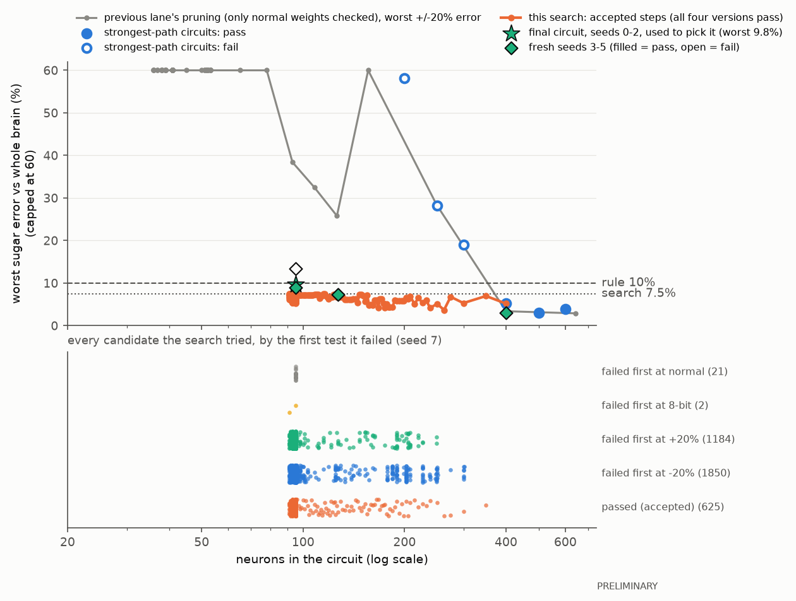
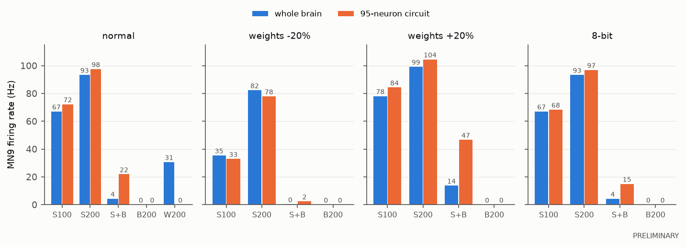

# The smallest hardware-ready feeding circuit

*Started 2026-09-24. Every result in this document is **PRELIMINARY**.*

## The short answer

- **95 neurons is the smallest hardware-ready circuit found.** It has **95 neurons,
  1,236 connections and 27,295 synapses**: 18 sugar taste neurons, 6 bitter taste
  neurons, 70 relay neurons and MN9. That is about 1 in 1,340 of the brain's 127,400
  neurons, 4 times smaller than the previous lane's 400-neuron robust circuit, and 2.6
  times the fragile 36-neuron one.
- **It passes every test on 3 fresh seeds (3, 4, 5) that nothing had used, in all four
  versions** (normal weights, every synapse 20% weaker, 20% stronger, and 8-bit
  weights). Worst sugar error: 9.0% (limit 10%). Bitter brake kept: 0.59 to 0.94 of the
  whole brain's (limit 0.5). Bitter alone: 0 Hz every time. **The margins are thin.**
- **Correction (03:15): seeds 0-2 were not truly held out.** The step-back used them to
  choose among about 215 circuits, and the chosen circuit's neighbours (one connection
  fewer) fail seed 2. Its pass on seeds 0-2 is part of how it was picked, so it is not
  evidence. Seeds 3-5 are the real held-out test (section 5b).
- **It has lost water.** At water 200 Hz it gives 0 Hz; the whole brain gives 30 to
  31 Hz. It kept no water taste neurons. (Water survived in the search down to 181
  neurons.)
- **It fits the $17 RP2350 board with room to spare.** About **10 KB of the chip's
  520 KB** with 8-bit weights. Updating every neuron every 0.1 ms step costs about **27.5
  million cycles per simulated second, 18% of one 150 MHz core, so it should run about
  5.4 times faster than real time**. Event-driven code would use about 2% of one core
  (about 45 times faster than real time). This is arithmetic with assumed cycle costs,
  not a measurement on the chip.
- **The +/-20% test is what sets the size, not 8-bit.** Of 3,060 rejected candidates,
  3,037 failed first at +/-20% weights and only 2 at 8-bit.
- **The search's own smallest circuit (91 neurons) failed seed 0**, so the rule
  stepped back to the 95-neuron version. 95 is a local minimum for this removal order,
  not proven smallest.
- **Ready for a firmware lane:** `experiments/robust_circuit/results/robust_circuit_firmware.json`
  (20 KB: neurons, types, 8-bit weights, parameters, update rule, expected outputs).
  Rebuilding the circuit from that file alone reproduces the simulator exactly.

*Figure 1. Top: the worst sugar error over the four versions, against circuit size.
Grey: the previous lane's pruning, which only checked normal weights (its worse +/-20%
error, seed 0; capped at 60%). Blue: the "strongest paths" circuits scored with the new
rule (filled = pass). Orange: every circuit this search accepted (all pass on seed 7).
Green star: the final circuit on seeds 0-2 (the seeds used to pick it). Diamonds: the
four circuits declared in advance, on fresh seeds 3-5 (filled = pass; the open one at
95 neurons is checkpoint 79, which fails; section 5b). Dashed lines: the rule's 10% and the
search's 7.5%. Bottom: every candidate the search tried, by the first test it failed.
Almost all failures are at weights -20% or +20%.*

*Figure 2. MN9's firing rate in the whole brain (blue) and the 95-neuron circuit
(orange), averaged over seeds 0-2 x 30 trials (the seeds used to pick it; fresh seeds
3-5 give very similar numbers, section 5b), in each of the four versions. S+B =
sugar 100 Hz plus bitter 100 Hz. Sugar matches within 10% everywhere. The brake is
weaker than the whole brain's (S+B stays higher), most at +20%. Water (W200, normal
weights only) is gone.*

## 1. The pass rule (written down at 02:05 on 2026-09-24, before any search)

This rule is fixed. It was written before a single candidate circuit was run, and it
will not be changed afterwards. Any change of plan is recorded below as a timed
amendment.

**Model.** Same as the previous lane (docs/minimal-circuit.md): the Shiu et al. 2024
whole-brain model on FlyWire snapshot 630, with the `al_ln_literature` sign fix passed
explicitly, run with the fast engine (`sim/fast_engine.py`), one thread. Readout: MN9,
root ID 720575940660219265. Each trial lasts 1 second. Stimuli are the paper's taste
neuron lists: S100 and S200 (sugar at 100 and 200 Hz), B100 and B200 (bitter alone),
S100+B100 (sugar and bitter together), and W100 and W200 (water, reported only).

**The circuit is tested in four versions**, each run on its own
(`FastBrain.from_arrays`, only its own neurons and connections) and each compared with
the whole brain in the matching state, on the same seeds and trials:

| version | what changes in the circuit | compared with |
|---|---|---|
| normal | nothing | whole brain, normal |
| weights -20% | weight per synapse x 0.8 (as in the previous lane, this also scales the taste input kick) | whole brain, weights -20% |
| weights +20% | weight per synapse x 1.2 | whole brain, weights +20% |
| 8-bit | each connection's synapse count is rescaled so the largest one becomes 127, then rounded to the nearest whole number (the previous lane's "8-bit rescaled" method; connections that round to 0 are dropped); the taste input kick is kept the same | whole brain, normal |

**Each of the four versions must pass all three checks** (the previous lane's rule,
with its tolerances):

1. **Sugar strength.** MN9's rate at S100 and at S200 are each within 10% of the whole
   brain's rate.
2. **Bitter alone does not start feeding.** MN9 is below 0.5 Hz on average at B100 and
   at B200.
3. **The bitter brake works.** (MN9 at S100 minus MN9 at S100+B100) in the circuit is at
   least 0.5 times the same drop in the whole brain.

**Water is not required.** It is reported as a number (MN9 at W100 and W200, circuit
against whole brain). The previous rule's water check ("water weaker than sugar") is
dropped, because any circuit without water neurons passed it automatically.

**Final verdict** (as first written; see the 03:15 amendment below, which replaces
seeds 0-2 with fresh seeds 3-5). All four versions must pass on each of 3 held-out seeds (0, 1 and 2)
with 30 trials each. No held-out input is used during the search. (The previous lane
only ran the +/-20% test on seed 0; seeds 1 and 2 at +/-20% are new whole-brain runs.)

**Search settings (stricter, so the answer survives new inputs).** During the search,
candidates are scored on seed 7, first 10 trials, against the whole brain on the same
10 trials, with the previous lane's stricter search version in all four versions:
within 7.5% for sugar, zero MN9 spikes for bitter alone, and at least 0.6 of the
whole-brain brake. A candidate is rejected as soon as one check fails (tested in this
order: -20%, +20%, 8-bit, normal). Water is not run during scoring. If the final circuit
fails the held-out check, the search steps back to the last larger accepted circuit
that passes.

**Search plan.** Start from the previous lane's 400-neuron robust circuit
(`experiments/minimal_circuit/results/robust_circuit.json`). Remove neurons in blocks,
weakest first (the previous lane's path score), with block sizes halving from 100 to 2;
then single neurons; then connections in blocks and one at a time, as time allows.
After every accepted removal, neurons with no route from a taste neuron or no route to
MN9 are dropped (this cannot change MN9). The strongest-path circuits of other sizes
(600 down to 200 neurons) are also scored with the new rule, for the size curve.

**Budget.** About 90 minutes of compute in total, one simulation process at a time, and
at least 1.5 GB of free memory before each heavy run.

**Amendment at 02:08 (search settings only; the pass rule and the held-out verdict are
unchanged).** The first search attempt scored the strongest-path circuits and stopped:
on seed 7's first 10 trials, the 400-neuron start circuit missed the stricter search
version on 8-bit weights (sugar 100 Hz 8.3% low, against 7.5). It passes the fixed 10%
rule there, and the previous lane measured it at only 1.8% low with 8-bit weights on
seed 0 (30 trials), so 10 trials looked too noisy. The simulator also turned out to be
about 10 times faster than the previous lane's timings, so two changes were made before
any pruning: (1) the search scores on all 30 trials of seed 7 instead of the first 10
(the whole brain at +/-20% was re-run on seed 7 with 30 trials); (2) the search starts
from the 400-neuron circuit even if it misses the stricter search version itself; only
candidates that pass it are accepted after that. The first attempt's log is kept in
`results/raw/search_attempt1_10trials.log`.

**Amendment at 03:15 (after review; written before any fresh-seed run).** Seeds 0, 1
and 2 were not truly held out in the end: the step-back in section 3 tried about 215
accepted circuits on them and picked the first that passed, and its immediate
neighbours (one connection fewer) fail seed 2. So seeds 0-2 became part of the
selection. The real held-out test is now: **seeds 3, 4 and 5**, which no script in this
lane or the minimal-circuit lane has used, 30 trials each, the same fixed rule in all
four versions, against whole-brain values newly measured at those seeds (normal,
-20%, +20%). Exactly four circuits are tested, fixed now and not added to afterwards:
checkpoint 411 (95 neurons, 1,236 connections, the chosen one), checkpoint 79 (95
neurons, 2,156 connections, before connection pruning), checkpoint 47 (127 neurons,
end of the neuron blocks) and checkpoint 0 (the 400-neuron start). If checkpoint 411
fails, the smallest of the others that passes on all three fresh seeds is reported;
there is no step-back on the fresh seeds.

## 2. The whole brain with weaker and stronger synapses (new runs)

MN9's firing rate in Hz, whole brain, `al_ln_literature` model, 30 one-second trials per
cell. Seed 0 and the normal-weight numbers come from the previous lane
(`experiments/minimal_circuit/results/reference.json`); the rest are new
(`results/reference_pm20.json`).

| input | -20%: seed 7 | seed 0 | seed 1 | seed 2 | +20%: seed 7 | seed 0 | seed 1 | seed 2 |
|---|---|---|---|---|---|---|---|---|
| sugar 100 Hz | 34.0 | 36.6 | 35.1 | 34.5 | 77.1 | 79.7 | 77.2 | 77.4 |
| sugar 200 Hz | 83.0 | 82.4 | 82.1 | 82.3 | 98.5 | 100.1 | 99.8 | 97.7 |
| sugar 100 + bitter 100 | 0.4 | 0.5 | 0.1 | 0.2 | 12.9 | 13.8 | 14.3 | 12.9 |
| bitter alone (100 or 200 Hz) | 0 | 0 | 0 | 0 | 0 | 0 | 0 | 0 |

At normal weights the whole brain gives about 67 Hz (sugar 100), 93 Hz (sugar 200),
4 Hz (sugar + bitter) and 31 Hz (water 200). The hard case is **sugar 100 Hz with
weights 20% weaker**: the whole brain's answer halves (67 to about 35 Hz), and a
circuit has to halve by the same amount, within 10% (about 3.5 Hz).

## 3. How the search went, in plain English

1. **Strongest-path circuits.** The previous lane's "keep the strongest routes" circuits
   were scored with the new rule. 600, 500 and 400 neurons pass. 300 fails (sugar
   100 Hz at -20% is 19% low), 250 fails (28% low) and 200 fails (58% low).
2. **Neuron blocks.** From the 400, neurons were removed in blocks, weakest first
   (block sizes 100, 50, 25, 12, 6, 3, 2), keeping each removal only if all four
   versions still passed: 400 to 127 neurons.
3. **Single neurons.** Every remaining neuron was tried one at a time, and the round was
   repeated until a whole round removed nothing (3 rounds): 127 to **95 neurons**. That is
   a local minimum: no single neuron can go without failing.
4. **Connections.** Dropping every 1-synapse connection at once failed. Connections were
   then removed in blocks, weakest first, down to one at a time (one full pass):
   2,156 to 1,007 connections, and 4 more neurons fell out, leaving 91 neurons.
5. **Check on seeds 0-2, and step-back.** The 91-neuron end point failed on seed 0
   (weights -20%: sugar 100 Hz 13% low). Following the rule, the check stepped back
   through the accepted circuits until one passed on all 3 seeds in all four versions.
   That was a **95-neuron, 1,236-connection** circuit (checkpoint 411 of 626). Because
   about 215 circuits were tried on seeds 0-2 to find it, those seeds became part of the
   choice (see the 03:15 amendment).
6. **Fresh-seed test (the real held-out test).** Checkpoint 411 and three other circuits
   declared in advance were run on seeds 3, 4 and 5, which nothing had used
   (section 5b). Checkpoint 411 passes on all three.

In total 3,688 candidates were run (about 42 minutes). Of the 3,060 rejected ones
(counting the 3 strongest-path circuits that failed), 1,853 failed first at weights
-20%, 1,184 at +20%, 21 at normal weights and only 2 at 8-bit. The versions were tested
in that order, so a circuit that failed at -20% was never tried at 8-bit; still, of the
roughly 650 candidates that got as far as the 8-bit test, only 2 failed it. **So the +/-20% test is
what sets the size; 8-bit weights almost never matter here.**

### 3b. A second removal order (a check, not the answer)

To see whether the order of removal matters, a second search started from the same 400
neurons but tried neurons in a random order (`search_alt.py`, 15 minutes, neurons only).
It reached **165 neurons** and was still shrinking when time ran out (the second
single-neuron round was cut off). The main search's "weakest first" order reached 95 in
about 6 minutes. So weakest-first is much faster, but this check cannot say whether a
different order would end below 95.

## 4. Size vs pass

Search seed 7, 30 trials. "Worst error" is the largest sugar error over all four
versions. "Weakest brake" is the lowest brake ratio over all four versions (1 = the whole
brain's brake). Water is MN9 at water 200 Hz, normal weights (whole brain 31 Hz).

| circuit | neurons | connections | synapses | worst error | weakest brake | water 200 Hz | passes new rule |
|---|---|---|---|---|---|---|---|
| strongest paths, top 600 | 600 | 29,588 | 313,821 | 4.0% | 0.90 | 30 | yes |
| strongest paths, top 500 | 500 | 24,478 | 253,014 | 3.0% | 0.92 | 30 | yes |
| strongest paths, top 400 (start) | 400 | 18,894 | 202,495 | 5.2% | 0.90 | 30 | yes |
| strongest paths, top 300 | 300 | 12,814 | 138,746 | 19.0% | 0.81 | 34 | **no** (-20%) |
| strongest paths, top 250 | 250 | 9,271 | 110,197 | 28.3% | 0.72 | 27 | **no** (-20%) |
| strongest paths, top 200 | 200 | 6,297 | 82,363 | 58.1% | 0.42 | 15 | **no** (-20%) |
| neuron blocks | 299 | 11,417 | 115,973 | 5.3% | 0.96 | 36 | yes |
| neuron blocks | 250 | 8,688 | 91,402 | 5.1% | 0.95 | 34 | yes |
| neuron blocks | 208 | 6,562 | 73,336 | 6.8% | 0.83 | 35 | yes |
| neuron blocks | 181 | 5,189 | 58,132 | 4.3% | 0.81 | 24 | yes |
| neuron blocks | 127 | 3,161 | 40,318 | 6.7% | 0.66 | 0 | yes |
| single neurons | 110 | 2,534 | 35,376 | 7.3% | 0.70 | 0 | yes |
| single neurons (local minimum) | 95 | 2,156 | 32,546 | 7.2% | 0.62 | 0 | yes |
| **connections, chosen** | **95** | **1,236** | **27,295** | 7.4% | 0.61 | **0** | **yes; also on fresh seeds 3-5** |
| connections, end of search | 91 | 1,007 | 23,086 | 7.5% | 0.65 | 0 | yes on seed 7; **fails** seed 0 |

What the curve says:

- **Robustness costs about 60 neurons.** The previous lane's fragile minimum was 36
  neurons; with the +/-20% and 8-bit tests inside the rule, the minimum is about 95.
  The robust circuit contains 34 of the 36 fragile-circuit neurons plus about 60 more.
- **"Strongest paths" alone stops at about 400.** Careful pruning reaches 95, about 4
  times smaller.
- **Water is lost between 181 and 127 neurons.** The rule did not protect it.
- **The brake weakens as the circuit shrinks** (0.90 at 400, about 0.6 at 95), as in the
  previous lane.

## 5. The 95-neuron circuit

Files: `results/robust_circuit_firmware.json` (compact, for the firmware lane) and
`results/summary.json` (contents and held-out numbers).

- **Counts:** 95 neurons, 1,236 connections, 27,295 synapses. 292 connections inhibit.
  The largest connection has 561 synapses.
- **Inputs:** 18 of the 21 sugar taste neurons and 6 of the 21 bitter taste neurons. **No
  water taste neurons.**
- **Output:** MN9.
- **70 relay neurons:** 41 use acetylcholine (excite), 21 GABA and 7 glutamate (inhibit
  in the model), 1 dopamine.
- **Named cells:** 9 of the paper's 10 named sugar-pathway types are in it (G2N-1,
  Zorro, FMIn, Phantom, Usnea, Roundup (both copies), Rattle, Clavicle, Bract); only Fdg
  is missing. Scapula, the bitter brake, is in it. So are Rounddown (both), Roundtree,
  Sternum and DNge062 from the Phase 5 strongest routes.
- **Compared with the fragile 36-neuron circuit:** it contains 34 of those 36 neurons.
  It has twice the taste inputs (24 against 12), three times the relay neurons (70
  against 23), and 28 inhibitory relays (GABA or glutamate) against 2. Our reading, not
  tested: the extra parallel routes and the extra inhibition are what let it follow the
  whole brain when every synapse changes by 20%.

**Check on seeds 0, 1 and 2 (used to pick the circuit, so not a held-out test).** 30
trials each, each version against the whole brain in the matching state
(`results/validation.json`). MN9 in Hz, circuit vs whole brain:

| seed | version | sugar 100 Hz | sugar 200 Hz | sugar + bitter | brake kept | bitter alone | passes |
|---|---|---|---|---|---|---|---|
| 0 | normal | 72.5 vs 67.6 (+7.2%) | 96.3 vs 92.9 (+3.6%) | 21.7 vs 4.4 | 0.80 | 0 | yes |
| 0 | -20% | 33.5 vs 36.6 (-8.4%) | 78.9 vs 82.4 (-4.2%) | 2.3 vs 0.5 | 0.86 | 0 | yes |
| 0 | +20% | 83.8 vs 79.7 (+5.2%) | 104.7 vs 100.1 (+4.6%) | 47.1 vs 13.8 | 0.56 | 0 | yes |
| 0 | 8-bit | 68.4 vs 67.6 (+1.1%) | 97.5 vs 92.9 (+4.9%) | 14.8 vs 4.4 | 0.85 | 0 | yes |
| 1 | normal | 73.2 vs 67.3 (+8.8%) | 97.0 vs 93.3 (+4.0%) | 21.5 vs 3.6 | 0.81 | 0 | yes |
| 1 | -20% | 32.6 vs 35.1 (-7.2%) | 77.8 vs 82.1 (-5.2%) | 2.7 vs 0.1 | 0.86 | 0 | yes |
| 1 | +20% | 84.8 vs 77.2 (+9.8%) | 104.7 vs 99.8 (+4.9%) | 46.9 vs 14.3 | 0.60 | 0 | yes |
| 1 | 8-bit | 69.4 vs 67.3 (+3.1%) | 96.8 vs 93.3 (+3.8%) | 15.0 vs 3.6 | 0.85 | 0 | yes |
| 2 | normal | 70.9 vs 66.2 (+7.1%) | 99.2 vs 93.8 (+5.7%) | 22.5 vs 4.9 | 0.79 | 0 | yes |
| 2 | -20% | 32.6 vs 34.5 (-5.6%) | 77.0 vs 82.3 (-6.4%) | 2.1 vs 0.2 | 0.89 | 0 | yes |
| 2 | +20% | 84.3 vs 77.4 (+9.0%) | 104.0 vs 97.7 (+6.4%) | 46.0 vs 12.9 | 0.59 | 0 | yes |
| 2 | 8-bit | 67.3 vs 66.2 (+1.7%) | 96.4 vs 93.8 (+2.7%) | 15.1 vs 4.9 | 0.85 | 0 | yes |

**Water:** the circuit gives 0 Hz at water 100 and 200 Hz on every seed; the whole
brain gives 0 Hz at 100 Hz and 30 to 31 Hz at 200 Hz. The circuit has no water taste
neurons, so it cannot respond to water at all.

The margins are thin: the worst sugar error is 9.8% (limit 10%, seed 1, +20%), and the
weakest brake is 0.56 (limit 0.5, seed 0, +20%). With sugar and bitter together the
circuit still fires about 22 Hz at normal weights, where the whole brain gives about
4 Hz, so its brake is about 80% as strong. The 8-bit version is the closest to the whole
brain, which suggests rounding off the smallest connections (282 of 1,236 round to zero)
happens to cancel part of the circuit's overshoot; do not read more into it.

**The 400-neuron start circuit also passes all four versions on seeds 0-2** (worst
error 5.4%, weakest brake 0.90).

### 5b. The real held-out test: fresh seeds 3, 4 and 5

No script in this lane or the minimal-circuit lane had used seeds 3, 4 or 5. The whole
brain was measured at each (normal, -20%, +20%; 30 trials). Then four circuits, fixed
in advance (03:15 amendment), were run through the same rule in all four versions, with
no early stop (`fresh_seeds.py`, `results/fresh_seeds.json`).

Whole brain at seeds 3/4/5: sugar 100 Hz 67.1/67.8/68.5 (normal), 34.6/34.2/34.3
(-20%), 77.1/77.4/77.5 (+20%); sugar 200 Hz 92.4/92.3/91.6, 81.9/81.7/83.1,
101.7/98.6/100.5; sugar + bitter 3.8/3.4/3.6, 0.4/0.3/0.3, 14.4/13.8/12.7; water 200 Hz
30.8/32.1/29.9; bitter alone 0 throughout.

**The 95-neuron circuit (checkpoint 411) on fresh seeds.** MN9 in Hz, circuit vs whole
brain:

| seed | version | sugar 100 Hz | sugar 200 Hz | sugar + bitter | brake kept | bitter alone | passes |
|---|---|---|---|---|---|---|---|
| 3 | normal | 72.4 vs 67.1 (+7.8%) | 98.9 vs 92.4 (+7.0%) | 24.2 vs 3.8 | 0.76 | 0 | yes |
| 3 | -20% | 34.4 vs 34.6 (-0.6%) | 79.4 vs 81.9 (-3.0%) | 2.3 vs 0.4 | 0.94 | 0 | yes |
| 3 | +20% | 83.4 vs 77.1 (+8.1%) | 104.8 vs 101.7 (+3.0%) | 46.2 vs 14.4 | 0.59 | 0 | yes |
| 3 | 8-bit | 69.8 vs 67.1 (+4.0%) | 95.8 vs 92.4 (+3.6%) | 15.5 vs 3.8 | 0.86 | 0 | yes |
| 4 | normal | 73.8 vs 67.8 (+9.0%) | 98.5 vs 92.3 (+6.7%) | 21.9 vs 3.4 | 0.81 | 0 | yes |
| 4 | -20% | 31.8 vs 34.2 (-7.0%) | 80.8 vs 81.7 (-1.1%) | 2.4 vs 0.3 | 0.87 | 0 | yes |
| 4 | +20% | 84.2 vs 77.4 (+8.8%) | 105.5 vs 98.6 (+7.0%) | 45.4 vs 13.8 | 0.61 | 0 | yes |
| 4 | 8-bit | 68.8 vs 67.8 (+1.6%) | 95.9 vs 92.3 (+3.8%) | 13.8 vs 3.4 | 0.86 | 0 | yes |
| 5 | normal | 72.0 vs 68.5 (+5.1%) | 98.5 vs 91.6 (+7.5%) | 22.3 vs 3.6 | 0.77 | 0 | yes |
| 5 | -20% | 32.9 vs 34.3 (-4.1%) | 79.6 vs 83.1 (-4.2%) | 2.0 vs 0.3 | 0.91 | 0 | yes |
| 5 | +20% | 83.5 vs 77.5 (+7.7%) | 101.3 vs 100.5 (+0.8%) | 44.8 vs 12.7 | 0.60 | 0 | yes |
| 5 | 8-bit | 68.9 vs 68.5 (+0.5%) | 95.1 vs 91.6 (+3.9%) | 15.5 vs 3.6 | 0.82 | 0 | yes |

**It passes all 12.** Worst sugar error 9.0% (seed 4, normal weights; limit 10%).
Weakest brake 0.59 (seed 3, +20%; limit 0.5). Water: 0 Hz at 200 Hz against 30 to 32 Hz
in the whole brain.

**All four circuits declared in advance, on fresh seeds:**

| circuit | neurons | connections | passes seeds 3, 4, 5 (all four versions) | worst sugar error | weakest brake | water 200 Hz, circuit vs whole brain |
|---|---|---|---|---|---|---|
| checkpoint 411 (chosen) | 95 | 1,236 | **yes, all three** | 9.0% | 0.59 | 0 vs 30-32 |
| checkpoint 79 (before connection pruning) | 95 | 2,156 | **no**: seed 5 at -20% (sugar 100 Hz 13.4% low) | 13.4% | 0.58 | 0 vs 30-32 |
| checkpoint 47 (end of neuron blocks) | 127 | 3,161 | yes, all three | 7.3% | 0.61 | 0 vs 30-32 |
| checkpoint 0 (400-neuron start) | 400 | 18,894 | yes, all three | 3.0% | 0.91 | 32 vs 30-32 |

What this says:

- **The 95-neuron answer holds on inputs it has never seen**, but only just (9.0%
  against 10%).
- **At this size, passing is partly luck.** Checkpoint 79 has the same 95 neurons plus
  920 more connections, and it fails one fresh seed; checkpoint 411 passes all three.
  Both sit near the 10% line, so which one passes depends partly on the seeds. More
  seeds would be needed to say how often 411 fails.
- **The 400-neuron circuit is far safer** (worst error 3%, brake above 0.9, and it keeps
  water). 127 neurons is a middle option with a little more room (7.3%).

## 6. Does it fit the RP2350 microcontroller?

**Chip specs** (from the previous lane, checked 2026-09-23 on the
[Raspberry Pi RP2350 page](https://www.raspberrypi.com/products/rp2350/)): two Arm
Cortex-M33 cores at 150 MHz with hardware single-precision floating point, 520 KB of
on-chip memory (SRAM).

**Assumptions (the previous lane's, unchanged; not measured on the chip):** 25 cycles
per neuron update, 10 cycles per synaptic event (one spike arriving at one target),
12 cycles per random-number draw for the taste input; 0.1 ms steps (10,000 per simulated
second); a delay line of 19 slots for the 1.8 ms synaptic delay. Firing rates come from
running the circuit itself (seed 0, 30 trials). The worst input is sugar 200 Hz.

**Memory** (`results/hardware.json`):

| part | 8-bit weights (954 connections kept) | 16-bit weights (all 1,236) |
|---|---|---|
| connections (1-byte target + weight) | 1,908 B | 3,708 B |
| where each neuron's connections start (96 x 2 bytes) | 192 B | 192 B |
| neuron state: voltage, input, refractory counter (95 x 9 bytes) | 855 B | 855 B |
| delay line: 19 slots x 95 neurons x 4 bytes | 7,220 B | 7,220 B |
| taste input list and random-number state | 112 B | 112 B |
| **total** | **10,287 B (10 KB, 2% of 520 KB)** | **12,087 B (12 KB)** |

**Work per simulated second** (8-bit version, sugar 200 Hz: 7,240 spikes, 90,860
synaptic events, 3,600 input kicks):

- **Clock-driven** (update every neuron every step):
  - neuron updates: 95 x 10,000 = 950,000, x 25 cycles = 23.75 M
  - random draws: 24 taste neurons x 10,000 = 240,000, x 12 = 2.88 M
  - synaptic events: 90,860 x 10 = 0.91 M
  - **total 27.5 million cycles per simulated second = 18% of one core.** One core
    gives 150 million, so it runs **about 5.4 times faster than real time**. Per
    0.1 ms step: about 2,750 cycles used of 15,000 available.
- **Event-driven** (work only when an input or spike arrives): (90,860 + 3,600) events x
  35 cycles + 3,600 draws x 12 = **3.3 million cycles, 2.2% of one core, about 45 times
  faster than real time.**

**Comparison:**

| circuit | passes +/-20% and 8-bit | memory | clock-driven, one core | event-driven | margin (clock-driven) |
|---|---|---|---|---|---|
| 36 neurons (previous lane) | no | 3.5 KB | 7% | 0.3% | about 14x |
| **95 neurons (this lane)** | **yes, fresh seeds 3-5** | **10 KB** | **18%** | **2.2%** | **about 5.4x** |
| 400 neurons (previous lane's robust option) | yes, seeds 0-2 and 3-5 | 108 KB | 77% | 20% | about 1.3x |

**Verdict: yes, it should fit and run in real time on one core, with room to spare.**
This is arithmetic, not a measurement. It is also below the published 186-neuron
real-time result on the same chip (Niedermeier and Krichmar, arXiv 2604.16474, cited in
the hybrid-computer plan (not in this repo); a different simulator and neuron model). On this PC the fast
engine runs it about 330 times faster than real time (3 ms per simulated second).

## 7. The firmware file

`results/robust_circuit_firmware.json` (20 KB) holds everything a firmware lane needs,
and nothing else:

- `neurons`: index, FlyWire root ID, role (sugar, bitter, relay, MN9), cell type,
  transmitter.
- `readout_index` (MN9) and `input_indices` (sugar and bitter; water is empty).
- `connections`: 954 rows of [from, to, 8-bit weight, exact signed synapse count],
  sorted by sender. Negative = inhibitory. The 282 connections that round to zero are
  left out.
- `weights`: one 8-bit step = 4.42 synapses = 1.21 mV.
- `parameters`: time step, resting, reset and threshold voltages, time constants,
  refractory steps (22), delay steps (18), taste-input kick (68.75 mV), and the four
  per-step multipliers of the exact update.
- `update_rule`: the model in five plain sentences, in the order the simulator does it.
- `expected_mn9_hz_seed0_30trials`: what MN9 should do, for checking the firmware.

## 8. Limits (read before quoting)

- **PRELIMINARY.** One search from one start, one main removal order, one search seed.
  95 is a local minimum for single neurons, not proven smallest.
- **Seeds 0-2 were used for selection.** Only seeds 3-5 are a clean held-out test, and
  that is just 3 seeds. The chosen circuit passed them; its 95-neuron sibling
  (checkpoint 79) did not. With so little room, some other seeds will probably fail it.
- **Thin margins.** Fresh-seed errors reach 9.0% against a 10% limit (9.8% on seeds
  0-2), and the brake falls to 0.59 against 0.5 at +20%. The 400-neuron circuit has
  wide margins.
- **Search-seed overfitting is real.** The search's own end point (91 neurons) passed on
  seed 7 but failed seed 0, and so did 214 of the accepted circuits between 95 and
  91 neurons. The chosen circuit is the first one on the way back that passed seeds 0-2.
- **The 8-bit test uses one method** (largest connection = 127, round to nearest). It
  was not the limit here, but other methods were not tried.
- **Water is gone** (0 Hz vs about 31 Hz). A rule that required water would need
  roughly 180 neurons or more (water survived to 181 in this search).
- **Hardware numbers are arithmetic.** Cycle costs are assumed, nothing ran on a chip,
  and the model was not tested in 32-bit or fixed-point arithmetic (only its weights
  were rounded).
- **A reduction of the model, not of the fly.** The model disagrees with real flies on
  Roundup and Fdg (docs/phase5-sugar-pathway.md).

## Files

All in `experiments/robust_circuit/` (they reuse `experiments/minimal_circuit/` code by
import):

- `rcommon.py`: the rule, the four versions, the scoring.
- `reference_pm20.py`: whole brain at +/-20% (section 2). Log: `results/raw/reference_pm20.log`.
- `search.py`: the search (sections 3 and 4). Log: `results/raw/search.log`; every
  candidate in `results/search_log.csv`; every accepted circuit in `results/raw/checkpoints.json`.
- `search_alt.py`: the second removal order (section 3b).
- `validate.py`: held-out verdict (section 5). `results/validation.json`.
- `hardware.py`: RP2350 arithmetic and the firmware file (sections 6 and 7).
- `check_firmware.py`: rebuilds the circuit from the firmware file alone and checks it
  gives the expected MN9 rates (it does, to 0.000 Hz). Log: `results/raw/check_firmware.log`.
- `fresh_seeds.py`: the real held-out test on seeds 3-5 (section 5b).
  `results/fresh_seeds.json`; whole brain in `results/raw/reference_fresh.npz`; log in
  `results/raw/fresh_seeds.log`.
- `summarize.py`: contents and tables. `results/summary.json`.
- `make_figures.py`: Figures 1 and 2.
- `log-entry.md`: the entry for EXPERIMENTS.md.

To re-run (from `experiments/robust_circuit/`, with `..\..\.venv\Scripts\python.exe`):
`reference_pm20.py`, `search.py 50`, `validate.py`, `hardware.py`, `check_firmware.py`,
`search_alt.py 15`, `summarize.py`, `make_figures.py`, `fresh_seeds.py`.

**Compute used:** about 68 minutes of the 90-minute budget (whole-brain runs 7 min,
main search 42, seeds 0-2 check 2, second removal order 15, fresh-seed circuit runs
under 1, the rest under a minute). Nothing was trimmed. Amendments: 02:08 (search
settings) and 03:15 (fresh-seed test), both in section 1.
